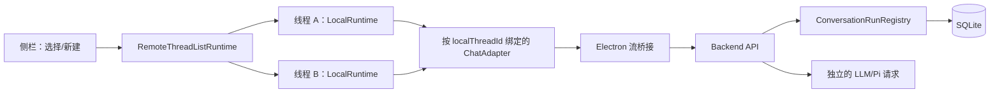
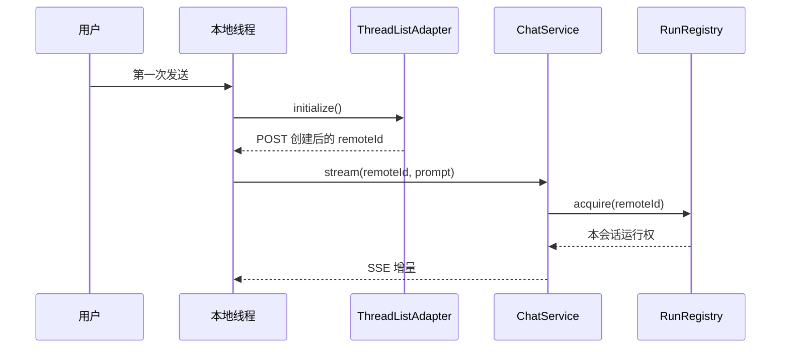

# 学习笔记：桌面端多会话后台生成

> 目的：理解 TeachForge 如何从“一个页面只有一条运行中的对话”演进到“会话 A 在后台生成时，仍能切换或开始会话 B”。本文是学习材料，不替代当前事实文档或变更设计。

## 1. 先建立问题模型

旧实现只有一个 `useLocalRuntime`。因此页面上的消息、`isRunning`、附件草稿、工具活动都天然属于同一个运行时。

如果只把侧栏的 `disabled` 去掉，会产生“界面能点、状态却串了”的问题：

- A 正在生成时切到 B，A 的增量可能显示在 B；
- A 的附件草稿可能在 B 中发送；
- B 开始运行会覆盖 A 的工具活动；
- 为加载 B 的历史而调用 `reset()`，可能覆盖 A 正在追加的消息。

关键结论：**允许并行交互之前，必须先把运行态及其关联数据按会话隔离。**

## 2. 这次采用的核心结构



这里有两个容易混淆的 ID：

| ID | 含义 | 何时得到 | 用途 |
| --- | --- | --- | --- |
| `localThreadId` | assistant-ui 为草稿/线程分配的稳定本地身份 | 草稿出现时 | 绑定附件、斜杠命令和每线程 adapter 闭包 |
| `remoteId` / `conversationId` | 后端持久化 Conversation 的 UUID | 第一次发送初始化成功后 | 调用 stream、读取历史、删除会话 |

不能把两者混为一谈。首次发送时后端 ID 尚不存在；如果输入草稿改用 `remoteId` 作键，会在“草稿提升为已持久化会话”的瞬间丢失或串用数据。

## 3. 首次发送到底发生了什么

`apps/desktop/src/features/agent/thread-list-adapter.ts` 是前端线程列表与后端会话 API 的翻译层。

1. 用户在一个本地草稿线程中输入内容。
2. assistant-ui 请求 adapter 的 `initialize()`。
3. adapter 调用 `POST /api/conversations`，获得 `remoteId`。
4. 每线程 adapter 使用这个 `remoteId` 调用 Electron `streamChat`。
5. 后端取得该会话的运行权，写入本轮状态，开始独立的模型请求并通过 SSE 回传。



`apps/desktop/src/features/agent/conversation-runtime.ts` 中的 `useConversationRuntime()` 是这个隔离的关键：它读取 ambient `threadListItem.id`，并用 `useMemo` 为每条线程创建一个闭包绑定 `localThreadId` 的 `ChatModelAdapter`。

## 4. 后端为什么需要共享注册表

`apps/backend/src/conversations/conversation-run-registry.ts` 维护 `Map<conversationId, Promise<void>>`。它不是任务队列，也不持久化到数据库；它只是当前 backend 进程里的“会话运行权”。

- `acquire(id)`：先同步登记自己，再等待前一个同 ID 操作；所以同一会话串行。
- 不同 `id` 使用不同 Map 项，因此可并行。
- `tryAcquireDeletion(id)`：没有 `await` 地检查并占位；若已有运行、排队或删除，占位失败，删除 API 返回 409。
- `release()` 是幂等的，且只会删除仍属于自己的 tail，避免较早请求释放掉较晚请求的锁。

这解释了一个重要设计原则：**执行 Chat 与删除 Conversation 必须使用同一个互斥来源。**若 ChatService 有私有锁、ConversationsService 又有另一把锁，两者都“以为”会话空闲，竞态仍然存在。

## 5. 哪些状态必须按线程或请求分区

| 状态 | 分区键 | 原因 |
| --- | --- | --- |
| 消息与 `isRunning` | assistant-ui 线程实例 | A、B 的生成必须各自持续 |
| 附件与斜杠命令草稿 | `localThreadId` | 首次发送之前没有 `remoteId` |
| 工具活动 | `requestId` | 同一会话的不同请求和不同会话不能互相清空 |
| 历史消息、分页提交 | 线程实例 + 请求版本 | 迟到响应不能覆盖当前线程的新流 |
| 产物标签 | `conversationId` | 切换历史时不能清空其他会话的标签 |
| 会话运行/删除权 | `conversationId` | 后端需要保护持久化数据和目录清理 |

一个实用的判断法：如果某段状态会在 A、B 之间“看起来应该不同”，它就不应是单个无键的全局可变变量。

## 6. 本次桌面调试发现的两个典型陷阱

### 陷阱一：`useSyncExternalStore` 的空快照不能每次新建

`ComposerAttachmentChips` 订阅附件 store。若 `getSnapshot()` 在“没有附件”时每次返回新的 `[]`，React 会认为快照不断变化，并报出：

```text
The result of getSnapshot should be cached to avoid an infinite loop
Maximum update depth exceeded
```

修复位于 `apps/desktop/src/features/agent/attachment-store.ts`：用模块级的 `EMPTY_COMPOSER_ATTACHMENTS` 复用同一个空数组引用。

学习点：外部 store 的 `getSnapshot()` 在状态未变时必须返回可用 `Object.is` 判定为相同的值；对象或数组尤其容易踩到这个坑。

### 陷阱二：空 `reset()` 也可能有副作用

旧页面在“没有已恢复会话”时调用 `runtime.thread.reset([])`，本意是清空界面。迁移到远端线程列表后，这个调用会触发 assistant-ui 的 `initialize` 事件，进而调用 adapter 的 `initialize()`，导致应用启动或重载时意外 `POST /api/conversations`，生成空会话。

修复位于 `apps/desktop/src/features/agent/AgentChatPage.tsx`：空草稿本来就是空的，因此不再调用 `reset([])`。只有用户的首次实际发送才初始化远端会话。

学习点：迁移框架抽象时，不能只看方法名。`reset` 在本地 runtime 中像“清空 UI”，但在远端线程生命周期中还意味着“线程已经被使用/初始化”。

## 7. 调试和验收路径

本次实际执行过的桌面检查：

1. 启动 `npm run dev`，确认 Electron、Vite 和本地 backend 均启动。
2. 在桌面端输入并发送一条调试消息。
3. 在生成期间切换到另一会话，再切回来源会话。
4. 使用 DevTools 确认修复后控制台没有 React 无限更新错误。
5. 重载渲染进程，核对本地 SQLite 的会话数量与最新创建时间不变，证明未发送时不会创建空会话。
6. 执行 `npm run build:renderer --workspace @teachforge/desktop`、`npm run build:electron --workspace @teachforge/desktop` 和 `npm run test:agent-stream --workspace @teachforge/desktop`（9/9）。

尚未完成的关键验收：在真实 Provider 下让 A、B 同时持续生成，并验证停止 A、删除已结束 A、附件/`/查询资料库` 命令和产物标签都不会串会话。它需要真实模型响应，不能用“只构建通过”替代。

## 8. 建议的阅读顺序

1. [变更设计](docs/changes/2026-11-09-concurrent-conversations/design.md)：理解目标、边界和完整时序。
2. `apps/desktop/src/App.tsx`：看根线程列表运行时如何建立。
3. `apps/desktop/src/features/agent/conversation-runtime.ts`：理解“每线程一个 LocalRuntime”。
4. `apps/desktop/src/features/agent/thread-list-adapter.ts`：理解本地线程和后端 Conversation 的映射。
5. `apps/desktop/src/features/agent/agent-chat-adapter.ts`：看稳定本地键如何在发送时转为远端 ID。
6. `apps/backend/src/conversations/conversation-run-registry.ts`：理解同会话串行与删除占位。
7. [工作记录](docs/changes/2026-11-09-concurrent-conversations/worklog.md)：查看已验证范围与未完成风险。

## 9. 自测问题

1. 为什么附件草稿要用 `localThreadId`，而不是 `conversationId`？
2. 为什么删除操作不能先查数据库再决定是否允许删除？
3. 若 A 的 SSE 在切换到 B 后才到达，哪一层负责让它仍然写回 A？
4. 为什么 `getSnapshot: () => []` 会造成 React 无限更新？
5. 为什么“侧栏不禁用”不是并发会话功能的充分条件？

能用上面的状态归属和请求流程回答这五题，基本就掌握了本次改造最关键的部分。
