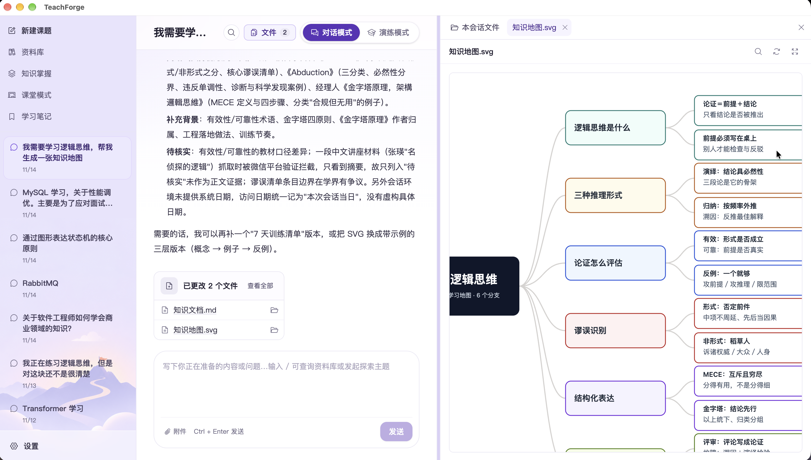
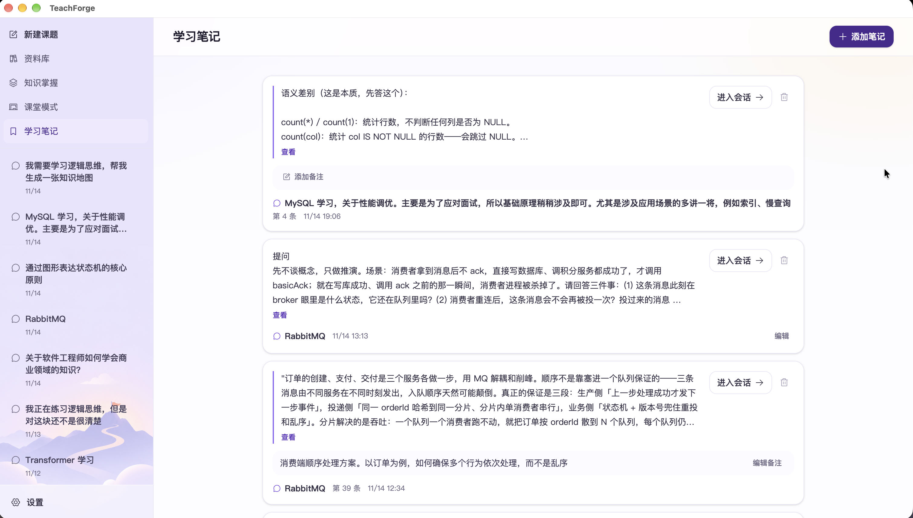
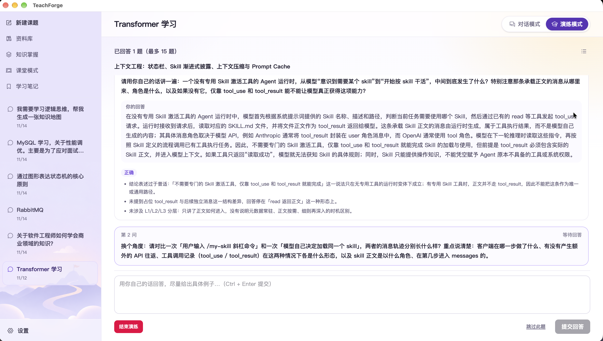
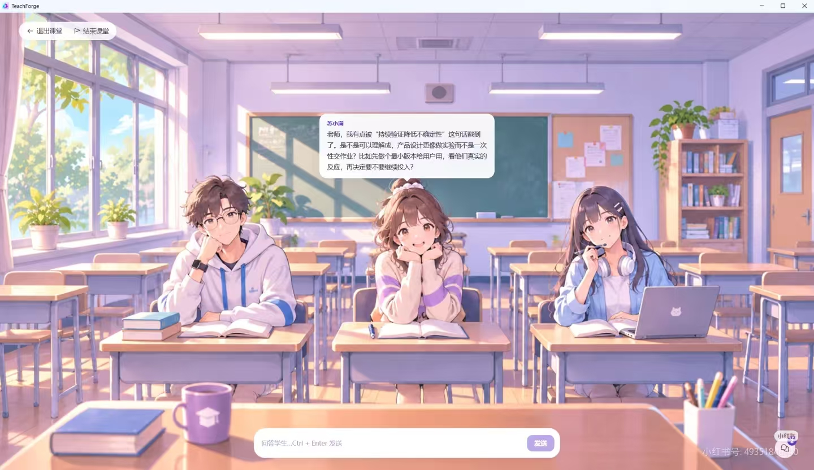

# TeachForge

> TeachForge 是一款面向个人学习者的本地运行 AI 学习桌面应用。它把资料库、AI 对话、主题探索、学习笔记、费曼式演练和课堂模拟结合起来，帮助你从理解知识走向主动讲述、回答追问，并检验自己是否真正掌握。



## 为什么做 TeachForge

AI 能快速解释一个概念，却不一定能让人真正掌握它。读完一段回答时觉得“懂了”，合上资料后能不能讲清楚、能不能回答追问，往往还没有经过检验。

TeachForge 围绕这个差距设计了一套从理解到表达的学习过程：

- **看过不等于会讲。** 在对话里追问概念和例子，再进入演练模式，让 AI 扮演学生提问。你需要用自己的话回答，系统会根据实际作答给出逐题反馈和复习建议。
- **重点容易淹没在长回答里。** 从助手回复中选取值得保留的内容，添加备注，或写下自己的笔记。摘录会留在学习笔记时间线中，并能回到原对话查看上下文。
- **备课时想不到学生会怎么问。** 课堂模式让你先讲解，再面对三名性格和提问角度不同的 AI 学生，练习如何回应问题。结束后可以查看课堂总结。
- **想学一个主题，却不知道从哪里开始。** 导入自己的资料，或在对话中发起主题探索，生成知识文档和知识地图，作为继续讨论和梳理思路的起点。

TeachForge 把“能否自己讲清楚、能否回应问题”作为学习过程中的检验方式。演练报告提供定性反馈，不提供百分制分数，也不把没有证据等同于没有掌握。

## 使用条件与数据说明

- **桌面系统：** 当前提供的安装包面向 Windows x64。
- **模型服务：** 使用 AI 功能前，需要在应用设置中自行配置 DeepSeek API Key，并保持网络连接。
- **本地数据：** 会话、笔记、导入资料和应用记录保存在本机的 `.tech-forge/` 数据目录中（Windows 默认位于用户目录下）。应用不提供账号、云端存储或跨设备同步。
- **模型请求：** 应用虽在本机运行，但 AI 推理由 DeepSeek API 提供。发送请求时，相关对话、附件内容或资料内容会发往 DeepSeek；主题探索还可以按需使用 DeepSeek 网页搜索与抓取工具。
- **密钥保存：** DeepSeek API Key 保存在本机 `~/.tech-forge/config.toml` 中（Windows 默认对应 `%USERPROFILE%\.tech-forge\config.toml`），目前以明文形式存储；设置界面会遮蔽显示。请勿公开分享包含个人密钥的配置文件。

## 功能介绍

### 对话与资料库

围绕正在学习或准备讲授的主题与 AI 多轮讨论。对话支持附加 PDF、DOCX、Markdown、TXT 和图片作为上下文。资料库支持导入本机 PDF、DOCX、Markdown 和 TXT 文件；需要结合资料回答时，可在对话中显式查询资料库。

### 学习笔记

选中助手回复中的一段文字即可保存为摘录，并可添加备注；也可以直接写下自己的笔记。学习笔记集中显示在一条时间线上，并保留返回相关对话的入口。



### 主题探索与知识地图

输入 `/探索主题`，让 AI 围绕主题整理知识文档，并生成 SVG 知识地图。主题探索会先读取资料库目录，模型可按需读取本地资料；需要补充外部信息时，也可以调用 DeepSeek 网页搜索和抓取工具。生成的文件可以在会话中预览。

### 费曼式演练

演练基于当前对话中的学习内容生成问题。AI 扮演学生提问和追问，你用自己的话作答；结束后可以查看逐题反馈、知识点掌握状态和复习建议。报告来自本次演练中的回答，不采用百分制评分。



### AI 学生课堂模拟

在 16:9 课堂舞台上讲解一个主题，并回应三名 AI 学生提出的问题。学生有不同的提问风格，课堂结束后会生成课堂总结。



## 本地运行与开发

### 环境要求

- Node.js `>=22.19.0`
- npm

### 开发模式

```bash
npm ci
npm run dev
```

### 构建

```bash
npm run build
```

生成 Windows x64 安装包：

```bash
npm run package:win
```

安装包输出到 `release/`。当前安装包尚未签名，Windows 可能会显示 SmartScreen 未知发布者提示。
