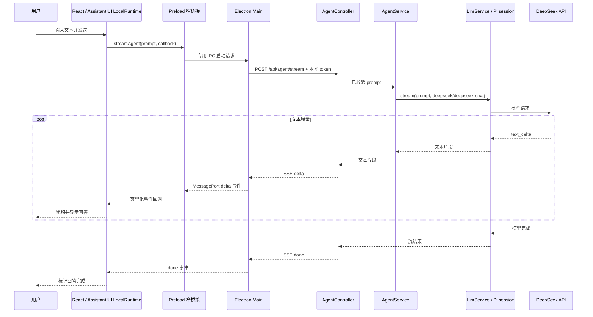
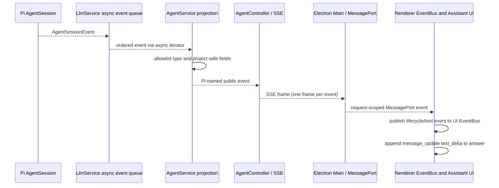

<!--
Lifecycle: this file starts `status: draft`. When the change lands, flip it to
`status: implemented` and add `landed_in: <last worklog loop / commit>`. If a
later change replaces this approach, set `status: superseded` + `superseded_by`.

Versioning: all pre-implementation iterations count as v1.0. Only developer
feedback after delivery and review triggers a version bump. Implementation-time
drift goes into `Design Deviations`.
-->

---
status: implemented
layer: change
domain: agent
created_at: 2026-11-06
version: 2.0
canonical_for:
  - agent-streaming-loop-design
related:
  - docs/current/platform/architecture-and-code-placement.md
  - docs/source/后端架构设计.md
  - docs/source/功能设计文档.md
last_verified: 2026-11-07
landed_in: L004
updates_current:
  - docs/current/platform/architecture-and-code-placement.md
---

# Agent 单轮流式闭环设计

## Problem

桌面端到 Agent 的最小用户闭环尚未接通。`AgentService` 目前只有空壳；`LlmService.stream()` 已能产出文本增量，但 `AgentModule` 没有 Controller，且没有注入 LLM 模块。Electron Main 当前 `backend:request` 会等待完整响应并解析 JSON，Preload 只暴露这一种请求桥接；它不能把响应增量交给 React。桌面端也尚未依赖 Assistant UI。

本次将用户指定的 `AgentService` 定为单轮 Agent 用例入口。[当前平台架构页](../../current/platform/architecture-and-code-placement.md)建议简单模型调用可直接使用 LLM 能力；本设计按明确的 Agent 入口要求收敛，不新增通用 Agent Runtime 或工具框架。落地后需同步修订该架构页的 Agent 责任描述。

## Goals

- 桌面端提供 Assistant UI 对话界面，用户提交一段文本后能看到 Agent 回复逐步出现。
- 请求经过既有 Preload/Main 受控边界到达 NestJS；Main 继续独占本地认证 token。
- NestJS 的 Agent 用例调用现有 `LlmService.stream()`，逐步转发文本，并正确结束或呈现错误。
- 保留 `LlmService` 当前配置的 Pi 扩展工具能力；本次不新增工具或工具管理能力。
- 保留现有健康状态和课程原型入口，以独立页面/标签承载新增 Agent 闭环。
- 以单人本地桌面应用为运行边界，不引入账号或多租户数据隔离。

## Non-Goals

- 多轮上下文、会话或消息持久化、断线续传、后台任务和 Agent Run 表。
- 新增工具、工具管理/审批 UI、检索/RAG、文档引用、演练、记忆或结构化产物。
- Provider 设置页、凭据管理 UI、模型选择 UI；本轮验收使用 DeepSeek 环境变量配置。
- 移除或重构现有 Course API 与课程原型。

## Must-Not-Break Existing Behavior

- Electron 仍先启动并等待本地后端 ready，再创建主窗口；启动失败仍显示现有错误对话框。
- `/api/health` 仍经现有本地认证代理可用，桌面端继续显示本地服务状态。
- `window.teachforge.request()` 的 JSON 请求语义继续服务健康检查和 Course 原型，不被流式协议改变。
- 本地 HTTP 仍只绑定 loopback；Origin 与 `x-teachforge-token` 校验继续生效，token 不进入 Renderer。
- Course 原型的创建和列表操作仍可从原入口访问。

## Current Behavior

- `apps/backend/src/agent/agent.service.ts` 是无业务方法的 Nest Injectable；`agent.module.ts` 只注册该 Service。
- `apps/backend/src/llm/llm.service.ts` 暴露 `stream(prompt, options?)` 异步生成器，逐个产出 Pi session 的 `text_delta`，并在结束时释放 session。当前 `createSession()` 加载 `billion-context-pi` 与 `pi-subagents` 扩展，并使用 `noTools: 'builtin'` 禁用 Pi 内置工具；这些扩展工具仍可用。`LlmModule` 当前未导出 `LlmService`。
- `apps/backend/src/main.ts` 启用全局 `/api` 前缀、DTO 校验、loopback 绑定和 token/Origin 检查。全局 body 限制为 1 MiB。
- `apps/desktop/electron/main/main.ts` 的 `backend:request` 会收集并解析完整 JSON/text body 后通过 `ipcMain.handle` 返回；Preload 使用 `ipcRenderer.invoke` 暴露 request。
- `apps/desktop/src/App.tsx` 是 Course 原型页；`apps/desktop/package.json` 只依赖 React 与 React DOM。
- DeepSeek Adapter 注册的当前模型 ID 为 `deepseek-chat`，密钥从后端进程的 `DEEPSEEK_API_KEY` 环境变量读取。Electron 启动后端时继承桌面进程环境。用户配置和密钥设置 UI 尚未实现。

## Proposed Behavior

1. 桌面端新增 Agent 页面，并在 App shell 中用 Assistant UI `LocalRuntime` 管理消息和运行状态；现有 Course 页面保留在独立入口，切换标签时 Runtime 继续挂载。仅呈现文本，不为首轮闭环增加 Markdown、工具或持久化适配器。
2. 自定义 `ChatModelAdapter` 读取本次最后一条用户文本，调用 Preload 的窄 `streamAgent` 能力。Agent 后端按独立单轮处理每次发送，不使用 UI 中之前的消息作为模型上下文。模型仍可调用 `LlmService` 当前装载的扩展工具；本次不新增工具或扩展。工具调用和结果不进入 UI 流协议，页面只显示助手文本。
3. 后端新增 `POST /api/agent/stream`，接收 `{ prompt: string }`，Controller 校验 DTO 并将 `AgentService` 的文本流编码为 SSE `delta`、`done`、`error` 事件。
4. `AgentModule` 导入 `LlmModule`；`LlmModule` 导出 `LlmService`。`AgentService` 负责单轮输入到模型流的用例编排，逐条委托 `LlmService.stream()`。本轮固定使用 `deepseek` / `deepseek-chat`，由 `DEEPSEEK_API_KEY` 提供凭据。
5. Electron 增加专用流式 IPC 能力。Main 仍持有端口和 token，向后端 POST 并增量读取 SSE；使用 `MessageChannelMain` 将规范化后的事件送到对应 Renderer。Preload 仅暴露带类型的 `streamAgent`、事件回调和取消能力，不暴露通用 IPC 或 MessagePort 对象。
6. Assistant UI Adapter 累积收到的文本，并按 LocalRuntime 约定逐次 yield 完整文本状态。用户取消、Renderer 关闭或应用退出时，停止 Main 的 fetch 并关闭后端响应流；Agent 层结束迭代并释放 Pi session。

Assistant UI 的 [LocalRuntime 文档](https://www.assistant-ui.com/docs/runtimes/custom/local-runtime)定义了自定义 `ChatModelAdapter` 和异步生成器的累计内容约定。Electron 的 [Message Ports 指南](https://www.electronjs.org/docs/latest/tutorial/message-ports)说明端口通过 `webContents.postMessage` 传递；[contextBridge 文档](https://www.electronjs.org/docs/latest/api/context-bridge)要求以窄函数包装 IPC，而不是暴露整个 `ipcRenderer`。

## Alternatives Considered

| 方案 | 结论 | 理由 | 是否升级为 ADR |
|---|---|---|---|
| Assistant UI `LocalRuntime` + 自定义流式 `ChatModelAdapter` | 采用 | 前端状态由 Runtime 管理，适配器只需接入当前已有的文本流；不会引入第二套消息状态或协议栈。 | n/a |
| Assistant UI Data Stream / Assistant Transport 协议 | 否决 | Data Stream 需要实现通用消息部分协议，Assistant Transport 适合暴露 Agent 状态和命令；当前只有单轮纯文本输出。 | n/a |
| Renderer 直接 `fetch` 本地 HTTP | 否决 | 需要把 token 或等价凭据交给 Renderer，越过当前安全边界。 | n/a |
| 继续通过 `backend:request` / `ipcRenderer.invoke` 承载流 | 否决 | 当前路径收集完整响应后才 resolve，无法在生成期间交付增量。 | n/a |
| 返回完整 JSON，再由 UI 展示 | 否决 | 无法验收真正的模型 token 流式呈现。 | n/a |

## Business Flow

1. 用户进入 Agent 页面并输入一段文本。
2. Assistant UI 提交本次用户文本，页面显示运行中状态。
3. Agent 接口将文本交给 LLM，页面收到一个或多个文本增量并持续更新回答。
4. 流正常结束后标记回答完成；发生错误时展示可读提示；用户可停止当前生成。
5. 当前页面会话仅存于 Assistant UI 内存。每次发送仅将最新输入交给后端，关闭应用后记录消失。

## End-to-End Data Interaction Flow



| 关键节点 | 输入 | 节点职责 | 输出 / 状态变化 | 关键边界 |
|---|---|---|---|---|
| Assistant UI `LocalRuntime` | 最后一条用户文本、abort signal | 保存本页临时消息状态；调用自定义模型适配器并渲染累计文本 | 正在生成或完成的 Assistant 消息 | 仅内存，不代表服务端会话 |
| Preload stream bridge | prompt、回调、取消信号 | 暴露固定的 Agent 流能力，隐藏 IPC 事件与端口 | 类型化 delta/done/error | 不传递认证 token 或任意 IPC 能力 |
| Electron Main | prompt、流通道 | 校验输入，添加本地 token，转发并增量读取后端 SSE | 通过专用端口转发的事件 | 仅允许当前窗口发起；关闭时 abort fetch |
| AgentController | DTO、已认证 HTTP 请求 | 处理 API 输入、SSE 编码和响应生命周期 | delta/done/error 事件流 | 无 DB 事务；请求断开时终止生成 |
| AgentService | prompt | 编排本次单轮 Agent 调用 | `LlmService.stream()` 片段 | 不加载历史、检索或工具 |
| LlmService / Provider / 已配置扩展 | prompt 与显式模型选项 | 创建临时 Pi session；可执行当前已装载的扩展工具并调用 DeepSeek | 助手 text delta 或生成异常 | 外部网络及扩展工具副作用；单轮 session；工具事件不进入 UI 流 |

## Data And API Impact

- 不新增数据库表、迁移、缓存或业务文件。
- 新增 `POST /api/agent/stream`：请求 `application/json`，字段 `prompt` 为必填、trim 后不可空，最大 10,000 个 Unicode 字符（按 Unicode 码点计数）。
- 正常响应使用 `Content-Type: text/event-stream; charset=utf-8`，逐事件以空行分隔。首期事件载荷：

```text
event: delta
data: {"text":"部分文本"}

event: done
data: {"finishReason":"stop"}

event: error
data: {"message":"模型请求失败，请检查模型配置和网络。"}
```

- 输入校验失败使用 HTTP 400 JSON；本地认证沿用现有 401/403。开始发送 SSE 后的模型错误通过 `error` 事件表示，事件不包含 token、密钥、堆栈或原始 provider 响应。
- Pi 扩展工具可能在生成期间运行，但 SSE 只传递助手文本、结束和安全错误事件；不新增工具调用/结果事件或 UI 渲染。
- 不传 `runId`、序号或重放游标：一次 HTTP 请求与一次临时流一一对应，服务端不保存可恢复状态。
- Agent 模块依赖边调整为 `AgentModule -> LlmModule`；`LlmModule` 导出 `LlmService`。无实体或其他跨模块数据写入。

## Frontend Fetching Logic

- 新增 `@assistant-ui/react`，在 Agent feature 中以 `AssistantRuntimeProvider` + `useLocalRuntime` 装配 `ChatModelAdapter`。
- Adapter 只提取当前待发送消息的最后一条文本，调用 `window.teachforge.streamAgent`；不在 React 中构造本地 HTTP URL，也不读取 token。
- Preload 注册对应流回调后发起专用 IPC。Main 通过当前后端端口发起 `POST /api/agent/stream`，携带 `x-teachforge-token`，分段读取响应并通过 `MessageChannelMain` 转发类型化事件。普通 JSON `request()` 仍处理 health 与 Course API。
- Adapter 收到 `delta` 后累加文本，并 yield `{ content: [{ type: "text", text: accumulated }] }`；`done` 结束生成器，`error` 转成可由 Assistant UI 呈现的错误。
- 适配器将 Assistant UI 的 `abortSignal` 接到 bridge 取消方法。每次运行释放回调和端口，避免后续请求收到旧事件。

## Frontend Behavior

- 应用保留健康状态指示和课程原型入口；Agent 为默认标签/页面，Course 保持可访问。
- Agent 页面包含消息区、单一文本输入和发送控件；生成期间显示增量文本和运行状态，并防止重复提交。
- 本轮只支持文本。发送完成后 Composer 可再次使用，但新请求单独处理，不把上一轮消息作为模型上下文。
- 可停止当前生成。关闭应用、关闭窗口或后端进程退出时，当前消息显示为取消或未完成状态；重启后不恢复聊天记录。

## Backend Fetching Logic

- `AgentController` 从已启用全局校验的 DTO 读取 `prompt`；`AgentService` 是本次调用的唯一业务入口，不查询 Conversation、Message 或其他 Repository。
- `AgentService` 指定当前代码已注册的 `deepseek` / `deepseek-chat`，调用 `LlmService.stream()`。沿用 `LlmService` 当前 session 配置，因此 `billion-context-pi` 与 `pi-subagents` 的扩展工具可被模型调用；本次不增加工具。`DeepseekLLMAdapter` 从后端进程环境取得 `DEEPSEEK_API_KEY`；设置页和凭据安全存储不在本次范围。
- 每个请求创建独立 Pi AgentSession，使用 `SessionManager.inMemory()`；`LlmService.stream()` 结束时取消订阅并 dispose session。读取路径没有事务、缓存或批量策略。
- Provider 网络慢或不可用时不做自动重试；在 SSE `error` 事件中报告安全、可读的失败信息。下游一致性仅要求同一响应中保留 LLM delta 的顺序。

## Backend Behavior

- `AgentModule` 增加 `AgentController`，并通过导出的 `LlmService` 注入现有模型流。
- Controller 验证 prompt 后设置 SSE 响应头。每个 LLM 文本片段编码为 `delta`；模型正常结束发送 `done` 并结束响应；模型异常发送 `error` 并结束响应。
- 客户端断开时终止对 `LlmService.stream()` 的迭代并释放 Pi session；取消不写入业务数据。
- 扩展工具调用由当前 Pi session 内部处理；Agent SSE 只转发助手文本，不呈现工具调用进度或结果。扩展可能产生自身的本地/子代理副作用。
- 启动阶段配置 DeepSeek 密钥是最小闭环的前置条件。当前 Adapter 在后端进程装配时读取环境变量，变更凭据后需重启应用生效。

## Error Handling

| 情况 | 后端/桥接行为 | 用户可见结果 |
|---|---|---|
| 空白或过长 prompt | DTO 拒绝，HTTP 400 | 保留输入，提示输入长度/内容无效 |
| 后端未 ready 或 IPC 输入无效 | Main 在流开始前拒绝请求 | Assistant UI 显示本地服务不可用 |
| `DEEPSEEK_API_KEY` 缺失或 provider 调用失败 | 流开始前的 HTTP 错误或流中的 `error` 事件；不发送原始凭据和堆栈 | 提示配置或网络错误，当前消息标记失败 |
| 用户停止生成 | bridge 发送 cancel；Main abort fetch；后端释放 session | 消息标记取消/未完成，可重新提交 |
| Renderer/应用退出 | Main 取消对应请求并关闭 MessagePort | 不承诺恢复部分回答 |

## Risks

- Assistant UI 自定义 Adapter 的运行结果要求累计文本；误将 delta 当成完整内容会造成界面内容被覆盖或闪烁。依据其 [流式 LocalRuntime 约定](https://www.assistant-ui.com/docs/runtimes/custom/local-runtime)每次 yield 累计值。
- 当前通用 Electron JSON 代理无法复用为流式代理。专用 MessagePort 生命周期、并发请求 ID 和取消清理需要一起实现；MessagePort 必须由 `webContents.postMessage` 传递，不能走 invoke。
- Main 负责增量解析 SSE；需正确处理 UTF-8 字符被底层网络分块拆开、事件边界跨 chunk 等情况，再转发类型化事件。
- 项目尚无 Provider 设置页。本设计依赖启动桌面应用的环境中有 `DEEPSEEK_API_KEY`；开发验收需显式提供该配置并具备网络访问。
- 当前架构指南把简单模型调用定位在 LLM 能力层。本次由 AgentService 作为稳定入口属于有意调整，落地时必须更新 current 架构事实。
- Assistant UI Runtime 仅保存在 Renderer 内存。此闭环不具备历史恢复、失败续传或跨重启一致性。
- 当前 Pi 扩展可被模型调用，可能触发 context 压缩或子代理工作；聊天 UI 不展示对应工具事件，且本次不新增工具审批或进度呈现。

## Verification

- 启动桌面端后仍能看到后端 ready 状态，健康检查正常，Course 原型的创建/列表行为可继续使用。
- Agent 页面使用 Assistant UI；输入非空文本后经 `/api/agent/stream` 到达 `AgentService`，并从 `LlmService.stream()` 获得真实增量。
- 在模型完成前，至少一个 delta 已渲染；正常结束出现完成态，错误出现用户可读失败态。
- Renderer 与 Preload API 类型不包含认证 token；Main 转发仍携带 token；通过普通 JSON bridge 仍可调用 health 和 Course API。
- 空白/超长输入被拒绝；缺失模型配置时得到明确失败；日志或事件 payload 不出现密钥、token 或堆栈。
- 停止生成或关闭 Renderer 会取消后端请求、释放 session、移除监听/端口；下一次请求不会收到前一次的事件。
- 本轮无持久化：关闭并重开应用后，Agent 页面不恢复历史对话。

## Design Deviations

| 偏差 | 发现于 | 与设计不符之处 | 处理（改设计 / 改现状文档 / 接受） |
|---|---|---|---|
| Provider 模型 ID 改为 `deepseek-flash` | L004 真实 Provider 联调 | v1/v2 设计中的 `deepseek-chat` 与当前已配置模型 ID 不符；使用旧 ID 时真实请求无法完成 | 接受当前 Provider 配置，并以 `DEEPSEEK_MODEL_ID` 作为注册与请求的共享值；后续模型变更同步更新此设计 |
| 扩展加载前显式 reload | L004 Electron 联调 | Pi 运行时需要在创建 Agent session 前调用 `resourceLoader.reload()`，才能装载当前 allowlist 中的扩展工具 | 接受实现所需的初始化步骤；保持工具范围仍由 allowlist 控制 |
| 测试凭据存在源码 fallback | L004 用户明确要求真实请求 | v2 设计描述凭据来自 `DEEPSEEK_API_KEY` 环境变量；本轮真实 Electron 测试使用了源码中的 fallback | 仅记录来源，不记录凭据值；移除 fallback 并轮换凭据仍需处理 |
| 启用 Pi SDK 内置文件工具 | L005 用户要求 Agent 默认能产出文件 | 原实现设置 `noTools: 'builtin'`，关闭 SDK 原生 `read`、`edit`、`write` 工具 | 通过 SDK tool modifiers 启用文件工具并排除 `bash`；不重复实现 Pi 工具，扩展工具继续可用 |

L004 真实联调已完成核心用户路径，但发现模型 ID 与扩展加载初始化偏差，见上表。工具任务结束后 Electron 启动的后端进程以退出码 1 退出，Pi SDK 扩展运行时抛出 stale-context guard；根因尚未确认，需后续排查进程稳定性。

## Version History

当前文档为 v1.0 初始设计稿。交付后的开发者反馈及评审结论尚未产生版本升级记录。

## Current Doc Updates

- [x] `docs/current/platform/architecture-and-code-placement.md`（同步 AgentService 责任和流式入口事实）
- [x] `docs/manifest.yaml`

## v2.0 Active Design Amendment: Pi Event Stream

This amendment is the active v2.0 design for the post-delivery event-visibility request. It supersedes conflicting v1.0 statements about the Agent stream exposing text only. The original v1.0 record remains above for history.

### Goals

- Carry selected Pi lifecycle and tool-execution events to the Agent UI so the user can see that the run is active and which tool is running.
- Carry final assistant text as ordered Pi `message_update` events containing only `text_delta`; continue rendering the answer incrementally.
- Use one request-scoped event stream across AgentService, SSE, Electron Main/MessagePort, Preload, and the Renderer.
- Keep event names aligned with Pi events where the event originates in Pi. Do not add a semantic `progress` event.

### Non-Goals

- Do not forward every `AgentSessionEvent` or expose the model's private reasoning trace.
- Do not forward `tool_execution_update.partialResult`, `tool_execution_end.result`, `turn_end.message`, `turn_end.toolResults`, or `agent_end.messages`.
- Do not add a global process-wide bus, a third-party EventBus dependency, persistence, replay, or cross-run subscribers.
- Do not add knowledge retrieval or new tools in this change.

### Event Projection Contract

`LlmService.stream()` becomes an async event stream of Pi `AgentSessionEvent` objects. `AgentService.stream()` projects that internal stream into a request-safe event union before it reaches the HTTP boundary. The public event names remain Pi-native for observable lifecycle/tool/text events; payloads are intentionally narrower than Pi's internal event objects.

| Pi event | Public projection | UI use |
|---|---|---|
| `agent_start` | `{ type }` | Show that the run has started |
| `turn_start` | `{ type }` | Show a generic active state while the model is working |
| `turn_end` | `{ type }` only | Keep the run active; do not expose message or tool results |
| `tool_execution_start` | `{ type, toolCallId, toolName, args }` | Show the active tool and its arguments |
| `tool_execution_end` | `{ type, toolCallId, toolName, isError, durationMs? }` | Mark that tool activity as finished without showing its result |
| `message_update` with `assistantMessageEvent.type === 'text_delta'` | `{ type, assistantMessageEvent: { type: 'text_delta', delta } }` | Append the final answer delta to the active assistant message |
| `agent_end` | `{ type }` | Show that Pi's agent run ended; the transport `done` remains the stream terminal signal |

All other Pi events are ignored at the AgentService boundary. `tool_execution_start.args` is the one tool payload intentionally made visible. Tool result and full message fields never cross the boundary. Existing `done` and safe `error` SSE events remain transport lifecycle events; they are not a new progress vocabulary.

### Event Interaction Flow



| 节点 | 责任 | 关键边界 |
|---|---|---|
| Pi `AgentSession.subscribe()` | 产生 session 生命周期、工具及消息增量事件 | 内部事件可能包含完整 message、partial result 和 tool result |
| `LlmService.stream()` | 将 Pi 回调事件放入本次运行的异步队列并按序产出 | 继续响应取消；队列只属于当前 session，不做持久化或重放 |
| `AgentService.stream()` | 以 Pi 原生事件名筛选和投影公开字段 | 唯一的工具事件出站策略边界；不转发结果和非文本 message 更新 |
| AgentController / Electron bridge | 每事件一帧 SSE，再由 request ID 对应的 MessagePort 转发 | 认证 token 仍只在 Main；普通 JSON `request()` 不变 |
| Renderer EventBus / Assistant UI | 生命周期和工具事件更新临时活动状态；文本 delta 更新助手回答 | 状态不混入聊天文本；停止、完成、失败时释放对应订阅 |

### Frontend Fetching Logic

- Preload 桥接类型与 Main SSE 解码器采用同一组 Pi-native `type` 名称和窄 payload。Preload 仍逐事件校验后才调用 Renderer 回调。
- `agent-chat-adapter` 把收到的事件发布到 Renderer 的 request-scoped EventBus。文本 `message_update/text_delta` 同时按 Assistant UI 约定累积后 yield；工具与 lifecycle 事件只更新 UI 活动状态，不进入助手正文。
- Agent 页面订阅 EventBus，显示活动状态、工具名和参数；`done`、`error` 或取消时清除本轮状态。当前单线程 UI 只允许一个活动运行；事件仍以现有 request ID 隔离。
- EventBus 不替代 SSE 或 MessagePort：它统一 Renderer 内的事件订阅；跨进程传输继续使用已经实现的逐事件通道。

### Backend Fetching Logic

- 不读取数据库、文件或知识库；每个请求仍建立独立的 Pi session。
- `LlmService` 的 Pi session 订阅将事件入队；`AgentService` 只投影上述允许的事件。工具参数按 Pi 提供的 JSON 参数传递；工具输出、部分输出和完整 message 不传递。
- AgentController 逐条读取异步生成器并写 SSE。响应写入遇到 backpressure 时等待 `drain`；客户端断开仍沿 AbortSignal 关闭迭代器并释放 session。
- 工具事件的跨层处理保留原始顺序；各事件仅发送一次，不持久化、不重放。

### Verification

- L1 验证 Pi 事件筛选、工具结果字段剔除、SSE 编码/解码和 Renderer EventBus 状态变化。
- L2 验证真实本地 HTTP 流在工具事件与 `message_update/text_delta` 间保持顺序，并且普通 health/Course JSON 路径不变。
- L3 在 Electron 中确认等待状态、工具名/参数展示、文本增量更新和取消后的状态清理。

### Alternatives Considered

| 方案 | 结论 | 理由 | 是否升级为 ADR |
|---|---|---|---|
| 在 UI 只显示通用 spinner，不转发 Pi 事件 | 否决 | 用户需要看到当前工具活动，单一 spinner 无法表达该信息。 | n/a |
| 将所有 Pi 事件对象原样传到 UI | 否决 | 会暴露 tool result、partial result 和完整消息，也把 SDK 内部载荷耦合到 UI。 | n/a |
| 增加自定义 `progress` 事件类型 | 否决 | Pi 已提供可用的 lifecycle/tool 事件；避免维护重复的语义协议。 | n/a |
| 加入全局 EventBus 服务或第三方总线 | 否决 | 当前每次请求只有单一消费者；SSE 和每请求 MessagePort 已承担进程间传输，额外常驻总线不必要。 | n/a |
| 每请求异步事件迭代 + 现有 SSE/MessagePort + Renderer EventBus | 采用 | 保留流式消费与写入背压，按请求隔离事件，并在 UI 内用订阅更新活动状态。 | n/a |

### Version History

#### v2.0 — 2026-11-06

- 触发：开发者交付后要求将 Agent 中间处理事件传递给 UI，以减少长任务等待焦虑；明确复用 Pi 原生事件并通过 EventBus 订阅，最终回答继续流式输出。
- 改动内容：扩展事件流与 Pi 事件白名单；加入工具名和参数展示、文本 delta 事件、Renderer EventBus 与 UI 活动态；明确剔除工具结果、partial result、完整 message 和非文本更新。
- 影响范围：Agent/Llm 事件接口、SSE/桌面桥接 payload、Agent UI 状态与事件消费、AC-03/AC-04 及新增 AC-08/AC-09。
- 处理状态：已实施于 L003；构建、局部测试和本地 HTTP 回归通过。真实 DeepSeek v2 流及 Electron 活动事件界面验收仍待补齐。
