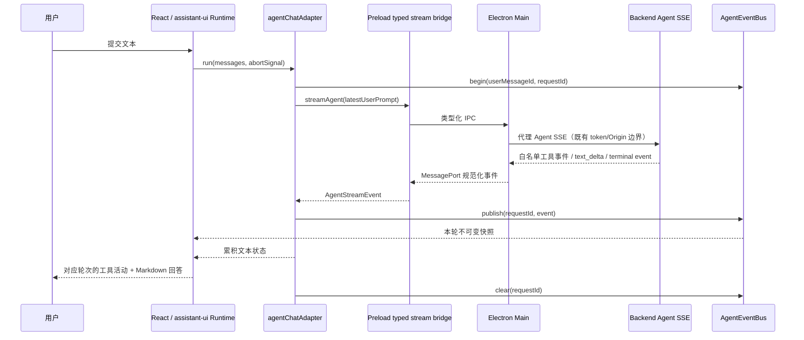

# Agent Chat Presentation Design

## Problem

Agent 对话已经接入 Assistant UI，并通过 Renderer `AgentEventBus` 展示当前轮工具活动。现有助手回答仍包在白色边框卡片中，消息部分按普通文本渲染；工具活动没有总耗时，且工具记录只保留最近一轮。用户提供的参考图要求以简洁时间线呈现工具过程，并让助手最终回答以无边框正文呈现。

## Goals

- 保留 assistant-ui LocalRuntime 和 Thread/Message primitives，调整 Agent 消息正文与工具活动的组合布局。
- 按 user message id 保存本进程内每一轮的工具活动，完成后仍显示在对应提问下方。
- 展示总耗时、工具名称、可识别的文件路径与执行状态；默认展开过程，允许折叠。
- 助手最终回答无外框，使用 assistant-ui 官方 MarkdownText 部件处理流式 Markdown。
- 遵循现有安全桥接：只显示已暴露的安全事件摘要，不呈现原始工具参数和结果。

## Non-Goals

- 不实现截图中的文件差异汇总卡片、增删行统计、Review 或 Undo。当前 Agent 事件未携带变更摘要，桌面端也没有相应操作契约。
- 不增加点击路径打开本地文件的能力。
- 不改变 Agent 后端工具、SSE 事件、Electron IPC 契约、提示词或文件权限边界。
- 不改变 Composer、App shell、消息持久化或单轮模型上下文语义。

## Must-Not-Break Existing Behavior

- Agent 的消息与活动仍只保存在当前应用运行期间。
- `agentChatAdapter.run()` 仍只把本轮最新用户文本传给后端，并按 assistant-ui 约定累积文本增量。
- Stop/abort 仍取消当前 Agent 请求；旧请求的结束事件不能覆盖另一轮状态。
- Renderer 仍只显示白名单工具名称、路径、状态与耗时，不显示工具结果或完整 Pi payload。
- ThreadPrimitive 继续负责消息列表、自动滚动、空状态和 sticky composer。

## Current Behavior

- `AgentChatPage` 用 `ThreadPrimitive.Messages` 按 `message.isLast` 显示 `AgentActivity`。该活动来自单一 `AgentEventBus` 快照，`begin()` 开始新轮时会丢弃上一轮记录。
- `AgentActivity` 已将工具动作与助手文本分开展示，并根据 `tool_execution_start/end` 保留完成/失败/取消状态；仅从对象参数中提取 `path`，不展示工具执行结果。
- 工具事件带有单次工具耗时，但不带 request 总耗时。页面没有总计时器。
- `AssistantMessage` 使用带边框、背景和内边距的容器，并直接渲染 `MessagePrimitive.Parts`。
- `@assistant-ui/react` 已安装为 `^0.15.32`，但桌面 package 尚未加入 assistant-ui Markdown renderer。

## Proposed Behavior

1. 在 `ThreadPrimitive.Messages` 中按 user message id 读取该轮活动，并在该用户消息下方渲染。后续轮次开始时不清除旧轮快照。
2. `AgentEventBus` 为每轮快照记录 request id、phase、tools、开始时刻和完成时长。`publish()` 与 `clear()` 仍校验当前 request id；终态把遗留的 running 工具标为 cancelled，并冻结总耗时。`getSnapshot()` 保持返回最新单轮兼容快照，`getTurnSnapshots()` 提供 UI 使用的按轮映射。
3. Adapter 在启动流时将最新 user message id 与 request id 一同交给 EventBus；文本流协议与后端请求内容保持不变。
4. 工具活动使用可访问的原生 disclosure 呈现总耗时和逐项记录。运行中显示动态耗时和状态；结束后保留最终耗时。工具行显示“读取/写入/编辑”动作、可选路径标签及完成/失败/取消状态。未知工具仍以安全工具名和状态展示。
5. `AssistantMessage` 移除正文外框、白底和卡片内边距，只保留清晰的行宽与 Markdown 排版；错误提示仍使用 `role="alert"`。
6. 添加 assistant-ui 官方 `@assistant-ui/react-markdown` renderer 与 GFM 插件，并将 MarkdownText 作为 `MessagePrimitive.Parts` 的 Text renderer。链接与图片采用保守 URL 处理，不允许模型内容打开任意本地路径。
7. 以 Phosphor 图标为工具状态和文件标签提供一致的图标，不绘制 CSS/HTML 假图标。保留项目既有中性色和绿色强调色。

## Alternatives Considered

| 方案 | 结论 | 理由 | 是否升级为 ADR |
|---|---|---|---|
| 保持 AgentEventBus 单一快照，只美化最近一轮 | 否决 | 下一轮提问会丢失旧轮活动，不能稳定对应截图中的每轮工具记录。 | n/a |
| 把 Pi 工具事件转换成 assistant-ui tool-call message parts | 否决 | 当前自定义 adapter 有独立的已筛选 Pi 事件桥；转换会改动消息协议并扩大传输面。 | n/a |
| 在现有 primitives 上关联每轮活动并自定义展示 | 采用 | 复用 runtime、bridge 与安全投影，只扩展 Renderer 内存态和页面组件。 | n/a |
| 增加 changed-files diff、Review/Undo 卡片 | 延后 | 当前安全事件无差异/行数，且没有可执行的审查或撤销契约；伪造按钮会误导。 | n/a |

## Business Flow

1. 用户提交问题；adapter 确定最新 user message id，并启动桌面 Agent stream。
2. EventBus 为该轮创建活动快照；流式工具事件更新其状态，文本 delta 仍更新 assistant-ui 消息。
3. 页面在对应用户问题下方显示工具活动，在最终助手回答处显示无边框 Markdown 正文。
4. done、error 或取消结束当前活动，冻结耗时并把尚未结束的工具标记为取消；新轮不会覆盖先前轮次的记录。

## End-to-End Data Interaction Flow

| 关键节点 | 输入 | 节点职责 | 输出 / 状态变化 | 关键边界 |
|---|---|---|---|---|
| `AgentChatPage` | Runtime messages 与 EventBus 快照 | 按 user message id 组合消息、工具活动和 Composer | 每轮独立活动显示；最终回答无卡片边框 | Renderer 只读已筛选事件 |
| `agentChatAdapter.run()` | assistant-ui messages、abort signal | 提取最新用户文本和消息 id；累积文本并投递事件 | Runtime 文本增量；EventBus 更新 | 取消与终态需清理当前 request |
| Preload / Electron Main | typed stream request 与 SSE 帧 | 保持既有窄桥接、token 和事件白名单 | 规范化 AgentStreamEvent | 本变更不修改桥接契约 |
| `AgentEventBus` | request id、user message id 与 AgentStreamEvent | 保存每轮不可变 UI 快照，隔离旧 request | 按 user message id 查找活动记录 | 仅内存；不保存 prompt、result 或完整 payload |

## Data And API Impact

- 无数据库、HTTP、SSE、IPC 或 preload 类型变更。
- Renderer `AgentEventBus` 状态从单个快照扩展为按 user message id 索引的进程内快照，并记录本地运行开始时刻/总耗时；`getSnapshot()` 保持最新单轮读取兼容，`getTurnSnapshots()` 返回历史映射。
- Desktop 依赖增加 `@assistant-ui/react-markdown`、`remark-gfm` 与 `@phosphor-icons/react`；锁文件同步更新。
- 不加入工具结果、文件 diff、增删行、打开文件、Review 或 Undo 字段。

## Frontend Fetching Logic

- 消息源：`ThreadPrimitive.Messages` 提供当前 assistant-ui thread 的 `ThreadMessage`；页面以其中 user message 的 `id` 查找工具活动。
- 活动源：`useSyncExternalStore` 订阅 `agentEventBus.getTurnSnapshots()` 的不可变映射；按消息 id 读取一轮状态。
- 运行状态写入：`agentChatAdapter.run()` 在 `window.teachforge.streamAgent()` 返回 request id 后启动活动快照，随后将已校验的桥接事件交给 `publish()`。
- 最终文本源：仍由 adapter 累积 `message_update.text_delta` 并 yield 给 LocalRuntime；MarkdownText 只负责显示当前 message part。
- 缺失与终态：尚无工具事件时不显示空工具容器；终态快照保留并显示冻结耗时；未知工具名只作文本展示。应用关闭后快照随进程结束。

## Frontend Behavior

- 每条 user message 后可以展开/折叠其工具过程；默认展开，工具名称与路径换行且不溢出。
- 工具各状态配图标和文字语义，颜色不是唯一状态信号；支持键盘操作与可见 focus。
- 助手最终文本透明无边框，Markdown 块有合适层级；用户消息保持右对齐浅色圆角背景。
- 保留空线程、错误提示、停止生成和 sticky composer 现有行为。
- 不展示参考图中的 file-change aggregate card，因为当前事件不提供其事实数据和动作能力。

## Backend Fetching Logic

n/a：本次不增加后端读取路径，不改变 Agent SSE 内容。

## Backend Behavior

n/a：文件操作、Pi tool lifecycle、安全桥接投影均保持不变。

## Error Handling

- `error` 与 `abort` 继续沿既有 adapter 终态路径清理当前 request；工具仍 running 时显示为 cancelled。
- 旧 request 的迟到事件由 EventBus request id 校验忽略，不得改写新轮或历史轮状态。
- Markdown 链接和图片不扩大为本地文件打开能力；异常/无效路径按纯文本安全展示。
- 依赖或渲染构建失败时不回退为把 Markdown 原文嵌入 HTML。

## Risks

- 本地消息 id 必须在 Runtime 与 ThreadPrimitive 中保持一致；若 id 生命周期不匹配，工具记录可能无法关联。
- 按轮次保存活动将比现有单快照使用更多内存，但记录只含短路径、状态和时间，生命周期受当前 thread/应用进程限制。
- assistant-ui MarkdownText registry 可能包含当前 app 未采用的 Tailwind/shadcn 配置；只引入 renderer 所需代码与依赖，不重置既有项目样式。
- Electron 中的视觉验收需要运行当前桌面 shell；单独打开 Vite 页面不能验证 preload bridge。

## Verification

- AC-01–AC-06 见 `verification.md`。
- 桌面 renderer TypeScript/build 检查确认新增依赖与组件类型正确。
- 在相同桌面视口比对用户气泡、展开工具活动、完成工具活动和无边框 Markdown 回答；检查键盘折叠、滚动与错误/取消状态。
- 不运行自动化测试，除非用户另行要求。
- assistant-ui 文档依据：[Installation](https://www.assistant-ui.com/docs/installation)、[Thread primitives](https://www.assistant-ui.com/docs/primitives/thread)、[Message primitives](https://www.assistant-ui.com/docs/primitives/message)、[MarkdownText](https://www.assistant-ui.com/elements/markdown-text)。

## Design Deviations

| 偏差 | 发现于 | 与设计不符之处 | 处理（改设计 / 改现状文档 / 接受） |
|---|---|---|---|

## Version History

## Current Doc Updates

- [x] `docs/current/platform/architecture-and-code-placement.md`
- [x] `docs/changes/README.md`
- [x] `docs/manifest.yaml`
- [ ] Separate `docs/current/domains/agent/` pages — n/a; current Agent behavior is owned by the platform architecture page.
