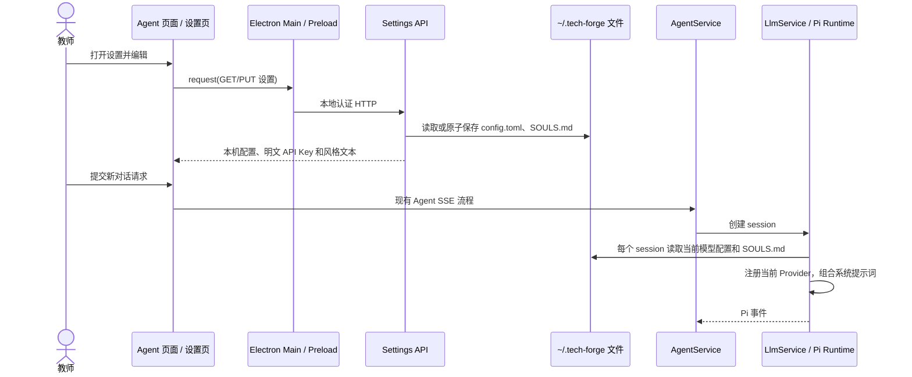

# 本机 Agent 设置设计

## Problem

Agent 页面没有设置入口。DeepSeek Adapter 从环境变量及源码凭据回退读取配置，自定义 Provider 只读环境变量；Pi session 使用固定系统提示词。教师无法在应用中选择模型或保存风格偏好。

## Goals

- 在对话侧栏底部提供设置入口；右侧主区域显示模型和风格设置，可返回当前对话。
- Provider 配置保存到 `~/.tech-forge/config.toml`；首次启动自动创建目录和默认配置。默认 DeepSeek 模型为 `deepseek-flash`。
- 支持 DeepSeek 自定义模型 ID 和 API Key；自定义兼容 Provider 支持名称、Base URL、模型 ID 和可选 API Key。
- 风格偏好保存到同目录 `SOULS.md`，每次创建 Pi session 时读取非空内容并追加到系统提示词。
- 新请求使用当前配置；已创建的 session 不因后续保存而改变。
- 本机认证的设置 API 返回 API Key，使设置页能明文显示并编辑；密钥不进入 Agent SSE、普通日志或 SQLite。

## Non-Goals

- 不改变 SQLite 数据目录、工作区路径、Conversation 持久化或 Agent 工具权限。
- 不新增账号、租户、设置数据库表、系统密钥链集成或远程同步。
- 不提供 Provider 模型发现、连通性测试、模型参数调节或对话级模型选择。

## Must-Not-Break Existing Behavior

- 会话列表、历史加载、分页和活动会话恢复继续工作。
- 现有消息发送、流式事件、取消和工具活动展示契约不变。
- Renderer 仍经 `window.teachforge.request()` 访问 backend，不获得 Node 或本地文件访问能力。
- Pi session 仍使用当前工具白名单和对话持久化扩展。

## Current Behavior

- `AgentChatPage` 始终渲染对话主界面；`ConversationSidebar` 只显示对话、新建和刷新操作。
- `AgentService.stream()` 固定传入 `deepseek/deepseek-flash`。
- DeepSeek Adapter 从环境变量读取配置且含源码凭据回退；Custom Adapter 读取环境变量。
- `LlmService.createSession()` 复用缓存 `ModelRuntime`，以固定 `SYSTEM_PROMPT` 创建 Pi 资源加载器。
- [系统配置设计草案](../../source/system-configuration-design.md)原建议 API Key 使用系统安全存储；本变更按开发者本次明确要求将 Provider API Key 和其它配置写入 `config.toml`，并记录差异。

## Proposed Behavior

### 责任单元

| 责任单元 | 入口与目标 | 所有状态 / 操作 |
|---|---|---|
| Agent 设置导航 | 从对话侧栏进入或离开设置 | 页面持有视图选择；根 Conversation Runtime 保持挂载 |
| 模型设置 | 选择 Provider 并保存其参数 | 本机 config.toml；设置 API 为本机桌面 UI 读回 API Key，供明文显示和编辑 |
| 风格偏好 | 编辑后续新 session 使用的风格指引 | 本机 `SOULS.md` |
| Agent session 创建 | 为一次请求选取模型并加载风格 | 每个新 session 读取当前文件快照 |

### 本地文件

backend 以 `os.homedir()` 解析用户主目录，文件根为 `.tech-forge`；Windows 下对应当前用户目录中的 `.tech-forge`。配置通过临时文件加 rename 更新；新文件按 owner-only 权限创建（POSIX mode `0600`，目录 `0700`，Windows 继承用户目录 ACL）。不更改既有 SQLite `TEACHFORGE_DATA_DIR`。

```toml
[llm]
provider = "deepseek"

[llm.deepseek]
model_id = "deepseek-flash"
api_key = ""

[llm.custom]
name = ""
base_url = ""
model_id = ""
api_key = ""
```

## Alternatives Considered

| 方案 | 结论 | 理由 | 是否升级为 ADR |
|---|---|---|---|
| Renderer 直接读写用户目录 | 否决 | Renderer 沙箱不应暴露 Node 文件系统；使用受认证本地 API | n/a |
| 把配置放 SQLite | 否决 | 用户指定 TOML/Markdown 文件；设置不属于业务数据 | n/a |
| 常驻 ModelRuntime 重注册 Provider | 否决 | Provider 重复注册的覆盖行为不明确；每个 session 创建轻量 runtime | n/a |
| API Key 仅存系统密钥链 | 否决 | 与 config.toml 的明确要求不符；按用户后续明确要求经本机设置 API 返回并在 UI 明文显示 | n/a |

## Business Flow

1. 教师通过侧栏底部按钮切换右侧设置/对话主视图。
2. 设置页通过现有桌面桥接读取 Provider 配置、已保存 API Key 明文和 SOULS 文本。
3. 保存时 backend 合并未提交的密钥字段、验证配置并原子替换本机文件。
4. 新 Agent 请求创建 session 时重新读取配置，注册所选 Provider，并把非空风格偏好追加至系统提示词末尾。

## End-to-End Data Interaction Flow



| 关键节点 | 输入 | 职责 | 输出 / 状态变化 | 关键边界 |
|---|---|---|---|---|
| Agent 页面与 Sidebar | 设置打开/关闭动作 | 在主区域切换聊天或设置视图 | 视图状态变化 | Conversation Runtime 保持在根 Provider 内 |
| 设置 HTTP 边界 | 已校验设置 DTO | 验证 Provider 字段并委派文件操作 | 仅供本机桌面 UI 使用的设置视图，包含 API Key | 复用现有本机 token 与 loopback 认证 |
| 本机配置文件 | TOML Provider 配置、Markdown 文本 | 原子写入，缺失时生成默认配置 | 当前配置快照 | 不写 SQLite；设置页可经本机设置 API 读回 Key |
| LlmService session 创建 | 当前文件快照、history | 选择 Provider/model、加载 SOULS 并创建 Pi session | 一次性 runtime/session | 请求开始时快照，不在运行中热切换 |

## Data And API Impact

- 新增 backend 设置 Controller/DTO/Service；GET 返回两个 Provider 配置（含 API Key 明文）、密钥状态及 SOULS 文本；PUT 保存两者。
- `PUT` 的 Key 字段可省略以保留已有值；显式清除标志才删除。GET /api/settings 可将 Key 返回本机设置页；其他接口不得返回 Key。
- 不修改 SQLite schema、SSE 事件、Electron IPC 类型或数据迁移。
- API Key 按用户要求以明文 TOML 保存于本机用户目录，并由本机认证的设置 API 返回到设置页；不进入 Agent SSE、普通日志或 SQLite。这与旧草案不同。

## Frontend Fetching Logic

设置页通过 `window.teachforge.request()` 获取并保存设置，校验响应结构并展示加载、成功和失败状态。浏览器直开无 bridge 时显示桌面端提示；请求失败不得清除未保存输入。

## Frontend Behavior

- Sidebar 最底部新增有可访问名称的齿轮按钮；按下时更新普通/设置主视图并提供选中状态。
- 主区域沿用现有中性底色、表单边框和间距；标题“设置”，内容分为“模型配置”和“风格偏好”，纵向滚动。
- Provider 选择为 DeepSeek 或自定义；仅展示当前 Provider 字段。DeepSeek model ID 初始 `deepseek-flash`；自定义包括名称、Base URL、模型 ID 和可选 API Key。
- Key 使用普通文本控件；GET 预填已保存的明文，允许直接查看和编辑。留空保留已存值，提供明确清除操作。
- 风格偏好编辑 `SOULS.md` Markdown 文本；页面显示本机文件目录。

## Backend Fetching Logic

- 设置服务维护 `.tech-forge` 文件目录；TOML 解析支持应用写出的字符串 section/字段，格式错误报错而不静默重置密钥。
- GET 确保目录、默认 config.toml 和空 SOULS.md 存在；设置响应包含本机两个 Provider 的 API Key 明文。
- PUT 按字段合并配置；空/缺省 Key 保留旧值，清除标志才删除。使用临时文件写入后 rename。
- 每次 session 创建重新读设置；仅为所选 Provider 注册 runtime，并校验必需配置。进行中的 session 不受后续保存影响。

## Backend Behavior

- DeepSeek Adapter 接收本机配置的 Key/model ID，不再使用源码凭据或直接读取环境变量。
- Custom Adapter 接收名称、HTTP(S) Base URL、模型 ID 和可选 Key。
- `LlmService` 将非空 SOULS 内容追加到固定 `SYSTEM_PROMPT` 后，保留 workspace 指引、history、工具边界和 awaited 持久化钩子。
- AgentService 不再固定覆盖 Provider/model；日志采用实际模型标识，不包含 Key。

## Error Handling

- 不支持或损坏的 TOML、无效 Base URL、缺少所选 Provider 必需字段时返回明确错误；日志不得包含配置内容或凭据。
- 文件读写失败返回请求错误；临时文件写入避免截断原配置。
- SOULS 缺失时创建空文件；空白文本不改变 system prompt；其它读取错误按 session 创建失败处理。
- bridge 不可用或 API 失败时，设置页保留表单并提示可重试。

## Risks

- API Key 按明确要求明文写入普通本地文件，并经本机设置 API 返回 Renderer 显示；限制文件创建权限，限制响应只由设置页使用，且不进入 Agent SSE、普通日志或 SQLite。Windows 依赖用户目录 ACL。
- 用户手工增加的 TOML 字段保存时可能丢失；当前文件由应用拥有，尚无扩展字段契约。
- 每个 session 创建轻量 `ModelRuntime` 以规避运行时覆盖语义；应关注 SDK 初始化是否产生非预期网络请求。

## Verification

- 代码级验收见 verification.md。L001 的完整构建通过；v2.0 修改后 backend、renderer、Electron 的 TypeScript noEmit 检查通过。完整构建因运行中的 backend 占用 dist 报 EBUSY；本任务未新增或运行测试。

## Design Deviations

| 偏差 | 发现于 | 与设计不符之处 | 处理 |
|---|---|---|---|
| API Key 存储位置 | 设计前 | docs/source/system-configuration-design.md 候选方案建议系统密钥链；用户明确要求写入 config.toml | 遵从用户要求，更新当前事实文档并保留草案差异 |
| API Key 设置页回显 | 用户反馈 | 初版只返回配置状态，导致保存后重新打开时输入框为空 | 设置 API 返回本机明文 Key，设置页以普通文本控件显示；Agent SSE、日志与 SQLite 仍不包含 Key |

## Version History

| 版本 | 变更 |
|---|---|
| v1.0 | 初版本机模型设置与风格偏好。 |
| v2.0 | 按用户反馈，设置页重新打开时明文显示已保存 API Key；扩展设置 API 响应契约。 |

## Current Doc Updates

- [x] Current domain, Agent Runtime, architecture, and platform index pages reflect the revised settings contract.
- [x] docs/manifest.yaml