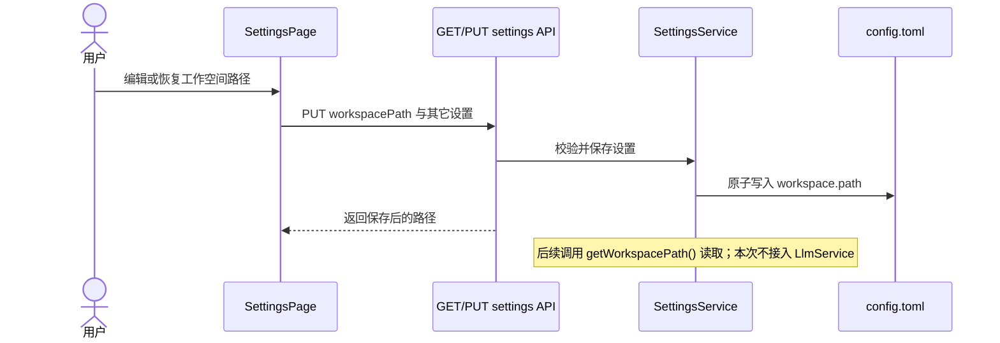
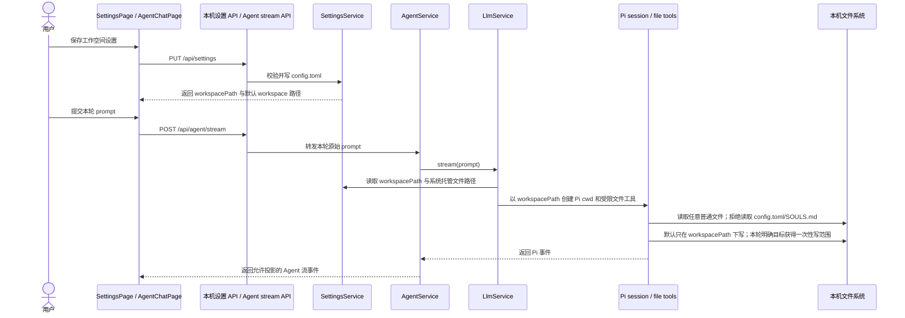

# 本机工作空间设置设计

> v1.0 已在 L001 交付。下方 v2.0 追加设计来自交付后的开发者反馈；与 v1.0 冲突的默认目录和 Agent 集成约束由 v2.0 取代，v1.0 内容保留作历史记录。

## Problem

本机设置已有模型和风格偏好，但没有保存工作空间路径的位置。后续代码无法从 SettingsService 取得用户配置的工作空间。

## Goals

- 在设置页增加可编辑的“工作空间”路径。
- 新安装默认路径等于 config.toml 的所属目录，即用户目录下的 .tech-forge。
- 将路径写入 config.toml；旧配置缺少该字段时回退到 config.toml 所在目录。
- 在 SettingsService 提供专用公开 getter，便于后续业务代码显式读取。
- 本次不在 LlmService 或 Agent 运行链路中读取、传递或应用该路径。

## Non-Goals

- 不移动 config.toml、SOULS.md、SQLite 或已有工作区文件。
- 不创建或验证用户指定目录是否存在，不改变 backend cwd、Agent 工具根目录或 Pi session。
- 不增加 Electron 文件夹选择 IPC、数据库字段或新的通用路径服务。

## Must-Not-Break Existing Behavior

- Provider、API Key 和 SOULS.md 的读取、保存行为保持不变。
- 既有 config.toml 若缺少 workspace.path，设置 API 继续正常工作并返回默认目录。
- 设置保存仍通过本机认证的 settings API，并原子替换 config.toml。
- Agent 当前工作目录、LlmService session、工具文件范围和 SQLite 路径不受此字段影响。

## Current Behavior

SettingsService 在用户主目录维护 .tech-forge/config.toml 和 SOULS.md。config.toml 当前只序列化 llm 配置。GET /api/settings 返回设置表单数据；PUT /api/settings 保存模型配置和风格文本。SettingsService 尚无读取工作空间路径的公开方法，SettingsPage 也没有路径输入。

## Proposed Behavior

### TOML 字段与兼容

新建配置增加独立 section：

    [workspace]
    path = "<absolute path to the .tech-forge directory>"

没有该字段的旧配置读取时，使用当前 config.toml 所在目录作为默认值；不会在启动时重写旧文件，下一次保存时将字段写入文件。

### API 与 Service

GET /api/settings 返回 workspacePath；PUT /api/settings 接收 workspacePath，并与现有设置一并保存。

SettingsService 新增 getWorkspacePath()，返回规范化的绝对路径。该 getter 只读取设置文件，不创建路径，不检查目录存在性。SettingsService.getLlmSettings() 仍只返回 LLM 配置，不把工作空间混入 LLM 配置对象。

### Settings UI

设置页增加“工作空间”路径输入框，加载当前 workspacePath，可编辑并保存；“恢复默认目录”按钮将输入重置为 config.toml 所属目录。路径必须为绝对路径。设置值只作为后续本地代码可读取的配置，本次不改变任何现存文件操作。

## Alternatives Considered

| 方案 | 结论 | 理由 | 是否升级为 ADR |
|---|---|---|---|
| 将路径放在 config.toml 的 workspace section | 采用 | 与同属本机运行配置的 Provider 设置一起持久化，保持独立字段 | n/a |
| 使用 Electron userData 或 SQLite 保存 | 否决 | 与用户指定的 config.toml 配置位置不符 | n/a |
| 立即把路径传给 LlmService 或文件工具 | 否决 | 用户明确要求本次只创建设置，并由其之后手动从 SettingsService 获取 | n/a |
| 增加文件夹选择 IPC | 否决 | 当前只需保存路径；会扩大 Electron 权限面且不是本次要求 | n/a |

## Business Flow

用户打开设置后查看当前路径，可编辑路径或恢复默认值。保存时 SettingsPage 将路径与现有设置一起发送；SettingsService 验证绝对路径、写入 config.toml，并返回保存后的路径。后续服务可调用 SettingsService.getWorkspacePath() 显式获取。

## End-to-End Data Interaction Flow

| 关键节点 | 输入 | 节点职责 | 输出 / 状态变化 | 关键边界 |
|---|---|---|---|---|
| SettingsPage | 编辑值或默认目录 | 展示、编辑并提交绝对路径 | 表单路径更新 | 使用受限 desktop request bridge |
| SettingsController | 已校验 settings DTO | 委派 SettingsService 读写 | settings 响应 | 复用本机认证路由 |
| SettingsService | workspacePath 与现有设置 | 验证并原子写入 TOML | 当前路径持久化 | 不创建目录；不改变其它数据位置 |
| 后续调用方 | SettingsService | 显式调用 getWorkspacePath() | 已保存的绝对路径 | 当前不传递给 LlmService |

## Data And API Impact

- LocalSettingsView 增加 workspacePath；SaveSettingsInput 增加 workspacePath。
- SettingsService 提供 getWorkspacePath()；getLlmSettings() 保持仅包含 Provider 字段。
- TOML parser / serializer 识别 [workspace].path；旧文件缺字段时用 config directory 作为兼容默认值。
- 不改 SQLite schema、Electron IPC、Agent SSE、LlmService 或当前工作目录契约。

## Frontend Fetching Logic

SettingsPage 继续通过 GET /api/settings 加载，并在 PUT 请求提交 workspacePath。成功响应回填规范化路径；请求失败保留未保存的输入。

## Frontend Behavior

- 在模型配置和风格偏好之间增加工作空间卡片。
- 显示可编辑的绝对路径，以及“恢复默认目录”按钮。
- 默认值为当前 config.toml 所属目录；不提供文件夹浏览器。
- 相对路径时由表单或 API 给出明确提示，防止保存歧义值。

## Backend Fetching Logic

- 初始化新 config.toml 时写入绝对 config directory 作为 workspace.path。
- 读取旧配置时若缺字段则回退到 config directory。
- 保存前使用平台路径函数验证绝对路径并规范化；不要求目标目录存在。
- serializeSettings 写入 workspace section；写入失败时保留旧 config.toml。

## Backend Behavior

- getWorkspacePath() 读取 config.toml 并返回 workspace.path。
- getLlmSettings() 不返回 workspacePath，避免 LLM 配置契约和调用方被扩大。
- 不在本次变更中注入 SettingsService 到 LlmService，也不更改 AgentService、workspace-file-tools 或 process.cwd()。

## Error Handling

- 相对路径或过长路径返回可读的 400 错误，不覆盖已有设置。
- 路径指向尚不存在的目录仍可保存；实际目录管理由后续调用方负责。
- 旧 TOML 中没有 workspace.path 时使用 config directory；损坏的 TOML 仍按当前规则报告错误。

## Risks

- 路径只作为设置保存，不会自动改变当前 Agent 文件工具的工作根目录；当前 UI 不声称已经切换运行目录。
- 用户可能填写尚不存在的目录；本次仅验证路径格式，目录创建与权限由后续集成负责。

## Verification

代码级验收见 verification.md。本任务不新增或运行测试；进行类型/构建检查并记录桌面人工确认项。

## Design Deviations

| 偏差 | 发现于 | 与设计不符之处 | 处理（改设计 / 改现状文档 / 接受） |
|---|---|---|---|
| none | n/a | n/a | n/a |

## Version History

<!-- 仅交付后的用户反馈触发版本升级。 -->

### v2.0 — 2026-11-08

- 触发：开发者确认工作空间是 Agent 产物的默认目录，并要求读任意来源、写操作默认不可越界，只有本轮用户明确给出外部目标时可临时授权。
- 改动内容：默认目录从 config.toml 所属目录调整为其 `workspace/` 子目录；Pi cwd 接入 workspace；read 与 write/edit/mkdir 分离；保护 SettingsService 独占的 config.toml、SOULS.md 和原子替换临时文件；增加当前轮次绝对目标路径的一次性写授权（AC-05 至 AC-10）。
- 影响范围：默认迁移、设置 UI、SettingsService、LlmService session 初始化、Pi 文件工具、Agent 运行事实和 manifest。
- 处理状态：已重新实施于 L002。

## Current Doc Updates

- [x] docs/current/domains/system-settings/index.md
- [x] docs/current/platform/architecture-and-code-placement.md
- [x] docs/manifest.yaml

## v2.0 Post-Delivery Amendment

### Updated Goals

- `config.toml` 和 `SOULS.md` 继续固定由 `SettingsService` 管理在 `~/.tech-forge/`；Agent 文件工具不得读取或修改这两个文件。
- Agent 默认输出工作空间为 `~/.tech-forge/workspace/`。旧配置中恰好等于 `~/.tech-forge/` 的旧默认值迁移到子目录；自定义绝对路径保留。
- Pi session 的 `cwd`、资源加载器、会话分组和文件工具使用同一个已保存工作空间。`agentDir` 仍由 Pi SDK 管理。
- Agent 可以读取任意现存普通文件；写入、编辑和建目录必须在默认工作空间下。只有本轮用户原始请求包含明确写入意图和唯一、明确的绝对目标路径时，才临时允许写入该目录下，或写入用户明确指定的单个文件。
- 这项一次性写入许可只由当前请求文本导出；对话历史、读取文件内容、模型输出和工具参数均不能创建授权。外部目标目录的父目录必须已存在；外部建目录只允许发生在本轮明确授权的目标目录内。

### Responsibility And Security Boundaries

| 文件 / 责任单元 | 拥有的职责 | 禁止越界 |
|---|---|---|
| `SettingsService` | 固定的用户配置文件位置、TOML/SOULS 读写、默认工作空间路径与系统托管文件路径 | 不把 config/SOULS 交给 Agent 文件工具写入 |
| `LlmService.createSession()` | 每轮读取 workspace 设置，统一 Pi `cwd`，将本轮原始 prompt 传给工具策略 | 不从历史消息或工具输出推导外部写权限 |
| `workspace-file-tools.ts` | 对 read/edit/write/mkdir 的真实文件操作执行路径与文件身份检查 | 不把系统提示词当作安全边界；不能凭模型给出的路径扩大权限 |
| `SettingsPage` | 展示默认/当前路径并保存 | Renderer 不直接读写本机文件 |

### v2.0 Data Interaction Flow

| 关键节点 | 输入 | 节点职责 | 输出 / 状态变化 | 关键边界 |
|---|---|---|---|---|
| `SettingsPage` / settings API | 工作空间路径 | 显示默认值并保存绝对路径 | TOML 中的 workspace 配置 | Renderer 只经受限本机 API |
| `SettingsService` | 设置请求 / 本机文件 | 固定管理 config 与 SOULS，并提供 workspace 和托管文件路径 | 规范化的设置视图 | Agent 工具不拥有这两个文件 |
| `AgentService` / `LlmService.stream()` | 当前用户 prompt、对话 ID | 保留当前轮次输入并构建 session | Pi session | 外部许可只绑定本轮原始 prompt |
| `workspace-file-tools.ts` | Pi 工具路径和工具操作 | 分别执行读取、默认写入、一次性外部写入校验 | 文件 I/O 或稳定拒绝错误 | 工具层执行权限；路径穿越、符号链接和系统文件别名均拒绝 |
| Pi session | workspace `cwd` | 资源加载、会话分组与文件工具共享工作空间 | Pi 事件流 | `agentDir` 继续由 Pi SDK 管理 |

### Updated API, Frontend And Backend Behavior

- GET `/api/settings` 继续返回已有 `configDirectory` 与 `workspacePath`；设置页根据当前平台分隔符将默认目录确定为 `configDirectory/workspace`。
- PUT `/api/settings` 保持现有字段结构，并持久化工作空间路径。空缺字段与旧配置中的旧默认目录均回退到 `configDirectory/workspace`。
- SettingsService 创建默认 workspace 目录；拒绝把 config 目录本身或其祖先目录配置为 Agent workspace。应用托管文件路径仍由 SettingsService 提供给 LlmService。
- `LlmService.createSession()` 将 workspacePath 同时用于 `DefaultResourceLoader.cwd`、恢复会话的 `SessionManager.inMemory(cwd, ...)`、`createAgentSession({ cwd })` 和自定义文件工具；默认资源发现的其他开关和 `agentDir` 保持当前设置。
- 读取工具允许访问绝对路径和 workspace 下的相对路径，但只处理普通文件，并通过规范路径及文件身份拒绝 config.toml / SOULS.md 本体、符号链接别名、硬链接别名及 SettingsService 原子替换期间的同目录临时文件。
- edit/write/mkdir 在文件操作边界校验 workspace 根、路径穿越、符号链接和托管文件身份。外部目录授权不自动允许创建其上级目录；外部目标父目录必须存在。
- 系统提示词只帮助模型选择合规路径；文件工具实施真正的边界，即使模型忽略提示也不能越界写入。

### Updated Alternatives Considered

| 方案 | 结论 | 理由 | 是否升级为 ADR |
|---|---|---|---|
| 只在系统提示词中写“不要越界” | 否决 | 提示词不能限制工具的实际文件 I/O | n/a |
| 把 Pi `cwd` 当作文件写入安全边界 | 否决 | cwd 影响资源与内置工具路径，不替代每次文件操作的授权检查 | n/a |
| 所有文件读写都限制在 workspace | 否决 | 用户明确需要读取任意来源文件 | n/a |
| 文件工具执行读写分离策略，写操作逐次校验 | 采用 | 保留任意来源读取，同时由后端工具边界阻止默认工作空间外的写入 | n/a |

### Updated Verification And Risks

- 逐条对照 v2.0 `verification.md` 的 AC-05 至 AC-10；类型检查、静态路径审查和 Electron 手动检查分别记录结果。
- 用户未写清楚唯一的绝对输出目标、请求未明确表达写入意图、目标存在歧义或路径不是当前平台绝对路径时，外部授权失败关闭；工具错误提示模型请用户提供目标绝对路径。
- 含空格的外部绝对路径必须在当前请求中加引号；未加引号且不能无歧义识别的路径不产生许可。
- 外部目录授权是目录范围内的临时权限；硬链接身份检查、拒绝托管文件和禁止外部父目录创建，避免目录授权成为 config 文件或任意路径的绕过。
- 不新增上传 UI/API；当前 Agent 文件工具边界覆盖已存在的读写通道。后续增加上传时必须复用同一 workspace 归属和路径校验规则。

### v2.0 Current Doc Updates

- [x] `docs/current/domains/system-settings/index.md`
- [x] `docs/current/platform/agent-runtime.md`
- [x] `docs/current/platform/architecture-and-code-placement.md`
- [x] `docs/changes/README.md`
- [x] `docs/manifest.yaml`
