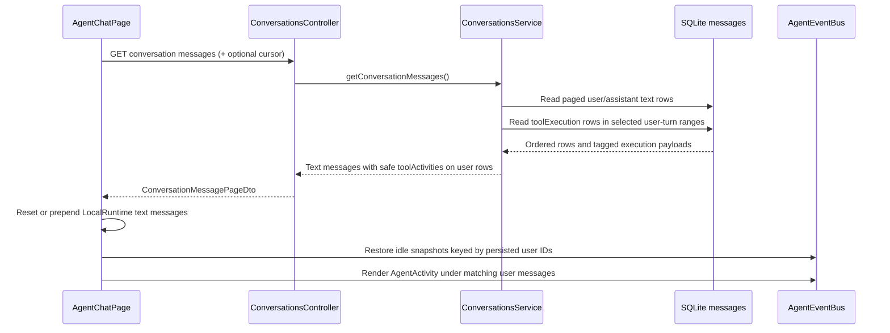

# Conversation Tool Activity History Design

## Problem

The first live turn renders tool activity from the desktop `AgentEventBus`. When a conversation is selected again, `AgentChatPage` reloads only the text history and resets the runtime. The activity list is absent after the reload even though completed tool execution rows are stored in SQLite.

## Goals

- Restore a conversation's completed tool activity beneath its user messages when a history page is loaded.
- Associate activities with the correct user turn, including when a page is loaded with `beforeMessageId`.
- Preserve the live tool activity UI and the current text message pagination contract.
- Persist and expose only the tool name, status, duration, and a string display path; keep raw arguments and results private.

## Non-Goals

- Render `toolResult` or `toolExecution` records as independent assistant-ui chat messages.
- Restore activities for tool rows that have no terminal state while the current turn is running.
- Backfill display paths for existing rows whose arguments were not persisted.
- Change Pi conversation restoration, turn serialization, or tool execution behavior.

## Must-Not-Break Existing Behavior

- History pages continue to contain at most 30 visible user/assistant text messages, with the same stable message-ID cursor and `hasMore` semantics.
- Tool arguments, results, and Pi-native `toolResult` payloads remain unavailable to the renderer.
- Live SSE tool summaries continue to appear under the currently submitted user message.
- Conversation history can still be loaded after app restart, using SQLite as the source of persisted tool state.

## Current Behavior

- `ConversationsService.startToolExecution()` stores tool records as `role: 'toolExecution'` with a tagged JSON payload containing call ID, tool name, status, duration, and result state. The history projection persists only a string display path when the start event provides `args.path`.
- `getConversationMessages()` pages top-level user/assistant text rows and returns safe tool summaries under user DTOs; tool rows never become top-level chat roles.
- The current query change includes role `'tool'`, which does not match the persisted `'toolExecution'` role. Tool activity still is not in the response.
- `AgentEventBus` keeps snapshots in renderer memory and keys them by the live assistant-ui user-message ID. History loading constructs messages from backend row IDs and does not restore an activity snapshot for those IDs.

## Proposed Behavior

- Keep visible history rows restricted to user and assistant text. Extend each user DTO with `toolActivities`, a safe list of terminal tool summaries from the same turn.
- Use ordered message rows to determine turn ranges: a turn starts at a user row and ends before the next user row. For the user rows in the selected text page, query `toolExecution` rows from the first selected user through the next user row after the newest selected user. Assign each execution to the nearest preceding selected user row by `sequenceNo`.
- Parse the tagged execution payload and project only `toolCallId`, `toolName`, optional `displayPath`, terminal status, and optional `durationMs`. Query entity rows in `completed` or `failed`; an interrupted execution is stored as failed and remains failed in history, while pending rows are excluded. Do not return `partialResult`, `result`, or arbitrary tool arguments.
- On new live tool starts, persist only a string `args.path` as `displayPath`. Existing rows without that field still restore action, status, and duration without a path chip.
- When `loadConversation()` or `loadEarlierMessages()` accepts a validated history page, hydrate `AgentEventBus` snapshots keyed by each persisted user message ID. These snapshots are idle and do not claim to have a restored whole-turn duration.
- Preserve `toThreadMessage()` as a text-message converter. Tool activity remains auxiliary UI state under user messages.

## Alternatives Considered

| 方案 | 结论 | 理由 | 是否升级为 ADR |
|---|---|---|---|
| Return `toolExecution` rows as top-level chat messages | 否决 | The renderer history contract accepts only user/assistant messages; exposing execution rows as chat roles breaks the existing message model and may leak payload fields. | n/a |
| Keep the existing renderer event bus as the history source | 否决 | It is process-local and keyed by a live renderer message ID that differs from the backend history row ID; it cannot restore after restart. | n/a |
| Add a normalized turn foreign key and migration | 否决 | Existing rows are already ordered between user messages, so sequence boundaries provide the needed relation without a schema migration or backfill. | n/a |
| Add safe summaries to the history response and hydrate renderer state | 采用 | Uses the current durable rows, preserves the message model, and works for both initial and cursor-based history pages. | n/a |

## Business Flow

1. A user selects a conversation or loads an earlier page.
2. The backend returns visible text messages and safe tool summaries nested under user messages.
3. The desktop resets or prepends the text messages and restores matching idle activity snapshots in the event bus.
4. The message renderer finds activity by the stable persisted user-message ID and displays the tool rows below it.

## End-to-End Data Interaction Flow

| 关键节点 | 输入 | 节点职责 | 输出 / 状态变化 | 关键边界 |
|---|---|---|---|---|
| `AgentChatPage.loadConversation()` / `loadEarlierMessages()` | Conversation ID and optional stable message cursor | Validate the history response, reset or prepend text, hydrate tool state | Renderer thread and event bus reflect the selected page | Stale request versions remain ignored |
| `ConversationsController.getMessages()` | UUIDv4 conversation and optional cursor | Preserve the existing HTTP/auth boundary and delegate one query | Bounded `ConversationMessagePageDto` | No direct repository access |
| `ConversationsService.getConversationMessages()` | Conversation ID and cursor | Page visible messages, read execution rows in turn ranges, project safe summaries | User message DTOs include `toolActivities` | Tool rows do not count as visible messages or alter pagination |
| SQLite `messages` | Ordered user, assistant, and `toolExecution` rows | Preserve durable message and execution state | Existing rows remain valid; new execution JSON may include `displayPath` | No schema migration; raw args/results stay private |
| `AgentEventBus` | Persisted user ID and safe tool DTOs | Build an idle activity snapshot for historical messages | `AgentActivity` can render under restored user IDs | Historical snapshots have no request ID or live timer |

## Data And API Impact

- `GET /api/conversations/:conversationId/messages` adds optional `toolActivities` to user message objects. Each summary contains `toolCallId`, `toolName`, optional `path`, `status`, and optional `durationMs`.
- Existing response fields, message roles, pagination, and cursor behavior do not change.
- New `toolExecution` JSON stores an optional `displayPath` string derived only from a string `args.path`; no arbitrary tool arguments or results are added to the history response.
- No SQLite schema migration or new table is needed. Existing JSON records without `displayPath` remain readable.

## Frontend Fetching Logic

- `loadConversation()` continues to fetch the latest text page. After response validation and before/after the thread reset, it hydrates each user message's optional `toolActivities` into `AgentEventBus` keyed by that DTO's `id`.
- `loadEarlierMessages()` uses the same endpoint and cursor. It restores activity only for the newly fetched users while preserving existing page snapshots.
- Missing `toolActivities` is treated as an empty list for older response fixtures; malformed tool summaries reject the history response.
- No client-side cache is authoritative for tool history; the backend response is the persisted source.

## Frontend Behavior

- Existing live snapshots remain keyed to the live renderer message and keep their running timer.
- Restored snapshots are keyed to persisted user-message IDs, have idle status, and show tool rows without a fabricated whole-turn elapsed time.
- The existing `AgentActivity` and `ToolActivityRow` renderers continue to show safe tool actions, paths, statuses, and per-tool durations.

## Backend Fetching Logic

- The first query continues to scan user/assistant text rows in descending sequence order until it has 31 visible rows or exhausts candidates.
- Only the selected 30 rows are returned. For selected user rows, compute a lower sequence bound from the oldest selected user and an upper bound from the next user after the newest selected user, when one exists.
- Read `completed` or `failed` `toolExecution` rows inside that turn range, parse the tagged JSON, and attach each row to the nearest preceding selected user row.
- The tool query does not change `hasMore`, cursor validation, or the top-level text-message projection. It does not return tool execution results or Pi `toolResult` rows.
- The reads remain read-only and do not span model or tool I/O. If no user message is in a page, no tool query is needed.

## Backend Behavior

- The persisted execution row's role is `toolExecution`, not `tool`; the history query must select this durable role for summaries.
- For new execution rows, persist only the optional display path from the start event. For older rows without it, return the tool name and status without a path.
- Entity state `pending` is excluded from history; tagged `interrupted` execution on a failed entity is rendered as failed. Completed and failed remain unchanged.
- Tool execution rows are nested under user turns and never become `ConversationMessageDto.role` values.

## Error Handling

- Existing malformed cursor, missing conversation, and repository errors retain their current HTTP behavior.
- A malformed execution payload is skipped for activity projection so one corrupt tool row does not make visible text history unavailable; the service records a safe query diagnostic.
- Invalid `toolActivities` response fields fail frontend history validation and show the existing history-load error.

## Risks

- Existing records cannot recover a display path because they did not persist it; they can still restore action, status, and duration.
- Sequence grouping assumes each turn begins with one user row and the next turn begins at the next user row, matching current `beginTurn()` ordering.
- Historical elapsed time for the complete turn is not currently persisted; the UI will omit that value while retaining per-tool durations.

## Verification

- Add a SQLite-backed `ConversationsService.getConversationMessages()` regression test containing `user`, `assistant`, and tagged `toolExecution` rows; assert the nested activity is associated with the correct user.
- Add a compatibility assertion for a tagged execution row without `displayPath`; its summary remains available without a `path` field.
- Add a desktop history hydration test; assert a restored snapshot is available by persisted message ID and remains terminal/idle.
- Run both conversation-history test commands and the relevant backend/desktop type checks only if separately requested.

## Design Deviations

| 偏差 | 发现于 | 与设计不符之处 | 处理（改设计 / 改现状文档 / 接受） |
|---|---|---|---|

## Version History

## Current Doc Updates

- [x] `docs/current/domains/conversations/index.md`
- [x] `docs/current/domains/conversations/backend-behavior.md`
- [x] `docs/current/domains/conversations/api-contract.md`
- [x] `docs/current/platform/agent-runtime.md`
- [x] `docs/current/platform/architecture-and-code-placement.md`
- [x] `docs/manifest.yaml`
