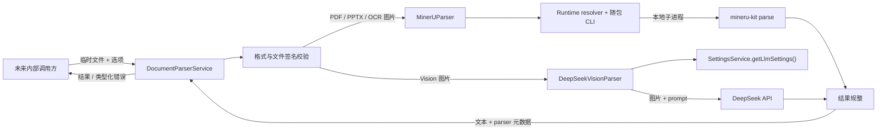

# 文档解析适配层设计

## Problem

TeachForge 尚无统一的文件解析能力。现有 `documents` 模块只有实体和空壳
`DocumentsService`，没有 PDF、图片或演示文稿解析流程。解析能力会被后续
业务使用，但本变更不决定解析结果如何进入对话或知识库。

解析器同时涉及两种运行方式：MinerU 是需要 Python 运行时和模型文件的本地
工具；图片语义理解可能调用用户已配置的 DeepSeek。需要一个清楚的适配层，
隔离解析器差异、凭据读取、进程启动和应用打包细节。

## 修订 2026-11-08：v1 采用文本层提取，解析器可替换

初版把 MinerU 作为默认解析器。按"初期不过度设计、后续可替换"重新评估后调整为：v1 用纯 JS 文本层提取，**但契约按"未来会换成子进程解析器"来设计**，替换成本压到新增一个实现文件。

### 为什么纯 JS 先上

- `pdfjs-dist` 6.5.438（Apache-2.0）在 Node 内实测：28 页英文论文 open 75 ms、提取 210 ms、101k 字符；18 页 142 ms。打包构成 `legacy/build` + `cmaps`（中文必需 1.2 MB）+ `standard_fonts` 0.8 MB ≈ 20 MB。
- `mammoth`（BSD-2-Clause）处理 DOCX，1.6 MB。
- 对比 MinerU 组件：1.5–2.5 GB、AGPL-3.0、Python 冷启动 10–30 s、三平台各自构建。
- 触发以下条件才启用下方 MinerU 方案：扫描件占比升高、双栏/表格还原质量不达标、需要公式结构。

### 契约（v1 即按最终形状定义）

关键决定：**结果按页返回，而不是一根字符串**。这样 pdfjs（逐页）与 MinerU（Markdown + 页码标记）都能满足同一形状，未来换实现时下游分块与引用不受影响。

```ts
interface ParseDocumentRequest {
  inputPath: string;          // 应用管理的临时文件，不接受 Renderer 任意路径
  originalName: string;
  mimeType?: string;
  signal?: AbortSignal;
}

interface ParsedPage {
  pageNo: number;             // 1 起
  text: string;               // 该页重建后的文本（Markdown 或纯文本）
}

interface ParseDocumentResult {
  text: string;               // pages[].text 的拼接，供不关心分页的调用方使用
  pages: ParsedPage[];        // 分块与 locator 的唯一来源
  format: 'markdown' | 'plain_text';
  parser: { id: 'pdf-text' | 'docx' | 'plain-text' | 'mineru-kit'; versionOrModel: string };
  source: { mediaType: string; pageCount: number; byteSize: number };
  warnings: Array<{ code: string; message: string }>;
}
```

调用方（Documents 域）只依赖 `ParseDocumentResult`；分块器按 `pages[]` 切分并直接得到 `pageStart`/`pageEnd`，不需要解析器提供页码之外的任何排版信息。

### 格式与定位语义

`pages[]` 是"定位单元"，不是"PDF 页"的同义词：

| 格式 | `pages[]` | `source.pageCount` | 可用定位字段 |
|---|---|---|---|
| PDF | 每页一项，`pageNo` 即真实页码 | 实际页数 | `pageStart`/`pageEnd` + `headingPath` + 字符偏移 |
| DOCX | 单一项，`pageNo = 1`（docx 无分页语义） | `1` | `headingPath` + 字符偏移（**无页码**） |
| MD / TXT | 单一项，`pageNo = 1` | `1` | `headingPath` + 字符偏移 |

分块器据此决定 `locatorJson` 写不写页码：只有 PDF 会产出 `pageStart/pageEnd`，其余格式留空。这避免了"给 docx 编造页码"这类会污染引用的取值。

### 实测：中文样本（2026-11-08）

| 样本 | 规模 | 结果 |
|---|---|---|
| `AI-Agents-in-Depth-zh-CN.pdf` | 11 MB / 313 页 | open 8 ms、文本 **503,320 字符**、**12,185 行**、**1,455 段**、含行段重建总耗时 **1.7 s**（≈5.4 ms/页） |
| `AI员工平台_作业背景文档_脱敏版_v1.docx` | 50 KB | 转换 87 ms、**29,881 字符**、标题 0 个、**18 个表格**、warnings 0 |

由此确认的三条实现规则：

1. **必须按 y 坐标聚行、按行距聚段**。直接 `items.join(' ')` 每页只会得到一行，段落信息全丢；按 y 聚行 + 中位行距 ×1.6 阈值聚段后，才得到上表的段落分布。
2. **cmaps 不是这个样本的必需项**，但必须随包。该 PDF 自带 ToUnicode，加载与不加载 cmaps 输出完全一致（28,299 字符逐字相同）。曾据此认为"漏 cmaps 必然乱码"的推断不成立：乱码发生在仅有预定义 CJK CMap、没有 ToUnicode 的 PDF 上。cmaps 只占 1.2 MB，仍然随包，并用另一份样本验证兜底。
3. **目录页会产生点线噪声**：TOC 段落形如 `7.3.2 人机交互型… . . . . . 190`，单段可达数百字符且占比很高。检测规则：单段内 `" . "` 出现次数占字符数超过阈值时标记 `TOC_LIKE` warning，分块器可选择不入库（避免目录污染检索），但**不静默丢弃**。

DOCX 侧的两条实现规则：

- 该样本**零标题样式、18 个表格**：`convertToMarkdown` 会把 18 个表全部拍平，因此 `UNSTRUCTURED_TABLE` 不是理论风险而是必然触发；同时因无标题，分块只能靠段落回退。
- 该样本用加粗段落充当标题（`__0. 关于本文档__`）。规则：**仅由加粗构成的短段落**（≤40 字符、无句末标点）作为 `headingPath` 的伪标题，否则段落层级全丢。

### DOCX 处理

- `mammoth` 1.13.0 `convertToMarkdown`，实测：25 KB 中文 docx 50 ms / 4.6k 字符；594 KB 手册 31 ms / 798k 字符，标题层级（`#`/`##`/`###`）保留。
- **表格结构会丢**：实测 `convertToMarkdown` 把每个单元格降级为独立段落（内容不丢，行列关系丢）；`convertToHtml` 保留 `<table>`。v1 选择前者，并通过 `transformDocument` 检测到表格元素时产出 `UNSTRUCTURED_TABLE` warning。若将来表格结构成为硬需求，改为 `convertToHtml` + 本地表格→Markdown 转换，改动只在这个 parser 文件内。
- 需要清理的产物（否则污染分词与字符计数）：Markdown 转义（`178\-2119`）、`<a id="...">` 锚点、零宽字符（`U+200B`/`U+200D`/`U+FEFF`/`U+2060`）。属归一化器职责，见检索设计的分词契约。
- 标题稀疏的文档（实测 798k 字符仅 9 个标题）不能只按标题切块，分块器需要段落级回退。

### 模块布局

| 文件 | 职责 |
|---|---|
| `platform/document-parser/document-parser.service.ts` | 校验输入、格式路由、临时文件与超时、错误映射、结果规整。不含任何具体解析逻辑 |
| `platform/document-parser/parser.types.ts` | 上述契约与 `DocumentParser` 接口 |
| `platform/document-parser/parser.registry.ts` | 单一路由表：扩展名/签名 → parser 实例；新增格式只改这里 |
| `platform/document-parser/parsers/pdf-text.parser.ts` | `pdfjs-dist`：逐页 `getTextContent()`；单栏按 item `transform` 的 (y 降序, x 升序) 重排；x 分布呈双峰时判定为两列，改为按 (列, y 降序, x 升序)；行距阈值判段落 |
| `platform/document-parser/parsers/docx.parser.ts` | `mammoth` → Markdown |
| `platform/document-parser/parsers/plain-text.parser.ts` | Markdown / TXT 直读 |
| `platform/document-parser/parsers/mineru.parser.ts` | **未来**：子进程实现，接口不变 |

`DocumentParser` 接口只有一个方法：

```ts
interface DocumentParser {
  id: ParseDocumentResult['parser']['id'];
  supports(input: { extension: string; mediaType: string }): boolean;
  parse(input: ParseDocumentRequest): Promise<ParseDocumentResult>;
}
```

### 替换成本

将来接 MinerU 只需要：新增 `mineru.parser.ts` + 在 registry 里加一行路由 + 打包资源。`DocumentsService`、分块器、索引、检索全部不动——因为它们只消费 `pages[]` 与 `warnings[]`。

### 一致性验收（保证可替换）

同一组 fixture 用例必须对**任何** parser 实现生效：

- 单栏带文本层 PDF → `pages.length === pageCount`、每页文本非空、页面顺序正确。
- 双栏 PDF → 按列优先输出而非逐行交错；若列检测失败则必须产出 `MULTI_COLUMN_SUSPECTED` warning，不静默输出错序文本。
- 含表格页面 → 输出行文本且带 `UNSTRUCTURED_TABLE` warning（v1 不假装识别表格）。
- 扫描件 PDF → `NO_TEXT_LAYER`（不返回空文本，不静默入库）。
- DOCX / MD / TXT → `format` 与 `warnings` 符合预期。
- 超限文件 / 越界路径 / 取消信号 → 对应类型化错误。

### v1 明确不做

- 无文本层的扫描件（返回 `NO_TEXT_LAYER`，提示暂不支持）。
- 图片与 PPTX（契约保留 `imageMode` 等字段的位置，但不实现）。
- 表格结构识别、公式还原、版面分栏识别（只做行序重建）。

## Goals

> 下列 Goal 中涉及 MinerU 的条目已被上方修订取代，仅在触发条件成立时适用。

- 建立后端内部解析契约，解析成功时统一返回 Markdown 或纯文本及解析元数据。
- PDF 默认使用 MinerU 本地 CLI 的 Flash tier；调用方可显式请求 Basic。
- PPTX 使用 MinerU Flash 本地解析。
- 独立图片默认使用已配置的 DeepSeek Vision；调用方也可选择 MinerU Flash
  OCR，只提取可见文字。
- 随桌面应用分发默认 Flash 路径所需的运行时和模型资源；普通用户无需安装
  Python、手动执行命令或在首次使用时下载模型。
- 只在解析请求到来时启动 MinerU，不运行常驻 MinerU 服务。
- 解析输出、临时文件、错误、凭据及子进程生命周期由适配层封装。

## Non-Goals

- 不集成 Supermemory，不做知识库入库、分块、embedding 或检索。
- 不接 Pi SDK 工具、不修改 `LlmService`，不处理聊天附件，也不把解析结果
  注入提示词或对话上下文。
- 不实现 `DocumentsService` 业务用例、上传 API、Renderer UI 或业务流程。
- 不新增文档、任务、解析结果或模型缓存数据库表。
- 不要求用户安装或维护 MinerU 服务、Docker、Python 或模型管理工具。
- 不为 PDF/PPTX 中的每张图自动调用 DeepSeek。MinerU 文本解析不承诺解释
  文档内图片的语义。

## Must-Not-Break Existing Behavior

- 不改变 Electron 启停 Nest backend、loopback 认证、聊天 SSE 和退出行为。
- 不修改 Pi Provider 注册和当前 text-only 模型描述；解析调用不改变聊天模型
  对外声明的能力。
- `SettingsService` 继续独占 `.tech-forge/config.toml`；解析层只读取已有
  DeepSeek 设置，不另建凭据存储。
- 解析结果保持临时，不写入 SQLite，也不修改现有迁移或数据表。

## Current Behavior

- `DocumentsModule` 注册文档相关实体和 `DocumentsService`，但 Service 目前
  是空壳；文件上传与解析流程都未实现。
- Electron 打包模式从 `process.resourcesPath` 找到 backend，并通过
  `utilityProcess.fork` 启动。桌面端尚无 MinerU 安装资源收集配置。
- `SettingsService.getLlmSettings()` 返回 DeepSeek 和自定义 Provider 配置。
  当前 DeepSeek Pi 模型描述声明 `input: ['text']`，并未提供图片解析服务。
- MinerU 4.1 文档定义 Flash、Basic、Standard、Advanced：Flash 用于快速解析、
  原生 PDF/文档文本和扫描件/图片 OCR；Basic 面向 OCR、公式和表格，使用 ONNX
  或 Torch 小模型，不需要本地 VLM。PDF 和图片支持各 tier；PPTX 等 Office
  文档走本地 Flash。CLI 的 PDF 默认 tier 是 Standard，必须显式选档。
- `mineru-kit parse` 是无文档库状态的 CLI 路径，不依赖文档库数据库或缓存。
  纯 PDF 文本层提取不需要推理模型；扫描页或图片 OCR 需要对应模型资源。
- 当前桌面包还没有安装器构建配置。Electron 的 backend 打包启动已存在，但
  MinerU sidecar 资源的构建、收集和版本管理尚未设计到代码中。

官方依据：
[MinerU Tiers and Runtimes](https://opendatalab.github.io/MinerU/usage/tiers/)、
[MinerU Quick Start](https://github.com/opendatalab/MinerU/blob/master/docs/en/quick_start/index.md)、
[MinerU CLI Tools](https://opendatalab.github.io/MinerU/usage/cli_tools/)、
[DeepSeek Vision](https://api-docs.deepseek.com/guides/vision/)。

## Proposed Behavior

### 责任边界

新增后端基础设施模块 `DocumentParserModule`，导出内部
`DocumentParserService`。它不注册 Controller，不连接任何业务 Service，
也不由本次变更中的业务流程调用。建议放在
`apps/backend/src/platform/document-parser/`，而非 `documents` 业务目录。

| 组件 | 职责 | 不负责 |
|---|---|---|
| `DocumentParserService` | 校验请求、识别格式、选解析器、规整输出和错误 | 对话、知识库或文档生命周期 |
| `MinerUParser` | 调用随包分发的 `mineru-kit parse` 并收集结果 | 安装器决策或业务持久化 |
| `DeepSeekVisionParser` | 调用已配置的 DeepSeek 图片接口并返回文本 | Pi 会话/工具或聊天回答 |
| Runtime resolver | 解析开发/打包环境中的 CLI 和模型位置 | 应用启动时下载任意可执行文件 |
| 调用方 | 提供应用管理的临时输入，决定何时解析及如何使用结果 | 拼命令、处理 MinerU 输出格式 |

以后 Documents 等业务模块可显式依赖解析适配层；本设计不添加该依赖。
`PlatformModule` 只负责装配适配层，不因此启动 Python 或 MinerU 子进程。

### 格式路由

| 输入 | 默认实现 | tier / mode | 行为 |
|---|---|---|---|
| PDF | 本地 MinerU CLI | Flash | 解析整个 PDF；可显式请求 Basic 进行较强 OCR、表格和公式结构识别 |
| PPTX | 本地 MinerU CLI | Flash | 使用本地 Office 文档解析；Basic 不适用 |
| 独立图片 | DeepSeek Vision | Vision | 描述可见内容并转录可读文字 |
| 独立图片，仅 OCR | 本地 MinerU CLI | Flash OCR | 仅提取可见文字，不向 DeepSeek 发送图片 |

独立图片的 `imageMode` 可为 `vision` 或 `ocr`；未指定时使用 Vision，以
延续现有图片解析意图。适配层不在本地 OCR 与云端 Provider 之间静默切换，
从而让图片是否离开设备由所选解析模式决定。

PDF 默认 Flash。调用方可明确请求 Basic；适配层不根据内容猜测质量并自动
升级。tier 与格式不匹配时返回明确错误。保留 MinerU 输出已有的 Markdown
结构和页码标记；解析器未提供的页码/幻灯片锚点不由适配层臆造。

### 内部契约

第一版只提供 Nest Provider，不增加 HTTP 或 IPC 接口：

```ts
interface ParseDocumentRequest {
  inputPath: string; // 应用管理的临时文件，不接受 Renderer 任意路径
  originalName: string;
  mimeType?: string;
  pdfTier?: 'flash' | 'basic';
  imageMode?: 'vision' | 'ocr';
  imageDetail?: 'low' | 'original';
  signal?: AbortSignal;
}

interface ParseDocumentResult {
  text: string;
  format: 'markdown' | 'plain_text';
  parser: {
    id: 'mineru-kit' | 'deepseek-vision';
    versionOrModel: string;
    tier?: 'flash' | 'basic';
  };
  source: {
    mediaType: string;
    pageCount?: number;
  };
  warnings: Array<{ code: string; message: string }>;
}
```

实现时可将类型拆到独立文件。返回值不得暴露原始绝对路径、API Key、未经
规整的 Provider 响应或临时输出目录。页数/页码属于可选元数据，因为不同
解析模式未必提供。

### MinerU Runtime 与应用打包

- 固定一个 MinerU 4.1.x 版本及其 Python 和本机依赖。官方当前指南建议
  Python 3.12，支持范围为 `>=3.11,<3.15`；安装时固定精确版本，不能在用户
  机器上执行 latest 安装。
- 按操作系统和架构构建 sidecar，包含 Python runtime、MinerU CLI、运行依赖和
  tier 所需模型文件。资源放 Electron resources 内、`app.asar` 外，例如
  `resources/mineru/<platform>-<arch>/`。
- 基础安装包必须包含默认 Flash 流程所需资源，包括扫描页/图片 OCR 所需
  模型；用户首次解析不能依赖外网下载。Basic 模型是否也包含在基础包中，
  在锁定资源版本后测量安装包增量再定。若当前包未包含 Basic 权重，请求
  Basic 时返回 `PARSER_MODEL_NOT_READY`；不静默降级，也不临时联网下载。
- Electron Main 根据 `process.resourcesPath` 定位资源目录，并通过窄环境变量
  传给打包 backend。开发模式可用显式路径覆盖。打包版 backend 不搜索系统
  PATH 中的 Python 或 MinerU。
- Backend 在解析请求中创建独立临时目录，用绝对 CLI 路径、参数数组和
  `shell: false` 启动。设置输出上限、超时和取消；应用启动时不运行
  MinerU，也不开放本地 MinerU HTTP 服务。
- 构建产物清单记录 runtime/tier/model 版本与校验值。每次解析前校验选中
  tier 的文件齐备；不完整时报错，不下载未知版本。
- 不把开发机虚拟环境直接复制进安装包。每个平台构建和验证自身的可运行
  Python sidecar；不假设 Windows、macOS、Linux 可共享同一环境。

### 图片 Provider 行为

Vision parser 通过 `SettingsService.getLlmSettings()` 读取 DeepSeek 的 model ID
与 API Key，独立于当前 Pi 会话选择的 Provider。它直接调用 DeepSeek
OpenAI-compatible Chat Completions 图片格式，不调用 Pi，也不修改
`DeepseekLLMAdapter`。

当前 DeepSeek `deepseek-flash` 接受 JPEG、PNG、GIF、WebP 图片。适配层读取本地
图片并编码为 data URL，发送前校验序列化请求体大小；默认 `detail: 'low'`
以降低处理成本，调用方可为文字密集图片指定 `original`。若缺少密钥、模型
不支持图片或请求失败，返回规范化错误；不自动回退到另一解析器。

## Alternatives Considered

| 方案 | 结论 | 理由 | 是否升级为 ADR |
|---|---|---|---|
| 应用启动时运行 MinerU API server | 否决 | 只为文件解析增加常驻进程、端口、就绪和关闭管理 | n/a |
| 依赖用户安装 Python、MinerU 和模型 | 否决 | 普通用户必须自行配置运行时，不符合桌面应用开箱使用 | n/a |
| 随包分发 Python runtime，按需调用 CLI | 采用 | 保留简单的本地 CLI 调用，同时隐藏安装和模型配置 | n/a |
| 所有图片都调用 DeepSeek | 否决 | OCR-only 图片也会离开设备并产生云端调用成本 | n/a |
| 所有 PDF/PPTX 页面转图片后送 DeepSeek | 否决 | 增加图片上传和 API 费用，绕开 MinerU 面向文档的输出 | n/a |
| 把文件解析加进 `LlmService` 或 Pi 工具 | 否决 | 文件预处理与会话/模型工具语义不同，混在一起会耦合业务上下文 | n/a |

## Business Flow

本变更没有面向用户的业务流程。只定义内部调用方提交一个临时文件并获得
统一文本结果或类型化错误。未来业务变更决定何时解析、如何使用结果，以及
是否保留原文件。

## End-to-End Data Interaction Flow



| 关键节点 | 输入 | 节点职责 | 输出 / 状态变化 | 关键边界 |
|---|---|---|---|---|
| 未来内部调用方 | 应用管理的临时文件和解析选项 | 决定何时解析及如何使用结果 | 内部 Service 请求 | 本变更不新增业务调用方 |
| `DocumentParserService` | 请求、文件元数据、取消信号 | 校验、路由、规整并映射错误 | 统一结果或类型化错误 | 不持久化、不调业务服务 |
| `MinerUParser` | 有效文件路径与 tier | 调用随包 CLI 并收集输出 | Markdown 和解析元数据 | 本地进程；超时、取消、清理 |
| `DeepSeekVisionParser` | 有效图片和模型设置 | 调用图片接口并返回文本 | 纯文本/Markdown 描述 | 图片离开设备；Key 和正文不入日志 |
| `SettingsService` | 现有用户设置文件 | 提供 DeepSeek model ID 与 Key | 仅内存配置 | 仍由 SettingsService 独占设置文件 |
| 结果规整器 | Parser 输出和元数据 | 校验结果并建立统一响应 | Parser 无关的结果结构 | 不泄露绝对路径、原始 HTTP 响应或部分结果 |
| 打包运行时 | Electron 资源目录 | 将 MinerU 资源路径传给 backend | Backend 可解析 sidecar | 资源只读并位于 ASAR 外 |

## Data And API Impact

- 不新增 HTTP endpoint、IPC 方法、Renderer 契约、Pi 工具或业务 API。
- 新增一个内部 Nest Provider 契约。输入路径必须指向应用管理的临时文件，
  不接受 Renderer 任意路径。
- 不新增 Entity、migration、SQLite 记录、持久化任务或解析缓存。结果只在
  内存中流转，不改变应用持久化状态。
- 数据读取与生命周期：

| 数据 | 读取来源 | 写入位置 | 生命周期 |
|---|---|---|---|
| 原始文件字节 | 内部调用方的临时文件 | MinerU 临时输入或 DeepSeek 请求体 | 请求结束后删除/释放 |
| MinerU 输出 | 本次请求输出目录 | 校验后读入内存 | finally 清除；backend 启动时清理残留目录 |
| DeepSeek 设置 | `SettingsService.getLlmSettings()` | 无 | 每次请求读取，不写回设置 |
| 解析正文 | Parser 输出 | 调用方内存 | 由未来调用方决定是否持久化 |
| MinerU runtime/models | 安装包资源 | 只读 | 由应用安装/升级替换 |

## Frontend Fetching Logic

不适用。本设计不增加 Renderer 页面、上传控件、API 请求或加载状态。未来
业务变更再定义上传传输和进度反馈。

## Frontend Behavior

此阶段仅是 Backend 能力，没有 Renderer 接口。未来 UI 可展示进度、取消状态
和隐私/Provider 选择，但不属于本次范围。

## Backend Fetching Logic

- 输入源是内部调用方持有的临时文件。校验文件扩展名和实际签名；声明的
  MIME type 仅供参考。
- MinerU CLI 路径和模型清单由随包资源提供。打包环境不读取系统 PATH，也
  不下载未固定版本的 runtime。
- Vision parser 在请求开始时通过 SettingsService 读取 DeepSeek 设置；即使
  Pi 聊天选择了其他 Provider，图片解析仍使用已配置的 DeepSeek。未配置时
  明确报错。
- PDF/PPTX 和 OCR 模式图片执行本地 CLI；Vision 模式图片执行一次 DeepSeek
  API 请求。解析内容不写 SQLite。
- 不做跨请求缓存或去重。未来调用方若要缓存，需由所属业务域定义缓存键、
  所有权和失效方式。
- 初版限制一个 MinerU 子进程同时运行，其余任务顺序等待；不建持久化队列
  或恢复状态。DeepSeek 不自动重试，避免重复计费和结果不确定。
- 请求只返回完整结果或类型化错误；失败时丢弃部分 CLI 输出。成功、失败、
  超时和取消均清理本次临时文件。
- 文件大小、PDF 页数、子进程超时和 DeepSeek 请求超时都必须有显式默认值。
  实施时按目标设备和 Provider 限制确定，不允许无上限执行。

## Backend Behavior

1. 校验输入存在、是普通文件、未超过配置限制，且签名与支持的格式一致。
2. 根据格式和选项选择解析器；tier/mode 与格式不匹配时拒绝，不静默改变
   解析器。
3. 在应用临时区创建唯一请求目录。输入名规范化，输出路径固定，不将文件名
   拼进 shell 命令。
4. MinerU 调用前校验 CLI 和所选模型齐备，再用参数数组启动随包可执行文件。
   限制 stdout/stderr 捕获量，超时或取消时终止子进程。
5. DeepSeek 调用前检查 Key，校验格式和序列化请求体大小，然后调用配置的
   模型 endpoint。
6. 规整 Markdown/纯文本，附加非敏感解析元数据和 warning；空结果或格式异常
   返回明确错误。
7. 所有终态都清理临时文件并释放本地解析并发槽。Backend 关闭时也终止尚未
   结束的 MinerU 子进程。

## Error Handling

| Error code | 条件 | 处理 |
|---|---|---|
| `UNSUPPORTED_FORMAT` | 扩展名或签名不支持/不匹配 | 启动 Parser 前拒绝 |
| `INVALID_INPUT_FILE` | 文件缺失、非普通文件、不可读或损坏 | 不返回绝对路径 |
| `FILE_TOO_LARGE` | 超过配置上限 | 不启动模型或网络请求 |
| `UNSUPPORTED_PARSER_MODE` | tier/mode 不适用于文件类型 | 返回可由调用方修正的错误 |
| `PARSER_RUNTIME_MISSING` | 打包 MinerU 资源无法解析 | 不搜索系统 PATH，不下载可执行文件 |
| `PARSER_MODEL_NOT_READY` | 选中 tier 的模型文件缺失或校验失败 | 不静默切 tier 或下载 |
| `PARSER_TIMEOUT` | 本地 CLI 或 DeepSeek 请求超时 | 终止本地进程，不返回部分结果 |
| `PARSER_CANCELLED` | 调用方取消 | 结束进程并清理临时文件 |
| `PARSER_FAILED` | CLI 非零退出或输出格式损坏 | 记录脱敏退出信息，丢弃部分输出 |
| `VISION_CONFIG_MISSING` | DeepSeek Key/model 未配置 | 提示配置或显式选择 OCR mode |
| `VISION_MODEL_UNSUPPORTED` | DeepSeek model 不接受图片 | 返回 Provider 安全错误，不自动回退 |
| `VISION_REQUEST_FAILED` | 网络、限流或 Provider 失败 | 映射为规范错误，不记录 Key/正文 |
| `EMPTY_PARSE_RESULT` | Parser 完成但没有可用文本 | 返回明确的空结果错误 |

日志可记录 request ID、parser ID/version、tier、耗时、脱敏退出状态和输入字节
数。不得记录文档正文、图片字节、API Key、原始 Provider 响应或本地绝对路径。

## Risks

- **安装包体积：** Python 依赖与 OCR 模型可能显著增大安装包。锁定版本后
  实测 Flash 和 Basic 资源增量；基础包必须能离线完成默认 Flash 解析。
- **模型再分发许可：** 打包前核对 MinerU 依赖和模型文件的许可证及再分发
  条款。
- **CPU/内存：** 低配机器解析扫描件可能较慢；本地并发设为 1，并提供明确
  取消和超时反馈。
- **Windows 运行时：** Python 环境可能含绝对路径和本机二进制；必须构建并
  烟测目标平台 bundle，不可直接复制开发机 venv。
- **DeepSeek 隐私/可用性：** Vision 会把图片发送到配置的 Provider，需要网络
  和支持视觉输入的模型；有模型资源时可选本地 OCR。
- **MinerU 输出变化：** CLI 参数和输出布局可能随版本变化；固定版本并在升级
  时验证输出契约。
- **图片细节：** DeepSeek low detail 更省，但可能丢失小字；密集文字调用方
  需要显式选择 original。
- **安装器未接入：** 当前项目尚无安装器资源收集配置；要实现免安装依赖，
  必须同时补上安装包构建和 sidecar 校验。

## Verification

本文是设计阶段文档。开始实现前，需将以下行为拆成可由代码/运行验证的
验收标准：

- 带文本层 PDF 使用固定 Flash tier 解析；文本层模式不要求推理模型。
- 扫描 PDF、图片可在 Flash OCR 模型已随包提供时本地解析；Basic 仅在明确
  请求且资源齐备时使用。
- PPTX 路由到 MinerU Flash；请求 Basic 时返回格式/tier 不匹配错误。
- Vision JPEG/PNG/GIF/WebP 使用现有 DeepSeek 设置；错误可诊断，Key 不进入
  请求正文或日志。
- 打包应用不要求系统安装 Python/uv；启动应用时不启动 MinerU；默认 Flash
  流程可离线运行。
- 取消、超时、异常退出和错误输出均清理临时文件，不返回部分文本。
- 解析层不改变 Pi 工具、聊天 SSE、Conversation 持久化、Supermemory 或
  SQLite schema。

实施变更还需测量安装包体积，并至少在一台无独立 GPU 的受支持机器上验证。

## Design Deviations

| 偏差 | 发现于 | 与设计不符之处 | 处理（改设计 / 改现状文档 / 接受） |
|---|---|---|---|
| 暂无 | n/a | 设计阶段尚未开始实现 | n/a |

## Version History

所有实施前设计迭代均属于 v1.0。仅在交付和评审后的开发者反馈触发时新增
版本。

## Current Doc Updates

- [ ] `docs/current/platform/architecture-and-code-placement.md`
- [x] `docs/manifest.yaml`
