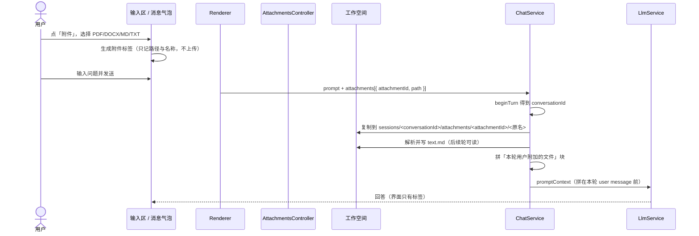

# 会话附件设计

## 1. 流程



## 2. 存储与引用

| 项 | 值 |
|---|---|
| 目录 | `<configDir>/sessions/<conversationId>/attachments/<attachmentId>/` |
| 原文件 | `<原名>`，保留；`<configDir>` 默认 `~/.tech-forge`，可被 `TEACHFORGE_CONFIG_DIR` 覆盖 |
| 提取正文 | 写到同目录 `text.md`，供后续轮的 `read`/`grep` 使用；本轮注入的是它开头的一部分 |
| 引用 | `{attachmentId, name, characters, injectedCharacters}`，`attachmentId` 由渲染层在挑选时生成，目录名与消息引用因此一致 |
| 持久化 | user 行 `contextRefsJson.attachments` |
| 生命周期 | 删除会话时随 `sessions/<会话ID>/` 一并删除 |

写入发生在发送时：上传时机受会话 ID 约束——新会话在 `beginTurn` 之前不存在，挑选时无法确定目录。

## 3. 为什么注入 user message，而不进 system prompt

最初把正文拼在 system prompt 末尾，理由是"本轮结束即消失"。实测两个问题：system prompt 每轮变化会打断 provider 的前缀缓存（该轮与下一轮都要全量 prefill）；system prompt 只该承载规则，数据放进去会让模型把文档当指令。

现在改为：`ChatService` 把材料放进 `LlmRequestOptions.promptContext`，`LlmService` 拼在本轮 user message 前面（`## 用户输入` 之后是用户原话）。SQLite 里的 user 行仍是干净文本；Pi 会话会把拼好的文本记成一条 user entry，因此保存 `pi_session_snapshots` 前用 `replaceInjectedUserText` 把最后一条 user 消息还原为纯用户文本（只换 `message.content`，保留 id/parentId/timestamp）。下一轮从快照恢复的就是干净历史，成本只在本轮。

这同时回答了"界面上怎么展示"——不需要过滤，也不需要 XML 标签：正文从未进入任何传给渲染层的通道。

## 4. 已知风险（有意接受）

- **注入上限 40000 字符**：最初整篇注入，实测一份长附件会让请求超出上下文——Pi 触发压缩后仍无法压缩本轮新正文，最终 `getLastAssistantText()` 为空并以 `Pi SDK completed without returning assistant text.` 失败。现在按顺序截断并告知模型可见范围，后面的文件整体跳过。仍是经验值，长对话叠加长附件时可能复现。
- **解析同步**：导入请求等待解析完成才返回（大 PDF 几十秒），期间标签显示"解析中"、发送按钮禁用。
- **附件不进资料库**：无法用 `/查询资料库` 再次检索它；后续轮只能靠模型对上一轮回答的记忆。

## 5. 代码落点

| 位置 | 内容 |
|---|---|
| `apps/backend/src/attachments/` | 新模块：`storeForConversation`（复制 + 解析）；无 HTTP 入口 |
| `apps/backend/src/chat/dto/chat-prompt.dto.ts` | `attachments?: {attachmentId, path}[]`（≤10、UUIDv4 + 绝对路径） |
| `apps/backend/src/chat/chat.service.ts` | `storeForConversation` → `renderAttachmentContext` → 写 refs → 传入 LlmService |
| `apps/backend/src/llm/llm.service.ts` | `LlmRequestOptions.promptContext` 拼进本轮 user message；系统提示词保持稳定 |
| `apps/backend/src/llm/session-entries.ts` | `replaceInjectedUserText`：保存快照前把注入的 user 文本还原 |
| `apps/backend/src/conversations/*` | user 行投影 `attachments: [{attachmentId, name}]` |
| `apps/desktop/src/features/agent/ComposerAttachments.tsx` | 附件按钮、输入区标签、气泡内标签 |
| `apps/desktop/src/features/agent/attachment-store.ts` | 待发送/已发送两个 store |
| `apps/desktop/electron/*`、`types/desktop-bridge.ts` | `streamChat` 第 4 参数 `attachments[{attachmentId, path}]`，Main 校验后写进请求体 |

## 6. 后续轮的读取范围

正文只注入承载它的那一轮，所以之后每次请求都附带一段指针：

```
## 本会话可读取的附件
- 《长讲义》：…/sessions/<会话ID>/attachments/<附件ID>/text.md（共 82,431 字，已注入 40,000 字）
需要超出已提供范围的内容时，用 read 读取该路径（可带 offset/limit 分段），或用 grep 搜索关键词。
```

- 数据来源：历史 user 行的 `contextRefsJson.attachments`，`beginTurn` 汇总并按附件取各轮最大值。
- `read` 支持 `offset`/`limit` 并按行/字节截断；`grep` 接受绝对路径。附件目录不在受保护目录内，两者都能读。
- 工具是模型可选的：它可能不调用就直接回答，因此这是"可用的后备"，不是强保证。
- 已知缺口：同一机制也让模型能读到别的会话的 `sessions/<其他ID>/`；收紧需要单独的工具边界改动。
