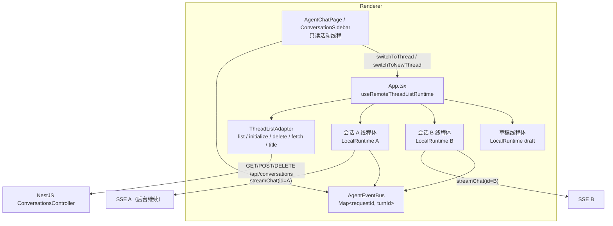

# 多会话并行（后台生成）设计

## 1. 背景

当前 Agent 页面是「一个全局运行时 + 一个线程」：`App.tsx` 只创建一个 `useLocalRuntime(agentChatAdapter)`，页面用它承载唯一的对话视图。恢复历史、切换会话、新建课题都靠同一个 `runtime.thread.reset(...)` 覆盖消息。

用户发起一轮生成后，页面按 `thread.isRunning` 把整个侧栏置灰：不能切换、不能新建、不能翻页。用户视角是「被一个 Agent 卡住」，而实际后端可以同时处理多个会话。

本文设计目标是在不改变后端持久化语义的前提下，把桌面端升级为「每个会话一个运行时」，让未选中的会话继续生成，并且活动状态、产物、附件草稿都按会话隔离。

## 2. 问题拆解与证据

### 2.1 置灰链路

| 层 | 事实 | 证据 |
|---|---|---|
| 运行时 | 全局仅一个 `useLocalRuntime`，即一个线程与一个 `isRunning` | `apps/desktop/src/App.tsx:10` |
| 页面 | 运行中拒绝切换、新建、翻页 | `AgentChatPage.tsx:117,208,342` |
| 侧栏 | `isBusy = isRunning \|\| isHistoryLoading \|\| isInitialListLoading`，整列与新建按钮 `disabled` | `AgentChatPage.tsx:408`、`ConversationSidebar.tsx:50,117,184` |
| 活动状态 | `AgentEventBus` 单 `activeRequestId` / `activeTurnId` | `agent-event-bus.ts` |
| 输入草稿 | 附件、斜杠命令为模块级单例 store | `attachment-store.ts`、`composer-command-store.ts` |

### 2.2 为什么不能只去掉 `disabled`

| 风险 | 发生方式 |
|---|---|
| 后台流写错会话 | `agent-chat-adapter.ts:76` 取全局 `activeConversationId`；`conversation` 事件还会 `setActiveConversationId`（`:90`），把视图切到后台会话 |
| 活动状态互相覆盖 | 第二个 run 的 `begin()` 覆盖第一个的 `activeRequestId`，第一个的 `publish()` 被丢弃；第一个结束时的 `clear()` 也可能清错槽位 |
| 迟到增量落入新线程 | `thread.reset()` 不中止 run（assistant-ui `local-thread-runtime-core.test.ts` 的 reset/import 流式用例），未结束的响应会把增量写回重置后的线程 |
| 附件串会话 | 全局附件草稿在 A 选择、在 B 发送 |
| 历史恢复互相清空 | `artifactHistoryStore.setFromHistory()` 整表替换；后加载的会话会抹掉先加载会话的产物标签 |

结论：必须先把「运行态、消息、历史加载、输入草稿、产物标签」按会话隔离，才允许放开导航。

### 2.3 后端已具备的能力

| 能力 | 现状 | 证据 |
|---|---|---|
| 跨会话并行 | 锁按 `conversationId` 分桶；不同会话互不等待 | `chat.service.ts:46,743-760` |
| 同会话串行 | 同 ID 后续请求排在前一请求之后，并记录 `chat.conversation.queue.waiting` | `chat.service.ts:117-137` |
| LLM 会话隔离 | 每次 `stream()` 创建独立 Pi session，无共享运行态 | `llm.service.ts:183-`、`createSession` |
| Electron 多流 | `Map<requestId, ActiveChatStream>`，每条流独立 AbortController 与端口 | `main.ts:59,430-445` |
| 会话创建 | `beginTurn(createIfMissing)` 在首次轮次内创建行 | `conversations.service.ts:517-560` |
| 标题 | 列表按首条用户消息派生，缺省 `新对话` | `conversations.service.ts:104-160` |

唯一缺口是「第一次发送之前拿不到会话 ID」：多线程运行时的 `initialize` 必须先返回 `remoteId`，而现有创建发生在 `beginTurn` 内部。

## 3. 目标与非目标

### 3.1 目标

- G1：生成中的会话不阻塞其他会话的切换、新建、发送、翻页、删除（删除受保护场景除外）。
- G2：切走的会话继续生成；切回后消息、工具活动、耗时、产物完整。
- G3：活动状态、历史加载、附件/命令草稿、产物标签按会话隔离，互不覆盖。
- G4：侧栏能表达每个会话的运行态，而不是全局忙碌。
- G5：后端仍保持「同会话串行、跨会话并行」；运行中的会话不可删除。
- G6：重启应用能恢复上次活动会话；不新增数据库表与迁移。

### 3.2 非目标

- 不做跨窗口、跨进程或应用重启后的后台运行恢复。
- 不改 SSE 事件契约的语义，不新增事件类型。
- 不改模型上下文构建、附件注入、知识库检索、产物索引。
- 不引入并发上限之外的调度器或任务队列。

## 4. 方案选择

| 方案 | 做法 | 优点 | 代价/风险 | 结论 |
|---|---|---|---|---|
| A. 多线程运行时 | `useRemoteThreadListRuntime` + 每线程 `useLocalRuntime`，`backgroundThreads` 常开 | 后台运行、每项运行态、历史切换均为上游实现；与现有 ThreadPrimitive 兼容 | 一次性重构页面状态归属 | **采用** |
| B. 自建运行时池 | 页面维护 `Map<conversationId, LocalRuntime>`，用隐藏组件常驻 | 不依赖上游线程列表 | 需自行实现选择、运行态、列表刷新、生命周期，重复 A 的工作 | 备选，不推荐 |
| C. 后端运行注册表 | 把 run 从 SSE 请求中解耦，前端按会话订阅/重连 | 可覆盖应用重启 | 牵动 Pi session 生命周期、取消、恢复协议，超出需求 | 不做 |
| D. 仅放开 UI | 删除 `disabled` 与 `isRunning` 守卫 | 改动最小 | 串流、状态覆盖、消息丢失，见 §2.2 | 不可行 |

选择 A 的关键依据（已安装 `@assistant-ui/react@0.15.32`）：

- client 模式固定传 `backgroundThreads: true`：`RemoteThreadListRuntimeThreads.ts:90`。
- 上游对该模式的描述：访问过的线程保持挂载，切走后 run 继续，每项 `isRunning` 实时；删除/解除挂载才回收。
- 每个线程体通过 `useLocalRuntime` 拿自己的运行时；`__internal_setGetThreadId` 把 `remoteId` 作为 `unstable_threadId` 传给适配器：`useLocalRuntime.ts:86`、`local-thread-runtime-core.ts:1530`。
- 列表项状态明确包含「切走后仍在运行」的 `isRunning`：`bindings.ts:38-52`。
- 新线程的 `initialize` 在首次发送时被 await，随后才启动 run：`RemoteThreadListRuntimeThreads.test.tsx`「initializes a new thread through the adapter when its composer sends」。

## 5. 总体架构



### 5.1 状态归属

| 状态 | 现状 | 目标归属 |
|---|---|---|
| 会话列表、当前选择 | `conversationStore`（全局快照 + localStorage） | `runtime.threads`（列表）+ `onThreadIdChange`（持久化） |
| 消息、`isRunning`、composer 文本 | 单个 `LocalRuntime` | 每个线程体一个 `LocalRuntime` |
| 历史加载 / 翻页 | 页面级 `loadConversation` / `loadEarlierMessages` | 线程体挂载时加载；翻页仍由页面驱动活动线程 |
| 工具活动与耗时 | `AgentEventBus` 单活动槽 | `AgentEventBus` 按 request 映射到 turn |
| 附件草稿、斜杠命令 | 全局单例 store | 按线程 ID 键控 |
| 产物标签 / 产物列表 | 全局 tabs + `artifactListStore` | tabs 按会话命名空间；列表已按会话查询 |
| 活动会话持久化 | `teachforge.agent.activeConversationId` | 同 key，值改为线程 `remoteId`；草稿存 `null` |

## 6. 详细设计

### 6.1 后端

#### 6.1.1 创建会话接口

```
POST /api/conversations
→ 201 { "conversationId": "<uuid-v4>" }
```

- `ConversationsService.createConversation()` 插入 `ConversationEntity { id: randomUUID(), title: null, metadataJson: null }`，不写消息。
- 只由线程列表的 `initialize` 调用；`initialize` 在首次发送时触发，因此「新建后未发送」的草稿不会生成空会话行。
- 列表标题继续由首条用户消息派生；创建后、首条消息前显示 `新对话`。
- 不新增请求体 DTO；鉴权、错误封装沿用现有 Controller。

#### 6.1.2 删除保护

把会话锁从 `ChatService` 私有字段提取为共享注册表，避免 `ConversationsController` 反向依赖 `ChatService` 造成循环依赖：

- 新 `ConversationRunRegistry`（`apps/backend/src/conversations/conversation-run-registry.ts`）提供：
  - `acquire(conversationId): Promise<release>`：同 ID 排队，不同 ID 并行（迁入现有 `conversationTails` 逻辑）。
  - `isBusy(conversationId): boolean`：锁被持有或存在排队请求。
- `ChatService` 改为注入并使用该注册表，删除自己的 `conversationTails`。
- `ConversationsService.deleteConversation()` 在事务前检查 `isBusy`，命中抛 `ConflictException`（409，message：`该会话正在生成回复，请先停止后再删除。`）。
- 竞态处理：若检查后 run 才开始，该轮因会话行已删除会在 `beginTurn` 得到 404 并正常失败；不会产生孤儿写入。

#### 6.1.3 保持不变的并发规则

- 同一 `conversationId`：串行排队，日志保留 `chat.conversation.queue.waiting` / `acquired`。
- 不同 `conversationId`：并行；`LlmService.stream()` 的 session、workspace、持久化回调均为请求级。
- SSE 断开会中止对应 Pi run（现有行为）；后台会话的 SSE 不断开，因为线程体保持挂载、adapter 生成器继续消费。
- `DELETE` 之外的写接口（知识范围）不改。

### 6.2 桌面线程列表适配器

新增 `apps/desktop/src/features/agent/thread-list-adapter.ts`，实现 `RemoteThreadListAdapter`。迁移后删除 `conversation-store.ts` 的「活动 ID + 列表快照」职责。

| 适配器方法 | 后端 | 说明 |
|---|---|---|
| `list` | `GET /api/conversations` | `{ id, title, updatedAt }` → `{ remoteId: id, title, lastMessageAt: new Date(updatedAt), status: 'regular' }` |
| `initialize` | `POST /api/conversations` | 返回 `{ remoteId: conversationId }`；发送路径会 await 后才启动 run |
| `delete` | `DELETE /api/conversations/:id` | 409 原样抛错，侧栏提示且保留该行 |
| `fetch` | 列表查询后按 ID 匹配 | 供 `reloadMainThread` 等；若调用频繁再补单会话摘要接口 |
| `rename` | 无操作 | 标题由后端派生，UI 不提供重命名 |
| `generateTitle` | `GET /api/conversations` 取派生标题 | 见 §6.6；实现时二选一并验收 |
| `archive` / `unarchive` | 不提供 | 适配器省略这两项 |

约束：

- 适配器必须是**稳定引用**（模块常量或 `useMemo`），否则每次渲染都会重载列表并丢弃缓存线程。
- 列表不分页（当前后端返回全部）；`loadMore` 不实现。
- `list` 失败时保留 `runtime.threads.getState().loadError`，侧栏显示错误与重试（`runtime.threads.reload()`）。

### 6.3 每线程运行时

#### 6.3.1 运行时创建

`App.tsx`：

```tsx
const runtime = useRemoteThreadListRuntime({
  adapter: threadListAdapter,
  runtimeHook: useConversationRuntime,
});
```

`useConversationRuntime`（新文件 `conversation-runtime.ts`）：

```tsx
const useConversationRuntime = () => {
  const aui = useAui();
  const runtime = useLocalRuntime(agentChatAdapter);
  useEffect(() => {
    const conversationId = aui.threadListItem.getState().remoteId;
    if (!conversationId) return;
    // 草稿被 initialize 提升为真实 ID 时，run 可能已经开始：有消息或正在运行就跳过。
    const thread = runtime.thread.getState();
    if (thread.isRunning || thread.messages.length > 0) return;
    void conversationHistoryStore.load(runtime, conversationId);
  }, [aui, runtime]);
  return runtime;
};
```

- `useLocalRuntime` 位于线程体作用域内，会自动把 `remoteId` 注入 `unstable_threadId`（`:86`）。
- composer 文本状态天然随线程运行时隔离；切回线程时草稿仍在（需在验收中确认）。
- 历史加载只在该线程体**首次挂载且为空**时执行；常驻线程体不会重复加载，也不会在运行中 `reset`。

#### 6.3.2 历史加载与翻页

把 `AgentChatPage` 中的加载逻辑迁移为 `conversation-history-store.ts`（模块级 `Map<threadId, entry>`）：

| 能力 | 实现 |
|---|---|
| 首次加载 | `GET /api/conversations/:id/messages`（最近 30 条），校验 DTO 后 `runtime.thread.reset(rows.map(toThreadMessage))` |
| 恢复附属状态 | `restoreHistoryToolActivities`、`restoreHistoryAttachments`、`artifactHistoryStore.mergeFromHistory` |
| 翻页 | 页面用活动线程的 `remoteId` + 最早已加载消息 ID 请求前一页，合并去重后 `runtime.thread.reset([...earlier, ...current])`，并恢复滚动锚点 |
| 错误 | 每线程记录 `{ phase, message, retryable }`，页面只渲染活动线程的错误与重试 |
| 404 | 刷新线程列表；若该会话已不存在，切到草稿并提示 |

`isConversationHistoryPage` 等校验函数从页面移入 `conversation-store` 的替代模块，逻辑不变。

为什么不用 `adapters.history`：它的 `scopeId` 在「草稿 → 真实 ID」变化时会触发运行时 `resetHistoryScope`（`local-thread-runtime-core.ts:494-514`），内部会 `cancelRun()` 并清空仓库，与首条消息的发送时序冲突。每线程一个加载器可以显式避开这一时序。

#### 6.3.3 新建、切换与恢复

- 新建：`runtime.threads.switchToNewThread()` 创建草稿；发送时 `initialize` 创建后端会话并拿到 `remoteId`。
- 切换：`runtime.threads.switchToThread(id)`；失败写入 `threads.getState().switchError`，页面显示重试。
- 持久化：监听 `onThreadIdChange`，仅当值非空写入 `teachforge.agent.activeConversationId`；草稿写 `null`。
- 恢复：应用挂载后 `await runtime.threads.getLoadThreadsPromise()`，若保存的 ID 仍在列表中则 `switchToThread`；否则清空存储并停留草稿。不依赖已废弃的 `initialThreadId`。
- 删除活动会话：`item.delete()` 后切换草稿并清理该线程的输入/历史缓存。

### 6.4 全局状态改造

#### 6.4.1 AgentEventBus

```ts
begin(turnId: string, requestId?: string): void
publish(requestId: string, event: ChatStreamEvent): void
clear(requestId: string): void
getTurnSnapshots(): AgentActivityState
clearArtifacts(turnId: string): void
```

- 新增 `private readonly activeByRequest = new Map<string, string>()`，`publish`/`clear` 通过 request 查 turn，删除单 `activeRequestId` / `activeTurnId`。
- 快照仍按 `turnId` 存储；`begin` 不覆盖其他 request 的记录。
- 删除 `getSnapshot()`；页面不再使用全局活动槽。
- `clearArtifacts(turnId)` 只清该轮产物；历史加载不再影响其他会话的实时产物页脚。

页面展示：

- `AgentActivity`（user 消息下的工具明细）继续用 `activity[message.id]`，天然按消息隔离。
- `TurnProgress` 与 `LiveArtifactFooter` 改为读取「活动线程最后一条 user 消息 ID」对应的快照；该 ID 通过 `useAuiState` 选择器或 `runtime.thread.getState().messages` 派生。线程切换后自动指向新线程，不会显示后台线程的进度。

#### 6.4.2 输入草稿

| Store | 改造 |
|---|---|
| `composerAttachmentStore` | `Map<threadId, AttachmentDraft[]>`：`list/add/remove/reset` 全部带 key；发送时 adapter 用 `unstable_threadId` 取对应草稿，发送后只清该 key |
| `composerCommandStore` | 同上，`/查询资料库` 命令按线程保存与清除 |
| `sentAttachmentStore` | 继续按 user message ID 记录，跨线程安全（消息 ID 唯一） |

线程 key 取活动线程的运行时 ID（优先 `remoteId`，草稿阶段使用线程列表项 ID）；具体选择器在实现时以类型定义为准。

#### 6.4.3 产物状态

| Store | 改造 |
|---|---|
| `artifactHistoryStore` | `setFromHistory` 由「整表替换」改为「按 messageId 合并」；消息 ID 全局唯一，多会话加载不会互相清空 |
| `artifactTabsStore` | 以 conversationId 为命名空间保存/恢复 tabs，切换线程时切换命名空间，避免 A 的标签出现在 B |
| `artifactListStore` | 已按 `conversationId` 查询，保留；页面用活动线程 `remoteId` 触发加载 |
| `agentEventBus` 产物 | 见 §6.4.1，按 turn 清理 |

### 6.5 UI 设计

#### 6.5.1 侧栏

| 元素 | 行为 |
|---|---|
| 「新建课题」 | 始终可用（列表加载失败也可用）；点击切到草稿线程 |
| 会话行 | 非运行行始终可点击；运行行同样可点击，用于查看实时输出 |
| 运行指示 | 行尾显示小型转圈（`threads.getItemById(id).getState().isRunning`），不使用整列透明 |
| 删除菜单 | 仅对「运行中」的行禁用，提示「生成中，先停止再删除」；其他行保持可用 |
| 刷新 | 仅列表加载中禁用 |
| 列表加载态 | 首次加载显示骨架/占位；失败显示错误 + 重试，不阻塞新建 |

运行态更新依赖线程列表在 run 边界发出的通知（上游 `RemoteThreadListHookInstanceManager` 的既有测试覆盖「切走的线程仍在跟踪 run，并只在跨越运行边界时通知列表」）。

#### 6.5.2 主区域

- 标题：活动线程项的 `title`；空标题回退 `新对话`。
- 历史加载：活动线程有自己的 `isLoading`（正文区域显示「正在加载历史消息…」），不阻塞其他会话发送。
- 翻页按钮：仅受活动线程的 `isRunning` / 翻页请求状态影响。
- 发送/停止：`AuiIf state.thread.isRunning` 只反映当前线程；停止只取消当前线程的 SSE。
- 空状态、产物入口、知识库/设置切换保持现状；打开其他视图不会卸载线程体，后台生成继续。

#### 6.5.3 可访问性

- 运行指示提供 `aria-label`（如「正在生成」）或 `sr-only` 文本。
- 禁用删除提供 `title` 与 `aria-disabled` 语义。
- 切换会话时焦点保持在侧栏行，避免跳回输入框。

### 6.6 标题、刷新与排序

- 标题唯一来源是后端列表的派生值；桌面端不维护第二份标题。
- 每轮结束（adapter `finally` 或 `unstable_subscribeThreadEvents` 的 `runEnd`）触发一次去抖的 `runtime.threads.reload()`，使：
  - 首轮结束后侧栏标题变为派生标题；
  - 会话按 `updatedAt` 前移；
  - 后台完成的会话无需切换即可更新。
- `rename` 为无操作；`generateTitle` 读取后端派生标题并作为单段流返回。若实现时发现自动标题流程与列表刷新冲突，退化方案是返回空流并完全依赖 `reload()`（列入开放问题）。

### 6.7 错误处理

| 场景 | 表现 |
|---|---|
| 列表加载失败 | 侧栏错误 + 重试；新建仍可用 |
| 历史加载失败 | 仅该线程正文显示错误与重试；其他会话不受影响 |
| 历史 404 | 刷新列表；会话不存在则切换草稿并提示 |
| 发送初始化失败 | 该轮发送失败，错误显示在该线程；不创建会话行 |
| 流式错误 | 现有 assistant 错误气泡；adapter `finally` 结束该 request 的活动状态并刷新列表 |
| 切换失败 | `switchError` 对应的行显示重试；保留当前线程 |
| 删除 409 | 侧栏行内提示「生成中，先停止」；不删除本地项 |
| 应用重载 | 所有 SSE 断开，行为与现状一致；重启后恢复上次会话 ID（若仍存在） |

## 7. 契约

### 7.1 HTTP

| 方法 | 路径 | 请求 | 响应 | 错误 |
|---|---|---|---|---|
| `POST` | `/api/conversations` | 无体 | `201 { conversationId }` | 500 |
| `DELETE` | `/api/conversations/:conversationId` | 无 | `200 { conversationId, sessionCleanup }`（现有） | 404、**409 运行中** |

Electron 侧复用通用 `window.teachforge.request`，无需新增 IPC 通道；`streamChat` 契约不变。

### 7.2 运行时适配器

- `agentChatAdapter.run` 的会话 ID 来源改为 `unstable_threadId`。
- 删除对 `conversationStore.getSnapshot().activeConversationId` 的读取与 `conversation` 事件的 `setActiveConversationId` 回写；`conversation` 事件仍可能到达，适配器忽略（或仅做一致性断言）。
- 发送后按 `unstable_threadId` 清理附件/命令草稿。

### 7.3 本地存储

| Key | 值 | 写入时机 |
|---|---|---|
| `teachforge.agent.activeConversationId` | `remoteId` 或 `null` | `onThreadIdChange` |

## 8. 并发与生命周期规则

1. 不同会话的 run 可同时存在；后端与 Electron 均已支持。
2. 同一会话的第二次发送由后端排队；UI 的发送按钮在该线程 `isRunning` 时禁用，排队仅可能来自多窗口等异常路径。
3. 删除运行中的会话：UI 阻止，后端 409 兜底；停止或结束后才可删除。
4. 停止生成只中止当前线程；后台线程的停止入口本轮不做。
5. 线程体只在线程列表删除/解除挂载时回收；访问过的线程在 renderer 生命周期内常驻（消息量级可控）。
6. 应用退出/重载中止全部 run；不做断线恢复。

## 9. 迁移与代码落点

### 9.1 后端

| 文件 | 变更 |
|---|---|
| `apps/backend/src/conversations/conversations.controller.ts` | 新增 `POST /conversations`；删除接口 409 透传 |
| `apps/backend/src/conversations/conversations.service.ts` | 新增 `createConversation()`；删除前检查 `isBusy` |
| `apps/backend/src/conversations/conversation-run-registry.ts` | 新增：会话锁/忙碌查询 |
| `apps/backend/src/chat/chat.service.ts` | 用注册表替换私有 `conversationTails`；行为与日志不变 |
| `apps/backend/test/conversation-*.test.cjs` | 新增创建接口、运行中删除 409 的回归 |

### 9.2 桌面

| 文件 | 变更 |
|---|---|
| `apps/desktop/src/App.tsx` | 改用 `useRemoteThreadListRuntime`；注册列表刷新回调 |
| `apps/desktop/src/features/agent/thread-list-adapter.ts` | 新增：列表/初始化/删除/标题 |
| `apps/desktop/src/features/agent/conversation-runtime.ts` | 新增：`runtimeHook` + 首次历史加载 |
| `apps/desktop/src/features/agent/conversation-history-store.ts` | 新增：按线程的历史加载、翻页、错误（从页面迁出） |
| `apps/desktop/src/features/agent/agent-chat-adapter.ts` | 用 `unstable_threadId`；按线程清理草稿；结束时通知列表刷新 |
| `apps/desktop/src/features/agent/agent-event-bus.ts` | 多 request 活动映射；移除全局槽 |
| `apps/desktop/src/features/agent/attachment-store.ts`、`composer-command-store.ts` | 按线程键控 |
| `apps/desktop/src/features/agent/artifact-store.ts` | 历史合并；tabs 按会话命名空间 |
| `apps/desktop/src/features/agent/AgentChatPage.tsx` | 删掉 `loadConversation` / `startNewConversation` / 全局 `isBusy`；改用线程列表与活动线程 |
| `apps/desktop/src/features/agent/ConversationSidebar.tsx` | 行级运行态；只禁用运行行的删除；新建不再受运行影响 |
| `apps/desktop/src/features/agent/conversation-store.ts` | 删除（职责拆分到适配器/历史 store/持久化） |
| `apps/desktop/src/features/agent/ArtifactSidebar.tsx` | 活动会话改读线程列表 |

## 10. 验收标准

### 10.1 功能

| # | 场景 | 期望 |
|---|---|---|
| 1 | A 发起长回复，切到 B 发送 | 两条流并行；B 不被 A 阻塞；A 结束后切回可见完整文本、工具、产物 |
| 2 | A 运行中点「新建课题」并发送 | 建立新会话；A 不受影响 |
| 3 | A 运行中打开历史会话并翻页 | 历史加载与翻页只作用于该会话；A 继续 |
| 4 | 停止 A | 仅 A 变为 cancelled；B 继续；A 的后端日志出现 cancelled 终态 |
| 5 | 运行中删除 A | 侧栏禁用；强行请求返回 409；停止后可删除并清理目录 |
| 6 | A、B 各自选择附件/命令 | 发送互不串；气泡标签正确 |
| 7 | A 后台生成时切到 B，再切回 A | 不重复加载历史、不丢增量；进度与耗时正确 |
| 8 | 重启应用 | 恢复上次活动会话；不恢复运行中的 run |
| 9 | 删除最后一条会话 | 自动切草稿，输入区可用 |
| 10 | 同会话连发 | 后端排队，UI 只锁该会话发送 |

### 10.2 回归

- `npm run test:agent-stream --workspace @teachforge/desktop`
- `npm run test:conversation-history --workspace @teachforge/desktop`
- `npm run test:backend-request --workspace @teachforge/desktop`
- 后端相关 `apps/backend/test/*.cjs` 既有套件。
- 手工检查日志：不同 `conversationId` 的 `chat.turn.*` 时间重叠；同 ID 出现 queue 事件。

## 11. 风险与已知限制

| 风险 | 影响 | 处置 |
|---|---|---|
| 并发请求数上涨 | provider 限流、CPU/内存上升 | 本轮不做上限；观察日志后再决定是否加并发闸门 |
| 常驻线程体 | 访问会话越多，renderer 内存越高 | 单会话仅保留消息列表；后续可对空闲线程 `detach`（会丢翻页态） |
| 草稿提升时序 | `initialize` 后线程体可能重建 | 以上游测试为准验收首轮；历史加载带「运行中/有消息则跳过」保护 |
| 标题双写 | 自动标题与列表派生标题冲突 | 以列表派生为唯一来源；`rename` 无操作；冲突时退化 `generateTitle` 为空流 |
| 删除竞态 | 会话刚被删除时请求仍到达 | `beginTurn` 抛 404，run 干净失败；不产生残留 |
| 页面级选择器 | `threadListItem` / `threads` 的具体选择器写法可能随版本演进 | 优先使用公开的 `runtime.threads` 订阅与 `getState()`；实现时以类型为准 |
| 跨应用重启 | run 不恢复 | 明确非目标 |

## 12. 开放问题

1. **自动标题**：`generateTitle` 回吐后端派生标题，还是返回空流并依赖 `reload()`？默认前者，实现时用一个会话验收两种表现。
2. **删除保护位置**：是否还需要在前端做二次确认（目前删除无确认）？默认保持现状，只增加「运行中不可删」。
3. **空闲线程回收**：是否在会话数超过阈值时 `detach` 未访问线程？默认不做，记录为后续优化。

## 13. 文档同步

实现落地后：

- 更新 `docs/current/platform/agent-runtime.md`：运行时归属、并发规则、状态归属、删除保护。
- 更新 `docs/current/domains/conversations/api-contract.md`：`POST /api/conversations`、删除 409。
- 更新 `docs/current/domains/conversations/backend-behavior.md`：会话锁注册表与忙碌判定。
- 在 `docs/changes/README.md` 与本目录补 `verification.md` / `worklog.md`（实施阶段产出）。
