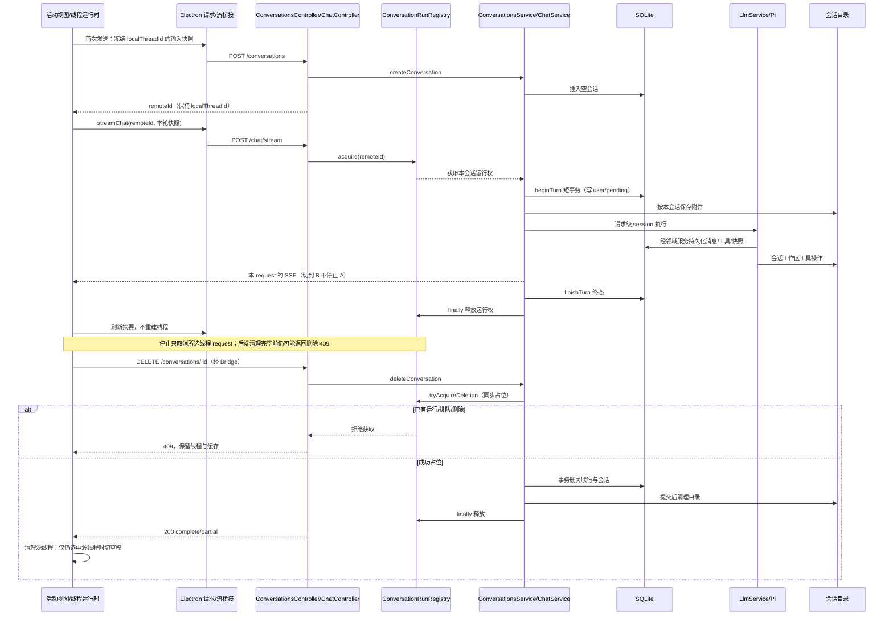

# 多会话并行（后台生成）设计

## 1. 背景

当前 Agent 页面是「一个全局运行时 + 一个线程」：`App.tsx` 只创建一个 `useLocalRuntime(agentChatAdapter)`，页面用它承载唯一的对话视图。恢复历史、切换会话、新建课题都靠同一个 `runtime.thread.reset(...)` 覆盖消息。

用户发起一轮生成后，页面按 `thread.isRunning` 把整个侧栏置灰：不能切换、不能新建、不能翻页。用户视角是「被一个 Agent 卡住」，而实际后端可以同时处理多个会话。

本文设计目标是在不改变后端持久化语义的前提下，把桌面端升级为「每个会话一个运行时」，让未选中的会话继续生成，并且活动状态、产物、附件草稿都按会话隔离。

## 2. 问题拆解与证据

### 2.1 置灰链路

| 层 | 事实 | 证据 |
|---|---|---|
| 运行时 | 全局仅一个 `useLocalRuntime`，即一个线程与一个 `isRunning` | `apps/desktop/src/App.tsx:10` |
| 页面 | 运行中拒绝切换、新建、翻页 | `AgentChatPage.tsx:117,208,342` |
| 侧栏 | `isBusy = isRunning \|\| isHistoryLoading \|\| isInitialListLoading`，整列与新建按钮 `disabled` | `AgentChatPage.tsx:408`、`ConversationSidebar.tsx:50,117,184` |
| 活动状态 | `AgentEventBus` 单 `activeRequestId` / `activeTurnId` | `agent-event-bus.ts` |
| 输入草稿 | 附件、斜杠命令为模块级单例 store | `attachment-store.ts`、`composer-command-store.ts` |

### 2.2 为什么不能只去掉 `disabled`

| 风险 | 发生方式 |
|---|---|
| 后台流写错会话 | `agent-chat-adapter.ts:76` 取全局 `activeConversationId`；`conversation` 事件还会 `setActiveConversationId`（`:90`），把视图切到后台会话 |
| 活动状态互相覆盖 | 第二个 run 的 `begin()` 覆盖第一个的 `activeRequestId`，第一个的 `publish()` 被丢弃；第一个结束时的 `clear()` 也可能清错槽位 |
| 迟到增量落入新线程 | 在活动 run 中复用运行时并 reset 存在覆盖风险；原稿引用的 SDK 测试本次未复核，方案禁止这种交错 |
| 附件串会话 | 全局附件草稿在 A 选择、在 B 发送 |
| 历史恢复互相清空 | `artifactHistoryStore.setFromHistory()` 整表替换；后加载的会话会抹掉先加载会话的产物标签 |

结论：必须先把「运行态、消息、历史加载、输入草稿、产物标签」按会话隔离，才允许放开导航。

### 2.3 后端已具备的能力

| 能力 | 现状 | 证据 |
|---|---|---|
| 跨会话并行 | 锁按 `conversationId` 分桶；不同会话互不等待 | `chat.service.ts:46,743-760` |
| 同会话串行 | 同 ID 后续请求排在前一请求之后，并记录 `chat.conversation.queue.waiting` | `chat.service.ts:117-137` |
| LLM 会话隔离 | 每次 `stream()` 创建独立 Pi session，无共享运行态 | `llm.service.ts:183-`、`createSession` |
| Electron 多流 | `Map<requestId, ActiveChatStream>`，每条流独立 AbortController 与端口 | `main.ts:59,430-445` |
| 会话创建 | `beginTurn(createIfMissing)` 在首次轮次内创建行 | `conversations.service.ts:517-560` |
| 标题 | 列表按首条用户消息派生，缺省 `新对话` | `conversations.service.ts:104-160` |

唯一缺口是「第一次发送之前拿不到会话 ID」：多线程运行时的 `initialize` 必须先返回 `remoteId`，而现有创建发生在 `beginTurn` 内部。

## 3. 目标与非目标

### 3.1 目标

- G1：生成中的会话不阻塞其他会话的切换、新建、发送、翻页、删除（删除受保护场景除外）。
- G2：切走的会话继续生成；切回后消息、工具活动、耗时、产物完整。
- G3：活动状态、历史加载、附件/命令草稿、产物标签按会话隔离，互不覆盖。
- G4：侧栏能表达每个会话的运行态，而不是全局忙碌。
- G5：后端仍保持「同会话串行、跨会话并行」；运行中的会话不可删除。
- G6：重启应用能恢复上次活动会话；不新增数据库表与迁移。

### 3.2 非目标

- 不做跨窗口、跨进程或应用重启后的后台运行恢复。
- 不改 SSE 事件契约的语义，不新增事件类型。
- 不改模型上下文构建、附件注入、知识库检索、产物索引。
- 不引入并发上限配置、调度器或任务队列。

## 4. 方案选择

| 方案 | 做法 | 优点 | 代价/风险 | 结论 |
|---|---|---|---|---|
| A. 多线程运行时 | `useRemoteThreadListRuntime` + 每线程 `useLocalRuntime`，`backgroundThreads` 常开 | 后台运行、每项运行态、历史切换均为上游实现；与现有 ThreadPrimitive 兼容 | 一次性重构页面状态归属 | **采用** |
| B. 自建运行时池 | 页面维护 `Map<conversationId, LocalRuntime>`，用隐藏组件常驻 | 不依赖上游线程列表 | 需自行实现选择、运行态、列表刷新、生命周期，重复 A 的工作 | 备选，不推荐 |
| C. 后端运行注册表 | 把 run 从 SSE 请求中解耦，前端按会话订阅/重连 | 可覆盖应用重启 | 牵动 Pi session 生命周期、取消、恢复协议，超出需求 | 不做 |
| D. 仅放开 UI | 删除 `disabled` 与 `isRunning` 守卫 | 改动最小 | 串流、状态覆盖、消息丢失，见 §2.2 | 不可行 |

方案 A 的 SDK 前提（待实施前核验）：仓库声明 `@assistant-ui/react: ^0.15.32`，本次 checkout 无 node_modules，原稿引用的 SDK 内部行号与测试结论不能作为本次已验证事实。功能契约先确定为：

- 访问过的线程保持运行；切换、摘要刷新和打开设置不卸载线程、不取消流。
- 每线程拥有独立运行态；首次发送等待 initialize 得到 remoteId。
- localThreadId 在草稿提升后保持不变；后端请求只能使用 remoteId。
- 列表更新只合并摘要，不重建已存在的线程；删除失败不丢失本地线程。

实施前须用锁定版本核验上述能力及选择器/事件签名。若 SDK 的 reload 会重建线程，则采用适配层摘要合并，禁止直接在 runEnd 调用破坏性 reload；若稳定线程身份或后台运行前提不成立，应回到方案评审，不静默替换架构。详见 §10.3。

## 5. 总体架构

根运行时管理列表与选择；每个线程独立持有 LocalRuntime、输入和历史状态。端到端交互见 §5.2。

### 5.1 状态归属

| 状态 | 现状 | 目标归属 |
|---|---|---|
| 会话列表、当前选择 | `conversationStore`（全局快照 + localStorage） | `runtime.threads`（列表）+ 活动项选择/remoteId 订阅（持久化） |
| 消息、`isRunning`、composer 文本 | 单个 `LocalRuntime` | 每个线程体一个 `LocalRuntime` |
| 历史加载 / 翻页 | 页面级 `loadConversation` / `loadEarlierMessages` | 线程体挂载时加载；翻页仍由页面驱动活动线程 |
| 工具活动与耗时 | `AgentEventBus` 单活动槽 | `AgentEventBus` 按 request 映射到 turn |
| 附件草稿、斜杠命令 | 全局单例 store | 按线程 ID 键控 |
| 产物标签 / 产物列表 | 全局 tabs + `artifactListStore` | tabs 按会话命名空间；列表已按会话查询 |
| 活动会话持久化 | `teachforge.agent.activeConversationId` | 同 key，值改为线程 `remoteId`；草稿存 `null` |

### 5.2 End-to-End Data Interaction Flow



| 关键节点 | 责任与一致性边界 |
|---|---|
| 线程运行时 | localThreadId 不变；输入快照绑定轮次；历史只向同一存活实例提交 |
| Electron | 每 request 独立端口与取消；不读取全局活动会话来重新路由事件 |
| Controller | 认证、参数校验、HTTP/SSE 映射；不存在的会话在 stream 中沿用安全 error SSE，不伪称 HTTP 404 |
| 注册表 | 单 backend 进程内运行与删除共用互斥；不持久化锁 |
| 领域服务/SQLite | 会话创建与 beginTurn 分开；删除事务先子表后主表；模型调用不在事务中 |
| LlmService/目录 | 请求级 session；副作用无法回滚；删除占位覆盖目录清理 |
| 列表与导航 | 摘要更新和导航分开；后台结果不修改当前选择 |

### 5.3 Frontend Fetching Logic

| 数据 | 读取/更新责任 | 缓存、失败与迟到处理 |
|---|---|---|
| 摘要/title/排序 | ThreadListAdapter 读取 GET /conversations；首轮持久化确认及 runEnd 去抖刷新 | 单个在途读取；期间新触发置 dirty，完成后补一次；版本号防旧响应覆盖。失败保留已有摘要并显示重试；成功只合并元数据 |
| 消息/hasMore | 每线程 history entry，首次最近 30 条，翻页按最早 messageId | §6.3.2 的状态/版本检查；后台允许加载但不能改导航；失败不 reset |
| 工具/附件/产物历史 | 同一历史响应中的投影 | 与消息通过同一个提交校验后合并；不全局清空 |
| 产物列表/预览 | 活动 remoteId 查询现有 artifacts API | 保留现有 requestVersion；tabs 更新显式携带命名空间；后台事件只标记对应会话数据过期 |
| 恢复选择 | 启动读取 localStorage，再等待首次列表成功 | 失败不清除保存 ID；用户主动导航后，迟到恢复不得覆盖用户选择 |

### 5.4 Backend Fetching Logic

- 摘要的 id/createdAt/updatedAt 来自 ConversationEntity；title 保持现有实体标题或首条 user 文本派生规则。读取不写回标题，不引入缓存或逐会话远程请求。
- 历史由 ConversationsService 复用现有有界分页查询与安全投影，messages/hasMore、工具、附件、产物字段语义不变；没有新增全量历史读接口。
- POST 只插入 ConversationEntity 并返回应用生成的 UUIDv4；创建成功不代表首轮消息已落库。DELETE 在占位内执行原事务与目录清理，HTTP 状态不由本地列表推断。
- 注册表是内存运行权来源，不是数据库持久状态；UI isRunning 只作交互提示，删除是否允许以后端同步占位结果为准。

## 6. 详细设计

### 6.1 后端

#### 6.1.1 创建会话接口

```
POST /api/conversations
→ 201 { "conversationId": "<uuid-v4>" }
```

- `ConversationsService.createConversation()` 插入 `ConversationEntity { id: randomUUID(), title: null, metadataJson: null }`，不写消息。
- 只由线程列表的 `initialize` 调用；`initialize` 在首次发送时触发，因此「新建后未发送」的草稿不会生成空会话行。
- 列表标题继续由首条用户消息派生；创建后、首条消息前显示 `新对话`。
- 不新增请求体 DTO；鉴权、错误封装沿用现有 Controller。

#### 6.1.2 删除保护

把会话锁从 `ChatService` 私有字段提取为共享注册表，避免 `ConversationsController` 反向依赖 `ChatService` 造成循环依赖：

- 新 `ConversationRunRegistry`（`apps/backend/src/conversations/conversation-run-registry.ts`）由 ConversationsModule 单例提供并导出，ChatModule 消费同一实例；不能分别注册两份。
  - `acquire(conversationId): Promise<release>`：调用时同步登记运行/等待项，然后异步等待前驱；同 ID 串行，不同 ID 并行。
  - `tryAcquireDeletion(conversationId): release | null`：同步检查并占位，不包含 await；已有运行、排队请求或删除占位时返回 null。删除不排在长任务之后静默执行。
  - `isBusy(conversationId)` 仅用于诊断，不承担删除授权。
- ChatService 持有运行权直至持久化、终态与相关收尾完成，finally 释放；取消排队请求也必须最终释放，不能泄漏尾链。
- deleteConversation 在任何数据库 await 之前取得删除占位；失败返回 409。成功后持有至数据库事务和目录清理结束，所有异常路径 finally 释放。
- 先运行：删除立即 409，运行/排队会话与文件保持完整。先删除：后来 run 排在删除占位后；成功删除后 beginTurn 发现不存在，沿既有安全 error SSE 结束，不重建会话。删除事务失败则后来 run 可在原会话继续。
- 目录清理失败仍返回 `200 { sessionCleanup: 'partial' }`，会话已删除；前端移除线程并提示残留文件，不能伪装成删除失败或恢复不存在的行。
- 停止按钮只发出取消请求；后端释放前删除仍可 409，提示稍后重试。重复删除占位期间返回 409，结束后再删返回 404。

#### 6.1.3 保持不变的并发规则

- 同一 `conversationId`：串行排队，日志保留 `chat.conversation.queue.waiting` / `acquired`。
- 不同 `conversationId`：并行；`LlmService.stream()` 的 session、workspace、持久化回调均为请求级。
- SSE 断开会中止对应 Pi run（现有行为）；后台会话的 SSE 不断开，因为线程体保持挂载、adapter 生成器继续消费。
- `DELETE` 之外的写接口（知识范围）不改。

### 6.2 桌面线程列表适配器

新增 `apps/desktop/src/features/agent/thread-list-adapter.ts`，实现 `RemoteThreadListAdapter`。迁移后删除 `conversation-store.ts` 的「活动 ID + 列表快照」职责。

| 适配器方法 | 后端 | 说明 |
|---|---|---|
| `list` | `GET /api/conversations` | `{ id, title, updatedAt }` → `{ remoteId: id, title, lastMessageAt: new Date(updatedAt), status: 'regular' }` |
| `initialize` | `POST /api/conversations` | 返回 `{ remoteId: conversationId }`；发送路径会 await 后才启动 run |
| `delete` | `DELETE /api/conversations/:id` | 409 原样抛错，侧栏提示且保留该行 |
| `fetch` | 列表查询后按 ID 匹配 | 供 `reloadMainThread` 等；若调用频繁再补单会话摘要接口 |
| `rename` | 无操作 | 标题由后端派生，UI 不提供重命名 |
| `generateTitle` | 无额外请求 | 空流；仅列表摘要提供标题，见 §6.6 |
| `archive` / `unarchive` | 不提供 | 适配器省略这两项 |

约束：

- 适配器必须是**稳定引用**（模块常量或 `useMemo`），否则每次渲染都会重载列表并丢弃缓存线程。
- 列表不分页（当前后端返回全部）；`loadMore` 不实现。
- `list` 失败时保留 `runtime.threads.getState().loadError`，侧栏显示错误与重试（`runtime.threads.reload()`）。

### 6.3 每线程运行时

#### 6.3.1 运行时创建

`App.tsx`：

```tsx
const runtime = useRemoteThreadListRuntime({
  adapter: threadListAdapter,
  runtimeHook: useConversationRuntime,
});
```

`useConversationRuntime`（新文件 `conversation-runtime.ts`）的责任契约：

- 捕获稳定 `localThreadId`，创建稳定的每线程 adapter（闭包持有该 ID）；LocalRuntime 与 history entry 都属于此线程实例。
- `remoteId` 专用于 HTTP/SSE，会话初始化后绑定到同一 localThreadId，不迁移输入草稿键、不重建 LocalRuntime。
- 新草稿标记 `origin=draft`、historyPhase=ready；初始化成功仍不读历史。已有会话标记 `origin=persisted`，必须完成首次历史读取才允许发送。不能用 remoteId 刚出现推断需要加载历史。
- composer 文本由每线程 runtime 保有；附件/命令由 localThreadId 保存。线程切换不清输入、不 reset；列表刷新不改变实例身份。

#### 6.3.2 历史加载与翻页

`conversation-history-store.ts` 维护 `Map<localThreadId, entry>`，entry 绑定 remoteId、实例代次、requestVersion、runEpoch、phase、hasMore 和错误。这里的字段为拟新增内部状态，不是现有 SDK API。

| 状态/动作 | 规则 |
|---|---|
| persisted 首次打开 | idle → loading → ready；失败为 error，保留重试；loading/error 禁止本线程发送 |
| draft | 直接 ready；initialize 前后均不自动 reset 历史 |
| 翻页 | ready 且非运行、非初始化、非删除时进入 paging；禁发、禁止重复翻页；失败回 ready 并保留旧内容及游标 |
| 发送 | 只在 ready 且无互斥操作时接受；同步增加 runEpoch 后才能进入异步初始化/发送 |
| 成功响应 | 校验同一实例存活、remoteId 匹配、requestVersion 最新、runEpoch 未变、非运行/初始化/删除，再无 await 地提交消息和附属状态 |
| 过期响应 | 直接丢弃，不能写 phase/error/工具/附件/产物，也不能导航 |
| 删除开始 | 暂停该线程发送；使在途历史版本失效。成功标记 disposed 并清缓存；失败恢复原内容，未完成的首次加载重新读取 |

首次响应 reset 最近 30 条；翻页将更早消息与提交时当前消息按 ID 去重合并，只有该线程仍可见时恢复滚动锚点。历史工具、附件、产物合并与消息共享同一提交校验。切换本身不使后台线程请求失效；A 的正常响应可以填充 A，但不能改变 B。

历史 404 先标记源线程不可用并刷新摘要。只有刷新成功且确认源 ID 不存在时才清理该线程；只有当前选择仍等于源线程时切草稿。刷新失败保持错误/重试，不把网络失败当作空列表。

采用显式每线程历史加载器以复用现有 DTO 与分页；不依赖尚未核验的 adapters.history scope 重置行为。上述互斥不仅禁用按钮，也在发送/分页入口执行，覆盖 Enter 和程序调用。

#### 6.3.3 新建、切换与恢复

- 新建：`runtime.threads.switchToNewThread()` 创建草稿；发送时 `initialize` 创建后端会话并拿到 `remoteId`。
- 切换：`runtime.threads.switchToThread(id)`；失败写入 `threads.getState().switchError`，页面显示重试。
- 持久化：订阅当前选择及其 remoteId 变化；保存活动项的 remoteId，草稿移除该 key。A 在后台初始化完成不覆盖 B 的选择；活动草稿提升时即使选择 ID 不变也要更新存储。
- 恢复：启动先保存 localStorage 值，首次列表成功前暂停自动持久化；成功后恢复仍存在的 ID，否则清空。使用导航代次判断用户是否已主动选择/新建；发生过则跳过迟到恢复，持久化用户当前选择。列表失败保留保存值供重试，不覆盖成草稿。
- 删除：请求期间禁用目标线程发送和重复删除，不阻止切换。仅后端确认成功或确认已不存在时清理源线程缓存；完成时仍选中源线程才切草稿，已切 B 则保留 B。失败保留本地项和输入；不得让 SDK 的乐观删除提前卸载线程。

### 6.4 全局状态改造

#### 6.4.1 AgentEventBus

```ts
begin(turnId: string, requestId?: string): void
publish(requestId: string, event: ChatStreamEvent): void
clear(requestId: string): void
getTurnSnapshots(): AgentActivityState
clearArtifacts(turnId: string): void
```

- 新增 `private readonly activeByRequest = new Map<string, string>()`，`publish`/`clear` 通过 request 查 turn，删除单 `activeRequestId` / `activeTurnId`。
- 快照仍按 `turnId` 存储；`begin` 不覆盖其他 request 的记录。
- 删除 `getSnapshot()`；页面不再使用全局活动槽。
- `clearArtifacts(turnId)` 只清该轮产物；历史加载不再影响其他会话的实时产物页脚。

页面展示：

- `AgentActivity`（user 消息下的工具明细）继续用 `activity[message.id]`，天然按消息隔离。
- `TurnProgress` 与 `LiveArtifactFooter` 改为读取「活动线程最后一条 user 消息 ID」对应的快照；该 ID 通过 `useAuiState` 选择器或 `runtime.thread.getState().messages` 派生。线程切换后自动指向新线程，不会显示后台线程的进度。

#### 6.4.2 输入草稿

| Store | 改造 |
|---|---|
| `composerAttachmentStore` | `Map<localThreadId, AttachmentDraft[]>`：所有操作带稳定 key；adapter 通过线程闭包取发送快照，remoteId 不用于查草稿 |
| `composerCommandStore` | 同上，`/查询资料库` 命令按线程保存与清除 |
| `sentAttachmentStore` | 继续按 user message ID 记录，跨线程安全（消息 ID 唯一） |

localThreadId 从草稿到正式会话保持不变，历史会话也按其本地线程项 ID 键控。发送入口冻结本轮文本、附件、命令及草稿版本；初始化期间只锁该线程的输入/重复发送，切到 B 不改变快照。已发附件按 userMessageId 保存。

initialize 使用每线程 single-flight，成功记住 remoteId，首轮后续失败重试复用同一会话。POST 明确失败时保留草稿；POST 响应丢失时可能已建空会话，本轮不承诺创建请求跨网络 exactly-once，不自动重试 POST；提示用户重试可能留下可手动删除的空会话。不新增持久幂等表。

只有 streamChat 成功创建本轮 request 后，按快照版本清理源 localThreadId 的草稿；初始化/桥接同步失败保留输入。流中途失败沿现有错误气泡处理，已发附件仍保留在消息标签中，不自动重发。

#### 6.4.3 产物状态

| Store | 改造 |
|---|---|
| `artifactHistoryStore` | `setFromHistory` 由「整表替换」改为「按 messageId 合并」；消息 ID 全局唯一，多会话加载不会互相清空 |
| `artifactTabsStore` | 以 conversationId 为命名空间保存/恢复 tabs，切换线程时切换命名空间，避免 A 的标签出现在 B |
| `artifactListStore` | 已按 `conversationId` 查询，保留；页面用活动线程 `remoteId` 触发加载 |
| `agentEventBus` 产物 | 见 §6.4.1，按 turn 清理 |

### 6.5 UI 设计

#### 6.5.1 侧栏

| 元素 | 行为 |
|---|---|
| 「新建课题」 | 始终可用（列表加载失败也可用）；点击切到草稿线程 |
| 会话行 | 非运行行始终可点击；运行行同样可点击，用于查看实时输出 |
| 运行指示 | 行尾显示小型转圈（`threads.getItemById(id).getState().isRunning`），不使用整列透明 |
| 删除菜单 | 运行/初始化中禁用；删除请求期间禁止重复点击；其余行可删除，后端 409 兜底 |
| 刷新 | 仅列表加载中禁用 |
| 列表加载态 | 首次加载显示骨架/占位；失败显示错误 + 重试，不阻塞新建 |

运行态来自每线程订阅，后台线程也需通知列表；准确 SDK 订阅接口在 §10.3 核验，不能只订阅活动线程。

#### 6.5.2 主区域

- 标题：活动线程项的 `title`；空标题回退 `新对话`。
- 历史加载：活动线程有自己的 `isLoading`（正文区域显示「正在加载历史消息…」），不阻塞其他会话发送。
- 翻页/发送按钮与快捷键遵循 §6.3.2 的线程状态；首次加载/失败、翻页、初始化和删除期间不可发送，其他线程不受影响。
- 发送/停止：`AuiIf state.thread.isRunning` 只反映当前线程；停止只取消当前线程的 SSE。
- 空状态、产物入口、知识库/设置切换保持现状；打开其他视图不会卸载线程体，后台生成继续。

#### 6.5.3 可访问性

- 运行指示提供 `aria-label`（如「正在生成」）或 `sr-only` 文本。
- 禁用删除提供 `title` 与 `aria-disabled` 语义。
- 切换会话时焦点保持在侧栏行，避免跳回输入框。

### 6.6 标题、刷新与排序

- 标题唯一来源是后端列表的派生值；桌面端不维护第二份标题。
- 每轮结束（adapter `finally` 或 `unstable_subscribeThreadEvents` 的 `runEnd`）触发一次去抖的摘要刷新（只有 §10.3 证明 reload 保留线程时才用 `runtime.threads.reload()`），使：
  - 首轮结束后侧栏标题变为派生标题；
  - 会话按 `updatedAt` 前移；
  - 后台完成的会话无需切换即可更新。
- `rename` 无操作且不暴露 UI；`generateTitle` 固定返回空流，不调用模型或额外拉列表。标题只由摘要刷新更新；需验证空流不会覆盖已有标题。

### 6.7 错误处理

| 场景 | 表现 |
|---|---|
| 列表加载失败 | 侧栏错误 + 重试；新建仍可用 |
| 历史加载失败 | 仅该线程正文显示错误与重试；其他会话不受影响 |
| 历史 404 | 按 §6.3.2 处理源线程；只有仍选中源线程才切草稿 |
| 发送初始化失败 | 保留源线程输入与重试；响应丢失可能留空会话，不自动再次 POST |
| 流式错误 | 现有 assistant 错误气泡；adapter `finally` 结束该 request 的活动状态并刷新列表 |
| 切换失败 | `switchError` 对应的行显示重试；保留当前线程 |
| 删除 409 | 源行提示「会话忙碌，请停止或稍后重试」；保留本地项与缓存 |
| 删除 partial | 移除已删除线程并提示本地文件未完全清理；不恢复数据库已删除项 |
| 应用重载 | 所有 SSE 断开，行为与现状一致；重启后恢复上次会话 ID（若仍存在） |

## 7. 契约

### 7.1 HTTP

| 方法 | 路径 | 请求 | 响应 | 错误 |
|---|---|---|---|---|
| `POST` | `/api/conversations` | 无体 | `201 { conversationId }` | 500 |
| `DELETE` | `/api/conversations/:conversationId` | 无 | `200 { conversationId, sessionCleanup }`（现有） | 404、**409 运行中** |

Electron 侧复用通用 `window.teachforge.request`，无需新增 IPC 通道；`streamChat` 契约不变。

### 7.2 运行时适配器

- `agentChatAdapter.run` 的会话 ID 来源改为 `unstable_threadId`。
- 删除对 `conversationStore.getSnapshot().activeConversationId` 的读取与 `conversation` 事件的 `setActiveConversationId` 回写；`conversation` 事件仍可能到达，适配器校验其 ID 与本轮 remoteId 一致，确认后触发摘要刷新但不修改选择。
- `unstable_threadId` 必须与线程绑定 remoteId 一致，缺失或不一致时本地失败，禁止隐式创建第二个会话；附件/命令以闭包 localThreadId 和冻结版本读取/清理。

### 7.3 本地存储

| Key | 值 | 写入时机 |
|---|---|---|
| `teachforge.agent.activeConversationId` | 活动 `remoteId`；草稿移除 key | 活动选择或其 remoteId 变化；启动恢复遵循 §6.3.3 |

## 8. 并发与生命周期规则

1. 不同会话的 run 可同时存在；后端与 Electron 均已支持。
2. 同一会话的第二次发送由后端排队；UI 的发送按钮在该线程 `isRunning` 时禁用，排队仅可能来自多窗口等异常路径。
3. 删除运行中的会话：UI 阻止，后端 409 兜底；停止或结束后才可删除。
4. 停止生成只中止当前线程；后台线程的停止入口本轮不做。
5. 线程体只在线程列表删除/解除挂载时回收；访问过的线程在 renderer 生命周期内常驻（消息量级可控）。
6. 应用退出/重载中止全部 run；不做断线恢复。

## 9. 迁移与代码落点

### 9.1 后端

| 文件 | 变更 |
|---|---|
| `apps/backend/src/conversations/conversations.controller.ts` | 新增 `POST /conversations`；删除接口 409 透传 |
| `apps/backend/src/conversations/conversations.service.ts` | 新增 `createConversation()`；删除获取同步占位并 finally 释放 |
| `apps/backend/src/conversations/conversation-run-registry.ts` | 新增：运行串行锁与同步删除占位 |
| `apps/backend/src/chat/chat.service.ts` | 用注册表替换私有 `conversationTails`；行为与日志不变 |
| `apps/backend/test/conversation-*.test.cjs` | 新增创建接口、运行中删除 409 的回归 |

### 9.2 桌面

| 文件 | 变更 |
|---|---|
| `apps/desktop/src/App.tsx` | 改用 `useRemoteThreadListRuntime`；注册列表刷新回调 |
| `apps/desktop/src/features/agent/thread-list-adapter.ts` | 新增：列表/初始化/删除/标题 |
| `apps/desktop/src/features/agent/conversation-runtime.ts` | 新增：`runtimeHook` + 首次历史加载 |
| `apps/desktop/src/features/agent/conversation-history-store.ts` | 新增：按线程的历史加载、翻页、错误（从页面迁出） |
| `apps/desktop/src/features/agent/agent-chat-adapter.ts` | 用 `unstable_threadId`；按线程清理草稿；结束时通知列表刷新 |
| `apps/desktop/src/features/agent/agent-event-bus.ts` | 多 request 活动映射；移除全局槽 |
| `apps/desktop/src/features/agent/attachment-store.ts`、`composer-command-store.ts` | 按线程键控 |
| `apps/desktop/src/features/agent/artifact-store.ts` | 历史合并；tabs 按会话命名空间 |
| `apps/desktop/src/features/agent/AgentChatPage.tsx` | 删掉 `loadConversation` / `startNewConversation` / 全局 `isBusy`；改用线程列表与活动线程 |
| `apps/desktop/src/features/agent/ConversationSidebar.tsx` | 行级运行态；只禁用运行行的删除；新建不再受运行影响 |
| `apps/desktop/src/features/agent/conversation-store.ts` | 删除（职责拆分到适配器/历史 store/持久化） |
| `apps/desktop/src/features/agent/ArtifactSidebar.tsx` | 活动会话改读线程列表 |

## 10. 验收标准

### 10.1 功能

| # | 场景 | 期望 |
|---|---|---|
| 1 | A 发起长回复，切到 B 发送 | 两条流并行；B 不被 A 阻塞；A 结束后切回可见完整文本、工具、产物 |
| 2 | A 运行中点「新建课题」并发送 | 建立新会话；A 不受影响 |
| 3 | A 运行中打开历史会话并翻页 | 历史加载与翻页只作用于该会话；A 继续 |
| 4 | 停止 A | 仅 A 变为 cancelled；B 继续；A 的后端日志出现 cancelled 终态 |
| 5 | 运行中删除 A | 侧栏禁用；强行请求返回 409；停止后可删除并清理目录 |
| 6 | A、B 各自选择附件/命令 | 发送互不串；气泡标签正确 |
| 7 | A 后台生成时切到 B，再切回 A | 不重复加载历史、不丢增量；进度与耗时正确 |
| 8 | 重启应用 | 恢复上次活动会话；不恢复运行中的 run |
| 9 | 删除最后一条会话 | 自动切草稿，输入区可用 |
| 10 | 同会话连发 | 后端排队，UI 只锁该会话发送 |

### 10.2 边界验收补充

| # | 场景 | 必须观察到的结果 |
|---|---|---|
| 11 | 草稿附文件/命令后首次发送；初始化时切 B | A 内容全部发送到 A，B 草稿不变；localThreadId 不变 |
| 12 | POST 明确失败、响应丢失、成功后首轮失败 | 明确失败保留草稿；不自动重试不确定 POST；已知 remoteId 重试复用 |
| 13 | 删除与 acquire 双向交错；另有排队请求 | run 先到则删除 409；删除先到则 run 等待并在删除成功后安全失败 |
| 14 | 删除事务失败/目录 partial/停止后立即删 | 释放占位；事务失败保留行；partial 移除行并提示；清理未结束可 409 |
| 15 | 慢历史请求、翻页中 Enter、旧请求晚到 | 入口禁发；旧响应不覆盖消息/工具/附件/产物/错误状态 |
| 16 | A 加载/删除时切 B，A 返回 404/成功 | B 选择、草稿和运行不变；只清理 A |
| 17 | 初始列表失败重试；恢复前用户新建 | 保存 ID 不被启动草稿清掉；迟到恢复不抢用户选择 |
| 18 | A/B 并行，A 完成触发列表刷新 | B 继续；A/B 实例、消息、草稿和翻页状态保持 |

### 10.3 SDK 验证前置项

实施前使用 package-lock 锁定版本建立最小运行时验证，记录实际版本、调用签名与结果；不以原稿内部源码行号代替执行证据：

1. 初始化在 run 前完成；草稿提升 localThreadId 与 LocalRuntime 实例不变，后台初始化不会改当前选择。
2. A/B 并行、切换设置、列表刷新均不取消或重建任何运行线程；每行 isRunning 独立更新。
3. generateTitle 空流不清空摘要标题；刷新保持未初始化草稿以及已加载历史页。
4. 删除 409/500 保留本地项和草稿；成功仅销毁源线程，当前选择按条件切换。
5. remoteId 变化可独立于选择变化触发持久化；原稿 API 名称需按实际类型核对。

### 10.4 回归


- `npm run test:agent-stream --workspace @teachforge/desktop`
- `npm run test:conversation-history --workspace @teachforge/desktop`
- `npm run test:backend-request --workspace @teachforge/desktop`
- 后端相关 `apps/backend/test/*.cjs` 既有套件。
- 手工检查日志：不同 `conversationId` 的 `chat.turn.*` 时间重叠；同 ID 出现 queue 事件。

## 11. 风险与已知限制

| 风险 | 影响 | 处置 |
|---|---|---|
| 并发请求数上涨 | provider 限流、CPU/内存上升 | 本轮不做上限；观察日志后再决定是否加并发闸门 |
| 常驻线程体 | 访问会话越多，renderer 内存越高 | 单会话仅保留消息列表；后续可对空闲线程 `detach`（会丢翻页态） |
| 草稿提升时序 | 输入归属可能丢失 | localThreadId 固定；origin=draft 不加载历史；SDK 必须验证提升不重建线程 |
| 标题刷新 | SDK 空流/刷新行为需验证 | 固定空流，列表为唯一来源；不得重建运行线程 |
| 删除竞态 | run 与删除争抢同一会话 | 共享注册表确定先后顺序；后到 run 等删除释放后再查库 |
| 页面级选择器 | `threadListItem` / `threads` 的具体选择器写法可能随版本演进 | 优先使用公开的 `runtime.threads` 订阅与 `getState()`；实现时以类型为准 |
| 跨应用重启 | run 不恢复 | 明确非目标 |

## 12. 已确定决策与待验证项

- 自动标题固定空流，以后端摘要为唯一来源。
- 删除保持现有无二次确认交互；增加运行/初始化/删除中的行级保护。
- 本轮不做空闲线程回收或并发上限配置。
- 唯一架构前提待验证项为 §10.3 的锁定 SDK 行为；验证失败需调整适配方案并复审。

## 13. 文档同步

实现落地后：

- 更新 `docs/current/platform/agent-runtime.md`：运行时归属、并发规则、状态归属、删除保护。
- 更新 `docs/current/domains/conversations/api-contract.md`：`POST /api/conversations`、删除 409。
- 更新 `docs/current/domains/conversations/backend-behavior.md`：会话锁注册表与忙碌判定。
- 在 `docs/changes/README.md` 与本目录补 `verification.md` / `worklog.md`（实施阶段产出）。

## 14. Design Deviations

| 日期 | 来源 | 方案修订 | 状态 |
|---|---|---|---|
| 2026-11-09 | CC-DR-001 | localThreadId 稳定输入键；remoteId 只用于后端；初始化 single-flight 与输入快照 | 已纳入设计，待实现 |
| 2026-11-09 | CC-DR-002 | 删除使用同一注册表的同步占位，覆盖事务与目录清理 | 已纳入设计，待实现 |
| 2026-11-09 | CC-DR-003/004 | 每线程历史状态、响应版本/实例校验、导航条件检查 | 已纳入设计，待实现 |
| 2026-11-09 | CC-DR-005 | 补数据流/Fetching Logic，SDK 引用改为待核验前提 | 文档已补；SDK 验证待完成 |

## 15. Version History

| 版本 | 日期 | 说明 |
|---|---|---|
| 1.0 | 2026-11-09 | 实施前方案优化；保留首次评审问题与修订追踪，不宣称已实现 |
