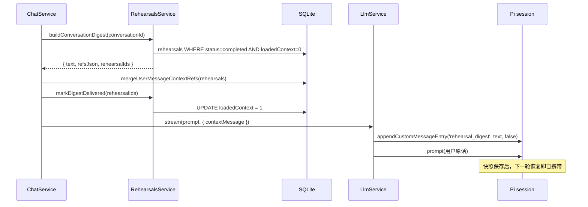

# 演练评估入普通对话：一次性投递设计

## 1. 为什么必须换成 custom message entry

通用做法是"把材料拼进发出的用户消息，交给 Pi 持久化"。本仓库此前放弃了这个做法：每次 `stream()` 结束前，`replaceInjectedUserText()` 会把本轮 user 消息还原成纯用户文本，并把历史 user 行里的附件/知识块一起剥掉——目的是不让每轮注入的正文在快照里累积。

这条规则对附件与知识块是必要的（它们是每轮不同的瞬时材料），对演练摘要则不成立：摘要需要被之后每一轮看到。因此摘要必须走一条不被清洗的通道。

Pi 提供 `SessionManager.appendCustomMessageEntry(customType, content, display, details)`：`custom_message` 条目参与 LLM 上下文（`convertToLlm` 将其映射为 `role: "user"`），但 `replaceInjectedUserText()` 只处理 `type === 'message'` 的 user 条目，不会碰它。`display: false` 让这条消息不进界面。

## 2. 数据流

## 3. 状态与查询

| 项 | 规则 |
|---|---|
| 字段 | `rehearsals.loadedContext`，默认 `false` |
| 取样 | `buildConversationDigest()` 传 `undeliveredOnly`，只取 `loadedContext = false` 的最近 3 次 completed |
| 演练开场摘要 | `planAndCreateFirstTurn()` 复用同一查询但**不过滤**，因为那是提示词材料，不是投递 |
| 置位时机 | 摘要构建成功、`contextRefsJson` 合并之后立即置位（与"加载即投递"一致） |
| 置位失败 | 只记录 `rehearsal.digest.mark_delivered_failed`，下一轮可能重复投递一次 |
| 迁移 | 新列默认 `0`：既有 completed 演练在升级后的下一个普通回合投递一次 |

## 4. 两条清洗策略的分叉

| 材料 | 通道 | 是否持久 | 是否被 `replaceInjectedUserText()` 清洗 |
|---|---|---|---|
| 附件正文 | `promptContext` | 否 | 是 |
| 知识块 | `promptContext` | 否 | 是 |
| 演练 digest | `contextMessage` → `custom_message` | 是 | 否 |

旧快照中仍可能残留早期版本写在 user 文本里的 digest 块，`stripInjectedText()` 的标题列表保留 `## 此前的演练记录` 用于一次性清掉它们。

## 5. 失败与取消语义

- 摘要在回合开始阶段构建；若该回合随后在附件/知识阶段被取消或 provider 失败，标识已置位而摘要未真正进入 session。
- 这被接受为 at-most-once：宁可不补投，也不每轮重发。用户可在演练历史里重新查看；需要时可手动触发新的演练。
- 不引入"成功后回填"的原因：那需要把投递状态与 Pi 快照保存结果耦合，而快照保存发生在 `LlmService` 内部。

## 6. 已知后果

- digest 冻结在投递时刻：报告重算或演练被丢弃后，上下文里仍是旧文本，transcript 路径可能失效。
- 若 Pi 快照被重建（缺失/落后于最新消息），重建依据是 `messages` 表，其中没有这条 custom message，摘要会消失而 `loadedContext` 仍为真。可接受，未在本次范围内补偿。
- 摘要只是历史前缀的一部分，因此可命中 provider 的前缀缓存，成本从"每轮全价"变为"一次投递"。

## 7. 代码位置

| 文件 | 责任 |
|---|---|
| `apps/backend/src/rehearsals/rehearsal.entity.ts` | `loadedContext` 列 |
| `apps/backend/src/database/migrations/1794000000000-rehearsal-loaded-context.ts` | 加列与回滚 |
| `apps/backend/src/rehearsals/rehearsals.service.ts` | `buildConversationDigest()`（只取未投递）、`markDigestDelivered()`、`loadDigestItems()` 的 `undeliveredOnly` |
| `apps/backend/src/chat/chat.service.ts` | 投递编排：构建、合并 refs、置位、以 `contextMessage` 交给 stream |
| `apps/backend/src/llm/llm.service.ts` | `LlmRequestOptions.contextMessage` 与 `appendCustomMessageEntry` 调用点 |
