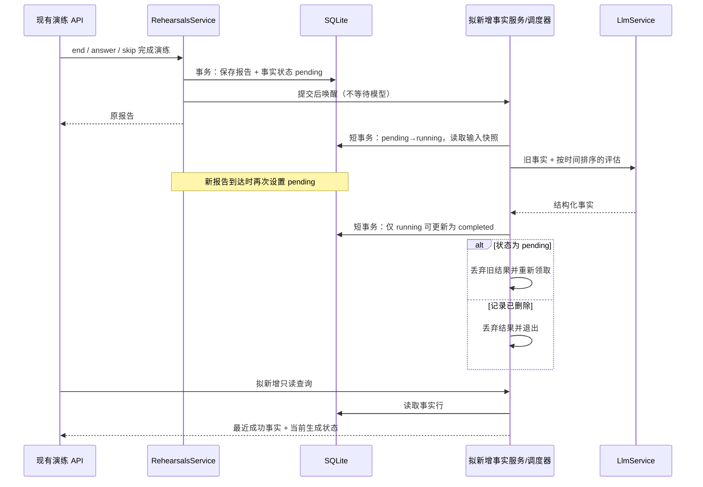

# 会话知识掌握事实功能设计

> 实施状态：已实现（2026-11-10）。下文保留设计时表述（含“拟新增”）；当前行为以 `docs/current/` 和 [verification.md](verification.md) 为准。

## Problem

教师的掌握情况会随演练变化。单次报告是当时表现的证据，不代表永久结论；简单拼接报告会同时保留“尚未掌握”和“已熟练掌握”等过时判断。

需要为同一 Conversation 维护唯一的当前事实，并保留时间演进、证据范围与不确定性。本设计的需求范围已于 2026-11-10 由用户确认（原文：“需求评审已确认”）。所有新增表、接口、服务均为拟新增能力，不代表已实现；需求确认不等同于实施前技术设计评审或验收标准评审通过。

## Goals

- 一个会话一条事实记录，综合该会话多次演练的有效评估。
- 输出不超过 200 字符的摘要、知识点详细说明、关键词和总体掌握等级。
- 依据时间顺序识别进步、退步与证据分歧，保留未被近期重新考察的已有判断。
- 报告生成后异步处理，不增加 end 等接口等待模型分析的时间。
- 简单持久化状态支持同会话串行、重跑、重启恢复及失败保留旧事实。

## Non-Goals

- 前端页面、普通对话上下文注入、跨会话知识画像。
- 独立知识点表、跨演练统一知识点 ID、人工纠正或版本历史。
- 新增版本字段、来源评估清单字段、重试次数字段、独立任务表或外部队列。
- 首次上线批量回填、手动重试 API、多实例分布式调度。

## Must-Not-Break Existing Behavior

- end 仍返回既有演练报告；事实生成失败不能把已完成演练改成 failed。
- 手动结束、15 问上限及跳过达到上限仍通过现有报告完成路径运行。
- 原始逐题评估、总体报告、transcript 和普通对话 digest 保持原有职责。
- 删除会话后不得被后台迟到结果重建；不增加账号、租户或多用户隔离。

## Current Behavior

- `apps/backend/src/rehearsals/rehearsals.service.ts` 的 `end()` 调用 `finishRehearsal()`；answer/skip 达到上限也调用同一方法。
- `finishRehearsal()` 保存 completed、overallEvaluationJson、endedAt，并写 transcript；当前没有本设计的后台事实任务。
- `rehearsals.id` 标识单次演练，conversationId 关联会话。planJson.knowledgePoints 保存 id、label 等；overallEvaluationJson.knowledgePointMastery 保存 pointId、status、evidence。
- `rehearsal_turns.pointId` 对应本次计划中的知识点，不是跨演练统一标识，也没有独立知识点表外键。
- 现有报告等级为 mastered / partial / weak / unverified；新事实等级是独立契约，不修改原报告枚举。
- `LlmService.generate()` 提供非流式调用；`ConversationsService.deleteConversation()` 负责会话数据清理。

## Proposed Behavior

### 触发与输出

每次新报告成功落库，在同一短事务中创建或更新该会话事实行为 pending。事务提交后唤醒后台处理，HTTP 继续返回原报告。已 completed 演练重复调用 end 不产生新的更新事件。

首次上线不处理所有旧会话；某会话后续完成演练时加载其全部已完成评估，包括上线前历史。查询接口不触发生成。

总体等级代表本会话已有效考察内容的综合表现，不代表整个主题的全部能力。由模型结合关键知识点、薄弱项和考察范围判断，不对枚举作数字平均。

### 时间序列与知识点归并

1. 按 endedAt ASC、createdAt ASC、id ASC 提供确定性顺序；后两项仅打破时间相同的排序平局，不能推断真实学习先后。
2. 每条材料包含演练 ID、时间、知识点名称、原始等级、评估依据及总体报告。pointId 必须与 rehearsalId 联用。
3. 仅将语义和考察范围一致的知识点合并；包含关系或同名异义保留范围差异。禁止以跨演练 pointId 相等作为合并依据。
4. 最近一次充分、直接且相关的有效证据更新对应范围。局部进步不能证明整个知识点已掌握。
5. 未考察、跳过、无回答或评估失败不是退步证据。后续缺席的知识点保留已有有效判断。
6. 有效新证据可以提升或降低等级，并说明变化；无法消解的分歧标记 conflicting，等级可为空，不编造确定结论。
7. 未验证知识点标记 insufficient，等级为空；只有证据支持薄弱时才判 needs_improvement。

### 上下文预算与截断

已有事实和本次评估是必保留材料；首次生成没有旧事实时明确传 null。重跑时“本次”指读取快照中最新一份评估，之前触发但被合并的报告归入历史，不重复输入。

优先加入全部历史评估；超预算时从最旧的历史开始整份移除，得到“已有事实 + 最近 N 次历史评估 + 本次评估”，允许 N=0。保留的评估仍按时间升序输入；明确告知模型历史已截断及保留的时间范围。

预算必须在 LlmService.generate() 解析并固定本次 provider/model 后、调用 session.prompt 前构造。拟增加可选的预算输入构造回调（现有字符串 prompt 调用不变），由 LLM 层传出本次实际 contextWindow；禁止调用前另读一次配置估算后再重新选择模型。采用保守字符上界估算（UTF-8 字节数作为 token 上界近似，仍需真实 provider 验证），预留输出 8192 token，安全余量取窗口的 10%；必须涵盖最终 system prompt、结构包装和格式修复追加文本。窗口未知或预算不正时失败并保留旧事实；不能用固定 N 冒充预算控制。估算需对中文保守处理。不得在 JSON 中间按字符切断，不依赖 SDK 隐式压缩保证业务材料保留。

旧事实仅是此前证据的归纳。新有效证据更新相关范围，未涉及的旧事实保留；没有保留原始证据时，不编造历史题目或引用。已有 evidenceRefs 可原样保留，新增引用只能来自本次提供的评估。

若必保留材料仍超预算，或 provider 实际报上下文溢出，先继续减少可选历史；N=0 仍失败则记录失败、保留旧事实，不无限重试或静默裁剪本次评估/旧事实。

### Prompt 契约

固定 system prompt 只定义归纳规则、时间序列规则及输出结构；评估正文、时间与旧事实放入 user 数据块，均视为资料，不能成为工具或访问指令。

核心约束：

> 生成截至最新有效评估的当前知识掌握事实。历史结论只描述对应时刻的表现，不能直接并列作为当前结论。逐知识点识别进步、退步、保持和分歧，以最近充分且直接相关的证据更新对应范围。未考察、跳过与评估失败不得推翻既有判断。历史被截断时保留旧事实中未被新证据涉及的知识点。不得扩大已验证范围或编造引用；无法判断时明确不确定性。仅输出符合约定的 JSON。

模型输出 summary、knowledgePointDetails、tags、masteryLevel。程序负责字段白名单、类型、长度、枚举、证据引用与重复知识点检查。语义一致性仍需样例验收，不能宣称通过 JSON 校验即可保证无事实冲突。

## Alternatives Considered

| 方案 | 结论 | 理由 | 是否升级为 ADR |
|---|---|---|---|
| 每次演练一条分析记录 | 否决 | 用户要求会话唯一当前事实 | n/a |
| 同步生成事实后返回 end | 否决 | 延长结束等待，并耦合两类失败 | n/a |
| 版本号、来源清单、尝试次数与独立任务表 | 否决 | 当前单进程本地场景优先简单，用户明确去掉四个字段 | n/a |
| 同会话进程内串行 + 表内持久化 pending | 采用 | 无版本字段仍可检测处理中出现新评估及恢复中断 | n/a |
| 上下文溢出一律失败 | 否决 | 用户允许参考旧事实并保留最近历史 | n/a |
| 新建统一知识点库 | 暂不采用 | 先按语义与范围归并，避免扩大数据模型 | n/a |

## Business Flow

1. 用户手动结束，或系统达到题数上限，生成原始演练报告。
2. 报告与 pending 状态一起提交，接口返回原报告。
3. 后台领取会话，读取旧事实和完整评估快照，构造预算内输入。
4. 模型输出经校验；未出现新事件时整体更新事实，状态 completed。
5. 处理中出现新评估则旧结果不发布，重新读取最新快照再生成。
6. 失败保留旧内容；后续新演练触发再次生成。重启恢复 pending/running。

## End-to-End Data Interaction Flow

| 关键节点 | 输入 | 节点职责 | 输出 / 状态变化 | 关键边界 |
|---|---|---|---|---|
| RehearsalsService | 新报告 | 原报告完成及待处理登记 | completed 演练、pending 事实 | 同一数据库事务 |
| 拟新增事实服务 | conversationId | 快照、prompt、校验与发布 | 整份当前事实 | 模型调用不持数据库事务 |
| 进程内调度器 | 唤醒、启动扫描 | 同会话排他、待处理扫描 | 每会话最多一个 worker | 仅支持单后端进程 |
| LlmService | 受限输入 | 无工具结构化生成 | JSON | 不写父会话快照 |
| SQLite | 报告、事实行 | 持久化待处理信号与最后成功结果 | 可恢复状态 | 完成必须条件更新，禁止 upsert |
| ConversationsService | 删除会话 | 事务删除事实，worker 放弃迟到结果 | 迟到结果不可回写 | 与会话数据同一删除事务 |

## Data And API Impact

### 新表 conversation_knowledge_facts

| 字段 | 类型 | 约束 / 默认值 | 说明 |
|---|---|---|---|
| conversationId | varchar | 主键，外键 conversations.id | 一会话一条；沿用显式删除方式 |
| summary | text | nullable | ≤200 Unicode 字符，标点计入 |
| knowledgePointDetailsJson | text | nullable | 下述对象数组 |
| tagsJson | text | nullable | 去重字符串数组，建议 3–8 个；无证据允许空数组 |
| masteryLevel | varchar | nullable | proficient / basic / needs_improvement |
| generationStatus | varchar | NOT NULL，pending | pending / running / completed / failed |
| lastError | text | nullable | 有界、脱敏失败原因 |
| generatedAt | datetime | nullable | 最近一次成功发布时间 |
| createdAt | datetime | NOT NULL | 创建时间 |
| updatedAt | datetime | NOT NULL | 最近状态或内容变化时间 |

不添加 requestedVersion、publishedVersion、sourceEvaluationsJson、attemptCount。可为 generationStatus 建普通索引供扫描；无需独立 id 或重复的 conversationId 唯一索引。

首次生成前事实字段和 generatedAt 为 null；重新生成期间保留全部旧事实字段。成功时一次性替换所有内容、清空 lastError、更新 generatedAt；任务状态不能被消费者误当作内容是否存在。

knowledgePointDetailsJson 每项字段：

| 字段 | 类型 | 说明 |
|---|---|---|
| name | string | 知识点名称，必要时带范围限定 |
| masteryLevel | enum / null | 与总体同一三档枚举；不足或分歧时允许空 |
| evidenceStatus | enum | sufficient / insufficient / conflicting |
| details | string | 当前掌握范围、薄弱项及未验证范围 |
| changeDescription | string | 时间演进；只有一次证据时说明尚无纵向比较 |
| lastAssessedAt | ISO datetime / null | 最后有效考察时间，不用生成时间替代 |
| evidenceRefs | array | { rehearsalId: string, pointId: string }；无可定位证据允许空数组 |

总体 proficient=熟练掌握、basic=基本掌握、needs_improvement=建议加强；证据不足允许总体 null。事实等级不回写原始报告。当前无知识点实体，evidenceRefs 是逻辑引用；程序验证同会话报告/计划中存在该组合。

字段级契约与空值约束以 [API 契约](api-contract.md) 和 [响应 JSON Schema](api-schema.json) 为准；技术评审见 [评审记录](reviews/design-review.md)，代码级验收见 [验收标准](verification.md)。

### 拟新增只读接口

`GET /api/conversations/:conversationId/knowledge-facts`，沿用现有本机 API 认证；conversationId 按现有 UUIDv4 规则校验。无请求体、无分页、无生成副作用。

200 返回 `{ conversationId, fact }`。会话存在但没有事实行时 fact=null；存在时 fact 对象字段为 summary、knowledgePointDetails、tags、masteryLevel、generationStatus、lastError、generatedAt、createdAt、updatedAt，类型和可空性同表，JSON 列解析为数组，日期为 ISO 字符串。lastError 仅返回脱敏摘要。

400：ID 格式错误；404：会话不存在；认证失败沿用全局约定；读取/存储 JSON 损坏返回 500，不伪装成无记录。pending/running/failed 仍可返回最近成功内容，generatedAt=null 表示尚无成功结果。不暴露内部队列或模型原始错误。

集合查询 `GET /api/knowledge-facts` 返回全部事实行，按 `updatedAt DESC, conversationId ASC` 排序，无分页、无生成副作用。为控制列表成本，查询只选择小字段并**不读取、不返回 `knowledgePointDetails`**；需要详情时使用单会话接口。列表项保留 conversationId、summary、tags、masteryLevel、generationStatus、lastError、generatedAt、createdAt、updatedAt，空值与单会话 fact 规则一致。

## Frontend Fetching Logic

本期不改前端，不增加轮询或 Electron 桥接。新接口供后续消费；现有演练返回值不等待或携带事实结果。

## Frontend Behavior

无本期变更；后续展示需要同时解释最近成功内容与生成状态，不能把 failed 当作没有旧事实。

## Backend Fetching Logic

- 拟新增事实服务拥有查询与生成读取；报告来自 rehearsals，知识点名称来自 planJson，依据来自 overallEvaluationJson；本期不重新评估原始回答。
- 只读取当前 conversationId、status=completed 且报告可解析的演练；读取全量后按时间排序再构造预算内输入。不复用现有 digest 最近三次查询。
- completed 记录报告损坏或知识点映射缺失时中止生成并记录失败，不能静默忽略导致错误全量结论。
- 领取阶段在同一短事务内将 pending 改 running，并读取旧事实及评估快照；避免领取后读到新报告却丢失待处理信号。
- API 只读数据库，无缓存；状态和事实从同一行获得。读取会话存在性与事实需一致快照，避免删除竞态造成误报。
- 旧事实不替代可容纳的完整证据；截断发生在 prompt 材料选择层，数据库原始历史永不删除。

## Backend Behavior

### 无版本号的排他与重跑协议

适用前提是当前本地单后端进程。调度器以 conversationId 保存 worker 排他标记，必须在第一个 await 前占位；不同唤醒与启动扫描共用该排他入口。

1. 报告完成事务总是把事实状态置 pending（包括当前 running）。新行仅在此处创建；已有成功内容保留。
2. worker 领取 pending，在短事务中改 running 并读取输入快照。数据库事务外调用模型。拟新增 worker 的默认扫描间隔为 5 秒；进程全局最多 1 个事实生成 worker，按 pending 行 updatedAt、conversationId 排序选取，避免多个会话同时争用本机模型。持续重跑回队尾，同一会话不垄断队列。
3. 模型成功后仅执行 `WHERE conversationId = ? AND generationStatus = 'running'` 的整体更新，不做 upsert。
4. 影响行数为 0：若为 pending，旧结果丢弃并重跑；若行不存在，退出。不能把 pending 改 completed。
5. 模型失败同样只允许 running→failed；如果已经 pending，保留该信号并继续下一轮，不能以旧任务失败覆盖新事件。
6. worker 完成后释放排他标记；同时保留周期 pending 扫描，补偿事务提交后未成功唤醒以及释放标记时的竞态。扫描只领取 pending，不自动重试 failed。

启动阶段在接受新任务前把遗留 running 转 pending，再扫描 pending；不能在仍有正常 worker 时随意重置 running。关闭时停止新领取并尽力中止调用，持久化状态留给下次启动恢复。状态协议必须由并发/中断测试验证。

### LLM 与删除边界

事实任务使用独立 AbortController，不复用 end 请求的 signal 或演练 run lease。复用 generate 的无工具、无记忆、无 SOULS、无父快照写入模式，使用专用归纳 prompt，不带学生角色指令。

删除会话时显式删除事实行；本期不为尽力取消额外建立反向模块依赖，worker 在调用前及回写时检查行是否仍存在；最终写入只更新仍存在的行，从而阻止迟到结果复活。拟新增事实服务、controller、调度器放在现有 rehearsals 模块内，依赖 DataSource 与 LlmService，不反向依赖 RehearsalsService。报告编排单向调用事实服务，ConversationsService 只在原删除事务中按表清理，避免循环模块依赖。

迁移仅新增该表、外键及状态索引，并在 database.options.ts 注册实体/迁移。up 不回填；down 只删除派生事实表/索引，保留所有原始演练评估；降级后旧程序可继续工作，重新升级后在下一次演练触发生成。

## Error Handling

- 原报告失败：不触发事实任务；零回答丢弃沿用现有规则。若现有路径生成无有效证据报告，事实不能伪造掌握等级。
- 报告/pending 联合事务失败：整体回滚，由现有报告错误路径处理；提交后唤醒失败不回滚报告，由扫描补偿。
- 网络、超时、预算无法满足或模型校验失败：事实行 failed、保存脱敏原因，保留全部旧内容和 generatedAt。
- JSON 格式修复遵循现有最多三次尝试的模式；任务失败不做无限自动重试，下次新评估再触发。
- 新任务开始和成功时清空旧 lastError；日志仅记录 ID、耗时、材料数量、是否截断、状态和安全错误分类，不记录评估正文或密钥。

## Risks

- 语义归并与总体等级仍具有模型不确定性；引用校验只保证定位，不保证推理正确，需固定案例验收。
- 截断后旧事实中的早期误判可能沿用；保留新证据修正机制及变化说明，不声称完全消除幻觉。
- 不存来源版本和快照，无法精确重建每次生成输入；这是简化方案的明确取舍。
- 旧事实自身可能不断增长，必保留材料最终超预算时会失败；本期不增加二级摘要或静默删知识点。
- 单进程排他不能推广到多实例部署；若运行模式变化，必须重新设计领取与提交协议。

## Verification

以下是设计验收场景。自动化 L1/L2 已于 2026-11-10 执行并通过，结果见 [verification.md](verification.md)；真实 provider 的 L3 语义验收尚未执行，评审与 AC 确认状态分别记录。

- 同会话多次演练只有一条事实；旧报告及普通对话 digest 不受影响。
- 手动结束、answer/skip 上限结束均登记 pending；重复 end 不重复登记。
- 先弱后强、先强后弱、局部提升、后续未考察、跳过、证据冲突和全部无证据均符合时间序列规则。
- 不同演练相同 pointId 不误合并；不同名称同范围可归并；证据引用必须同会话且真实存在。
- 预算足够提供全量；不足整份移除最旧历史；本次不重复；N=0 合法；必保留内容超限保留旧事实并失败。
- 第一次调用悬挂期间完成第二次报告：持久化 pending，第一次成功/失败均不得覆盖，第二轮包含全部最新评估。
- 模拟提交后未唤醒、任务领取后退出、新评估到达后退出：重启/扫描均可恢复，单会话无重叠 worker。
- 生成失败不影响原报告；查询可返回旧事实+failed；首次 pending 返回空内容+状态。
- 生成中删除会话：事实与会话一起删除，迟到结果不复活。
- 摘要超过 200 字符、非法枚举、无效引用、重复知识点和损坏报告不能直接发布。
- API 覆盖 UUID 校验、会话不存在、无事实、各任务状态、JSON 字段解码与全局认证。

## Design Deviations

| 偏差 | 发现于 | 与设计不符之处 | 处理（改设计 / 改现状文档 / 接受） |
|---|---|---|---|
| 事实服务公开 `scanPending()` / `waitForIdle()` 作为确定性调度与测试接缝 | 实施 T01/T05 | 设计只描述调度器行为，未点名这两个内部入口 | 接受：仅用于周期扫描和测试等待，不暴露到 HTTP，不改变生产状态协议 |
| `generate()` 的新增入口命名为 `buildPrompt({contextWindow})` | 实施 T04 | 设计写“可选预算输入构造回调”，未固定名称 | 接受：签名保持可选，旧字符串 prompt 调用不变 |
| 失败 `lastError` 按异常类别映射为固定中文摘要 | 实施 T05/T08 | 设计只要求“有界、脱敏”，未规定具体文案 | 接受：不包含 provider 正文、SQL 或凭据；测试覆盖超时与数据损坏分类 |

## Version History

### v2.0 — 2026-11-10

- 触发：用户要求在事实 controller 新增查询全部记录的 list API，并因性能忽略详情字段。
- 改动内容：新增 `GET /api/knowledge-facts`；列表按 `updatedAt DESC, conversationId ASC` 排序，只查询小字段，不读取/返回 `knowledgePointDetails`。
- 影响范围：事实只读 HTTP 与 current API 契约；持久化、生成 worker 和单会话接口不变。
- 处理状态：已实现并通过 L1/L2 自动化；验收标准确认与真实 provider L3 状态不变。

### v1.0 — 2026-11-10

- 触发：用户要求正式编写会话知识掌握事实设计。
- 改动内容：确定简化单表、时间序列推理、预算截断、状态重跑与只读查询契约。
- 影响范围：演练报告完成、后台生成、会话删除及新增读取接口。
- 处理状态：需求评审已由用户确认；技术设计评审 PASS；实现与自动化验收已执行，详见 [verification.md](verification.md) 和 [worklog.md](worklog.md)。验收标准确认状态仍为 pending（不代签）。

## Current Doc Updates

实现并完成自动化验证后，已同步以下当前事实；真实 provider 的 L3 语义仍未覆盖。

- [x] `docs/current/domains/rehearsals/index.md`
- [x] `docs/current/domains/rehearsals/api-contract.md`
- [x] `docs/current/platform/agent-runtime.md`
- [x] `docs/current/domains/conversations/backend-behavior.md`
- [x] `docs/manifest.yaml`：路由改为已实现描述。
