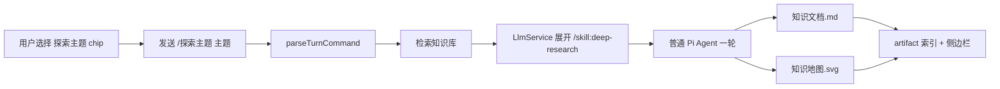

# `/探索主题` 设计

> 后续变更（2026-11-11）：DeepSeek 网页工具已作为 `web_search`/`web_fetch` 提供给 `/探索主题` skill。本文件关于“skill 不联网”的设计描述仅代表 2026-11-10 的范围；当前行为以 [Agent Runtime](../../current/platform/agent-runtime.md) 和 [deep-research SKILL.md](../../../apps/backend/assets/skills/deep-research/SKILL.md) 为准。

## 1. 命令协议

`/探索主题` 与 `/查询资料库` 一样是用户显式开关，不是模型工具：

- 命令必须位于 prompt 开头，后接空白；单独出现、`/探索主题化`、句中出现的文本都不算命令。
- 桌面端把命令存进 `composer-command-store`，输入框内显示 chip；发送时 `agent-chat-adapter` 拼回 `/探索主题 <主题>`。
- 后端 `parseTurnCommand()` 依次消费最多两个前导命令，因此 `/探索主题 /查询资料库 主题` 和反序都合法。探索主题隐含检索，`knowledge` 标志只记录用户是否额外写了资料库命令。
- 入库消息与模型输入都使用去掉命令后的主题。



## 2. 后端编排

`ChatService.stream()`：

1. `parseTurnCommand(prompt)` 得到 `{ research, knowledge, prompt }`。
2. `forceKnowledge = research || knowledge`，复用现有 `KnowledgeService.buildContext()`：
   - 范围、重排、8 片上限、去重、`contextRefsJson` 全部不变；
   - 研究轮次不额外扩大检索预算。
3. 组 `promptContext`：技能说明不在其中；技能由 `LlmService` 展开。资料块仍和附件块一起拼在用户消息前。
4. 调 `LlmService.stream(userPrompt, { skillName: 'deep-research', promptContext, ... })`。
5. `chat.turn.accepted` 记录 `knowledgeCommand` / `researchCommand`；`chat.llm.stream.started` 记录 `researchCommand` 与注入统计。

`LlmService`：

- `LlmRequestOptions.skillName` 是可选请求字段。
- 在 `createSession()` 的 `resourceLoader.reload()` 之后确认 skill 存在；缺失时抛出 `Pi skill not found: <name>.`，避免 Pi 把 `/skill:...` 当普通文本透传。
- 发送前构造：
  ```
  /skill:deep-research <promptContext>

  ## 用户输入
  <主题>
  ```
  `session.prompt(..., { expandPromptTemplates: true })` 让 Pi 把 skill 正文展开为 `<skill ...>` 块，后面的资料和主题成为它的参数。
- 快照清洗仍以 `prompt`（纯主题）为准，因此下一轮恢复时不会重放整份 skill 正文或本轮资料块。

## 3. Skill 装载

Pi 的 `noSkills: true` 只关闭默认目录发现，不关闭显式路径。当前 `additionalSkillPaths`：

| 路径 | 用途 |
|---|---|
| `<configDir>/skills` | 安装后的产品/用户 skill（默认 `~/.tech-forge/skills`）；内置模板首次复制到这里，用户可直接编辑 |
| `<workspace>/skills` | 用户自建的 workspace 级 skill |

内置模板源在 `apps/backend/assets/skills`（从编译产物 `dist/llm` 解析为 `../../assets/skills`，与 `assets/models` 一致）。`LlmService.ensureInstalledSkills()` 每个进程执行一次 `installBundledSkills()`：目标目录不存在时创建，目标 skill 已有 `SKILL.md` 时跳过，因此升级不会覆盖用户修改。`SettingsService.getSkillsDirectory()` 提供安装根。

`DefaultResourceLoader` 会在启动时把 skill 名称、描述和路径写入系统提示词；但探索主题路径只使用 `/skill:deep-research` 显式展开，不依赖模型自行选择。

## 4. Skill 契约

`deep-research/SKILL.md` 只定义工作流，不新增工具：

- **证据规则**：资料库分片是主证据，引用带资料名/章节/页码；资料库未覆盖的内容标 `[补充背景]`，不确定内容标 `[待核实]`；禁止编造资料名、页码或链接。
- **阶段门**：先拆核心问题、证据表与 3–6 个一级分支，再写文档；文档通过自检后才写 SVG。
- **文档结构**：概览、学习目标、核心概念、结构与机制、例子、常见误区、自测题、证据与来源、待核实。
- **SVG 约束**：左→右树形布局、根卡片 + 分支卡片 + 要点卡片、`viewBox`、显式十六进制颜色、`system-ui` 字体；禁止 `<script>`、`<foreignObject>`、外部字体/图片/样式表和事件属性。
- **文件路径**：`deep-research/<slug>/知识文档.md` 与 `deep-research/<slug>/知识地图.svg`，`slug` 为 ASCII 小写单词。
- **回答**：聊天里只给摘要、两个路径和证据覆盖情况，不重复全文。

## 5. 文件与权限

- skill 通过 `write` 工具写文件，受 `workspace-file-tools.ts` 约束：默认只能写当前会话工作区。
- 写入成功后 `onFileWritten` 调 `ArtifactsService.registerArtifact()`，产物出现在响应底部与侧边栏。
- SVG 继续由 `SvgArtifact` 以 `` + data URL 静态渲染，不执行脚本、不加载外部引用。
- 不放开知识库目录直读；研究轮次只消费注入的分片，边界与 `/查询资料库` 相同。

## 6. 失败与降级

| 情况 | 行为 |
|---|---|
| 资料库为空 / 无命中 | 仍运行 skill；资料块是明确通知，skill 必须如实说明并在文档中标注补充背景 |
| skill 文件缺失或名称写错 | `LlmService` 抛错，请求失败；不会静默退化为普通问答 |
| 模型只写了文档没写 SVG | 本轮仍是 completed；聊天摘要会列出实际存在的文件（skill 要求自检，但模型仍可能漏写） |
| SVG 解析失败 | 现有 `SvgArtifact` 回退为源码文本 |
| 命令单独出现 / 无主题 | 不算命令，按普通文本发送 |

## 7. 代码入口

- 命令解析：`apps/backend/src/chat/deep-research-command.ts`、`turn-command.ts`
- 编排：`apps/backend/src/chat/chat.service.ts`
- skill 展开与发现：`apps/backend/src/llm/llm.service.ts`
- skill 安装：`apps/backend/src/llm/skills.ts`、`SettingsService.getSkillsDirectory()`
- 内置 skill 模板：`apps/backend/assets/skills/deep-research/SKILL.md`
- 桌面菜单与 chip：`apps/desktop/src/features/agent/SlashCommandMenu.tsx`、`AgentChatPage.tsx`
- artifact 路径归属：`apps/backend/src/artifacts/artifacts.service.ts`（canonical path 比较）
