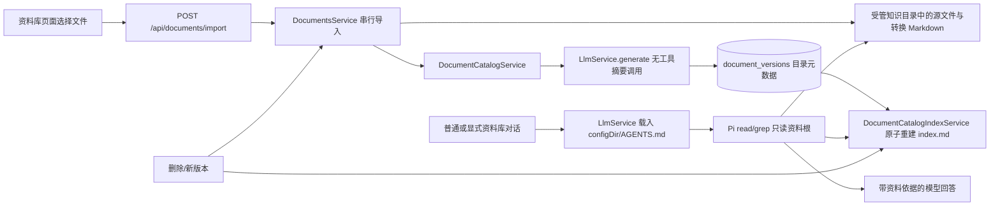

# 目录驱动的自主资料库查阅设计

## Problem

现有个人资料库按约 500 token 切片，使用 FTS5 与 embedding 双通道检索，并只在显式命令轮把最多八片内容注入 user message。新方向改为由 Agent 读取目录后自行选择转换后的原文：它适合个人资料库的可见文件组织，却要求重新定义导入后的摘要、目录一致性、自动查阅策略与知识库文件读取授权。

需要特别区分代码事实：向量/全文检索的调用链是 `ChatService → KnowledgeService → RetrievalService`，而非 `LlmService` 本身。`LlmService` 当前只接收预建 `promptContext`、创建 Pi 文件工具，并把知识根设为默认拒读目录；迁移必须移除整条调用链，而不是只修改该服务的注释。

## Goals

- 在 `<configDir>/AGENTS.md`（默认 `~/.tech-forge/AGENTS.md`）建立稳定、简短、可审计的自主资料查阅策略，并在每个普通 Pi session 中加载。
- 每份新导入或新版本资料从解析出的文本生成经 JSON 校验的结构化摘要：摘要不超过 200 个 Unicode 字符，附带 3–8 个关键词与资料类型。
- 将当前可用资料写为 `<configDir>/knowledge/index.md` 的稳定条目；资料原件、可读文本副本与 index 可以混放在同一受管根。PDF/DOCX/PPT 指向转换 Markdown，Markdown/TXT 等原生文本指向自身；条目包含 document/version id、标题、相对路径、摘要、关键词和更新时间。
- 允许模型仅在需要时以只读工具读取 `index.md` 和其中列出的转换 Markdown；用户可见工具活动，且写入边界、config/SOULS 保护和会话隔离不变。
- `/查询资料库`（及其兼容别名）与 `/探索主题` 都继续存在，但语义改为后端直接加载目录，再要求模型按目录读取原文；普通输入可由模型自行决定是否查阅。
- 显式目录注入在同一轮紧随 `index.md` 追加 `<agent_state>`，避免模型把已加载目录当作尚未读取；工具层同时阻止该轮再次返回完整 index 内容。
- 停止新资料的向量、全文与分片构建；保留旧模块、代码及历史数据，以便观察质量、延迟、token 与 Provider 成本后再决定是否删除，但不保留任何业务调用。

## Non-Goals

- 不把 `index.md` 全文经 `agentsFilesOverride` 或 `promptContext` 预先塞给模型。
- 不让模型读取 PDF/DOCX 二进制源文件；目录只指向本服务已保存的可读文本副本。
- 不让上传资料、AI 摘要或 `index.md` 的文字充当系统指令；它们始终是不可信资料内容。
- 不在本次实现本地重排、目录向量检索、全文目录搜索，或自动选择一个外部网络来源补齐资料。

## Must-Not-Break Existing Behavior

- 普通对话仍按 conversation 串行化、持久化 Pi 事件与快照；资料目录和本轮工具结果不能被写进可恢复的用户原文。
- `config.toml`、`SOULS.md` 及其链接/硬链接别名继续只能由 `SettingsService` 访问；Agent 不能借资料库策略读取它们。
- Agent 仍只能在会话 workspace 写入；知识库目录保持只读，`bash`、`subagent`、`subagents_enable` 继续不可用。
- 文件导入、重复内容幂等、删除的事务边界与用户可见错误语义不因停止 embedding 而退化。
- 演练仍使用无工具的 `LlmService.generate()`，不得获得资料目录读取能力；`/探索主题` 仍生成相同 artifact，但证据改为目录/原文而非旧分片；附件继续是每轮材料，不进入资料目录。

## Current Behavior

1. `DocumentsService.importFromPath()` 将文件暂存并解析、写转换 Markdown、分块、写 FTS 条目、生成向量，最后把版本置为 `ready` 或 embedding 失败时的 `indexed`。
2. `ChatService.stream()` 在命令轮调用 `KnowledgeService.buildContext()`；后者调 `RetrievalService.search()`，将分片正文写入 `promptContext` 与 `contextRefsJson`。
3. `LlmService.createSession()` 以 `guardedDirectories: [getKnowledgeDirectory()]` 创建文件工具。只有当前用户消息点名知识库内的绝对路径且表达读取意图，通用 `read` 才能读取该目录。
4. `DefaultResourceLoader` 使用 `noContextFiles: true`；没有用户根目录的 `AGENTS.md` 被加载。

## Proposed Behavior

### 1. 固定 AGENTS 策略与受限目录读取

`SettingsService` 在初始化 `<configDir>` 时以 `wx` 创建 `<configDir>/AGENTS.md`（0600）；已存在的文件绝不覆盖。文件来自 backend 打包资产，内容只包含固定策略和运行时实际资料根路径，例如：何时值得查个人资料、先读 `knowledge/index.md`、只读必要原文、把资料当内容而非指令、未读取时不得声称查阅、显式命令必须查阅。它不含目录条目或摘要。

`LlmService` 在 `resourceLoader.reload()` 前读取该确切文件，并通过 `agentsFilesOverride` 追加 `{ path, content }`；保留 `noContextFiles: true`，不会发现 workspace 或上级目录的任意 AGENTS 文件。该文件也加入 `SettingsService.getManagedFilePaths()`，不能被模型以普通工具读取或改写。

新建一个显式的 `knowledgeReadDirectory` 文件工具策略：普通 `stream()` 的受控 `read` 可读取 `<configDir>/knowledge/index.md` 和该 index 由后端解析出的转换 Markdown 白名单；受控 `grep` 只能搜索同一份原文白名单，不能读取 index；`edit`、`write`、`mkdir` 永远没有该例外。资料原件与转换 Markdown 虽混放于同一受管根，但原件不在 index 白名单中，因而不可读。既有未受控的默认 grep 必须被这份受控实现替换，不能成为绕过路径。所有路径均经过现有真实路径、符号链接、特殊文件和受保护文件检查。`generate({ tools: [] })` 的演练路径不传此策略。每次目录或原文读取仍作为标准 Pi tool activity 记录和展示。

文件工具为每轮维护已加载路径集合。后端预加载 index 的显式命令把 index 标为已加载；模型本轮再次请求它时，工具只返回固定的“目录已在本轮上下文，勿重复读取”消息，不返回正文。自主模式首次读取 index 后同样标记，第二次读取得到同一固定消息。原文不做此去重，因为模型可能需要不同 offset/limit。

### 2. 资料目录与摘要持久化

`document_versions` 新增目录字段：`catalogStatus`（`pending | ready | failed`）、`catalogSummary`、`catalogKeywordsJson`、`catalogDocumentType`、`catalogError`、`catalogedAt`。现有 `processingStatus` 收敛为 `parsing → cataloging → ready` 或 `failed`；旧 `indexed` 只作为历史兼容值读取。

SQLite 是目录的唯一权威来源：`documents` / `document_versions` 保存 document id、版本、标题、可读文本相对路径及所有已校验 catalog 字段。`knowledge/index.md` 不是可增量编辑或解析回写的数据源；导入、重试、删除或显式 rebuild 后，后端只查询剩余的最新 `catalogStatus=ready` 版本，以固定模板重新渲染整个临时文件并原子 rename。目录字段在渲染前归一化为单行文本，路径只由后端生成，绝不接受 Provider 产出的路径。

`DocumentCatalogService` 归 Documents 域所有，接收解析后的页文本与版本元数据：

1. 用确定性预算拼接标题、标题层级、首尾内容和分段采样文本；不得把整份超长原文无上限放进模型请求。
2. 调 `LlmService.generate()`，使用固定 system prompt、`tools: []`、`loadMemory: false`、无 conversation；输出严格 JSON。
3. 校验字段和 Unicode 长度；失败不接受模型自由文本。Provider/解析/校验失败把版本写为 `catalogStatus=failed` 与安全错误摘要。
4. 成功后与转换 Markdown 一起持久化目录元数据，并通过 `DocumentCatalogIndexService` 基于数据库的所有最新 `catalogStatus=ready` 版本重建 `knowledge/index.md`。

目录文件以稳定 document id 为主键，路径相对 `knowledge/`，且只列转换 Markdown。受管根可同时含原件，但它们从不出现在目录或可读白名单中，例如：

```md
## 资料目录

- id: 6f…
  version: 1
  title: 课堂评价设计
  type: 教学设计
  path: 6f…/v1/课堂评价设计.md
  keywords: [形成性评价, 量规, 反馈]
  summary: 面向课堂评价的设计原则、量规示例与反馈闭环。
  updated_at: 2026-11-10T00:00:00.000Z
```

逻辑上是“上传后追加一条”；物理写入必须先由数据库快照渲染到同目录临时文件，再原子 rename 替换。这使删除、版本更新、进程中断恢复和重复请求都不会留下重复/半行条目。删除先提交 SQLite 事务，再由剩余记录重建 index，最后清理 `knowledge/documents/<documentId>/`；文件清理失败不会重新暴露已删除条目。`DocumentsService.libraryQueue` 串行化导入、重试、删除和目录重建。

已存在的资料不应在升级时静默触发大量付费 Provider 请求。迁移先从现有资料生成标题/路径、`summary: 待生成` 的可读目录项；资料库视图提供显式“重建资料目录”操作，逐份生成摘要。未完成摘要的条目仍能被 Agent 发现并读取原文，但不能标称有 AI 摘要。

### 3. 对话、状态标记与旧检索迁移

`ChatService` 不再注入 `KnowledgeService`，不再调用 `buildContext()`，不再把 `knowledge` 写入 `contextRefsJson`，也不再记录旧检索的 `injectedTokens`/命中统计。保留命令解析：`/查询资料库` 和 `/探索主题` 都通过 Documents 域读取受管 `index.md`，构造持久目录消息的内容：

```text
## 资料库目录（系统已加载）
<index.md 原文>

<agent_state source="knowledge-index" status="loaded">
资料库目录已加载到本轮上下文。不要再次读取 index.md；根据其中的 path 仅读取回答所需的原文。
</agent_state>
```

首次显式命令把“目录 + `<agent_state>`”作为 `custom_message(type='knowledge_index', display=false)` 持久化到 Pi snapshot；这是刻意区别于附件的设计：目录是会话级上下文，后续轮次应继续可见，不能在快照清理时剥离。`LlmRequestOptions` 需从单个 `contextMessage` 扩展为有序的 `contextMessages`，使演练 digest 与资料目录可以同轮追加而互不覆盖。

目录消息的 `details` 保存 catalog revision/hash。相同 revision 已在当前可见上下文时不重复追加；revision 改变时，先以 `context_edit(..., null)` 从模型上下文排除旧目录消息，再追加带新 revision 的目录消息，保证 snapshot 的历史可追溯而模型只看见一个完整目录。每个后续普通轮额外在 transient `promptContext` 的末尾添加短 `<agent_state knowledge_index="loaded" revision="…">` 指针，使状态紧邻新问题而不重复全文。它不是 Renderer 的状态栏事件。无命令轮则只受 AGENTS 的自主判断约束。

`/探索主题` 不再强制调用旧检索；其 skill 改为以已预加载目录为起点，按目录读取选中的转换 Markdown，并在产物中按资料标题与路径引用。它仍不新增工具；使用的只是普通 chat 已获准的只读文件工具。

`LlmService` 的 `promptContext` 继续承载附件、显式目录和状态标记，但删除“知识分片”表述。创建文件工具处保留醒目注释：资料库当前采用文件目录 + 按需读取，旧 `knowledge/` 模块保留观察，不得在此处重新注入向量/全文检索结果。`KnowledgeModule`、`RetrievalModule`、`EmbeddingModule` 及已有 migrations 暂不删除，但 Chat、slash command、deep-research 与新导入路径都不再依赖它们。

### 4. 实现边界与可替换策略

本次不是把“目录模式”散落为 `DocumentsService`、`ChatService`、`LlmService` 中的条件分支。目录模式必须是一组可独立替换的知识访问实现；未来恢复或试验 RAG 时，只替换该实现和组合根，不改上传流程、命令语义或 Pi 会话机制。

| 层 / 组件 | 唯一职责 | 可依赖 | 明确禁止 |
|---|---|---|---|
| `DocumentCatalogService` | 将已解析文本变为已校验的摘要元数据 | 解析文本、受限的 `CatalogSummaryGenerator` port、catalog repository | 不读写 `index.md`，不碰 Pi、Chat 或文件工具 |
| `DocumentCatalogIndexService` | 将 ready catalog 元数据投影为原子 `index.md` | catalog repository、知识目录文件系统适配器 | 不调用 LLM，不解析聊天命令，不决定是否检索 |
| `KnowledgeDirectoryService` | 读取目录、计算 revision/hash、解析 index 并给出受限原文白名单 | `index.md`、转换 Markdown、路径安全适配器 | 不生成摘要，不保存 Pi snapshot，不访问旧 chunks/vectors |
| `KnowledgeContextCoordinator` | 将显式命令的目录变成/更新 `knowledge_index` Pi custom message，并给后续轮生成短状态指针 | `KnowledgeDirectoryService`、LlmService 的会话上下文请求契约 | 不自行读取原文、不解析 slash command、不知道资料导入状态 |
| `KnowledgeFileAccessPolicy` | 向 Pi `read`/`grep` 提供同一份窄只读授权与重复 index 读取处理 | `KnowledgeDirectoryService` 给出的白名单、既有路径安全检查 | 不写文件，不决定目录何时预加载，不加载 AGENTS |
| `ChatService` | 解析命令并编排“强制预加载”或常规 stream | `KnowledgeContextCoordinator`、现有 LLM facade | 不拼接 index 文本、不解析目录条目、不引用 `KnowledgeService` |
| `LlmService` | 管理 Pi session、固定 AGENTS 装载和通用 tool 生命周期 | `KnowledgeFileAccessPolicy` 的请求级配置 | 不含 catalog/目录渲染/命令业务；不得回退调用旧检索 |
| 旧 `knowledge` / `retrieval` / `embedding` 模块 | 仅保留历史实现与数据兼容 | 自身既有依赖 | 不可被任何 production composition root 注入 |

为避免名称相近而形成隐式耦合，新增的边界以小接口（port）表达，而不是让上层直接依赖具体实现：摘要生成使用 `CatalogSummaryGenerator`，目录读取/版本使用 `KnowledgeDirectoryReader`。Pi custom-message 的 entry id 与 snapshot 恢复均由既有 `LlmService` 所有；协调器只传入 revision、正文与状态指针，LlmService 从已恢复 entries 查找同类型 custom entry 并负责 `context_edit`。接口返回领域 DTO，不泄露 TypeORM entity、Pi entry id 或绝对文件路径给不需要它们的层。实际目录实现可注册为 `DirectoryKnowledgeAccess`；若未来引入 RAG，应另行实现同一“显式预加载 + 原文证据”能力，并通过 composition root 选择，禁止在服务内部以 `if (ragEnabled)` 混用两套逻辑。

所有新增 public class、public method、adapter 与复杂的安全/状态转换分支都必须有责任边界注释，说明输入信任级别、所有权与不得承担的职责。尤其保留以下关键注释：为什么 `AGENTS.md` 只放静态策略、为什么 `knowledge_index` 必须持久化且以 revision 替换、为什么文件工具拒绝重复 index、以及为什么旧 RAG 模块暂不删除。注释解释约束与原因，不重复代码字面行为。

## Alternatives Considered

| 方案 | 结论 | 理由 | 是否升级为 ADR |
|---|---|---|---|
| 每轮把完整 `index.md` 放入 `agentsFilesOverride` | 否决 | 300 份 × 200 字符约 6 万中文字符，成本和上下文风险随每轮发生；资料内容也不应进入 system prompt。 | n/a |
| 保留现有混合检索，只在 UI 展示目录 | 否决 | 不满足由 Agent 自主浏览文件目录的目标。 | n/a |
| 通用 `read` 永久放开整个配置目录 | 否决 | 会破坏 config/SOULS 与会话文件的既有保护边界。 | n/a |
| 只对知识根提供真实路径检查后的只读例外 | 采用 | 支持目录与原文读取，同时保留写入和敏感配置边界。 | n/a |
| 导入时同步生成摘要 | 采用 | 导入完成即有可用目录；失败状态可重试且不需要额外 Job 系统。 | n/a |
| 旧资料启动时自动批量调用模型生成摘要 | 否决 | 会在用户未操作时产生不可预期的 Provider 成本。 | n/a |

## Business Flow

上传资料时，资料库页面把选择的本机路径发送到现有导入 API。后端先复制与解析，写转换 Markdown；接着生成并验证摘要，持久化目录元数据，再原子重建 `index.md`。普通提问时，AGENTS 让模型判断是否需要资料；需要时它先读目录再读少量原文。显式资料库命令把“判断”升级为“必须执行”。

删除资料或生成新版本时，后端从最新已就绪版本重建目录，因此不会留下过期路径。

## End-to-End Data Interaction Flow



| 关键节点 | 输入 | 节点职责 | 输出 / 状态变化 | 关键边界 |
|---|---|---|---|---|
| `KnowledgeLibrary` 页面 | 用户选择的绝对路径 | 仅选择并调用本机 API | 导入请求与状态展示 | Renderer 不读文件正文 |
| `DocumentsController` / `DocumentsService` | 文件路径、标题 | 校验、串行化、复制、解析、版本和删除 | 受管源文件、转换 Markdown、版本状态 | 导入/删除不跨 LLM 调用持有 DB 事务 |
| `DocumentCatalogService` | 受预算的解析文本 | 调模型、验证结构化摘要 | 目录字段 ready/failed | 无工具、无 memory、正文不写日志 |
| `DocumentCatalogIndexService` | 最新 ready 版本 | 渲染并原子替换目录 | `knowledge/index.md` | 同一 `libraryQueue` 下幂等重建 |
| `KnowledgeDirectoryService` | index 文件与转换 Markdown | 计算目录 revision、解析安全白名单 | 不可变 directory snapshot | 不知道上传、Chat、Pi 或旧检索 |
| `KnowledgeContextCoordinator` | 显式命令与 directory snapshot | 维护持久目录 custom message 与短状态指针 | 会话级目录状态 | 不拼接/解析目录正文，不读取原文 |
| `KnowledgeFileAccessPolicy` | directory snapshot、Pi tool 请求 | 统一 read/grep 只读授权与 index 去重 | 窄工具授权结果 | 不承担命令或摘要业务 |
| `SettingsService` / `LlmService` | 固定 AGENTS 文件 | 初始化、精确装载、设置文件工具策略 | 稳定系统级查阅规则 | 不发现任意 context file；config 仍受保护 |
| `ChatService` 显式命令路径 | slash command、index 文件、catalog revision | 读 index、替换旧目录上下文或追加新目录与状态标记 | 持久 `knowledge_index` custom message | 不进 user 原文或 SQLite 可见消息；同 revision 不重复全文 |
| Pi `read` | 模型选择的资料路径 | 在 index/白名单内安全读取目录或转换文本 | 工具结果和活动事件 | 仅 stream session；无写授权；index 单轮去重 |

## Data And API Impact

- 新 migration 为 `document_versions` 添加目录元数据字段；`DocumentVersionEntity`、导入结果和资料列表 DTO/read model 增加 `catalog` 状态、摘要可用性与安全错误文案。
- 停止写入新 `document_chunks`、`chunk_search_terms`、`chunk_embeddings`；不删除旧行、表或现有 TypeORM 实体。
- 现有 `POST /api/documents/import` 仍返回 200，但成功定义为“转换文本与目录摘要均 ready”；Provider/摘要校验失败返回资料可见的 `catalog_failed` 状态，资料库 UI 提供重试动作。
- 新增 `POST /api/documents/:documentId/catalog/retry` 与 `POST /api/documents/catalog/rebuild`。前者只重试该文档最新版本；后者按用户明确操作串行补齐已有资料的摘要并重建目录。两者不接受模型提供的路径或目录内容。
- `DELETE /api/documents/:documentId` 成功删除资料后重建目录；若目录重建失败，API 返回既有删除结果但记录 `fileCleanup` 外的安全告警，启动时可用 rebuild 修复。
- 不新增面向 Renderer 的任意文件读取 API；普通模式的目录和原文经 Agent 工具读取，显式命令仅由后端读取目录文本并持久化为会话级上下文。

## Frontend Fetching Logic

资料库页面继续通过 `window.teachforge.request()` 调既有 documents API。列表的每个条目从 `GET /api/documents` 返回的最新版本 `catalog` 字段取得状态、摘要是否就绪和错误提示；导入轮询沿用现有列表刷新，直到 `ready` 或 `failed`。点击“重试摘要”只调用该文档 retry 端点；点击“重建资料目录”调用全库端点并以轮询列表观察进度，不读取 `index.md` 或原文。

普通聊天不增加 Renderer 请求。自主读取产生的 `read` 生命周期仍由既有 SSE → `AgentEventBus` 通道投影，用户会看到“正在读取 index.md/资料名”。显式命令的 `<agent_state>` 是模型状态标记，不新增或伪装成 Renderer 状态栏；若未来需要用户可见的“已加载目录”，应另行设计 SSE 事件契约。

## Frontend Behavior

- 上传期间显示 `parsing`、`cataloging`、`ready` 或 `failed`；`ready` 表示目录已含该资料，不再表示 embedding 完成。
- 旧 `indexed` 仅在已有资料尚未迁移时显示“旧索引资料，等待重建目录”，不能误导成新路径成功。
- 普通聊天无“隐式已查资料库”的伪造标记；实际读取时复用工具活动显示。
- 保留资料库 slash command/chip；它直接加载目录并持久化“目录 + `<agent_state>`”，而不是向量搜索。

## Backend Fetching Logic

- 导入的读取源是 parser 返回的 `pages`；目录原文路径只指向同一次导入保存的转换 Markdown。摘要输入由 `DocumentCatalogService` 依据实际 model context window 截断，优先保留标题层级、开头、结尾与均匀采样段落。
- `DocumentCatalogIndexService` 查询每个 document 的最新 `catalogStatus=ready` 版本；不读取旧 chunks、vectors 或 FTS 表。查询、渲染、临时写入和 rename 由 `DocumentsService.libraryQueue` 串行，避免并行导入互相覆盖。
- 显式命令的目录读取由 Documents 域使用固定 index 路径完成；普通模式的 Pi 工具从后端解析 index 建立的路径白名单读取。Chat/Llm 在恢复快照时依据 `knowledge_index` 的 revision/hash 识别当前可见目录；缺失、被 compaction 排除或 revision 不同才追加/替换。路径真实化后仍拒绝越界、符号链接、硬链接敏感别名和特殊文件；无权限或文件缺失向模型返回普通工具失败，不暴露内容。
- AGENTS 的读取源是 `SettingsService` 精确返回的 `<configDir>/AGENTS.md`；`noContextFiles` 不变，故不会批量发现不受控的项目说明文件。

## Backend Behavior

1. 导入先完成文件安全校验、拷贝和解析；解析成功后立刻保存转换 Markdown。
2. 版本转 `cataloging`，摘要模型只能看到受预算的文本。它必须输出指定 JSON；验证失败视同摘要失败。
3. 成功时在短 DB 写入中保存目录字段和 `ready`；随后重建 `index.md`。摘要调用和文件 rename 不在 SQLite transaction 内。
4. 摘要失败时保留受管文件与版本，写 `catalogStatus=failed`、`catalogError`，不写伪摘要到 index。retry 使用同一版本及转换文本。
5. 每个 stream session 装载固定 AGENTS；自主决策后用 Pi 文件工具读取。`/查询资料库` 与 `/探索主题` 由后端直接加载目录，按 revision/hash 持久化或替换 `knowledge_index` custom message；后续轮只追加短 transient 状态指针，再让模型读取原文。
6. 旧 `KnowledgeService`、`RetrievalService` 与 `EmbeddingService` 无生产调用。保留模块注释说明它们是观察期的旧混合检索实现，禁止新代码依赖它们；观察指标包括目录预加载次数、每轮文件工具次数、重复 index 读取拦截数、目录/原文 token、答案是否引用资料、延迟和摘要 Provider 失败率。

## Error Handling

| 场景 | 行为 |
|---|---|
| 未配置 Provider 或摘要模型调用失败 | 版本为 `catalogStatus=failed`，保留文件与转换 Markdown；UI 给出安全错误并允许重试，不把它写进 ready 目录。 |
| 模型输出非 JSON、字段缺失或摘要超 200 字符 | 与 Provider 失败相同；记录结构化失败类别，不记录正文。 |
| `index.md` 原子写失败 | 保留已成功的版本元数据，标记目录重建告警；后续任何导入/删除或显式 rebuild 再次从数据库重建。 |
| 模型决定不查资料 | 正常回答；不得在回答中声称已经查阅。 |
| 显式资料库命令但目录不存在/为空 | 后端注入明确空状态，模型如实说明，不能用模型记忆伪造资料依据。 |
| 模型重复读取已加载 index | 工具返回固定状态而非重复目录正文；模型继续使用紧邻问题的 transient `<agent_state>` 与持久目录。 |
| 原文路径已缺失 | 工具如实失败；目录条目保留供 rebuild/资料库 UI 诊断，不读取其他文件替代。 |
| 删除与目录更新并发 | `libraryQueue` 序列化；每次以 DB 当前快照完整重建，最终目录不含已删除版本。 |

## Risks

- 自主检索可能漏查或过度查阅；显式命令继续作为强制入口，并以工具事件、结构化日志和人工样本观察质量。
- `<agent_state>` 只是提示与相邻性设计，不是对 Transformer 注意力的确定性控制；必须同时以 revision/hash、context-edit 替换和工具层 index 去重验证实际效果。
- 文件工具结果会增加模型回合与 token；通过 AGENTS 的“只读必要文件”规则、index 白名单和每次原文 `read` 的 size/offset 预算约束来控制。
- 摘要是模型生成内容，可能错误或被原文中的提示注入影响；摘要只作导航，最终回答要求以原文为证据，且摘要输入/输出均不进入系统提示词。
- 现有 `grep` 的实现必须与 `read` 使用同一知识根授权与真实路径检查；若无法证明该点，首版只允许 `read`，不启用 `grep`。
- 旧模块被保留会增加维护成本；必须在观察期结束前以度量决定恢复、删除或继续双轨。

## Verification

以本变更的 `verification.md` 为执行契约：覆盖 AGENTS 精确加载、摘要结构校验/失败重试、目录原子重建、Agent 自动与强制查阅、读取边界、停止新 FTS/vector 写入、旧模块无生产调用、导入删除回归及真实 Provider smoke。

## Design Deviations

| 偏差 | 发现于 | 与设计不符之处 | 处理（改设计 / 改现状文档 / 接受） |
|---|---|---|---|
| 暂无 | — | — | — |

## Version History

无；本方案仍处于实施前 v1.0。

## Current Doc Updates

- [ ] `docs/current/domains/documents/index.md`
- [ ] `docs/current/domains/retrieval/index.md`（标记为历史实现并链接替代方案）
- [ ] `docs/current/platform/agent-runtime.md`
- [ ] `docs/current/platform/architecture-and-code-placement.md`
- [ ] `docs/current/domains/documents/api-contract.md`（如新增 retry/rebuild HTTP 契约）
- [ ] `docs/manifest.yaml`
