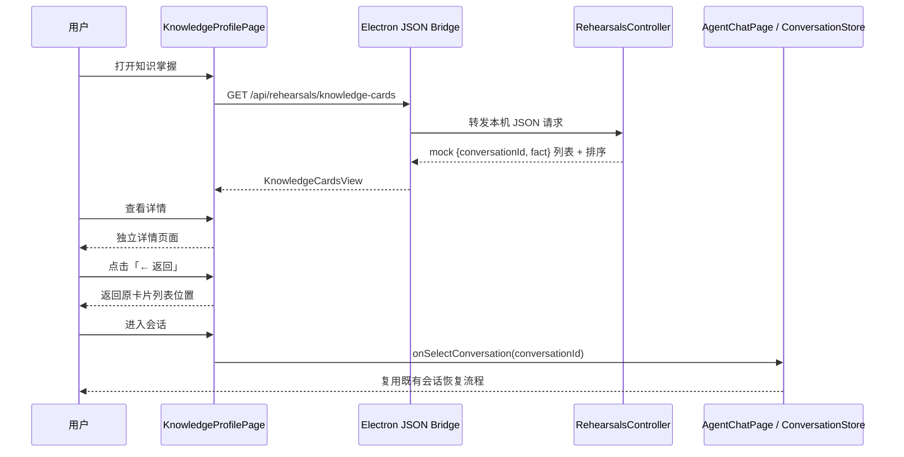

# 会话知识掌握卡片 Design

## Problem

当前应用没有知识掌握页面或跨会话评估 API。新的视觉稿以会话卡片为浏览单元；各会话的主题可以交叉，因此不建立严格领域树。后端真实聚合数据尚未实现，本次通过 mock API 固定前后端契约并让页面可交互；列表项复用会话事实 API 的响应结构。

## Goals

- 新增桌面端「知识掌握」视图和简洁双列卡片布局。
- 在后端定义可替换的卡片响应 schema 与 mock API；每个列表项复用 `{ conversationId, fact }` 会话事实响应结构。
- 卡片完整显示评估摘要；详情在独立页面查看。
- 通过单独的「进入会话」入口回到对应会话。
- 按掌握状态排序，同组按知识点最近有效考察时间倒序。

## Non-Goals

- 不生成或持久化真实跨会话评估。
- 不改现有演练状态机、报告格式、对话历史 API 或数据表。
- 不把会话主题归并成稳定知识领域。
- 不实现 Markdown 解析、证据溯源、分数、图表或复杂筛选。
- 不构造没有真实会话 ID 的 mock 样例；列表为空时不展示虚假跳转入口。

## Must-Not-Break Existing Behavior

- 资料库视图仍由左侧栏入口打开，不与「知识掌握」混用。
- 设置视图和会话列表、会话历史恢复、并行运行状态保持现状。
- 现有 `/api/rehearsals/:rehearsalId` 和会话级演练路由不被 mock 静态路由遮蔽。
- 进入卡片关联会话时复用现有 `loadConversation`，不创建新会话或替换现有会话历史。

## Current Behavior

- `ConversationSidebar` 只提供会话、资料库和设置视图。
- `RehearsalsController` 暴露单次演练详情与操作，没有知识卡片 API。
- 演练历史 API 仅按当前 conversation 查询；知识掌握页面尚未实现。

## Proposed Behavior

### API

- `GET /api/rehearsals/knowledge-cards` 保留 `{ items: ... }` 列表外壳，`items[]` 每项为 `{ conversationId, fact }`，字段严格复用 `docs/changes/2026-11-10-conversation-knowledge-facts/api-schema.json` 中的单会话响应 schema。
- mock fact 在 `RehearsalsController` 定义，并按真实会话 ID 绑定；会话标题由 Renderer 按 ID 与现有会话摘要合并。没有会话时返回空列表，不伪造导航 ID。每个真实会话对应一项；当前 mock 提供完整、已发布的 fact。
- 卡片等级映射为「建议加强 / 基本掌握 / 熟练掌握」；排序为 `needs_improvement` → `basic` → `proficient`，同组按知识点 `lastAssessedAt` 最大值倒序。不使用 `generatedAt`，不做时间衰减。
- 当前列表仍是只读 mock API；本次不修改事实表、事实生成 worker 或单会话 facts 路由。

### UI

- 左侧栏新增「知识掌握」入口，主区域显示页面标题和双列卡片，不显示整体印象、分组标题或解释性说明。
- 卡片始终显示会话标题、fact 标签、掌握状态和完整摘要；点击「查看详情」切换到单独的详情页面。
- 详情页面顶部显示「← 返回」按钮和会话标题；点击返回后回到卡片列表，并保留列表滚动位置。
- 详情页面以纯文本展示摘要和 `knowledgePointDetails`，不解析 Markdown。
- 卡片底部独立提供「进入会话」入口；每个列表项均关联真实会话 ID。
- 用边框、轻量底色和文字标签区别三种掌握状态；不使用卡片图标。
- `fact` 为空、尚无成功发布结果、摘要为空或总体等级为空的条目不渲染为带等级的卡片，不新增「暂不能判断」状态。

## Alternatives Considered

| 方案 | 结论 | 理由 | 是否升级为 ADR |
|---|---|---|---|
| 在 controller 中提供静态 mock 契约 | 采用 | 当前无真实跨会话评估数据；API schema 可以先稳定下来，不增加表和迁移 | n/a |
| 先新增数据库实体持久化知识卡片 | 否决 | 评估聚合规则仍未验证，超出本次 mock UI 范围 | n/a |
| 直接把卡片放进 Agent 对话视图 | 否决 | 卡片是独立浏览视图；在对话流中会与消息及演练状态混淆 | n/a |

## Business Flow

用户打开「知识掌握」，读取 mock fact 列表；Renderer 按 `conversationId` 关联已有会话摘要。摘要始终可见；点击详情入口切换到独立详情页面，页顶按钮返回列表；用户也可从卡片进入真实会话。

## End-to-End Data Interaction Flow

| 关键节点 | 输入 | 节点职责 | 输出 / 状态变化 | 关键边界 |
|---|---|---|---|---|
| KnowledgeProfilePage | 视图进入、会话摘要和 fact 列表 | 按 conversationId 补标题、映射展示状态、切换列表/详情视图及发出会话选择 | 卡片列表或单会话详情 | Renderer 只经桌面 bridge 请求 API |
| RehearsalsController | GET | 返回复用事实 schema 的 mock 列表并排序 | `KnowledgeCardsView` | 不写 SQLite、不运行事实生成 |
| AgentChatPage | `conversationId` | 切回 chat 并调用现有会话恢复 | 当前会话切换 | 空 ID 时不可进入 |

## Data And API Impact

- 不修改实体、数据库 schema 或迁移。
- 后端列表 item 复用 `ConversationKnowledgeFactsView` 类型；Renderer 为卡片派生展示字段，不要求 API 单独返回 `conversationTitle` 或卡片派生状态。
- 路由放在 `@Controller('rehearsals')` 下；静态 `knowledge-cards` 路由需先于 `:rehearsalId` 声明，避免被动态参数捕获。

## Frontend Fetching Logic

- 进入页面时通过 `window.teachforge.request` 请求 GET API；Renderer 使用 `conversationId` 与现有会话摘要合并标题。
- 错误时保留当前卡片并显示可操作错误文案；不通过浏览器直接请求 NestJS。

## Frontend Behavior

- 卡片摘要完整显示且不折叠；点击「查看详情」进入独立详情页面，页顶「← 返回」回到卡片列表并保留原滚动位置。详情由知识点名称、掌握程度、说明和变化文本组成，不渲染 Markdown。
- Renderer 仅渲染 `fact !== null`、`generatedAt !== null`、摘要非空且总体 `masteryLevel` 非空的条目；总体等级为空不新增第四种 UI 状态。`knowledgePointDetails` 为空数组时隐藏详情入口。
- 点击「进入会话」调用 AgentChatPage 传入的会话选择回调。
- 显示的卡片都关联真实 conversation ID；标题从 `ConversationSummary` 按 ID 查找，缺失时显示「未命名会话」。
- `needs_improvement` 映射为「建议加强」，`basic` 映射为「基本掌握」，`proficient` 映射为「熟练掌握」。

## Backend Fetching Logic

- GET 读取 controller 中的固定 mock fact，并按真实会话 ID 关联；mock 内容不根据会话内容或演练报告计算。
- 每次 GET 按等级排序：`needs_improvement` → `basic` → `proficient`，同组按知识点中最新非空 `lastAssessedAt` 倒序；`generatedAt` 只表示事实发布时间，不作为考察时间。
- 没有会话时返回 `{ items: [] }`；不返回不符合 UUID 契约的示例 ID。mock item 的 `fact` 字段完整符合事实 API schema。

## Backend Behavior

- mock endpoint 不声称是实际演练结论；替换为真实数据前需保留同一字段契约或进行显式 schema 版本调整。

## Error Handling

- Renderer bridge 不可用时显示桌面端使用提示。
- GET 非 2xx 或 schema 不匹配时显示重试提示，不清空已加载卡片。
- 空 `conversationId` 禁用导航入口，不发送历史读取请求。

## Risks

- mock mastery 与真实会话内容不匹配会误导用户；当前页面需作为原型/演示数据使用。

## Verification

- 代码走查 API 字段、静态路由顺序和排序顺序。
- 前端构建/类型检查和桌面端视觉交互检查列入计划，但本次是否执行由用户要求决定。

## Design Deviations

| 偏差 | 发现于 | 与设计不符之处 | 处理（改设计 / 改现状文档 / 接受） |
|---|---|---|---|

## Version History

<!-- 后续交付后的开发者反馈从 v4.0 开始记录。 -->

### v1.0 — 2026-11-10（历史基线）

- 原契约：列表项使用独立扁平卡片字段 `cardId`、`conversationTitle`、`masteryStatus`、`assessmentSummary`、`assessmentDetails`、`evaluatedAt`。
- 后续反馈：开发者提供会话事实 API schema，并明确要求改造现有卡片 API schema。
- 替代关系：由 v2.0 的 `{ conversationId, fact }` 结构替代；保留原路由 `/api/rehearsals/knowledge-cards` 和 `{ items }` 外壳。
- 处理状态：已被 v2.0 替代。

### v2.0 — 2026-11-10

- 触发：开发者提供会话事实 API schema，并明确选择改造现有知识卡片 API schema。
- 改动内容：现有列表路由保留，`items[]` 改为 `{ conversationId, fact }`；卡片状态改由 fact 等级映射，同组排序改用 `lastAssessedAt`。
- 影响范围：API 契约、前端卡片映射、mock 空值处理及排序；不改变事实存储和生成流程的职责范围。
- 处理状态：已实施，产品构建和视觉验收未执行。

### v3.0 — 2026-11-10

- 触发：开发者反馈详情内容通常较长，要求点击详情后切换到单独页面，并通过页顶「←」返回。
- 改动内容：详情从卡片内展开改为独立详情视图；列表保留挂载状态以恢复原滚动位置。
- 影响范围：知识掌握页面的详情交互与返回行为；API schema、摘要、卡片排序及会话入口保持既有契约。
- 处理状态：已按反馈实施，产品构建和视觉验收未执行。

## Current Doc Updates

- [x] `docs/current/domains/knowledge-profile/index.md`
- [x] `docs/current/domains/knowledge-profile/api-contract.md`
- [x] `docs/current/index.md`
- [x] `docs/current/domains/README.md`
- [x] `docs/current/domains/rehearsals/index.md`
- [x] `docs/current/domains/rehearsals/api-contract.md`
- [x] `docs/current/platform/architecture-and-code-placement.md`
- [x] `docs/changes/README.md`
- [x] `docs/index.md`
- [x] `docs/manifest.yaml`
