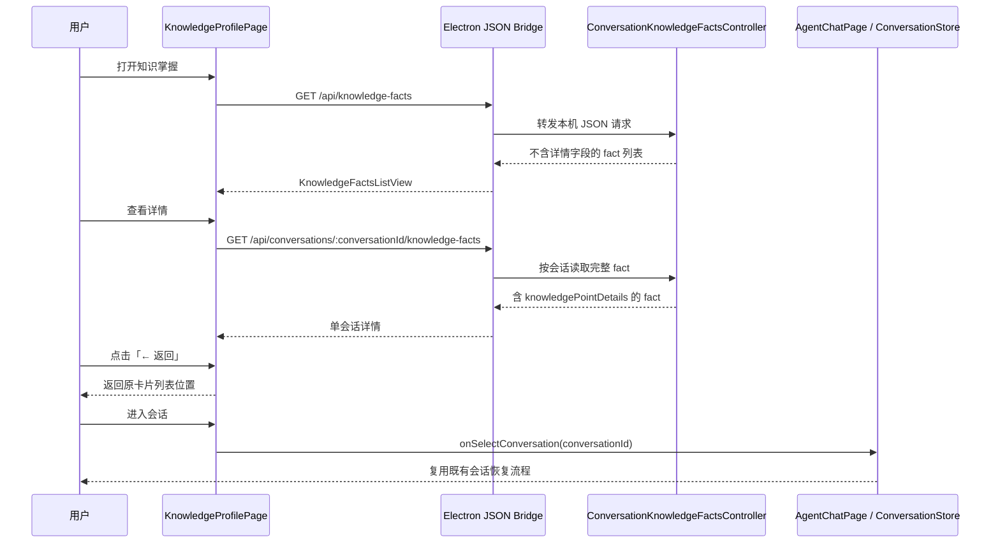

# 会话知识掌握卡片 Design

## Problem

当前应用需要把会话知识事实展示为易读的卡片；各会话的主题可以交叉，因此不建立严格领域树。事实列表和单会话详情 API 已提供，Renderer 应使用轻量列表数据，并延迟加载较大的知识点详情。

## Goals

- 新增桌面端「知识掌握」视图和简洁双列卡片布局。
- 使用现有 facts 列表 API 填充卡片，并在用户打开详情时调用单会话 facts API。
- 卡片完整显示评估摘要；详情在独立页面查看。
- 通过单独的「进入会话」入口回到对应会话。
- 按掌握状态排序，同组按轻量列表已有的更新时间倒序。

## Non-Goals

- 不从卡片页面重新生成或持久化知识事实；事实由其所属 API 与服务维护。
- 不改现有演练状态机、报告格式、对话历史 API 或数据表。
- 不把会话主题归并成稳定知识领域。
- 不实现 Markdown 解析、证据溯源、分数、图表或复杂筛选。

## Must-Not-Break Existing Behavior

- 资料库视图仍由左侧栏入口打开，不与「知识掌握」混用。
- 设置视图和会话列表、会话历史恢复、并行运行状态保持现状。
- 现有 `/api/rehearsals/:rehearsalId` 和会话级演练路由保持可用。
- 进入卡片关联会话时复用现有 `loadConversation`，不创建新会话或替换现有会话历史。

## Current Behavior

- `ConversationKnowledgeFactsController` 提供轻量集合读取和单会话完整事实读取。
- 知识掌握页面以会话卡片显示摘要；知识点详情在单独页面查看。

## Proposed Behavior

### API

- 页面通过 `GET /api/knowledge-facts` 读取 `{ items }` 轻量集合；每项包含 `conversationId`、摘要、标签、总体等级和时间/生成状态，不包含 `knowledgePointDetails`。
- 点击「查看详情」后切换到单独详情页面，并调用 `GET /api/conversations/:conversationId/knowledge-facts` 读取完整事实；详情请求不在列表初始化或排序时触发。
- 会话标题由 Renderer 按 ID 与现有会话摘要合并。列表只呈现已成功发布且摘要非空、总体等级非空的事实。
- 掌握状态映射为「建议加强 / 基本掌握 / 熟练掌握」；排序为 `needs_improvement` → `basic` → `proficient`，同组按轻量列表已有的 `updatedAt` 倒序。不为排序读取详情，不做时间衰减。

### UI

- 左侧栏新增「知识掌握」入口，主区域显示页面标题和双列卡片，不显示整体印象、分组标题或解释性说明。
- 卡片始终显示会话标题、fact 标签、掌握状态和完整摘要；点击「查看详情」切换到单独的详情页面。
- 详情页面顶部显示「← 返回」按钮和会话标题；点击返回后回到卡片列表，并保留列表滚动位置。
- 详情页面以纯文本展示摘要和 `knowledgePointDetails`，不解析 Markdown。
- 卡片底部独立提供「进入会话」入口；每个列表项均关联真实会话 ID。
- 用边框、轻量底色和文字标签区别三种掌握状态；不使用卡片图标。
- `fact` 为空、尚无成功发布结果、摘要为空或总体等级为空的条目不渲染为带等级的卡片，不新增「暂不能判断」状态。

## Alternatives Considered

| 方案 | 结论 | 理由 | 是否升级为 ADR |
|---|---|---|---|
| 在 controller 中提供静态 mock 契约 | 采用 | 当前无真实跨会话评估数据；API schema 可以先稳定下来，不增加表和迁移 | n/a |
| 先新增数据库实体持久化知识卡片 | 否决 | 评估聚合规则仍未验证，超出本次 mock UI 范围 | n/a |
| 直接把卡片放进 Agent 对话视图 | 否决 | 卡片是独立浏览视图；在对话流中会与消息及演练状态混淆 | n/a |

## Business Flow

用户打开「知识掌握」，读取轻量 fact 列表；Renderer 按 `conversationId` 关联已有会话摘要。摘要始终可见；点击详情入口切换到独立详情页面并按会话读取详情，页顶按钮返回列表；用户也可从卡片进入真实会话。

## End-to-End Data Interaction Flow

| 关键节点 | 输入 | 节点职责 | 输出 / 状态变化 | 关键边界 |
|---|---|---|---|---|
| KnowledgeProfilePage | 视图进入、会话摘要和轻量 fact 列表 | 按 conversationId 补标题、映射展示状态；打开详情后再请求完整 fact | 卡片列表或单会话详情 | Renderer 只经桌面 bridge 请求 API |
| ConversationKnowledgeFactsController | 集合 GET / 单会话 GET | 列表省略 knowledge-point details，详情按 conversationId 返回完整 fact | 轻量集合 / 单会话详情 | 只读，不由页面触发生成 |
| AgentChatPage | `conversationId` | 切回 chat 并调用现有会话恢复 | 当前会话切换 | 空 ID 时不可进入 |

## Data And API Impact

- 本次不修改实体、数据库 schema、迁移或 facts API。
- 列表使用 `ConversationKnowledgeFactListItem`；详情使用 `ConversationKnowledgeFactsView`。Renderer 不要求 API 单独返回 `conversationTitle` 或卡片派生状态。

## Frontend Fetching Logic

- 进入页面时通过 `window.teachforge.request` 请求 `GET /api/knowledge-facts`，并按 `conversationId` 与现有会话摘要合并标题。
- 点击「查看详情」后，请求 `GET /api/conversations/:conversationId/knowledge-facts`；只有打开详情页时才传输完整知识点内容。
- 列表失败可重试；详情失败时留在详情页提供重试，页顶返回仍可回到原列表位置。不通过浏览器直接请求 NestJS。

## Frontend Behavior

- 卡片摘要完整显示且不折叠；点击「查看详情」进入独立详情页面并发起单会话 GET，页顶「← 返回」回到卡片列表并保留原滚动位置。详情由知识点名称、掌握程度、说明和变化文本组成，不渲染 Markdown。
- Renderer 渲染 `generatedAt !== null`、摘要非空且标签非空的已发布条目；总体 `masteryLevel=null` 时显示第四种状态「证据不足」，不能把“已发布但整体证据不足”误判为没有记录。列表不含 knowledgePointDetails，所以每个有效卡片都显示详情入口；详情为空时显示空详情文案。
- 点击「进入会话」调用 AgentChatPage 传入的会话选择回调。
- 显示的卡片都关联真实 conversation ID；标题从 `ConversationSummary` 按 ID 查找，缺失时显示「未命名会话」。
- `needs_improvement` 映射为「建议加强」，`null` 映射为「证据不足」，`basic` 映射为「基本掌握」，`proficient` 映射为「熟练掌握」。

## Backend Fetching Logic

- facts 服务的列表 API 只查询小字段；`knowledgePointDetails` 保留在持久化行中并由单会话 GET 按需读取。
- 页面列表排序不使用详情字段：先按等级（建议加强 → 证据不足 → 基本掌握 → 熟练掌握），再按 `updatedAt` 倒序；API 集合本身按 `updatedAt DESC, conversationId ASC` 返回。

## Backend Behavior

- Renderer 消费已提供的事实查询契约；卡片展示不触发生成、不写事实数据。

## Error Handling

- Renderer bridge 不可用时显示桌面端使用提示。
- 列表 GET 非 2xx 或 schema 不匹配时显示重试提示，不清空已加载卡片。
- 详情 GET 非 2xx 或 schema 不匹配时在详情页显示重试提示；返回列表时使迟到请求失效，避免旧响应改变视图状态。
- 空 `conversationId` 禁用导航入口，不发送历史读取请求。

## Risks

- 列表摘要与详情可能在后台重新生成期间更新；详情页以按需 GET 返回的当前事实为准。

## Verification

- 代码走查列表响应不包含详情字段，打开详情才发起单会话 GET，并检查加载/失败/重试和返回行为。
- 前端构建/类型检查和桌面端视觉交互检查列入计划，但本次是否执行由用户要求决定。

## Design Deviations

| 偏差 | 发现于 | 与设计不符之处 | 处理（改设计 / 改现状文档 / 接受） |
|---|---|---|---|

## Version History

<!-- 后续交付后的开发者反馈从 v5.0 开始记录。 -->

### v1.0 — 2026-11-10（历史基线）

- 原契约：列表项使用独立扁平卡片字段 `cardId`、`conversationTitle`、`masteryStatus`、`assessmentSummary`、`assessmentDetails`、`evaluatedAt`。
- 后续反馈：开发者提供会话事实 API schema，并明确要求改造现有卡片 API schema。
- 替代关系：由 v2.0 的 `{ conversationId, fact }` 结构替代；保留原路由 `/api/rehearsals/knowledge-cards` 和 `{ items }` 外壳。
- 处理状态：已被 v2.0 替代。

### v2.0 — 2026-11-10

- 触发：开发者提供会话事实 API schema，并明确选择改造现有知识卡片 API schema。
- 改动内容：现有列表路由保留，`items[]` 改为 `{ conversationId, fact }`；卡片状态改由 fact 等级映射，同组排序改用 `lastAssessedAt`。
- 影响范围：API 契约、前端卡片映射、mock 空值处理及排序；不改变事实存储和生成流程的职责范围。
- 处理状态：已实施，产品构建和视觉验收未执行。

### v3.0 — 2026-11-10

- 触发：开发者反馈详情内容通常较长，要求点击详情后切换到单独页面，并通过页顶「←」返回。
- 改动内容：详情从卡片内展开改为独立详情视图；列表保留挂载状态以恢复原滚动位置。
- 影响范围：知识掌握页面的详情交互与返回行为；API schema、摘要、卡片排序及会话入口保持既有契约。
- 处理状态：已按反馈实施，产品构建和视觉验收未执行。

### v5.0 — 2026-11-10

- 触发：用户反馈 `conversation_knowledge_facts` 已有记录，但知识掌握页看不到。
- 根因：事实已发布且摘要/标签完整，但整体 `masteryLevel` 为 null（证据不足）；Renderer 的过滤条件把 null 等级当作未发布。
- 改动内容：保留 null 等级卡片，新增「证据不足」视觉状态；排序加入该状态；移除“总体等级为空不新增状态”的旧约束。
- 影响范围：知识掌握卡片过滤、排序与状态展示；列表/详情 API 和事实持久化不变。

### v4.0 — 2026-11-10

- 触发：开发者说明 facts 列表已提供，但为性能考虑不返回详情字段；点击详情需要单独 GET。
- 改动内容：知识掌握列表改为 `GET /api/knowledge-facts`，详情打开后按会话请求 `GET /api/conversations/:conversationId/knowledge-facts`；增加详情加载、重试和迟到请求失效处理。
- 影响范围：前端 API 客户端、卡片列表与详情页、当前 API 契约；事实列表不预加载知识点详情。
- 处理状态：已按反馈实施，测试、构建和视觉验收未执行。

## Current Doc Updates

- [x] `docs/current/domains/knowledge-profile/index.md`
- [x] `docs/current/domains/knowledge-profile/api-contract.md`
- [x] `docs/current/index.md`
- [x] `docs/current/domains/README.md`
- [x] `docs/current/domains/rehearsals/index.md`
- [x] `docs/current/domains/rehearsals/api-contract.md`
- [x] `docs/current/platform/architecture-and-code-placement.md`
- [x] `docs/changes/README.md`
- [x] `docs/index.md`
- [x] `docs/manifest.yaml`
