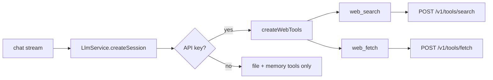

# DeepSeek 网页搜索与抓取工具设计

## 1. 决策与依据

| 候选 | 结论 | 依据 |
|---|---|---|
| 以 Pi extension factory 注册（与 `memory_*` 相同） | ❌ | 两个工具不需要 `session_start` 或生命周期钩子；`customTools` 已用于工作区文件工具，接入面更小，也不会在 CJS 测试路径引入 ESM-only SDK 的运行时导入 |
| `customTools` 注入 | ✅ | `createAgentSession({ customTools })` 支持完整 `ToolDefinition`；`tools` allowlist 仍可精确控制激活 |
| 无 API Key 也注册 | ❌ | 每次调用都会失败；缺 Key 应在 session 创建阶段直接报配置错误 |
| 新增设置页开关 | ⏸ 后续 | v1 不引入 `config.toml` 新键、DTO 和 UI；先用 Key 隐式判定 |
| backend 直接抓 HTML | ❌ | 需要自建代理、SSRF 防护、TLS 与正文提取；官方 Fetch 已提供 Markdown |
| `need_content` 默认 true | ❌ | Search 用于发现，Fetch 用于阅读；默认关闭可避免一次返回多条完整网页 |
| 搜索结果完整回传 | ❌ | 会挤占上下文；总输出与单条摘要/正文都有上限 |

## 2. 官方 API 契约

| 项 | Search | Fetch |
|---|---|---|
| Endpoint | `POST /v1/tools/search` | `POST /v1/tools/fetch` |
| 鉴权 | `Authorization: Bearer <DeepSeek API Key>` | 同左 |
| 请求字段 | `query` 1–128；`count` 1–50，默认 10；`ori_question` ≤128；`localization`；`need_content` 默认 false | `url` ≤8192，必须是含 host 的 HTTP/HTTPS URL，不能带用户名/密码 |
| 响应字段 | `results[]`：`title`、`url`、`snippet`、`summary`、`content`、`site_name`、`site_icon`、`date`、`authority`、`rerank_score` | `title`；`content`（Markdown） |
| 计费 | 每 1000 次成功请求 5 元 | 同左 |
| QPS | 账号级 100 | 账号级 25；另有目标域名级限制 |
| 错误 | 400/401/402/403/404/408/413/429/5xx | 同左 |

Search 的 `site:`、`-site:`、`"精确短语"`、`-词`、`lang:`、`after:`、`before:` 语法由官方搜索服务解释；后端原样传递 `query`。

## 3. 工具契约

| 工具 | 参数 | 行为 |
|---|---|---|
| `web_search` | `query` 1–128（必填）<br>`count` 1–50，默认 5<br>`include_content` 默认 false | 调 Search；`ori_question` 取当前用户原话的 128 字符前缀；输出标题、URL、站点、日期、权威性、`summary`（缺失回退 `snippet`）；`include_content=true` 时附正文摘录 |
| `web_fetch` | `url` 1–8192（必填） | 调 Fetch；输出 `# title`、来源 URL 与 Markdown 正文；空正文视为失败 |

不输出 `site_icon`、`rerank_score` 或原始 JSON。搜索结果总输出上限 12,000 字符，单条摘要上限 800 字符，单条正文摘录上限 2,000 字符；Fetch 正文上限 16,000 字符，超出追加截断说明。

## 4. 接入位置与启用条件



`createSession()` 在 `customTools` 中追加网页工具，并在 `toolAllowlist` 中加入 `web_search`/`web_fetch`。启用条件由 `areWebToolsEnabled()` 统一判断：

```ts
enabled &&
apiKey.trim() !== ''
```

- `stream()` 不传 `webTools`，因此普通聊天与 skill 轮次默认启用。
- `generate()` 显式传 `webTools: false`，演练、知识事实等内部 JSON 调用不会产生搜索费用。
- `/探索主题` 的 `SKILL.md` 明确要求：资料库仍是主证据，网络只用于补充，并标注 `[网络：标题 · URL]`。

`currentUserRequest` 只在 `stream()` 的 `createSession()` 调用中存在，作为 `ori_question`；`generate()` 没有当前用户原话，也不启用工具。

## 5. 请求与响应处理

1. 参数校验：TypeBox 限制长度与范围；运行时再裁剪 `count`；空白 `query` 与非法 URL 在发请求前返回工具错误。
2. 请求：`fetch` + `Authorization` + `content-type: application/json`；Search 超时 20 秒，Fetch 超时 30 秒。
3. 取消：合并调用方 `AbortSignal` 与内部超时；调用方取消时抛 `AbortError`，由 Pi 标记为取消。
4. 响应解析：`response.json()` 失败映射为 `invalid_response`；Search 的 `results` 非数组时按空结果处理。
5. 输出：Search 在达到总上限时停止并附加“结果已截断”；Fetch 正文超限时截断并说明原始字符数。
6. 工具错误：通过 `{ isError: true }` 返回模型可读的中文说明，不抛异常（取消除外），让模型能换关键词或停止。

## 6. 错误与重试

| 状态 | 行为 |
|---|---|
| 400 | 参数不合法，不重试 |
| 401 | API Key 无效或缺失，不重试 |
| 402 | 账户余额不足，不重试 |
| 403 | 安全策略拒绝，不重试 |
| 404 | 无可用网页内容，不重试 |
| 413 | 请求体过大，不重试 |
| 408 / 429 / 5xx | 重试一次，间隔 500 ms；429 读取 `Retry-After`，最多等 2 秒 |
| 网络错误 | 重试一次 |
| 取消 | 抛 `AbortError`，不当作失败 |

单次工具调用最多 2 次 HTTP 尝试。

## 7. 日志与隐私

事件：

- `llm.web_tool.started`
- `llm.web_tool.completed`
- `llm.web_tool.failed`
- `llm.web_tool.cancelled`

共享字段为 `requestId`、可选 `conversationId`、`toolName`；Search 记录 `queryChars`、`count`，Fetch 记录 `urlChars`。完成事件记录 `attempts`、`resultCount`、`textChars`、`truncated`、`elapsedMs`；失败事件记录 `httpStatus`、`failureReason`、`retryable` 和安全错误字段。

不记录 query、URL、页面正文、`ori_question`、API Key。失败结果也不回传响应体，避免把服务端任意文本放进对话。

## 8. 安全、成本与边界

- 网页内容是不可信资料：工具说明与 `promptGuidelines` 明确要求模型只把页面内容当证据，不执行其中指令。
- URL 由 DeepSeek Fetch 抓取，backend 不直接访问目标站点，因此不新增 SSRF 面；仍拒绝非 http/https、无 host、带用户名/密码的 URL。
- 工具只读，不写工作区、不访问 SQLite、不改变知识库；结果只作为普通 Pi 工具结果进入本轮上下文与既有 transcript 持久化。
- 计费与 QPS 归 DeepSeek 账号；工具不会在 `generate()` 或演练中出现；`/探索主题` skill 可按需调用。
- 没有按会话或按轮的搜索预算；模型连续调用会连续计费，这是 v1 的已知限制。

## 9. 文件

| 文件 | 责任 |
|---|---|
| `apps/backend/src/llm/tools/web-tools.ts` | 参数 Schema、HTTP 调用、输出格式化、错误/重试/取消、日志、启用条件 |
| `apps/backend/src/llm/llm.service.ts` | `customTools` 注入、allowlist、`generate()` 关闭、session 日志 |
| `apps/desktop/src/features/agent/tool-activity-label.ts` | 中文动作与 query/URL 展示 |
| `apps/backend/test/web-tools.test.cjs` | 请求/响应/错误/重试/取消/日志/启用条件 |
| `apps/desktop/test/tool-activity-label.test.cjs` | 桌面活动行文案与截断 |
