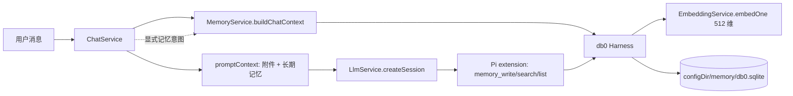

# 长期记忆（db0 + 本地 bge）设计

## 1. 决策与依据

| 候选 | 结论 | 依据 |
|---|---|---|
| `@db0-ai/pi@0.3.0` 直接装载 | ❌ 不可用 | `registerTool` 传 `inputSchema`，Pi `loader.js` 要求 `tool.parameters` 为对象并在扩展加载时抛错；`execute(args)` 与 Pi 的 `execute(toolCallId, params, signal, onUpdate, ctx)` 不符；`before_agent_start` 无返回值、`turn_end` 读 `ctx.message`（实际在 `event.message`）；`session_shutdown` 在 `dispose()` 时不触发 |
| `sqlite-memory` 全量替代 | ❌ v1 不采用 | 本地嵌入只能走 llama.cpp GGUF 或 vectors.space 远程；无 SQL 入口写预计算向量，C API `sqlite3_memory_register_provider` 在 Node 侧不可达；记忆模型是“文本块 + context”，没有 scope/supersede |
| db0 默认 hash embedding | ❌ | 官方注释明确“NOT a semantic embedding”；中文按字符 trigram 哈希，召回不可用 |
| db0 + `EmbeddingService`（本方案） | ✅ | `HarnessConfig.embeddingFn` / `batchEmbeddingFn` 是官方扩展点；`db0_memory.embedding` 是无维度约束 BLOB；余弦在 JS 侧计算，512 维可直接使用 |
| 记忆注入写系统提示词 | ❌ | `ChatService` 明确规定 per-turn 材料随用户消息走，系统提示词跨轮稳定以保住 provider 前缀缓存；`before_agent_start` 返回 `systemPrompt` 会破坏该不变量 |
| 记忆注入走 `promptContext` | ✅ | 复用现有 `composeModelPrompt`（`## 用户输入` 分隔）与快照清洗，注入内容不进入 SQLite 消息 |

## 2. 组件与数据流



| 单元 | 责任 |
|---|---|
| `SettingsService` | 提供 `<configDir>/memory` 绝对路径；把该目录加入受保护路径 |
| `MemoryService` | db0 引擎单例、Embedding 注入、独占锁与每日备份、写入队列、`buildChatContext()`、`write()`、`captureUserMessage()`、`createToolExtension()`、关闭 backend |
| `MemoryToolExtension` | 进程内 Pi 扩展工厂：注册三个工具、调用 `MemoryService.write/search/list` |
| `LlmService` | 按 `loadMemory` 决定是否装载扩展与 `memory_*` allowlist |
| `ChatService` | 每轮构建记忆块、拼接 `promptContext`、触发显式意图写入 |
| `MemoryController`（可选） | `GET/DELETE /api/memories` 的本地管理接口（§10.2） |
| `session-entries.ts` | 快照清洗时识别 `## 长期记忆` 头 |

## 3. 存储与数据模型

- 文件：`<configDir>/memory/db0.sqlite`；首次写入（或迁移）时由 sql.js 的 `persist()` 创建目录与文件。
- 只使用 db0 的 `db0_memory` 表；`db0_state`、`db0_log`、`db0_memory_edges` 保留表结构但不主动写入。**禁止**在每轮 `before_agent_start` 写 `log().append`：sql.js 每次写都会整库 `writeFileSync`。
- 行字段（v1 语义）：

| 字段 | 用法 |
|---|---|
| `agent_id` | 固定 `teachforge` |
| `session_id` | 写入时固定 `NULL`（v1 只用 user scope），检索不按会话过滤 |
| `user_id` | 固定 `local-user`（单人模型） |
| `content` | 记忆原文，≤ 1000 字符 |
| `summary` | db0 自动生成（首句），只用于注入展示 |
| `scope` | 只写 `user`；`session`/`task`/`agent` 不开放给模型 |
| `embedding` | 512 × float32 = 2048 B，来自 `EmbeddingService` |
| `tags` | 工具传入 + db0 实体标签 |
| `status` / `supersedes_id` | db0 去重/冲突检测使用；v1 不开放人工 supersede |

- 嵌入身份：`db0_meta.embedding_id = "local:bge-small-zh-v1.5:512"`。初始化时读取：
  - 为空 → 写入；
  - 不一致 → 调 `harness.migrateEmbeddings(embeddingFn, batchEmbeddingFn, id)`，记录 `reEmbedded`/`failed`；失败则记录错误并让记忆功能降级（见 §9）；
  - 一致 → 无操作。
- 维度保护：`cosineSimilarity` 在维度不一致时抛 `Vector dimension mismatch`；不允许在同一库混用 hash（384）与 bge（512）。

## 4. `MemoryService` 接口契约

```ts
export interface MemoryRecord {
  id: string;
  content: string;
  tags: string[];
  createdAt: string;
}

export interface MemoryWriteResult {
  status: 'saved' | 'duplicate' | 'superseded';
  id: string | null;
  /** superseded 时为被覆盖的旧记忆 id。 */
  supersedes?: string;
}

@Injectable()
export class MemoryService implements OnModuleInit, OnApplicationShutdown {
  constructor(embedding: EmbeddingService, settings: SettingsService) {}

  /** 创建记忆目录并安排后台预热；不阻塞应用启动。 */
  async onModuleInit(): Promise<void>;

  /** 释放锁并关闭 sql.js backend；只由 Nest 生命周期调用。 */
  onApplicationShutdown(): Promise<void>;

  /** 返回可拼进 promptContext 的记忆块；禁用、空库、超时、任何失败都返回 ''。 */
  async buildChatContext(userPrompt: string): Promise<string>;

  /** 返回 Pi 扩展工厂；引擎禁用或锁定不可用时返回 undefined，聊天继续。 */
  async createToolExtension(): Promise<PiExtensionFactory | undefined>;

  /** 统一写入路径：精确去重 → 中文极性冲突 → supersede；否则 ingest（§8.3）。 */
  async write(content: string, tags?: string[]): Promise<MemoryWriteResult>;

  /** 工具检索；比注入更宽松的阈值，返回结构化结果。 */
  async search(query: string, limit?: number): Promise<MemoryRecord[]>;

  /** 工具列表；只返回 active，最多 50 条。 */
  async list(): Promise<MemoryRecord[]>;

  /** 显式记忆意图的自动写入；fire-and-forget，绝不抛错。 */
  captureUserMessage(text: string): void;
}
```

可选（T0 决策 2 = 需要时）：`listForUi()`、`deleteMemory(id)`、`clearMemories()`，供 `GET/DELETE /api/memories` 使用（§10.2）。

内部实现：

```ts
type Db0Core = typeof import('@db0-ai/core');
type Db0Sqlite = typeof import('@db0-ai/backends-sqlite');

// 后端是 CommonJS，db0 是 ESM-only；与 llm.service.ts 的 importPiSdk 同一手法。
const importDb0 = new Function('specifier', 'return import(specifier)') as
  <T>(specifier: string) => Promise<T>;

private engine?: { core: Db0Core; backend: Db0Backend; embeddingId: string };
private enginePromise?: Promise<typeof this.engine>;
/** 串行化所有写入（工具、自动捕获、迁移），避免同一 sql.js 实例并发持久化。 */
private writeQueue: Promise<unknown> = Promise.resolve();
/** 独占锁不可用时的原因；非空时记忆整体降级为只读禁用。 */
private disabledReason: 'locked' | 'init_failed' | 'embedding_failed' | null = null;
```

- 引擎懒加载：首次 `buildChatContext` / `write` / `createToolExtension` 时初始化；失败后清空 `enginePromise`，下次重试。
- `harnessFor(conversationId)` 每次新建（无状态、不持有连接）：

```ts
core.db0.harness({
  agentId: 'teachforge',
  sessionId: conversationId,
  userId: 'local-user',
  backend,
  embeddingFn: (text) => this.embedding.embedOne(text),
  batchEmbeddingFn: (texts) => this.embedding.embed(texts),
  profile: core.mergeProfiles(core.PROFILE_CODING_ASSISTANT, {
    retrieval: { scoring: 'similarity', minScore: MEMORY_MIN_SCORE, topK: 3, graphExpand: { enabled: false } },
    context: { includeEdges: false },
  }),
});
```

## 5. 工具扩展

`createToolExtension(conversationId)` 返回一个同步注册的 Pi 工厂：

```ts
(pi) => {
  pi.registerTool(memoryWriteTool);
  pi.registerTool(memorySearchTool);
  pi.registerTool(memoryListTool);
}
```

约束（Pi 1.5 实际契约）：

- 每个工具必须提供 `name`、`label`、`description`、`parameters`（`typebox` 的 `Type.Object`）；
- `execute(toolCallId, params, signal, onUpdate, ctx)` 返回 `{ content: [{ type: 'text', text }], details }`；
- 工具名必须被 `createAgentSession({ tools })` 的 allowlist 覆盖，否则被静默过滤。

参数与行为：

| 工具 | 参数 | 行为 |
|---|---|---|
| `memory_write` | `content`（2–1000 字）、`tags?`（≤5 个，每个 ≤24 字） | `MemoryService.write()`：精确去重、中文极性冲突判定、必要时 `supersedes`（见 §8.3）；结果 `saved` / `duplicate` / `superseded` |
| `memory_search` | `query`、`limit`（1–10，默认 5） | `memory().search({ embedding: embedOne(query), scope: ['user'], limit, minScore: 0.35 })` |
| `memory_list` | 无 | `memory().list('user')`，过滤 `status === 'active'`，最多 50 条 |

返回值里的 `content` 截断到 300 字符，避免工具输出撑爆上下文；`details` 只放 `{ count }` 等结构字段。

工具描述用中文，明确“只记录长期有效的事实/偏好/要求；不要记录一次性的任务细节、文件内容、教学掌握度或回答风格”。

工具执行前必须检查 `disabledReason`：非空时返回固定的“记忆暂不可用”文本，不抛异常。

## 6. 上下文注入

常量：

```ts
const MEMORY_CONTEXT_HEADER = '## 长期记忆';
const MEMORY_TOKEN_BUDGET = 400;   // db0 用 text.length / 4 估算；中文另按字符上限兜底
const MEMORY_MAX_ITEMS = 3;
const MEMORY_MIN_SCORE = 0.65;     // 本机实测：无关中文句 0.59–0.64，相关句 0.70–0.76
const MEMORY_CONTENT_MAX_CHARS = 200;
const MEMORY_CONTEXT_TIMEOUT_MS = 1500;
```

`buildChatContext(userPrompt)`：

1. `disabledReason !== null` 或引擎未就绪 → 返回 `''`（不触发同步初始化）。
2. `harness.context().pack(userPrompt, { scopes: ['user'], tokenBudget: 400, maxItems: 3, minScore: 0.65 })`，外层用 `MEMORY_CONTEXT_TIMEOUT_MS` 包 `Promise.race`；超时或异常返回 `''`。
3. 过滤 `status === 'active'`，按 `score` 降序、同分按 `createdAt` 降序；最多 3 条。
4. 用 `ctx.memories` 自己排版（不直接用 db0 的英文 `## Relevant Memory` 头）：

```text
## 长期记忆
以下内容来自跨会话长期记忆；只在与当前请求相关时使用，不要逐条复述。若与用户当前指令或 SOULS 风格设置冲突，以当前指令 / SOULS 为准。
- [2026-11-08] 用户偏好：讲解知识点时先给结论，再给具体例子。
- [2026-11-05] 用户是初中数学老师，学生基础较弱。
```

5. 每条截断到 200 字符；日期取 `createdAt` 的 `YYYY-MM-DD`。空列表返回 `''`。

阈值依据：本机探针中“公开课准备”“讲课风格偏好”“用中文输出”的 top-1 分别为 0.7586 / 0.7539 / 0.7070，而无关记忆落在 0.59–0.65；0.65 是当前语料下的分离点，仍需真实教师语料复核。若上线后召回不足，优先降到 0.62，而不是回到 0.5。

`ChatService` 拼接：

```ts
const memoryContext = await this.memory.buildChatContext(userPrompt);
const promptContext = [attachmentContext, memoryContext]
  .filter((part): part is string => Boolean(part))
  .join('\n\n');
```

`composeModelPrompt()` 生成 `${material}\n\n## 用户输入\n${prompt}`；`LlmService` 保存快照时调用 `replaceInjectedUserText()`：

- 当前 user 条目用干净 `prompt` 替换；
- 历史条目若以已知注入头开头，用 `## 用户输入` 分隔符剥离；
- **因此** `session-entries.ts` 的 `injectedHeaders` 必须新增 `'## 长期记忆'`，否则崩溃恢复或旧快照会重复回放记忆块。

## 7. 会话装载与开关

`LlmService` 改动点：

| 位置 | 改动 |
|---|---|
| `LlmRequestOptions` / `LlmGenerateOptions` | 新增 `loadMemory?: boolean`；`generate()` 默认 `false`，`stream()` 默认 `true` |
| `PiSessionBuildOptions` | 新增 `loadMemory?: boolean` |
| `createSession()` | `const loadMemory = buildOptions.loadMemory ?? true;` |
| 扩展工厂 | `loadMemory` 时 `await this.memory.createToolExtension(conversationId)`，返回 `undefined` 则跳过 |
| allowlist | 当 `loadMemory && buildOptions.tools === undefined` 时追加 `'memory_*'`；显式 `tools: []`（演练/JSON）不追加 |
| 日志 | `llm.session.create.completed` 增加 `loadMemory`、`memoryToolCount` |

`runTurn` 矩阵：

| 调用 | `tools` | `loadMemory` | 工具 | 注入 | 自动写入 |
|---|---|---|---|---|---|
| 聊天 `stream()` | 默认列表 + `memory_*` | `true` | ✅ | ✅ | ✅ |
| 演练 / 知识事实 `generate()` | `[]` | `false` | ❌ | ❌ | ❌ |

## 8. 写入策略

### 8.1 模型工具

系统提示词（仅普通聊天，演练不拼接）新增一条：

> 当用户陈述长期偏好、身份信息或明确要求你记住的内容时，调用 `memory_write` 记录；不要记录一次性任务细节、文件内容或本轮临时上下文。

### 8.2 显式意图自动写入

`ChatService` 在用户消息持久化之后调用 `this.memory.captureUserMessage(userPrompt)`（不 `await`）：

- 意图正则：`/记住|记一下|帮我记|以后(都|每次|请)|每次(都|要)|不要(再)?用|我的偏好是|我习惯|我要求/`；
- 按 `[。！？!?\n]` 切句，只保留命中意图且长度 ≥ 4 的句子，最多 2 句，每句 ≤ 300 字；
- 逐句调用 `this.memory.write(sentence, ['explicit'])`（与工具同一条写入路径，见 §8.3）；
- 全部异常吞掉并记录 `memory.capture.failed`（只记错误类型）。

不做通用启发式、不做 LLM 抽取：宁可漏记，不可把一次性任务写进长期记忆。

### 8.3 写入前解析：去重与中文冲突

db0 的 `Context.ingest()` 只做“精确文本去重 + 英文否定词冲突边”，对中文不成立。所有写入（工具与自动捕获）统一走下面的流程：

```ts
async write(content, tags = []): Promise<'saved' | 'duplicate' | 'superseded'> {
  const embedding = await this.embedding.embedOne(content);
  const similar = await harness.memory().search({
    embedding, scope: ['user'], limit: 5, minScore: 0.80,
  });

  // 1. 精确重复：规范化后完全相同
  if (similar.some((m) => normalize(m.content) === normalize(content))) {
    return 'duplicate';
  }

  // 2. 冲突目标：语义相近且极性相反
  const target = similar.find((m) => polarity(m.content) !== polarity(content));

  if (target) {
    await harness.memory().write({
      content, scope: 'user', embedding, tags,
      supersedes: target.id,
      metadata: { supersededBy: target.id, reason: 'polarity-change' },
    });
    return 'superseded';
  }

  await harness.context().ingest(content, { scope: 'user', embedding, tags });
  return 'saved';
}
```

- `normalize()`：`toLowerCase()` + 压缩空白 + 去掉句末标点。
- `polarity()`：中文否定集合（`不要`、`别`、`不再`、`禁止`、`避免`、`不用`、`无需`、`取消`）与肯定集合（`要`、`用`、`喜欢`、`需要`、`保持`、`继续`）投票；两者都为 0 时返回 `neutral`，只有 `negative` vs `positive` 才算冲突。
- 时间转折（`以后`、`现在`、`改成`、`换成`、`不再`）即使极性相同，也与同主题旧记忆构成更新关系；v1 只在 `polarity` 冲突时自动 supersede，时间转折仅作为注入时的日期参考，避免误覆盖。
- 写入全部串到 `writeQueue`：`this.writeQueue = this.writeQueue.then(task, task)`，保证 sql.js 单实例持久化不交错。
- 不使用 `Context.ingest()` 的 `contradiction-candidate` 边作为唯一依据：它是英文启发式，中文语料下基本不触发。

### 8.4 不写入记忆的内容

工具描述与自动捕获共用一份排除规则，命中则跳过：

| 类型 | 示例 | 原因 |
|---|---|---|
| 一次性任务 | “帮我看看这道题”“把这段翻译一下” | 属于当前轮次 |
| 文件/知识库内容 | 文档片段、讲义原文 | 已由会话附件/资料库承载 |
| 教学掌握度 | “学生不会解方程”“正确率 60%” | 属于 `conversation_knowledge_facts` 与演练证据 |
| 回答风格 | “回答短一点”“语气亲切些” | SOULS.md 是唯一入口；记忆块声明 SOULS 优先 |
| 敏感凭据 | API Key、路径、账号 | 不进入记忆库 |

排除正则（与意图正则一起维护在 `memory-policy.ts`）：`/掌握|正确率|错题|薄弱|不会做|API|key|token|密码/` 命中即跳过；风格类由系统提示词与工具描述约束，不做强正则，避免误杀“先给结论”这类可执行偏好。

## 9. 耐久性、失败与并发

### 9.1 独占锁（P0）

问题：Electron 没有单实例锁，backend 端口为 `0`，第二个实例能起第二个后端；sql.js 每次写整库覆盖，两个进程会互相覆盖。

处理顺序（先做哪个都必须至少做一个）：

1. **桌面层**：`apps/desktop/electron/main/main.ts` 顶层调用 `app.requestSingleInstanceLock()`；拿不到锁时 `app.quit()`，`second-instance` 事件聚焦已有窗口。这是全局修复，顺带消除两个后端同时操作 SQLite 主库的其他隐患。
2. **记忆层兜底**：`MemoryService.ensureEngine()` 在打开 sql.js 前创建 `<configDir>/memory/.lock`：
   - `writeFileSync(lockPath, JSON.stringify({ pid: process.pid, startedAt }), { flag: 'wx' })`；
   - `EEXIST` 时读取 PID，用 `process.kill(pid, 0)` 判断存活：存活 → `disabledReason = 'locked'`，记忆整体禁用并记录 `memory.lock.unavailable`；已死 → 删除陈旧锁并重试一次；
   - `onApplicationShutdown` 删除自己的锁文件；
   - 锁只保护记忆库，不阻止应用启动。
3. 开发态同时跑 `npm run dev` 与打包应用时，锁兜底生效。

### 9.2 备份（P0）

db0 的 `persist()` 是直接覆盖写且吞掉失败，无法在上游改为 temp+rename。应用侧做最小补偿：

- 引擎初始化成功后，若当天尚未备份且库文件存在，复制到 `<configDir>/memory/backup/db0-<YYYY-MM-DD>.sqlite`；
- 只保留最近 3 份，删除更早的；
- 备份失败只记录 `memory.backup.failed`，不影响读写；
- 备份文件与主库同目录树，`getManagedFilePaths()` 的保护范围已覆盖。

### 9.3 写入串行化

`write()`、`captureUserMessage()`、`migrateEmbeddings()` 全部经过 `writeQueue`；读取（`pack` / `search`）不入队，但只在写入完成后的稳定快照上执行。禁止在同一进程内并发调用 `backend.memoryWrite`。

### 9.4 失败矩阵

| 场景 | 行为 |
|---|---|
| 锁不可用 | `disabledReason = 'locked'`；不注册工具、不注入、不写入；聊天继续 |
| db0 动态导入失败 / sql.js 初始化失败 | `disabledReason = 'init_failed'`；`enginePromise` 清空，下次重试；`buildChatContext` 返回 `''`；`createToolExtension` 返回 `undefined` |
| 嵌入模型加载失败 | `disabledReason = 'embedding_failed'`（只影响记忆，不影响知识库）；工具返回“记忆暂不可用” |
| `pack()` / `search()` 抛错或超时（1.5 s） | `buildChatContext` 捕获并返回 `''`；工具层把错误映射为失败文本（不含内部路径） |
| 维度不一致 | 启动时由 `embedding_id` 检测并迁移；运行期抛错按上一条处理 |
| 写入失败（磁盘满、只读） | 工具返回失败；`memory.write.failed` 记录错误类型；不重试、不回滚已经成功的历史写入 |
| 库文件损坏 | 初始化捕获；尝试提示备份路径；记忆禁用，不阻断聊天 |
| 多进程 | 由 §9.1 的锁阻止；锁失效时宁可禁用，也不并发写 |
| 同时运行 `@db0-ai/inspector` | 不支持；它会改 mtime 触发整库重载，与后端互相覆盖 |

## 10. 安全、纠错与生命周期

### 10.1 文件与内容边界

- 记忆库位于 `<configDir>/memory/`，与 `config.toml`、`SOULS.md`、`AGENTS.md` 同级；`SettingsService.getManagedFilePaths()` 增加该目录，`workspace-file-tools` 对读写一律拒绝。
- 记忆内容不写入 SQLite 消息表、不进入 SSE、不进入会话历史接口；唯一可见位置是模型输入中的 `## 长期记忆` 块（快照清洗后不留存）。
- 日志只记录数量、耗时、错误类型，不记录记忆正文、用户原句或文件路径。
- 备份目录 `memory/backup/` 同样在受保护路径内。

### 10.2 最小纠错闭环（推荐纳入 v1，待产品确认）

产品设计要求可查询、可修改记忆；v1 至少提供“看见 + 删除”，否则错误记忆无法纠正：

| API | 行为 |
|---|---|
| `GET /api/memories` | 返回 `{ id, content, tags, createdAt, status }`，仅 active，最多 100 条，不返回 embedding |
| `DELETE /api/memories/:id` | 物理删除一条（`backend.memoryDelete`）；不存在返回 404 |
| `DELETE /api/memories` | 清空全部 active 记忆（逐条删除并返回数量），需要设置页二次确认 |

- 控制器放在 `apps/backend/src/memory/memory.controller.ts`，沿用全局 `/api` 前缀与本机认证；DTO 只允许上述字段。
- 设置页新增“长期记忆”区块：条目数、列表、单条删除、清空；不提供编辑（`PATCH /api/memories/:id` 仍属产品后续范围，编辑 = 删除 + 重新记录）。
- 若不纳入 v1，必须在 brief 中记录“教师无法纠错”的已知缺口，并把产品文档 §15.3 的候选/确认模型列为下一阶段。

### 10.3 数据生命周期

- 记忆按用户全局共享；删除会话不删除记忆，也不触发重新提取。
- `TEACHFORGE_DATA_DIR` 只重定位 SQLite 主库与 `documents/`，不重定位记忆；`TEACHFORGE_CONFIG_DIR` 才会同时移动记忆根。
- 记忆库不参与现有 `migrateLegacyDataDirectory()`；升级、卸载与“清空数据”流程需要显式说明该目录。
- 备份只做每日副本，不自动恢复；恢复流程由人工复制 `backup/db0-*.sqlite` 回主库。

## 11. 观测

新增结构化日志（`writeStructuredEvent` 或 `Logger`，字段安全）：

- `memory.engine.ready`：`dbPath` 使用相对 `<configDir>` 的分类、`embeddingId`、`elapsedMs`；
- `memory.lock.unavailable`：`holderPid`、`stale`；
- `memory.backup.written` / `memory.backup.failed`：`fileName`、`errorType`；
- `memory.embedding.migrated`：`reEmbedded`、`failed`；
- `memory.context.built`：`items`、`characters`、`elapsedMs`；
- `memory.context.timeout` / `memory.context.failed`：`elapsedMs`、`errorType`；
- `memory.capture.failed`、`memory.tool.failed`：`errorType`；
- `memory.write.saved` / `memory.write.deduped` / `memory.write.superseded` / `memory.write.failed`：`tagsCount`、`errorType`；
- `memory.disabled`：`reason`（`locked` / `init_failed` / `embedding_failed`）。

## 12. 技术风险与未决

产品级与耐久性风险（P0/P1）见 §14；本节只列实现层风险。

| 风险 | 说明 / 缓解 |
|---|---|
| sql.js 整库同步写 | 每次写 `writeFileSync`；v1 写入量小，且不写 log/state；锁与备份见 §9，长期评估 `better-sqlite3` 自写 backend |
| 注入阈值未标定 | 0.65 来自本机探针（相关 0.70–0.76，无关 0.59–0.65），仍需真实教师语料复核；召回不足优先降到 0.62 |
| 中文 token 估算偏差 | db0 用 `length / 4`，中文会低估 token；用 3 条 × 200 字符做硬上限 |
| supersede 误判 | 阈值 0.80 + 极性投票；只在极性相反时自动覆盖，时间转折不覆盖；保留 superseded 行可审计 |
| ESM/CJS | 运行时动态 import；类型用 `typeof import(...)`（包 `types` 字段可被 node10 解析）；构建后必须跑 `nest build` 验证 |
| 打包 | 开发/`node dist/main.js` 下 sql.js WASM 从 `node_modules/sql.js` 解析；若将来改为打包后端，需要显式 `wasmUrl` |
| 记忆导致的提示词膨胀 | 只注入 top 3、每条 200 字符，约 600 字符上限 |

## 13. 文档同步

实现完成后必须更新：

- `docs/current/platform/agent-runtime.md`：`MemoryService` 行、扩展通道、工具 allowlist、记忆目录与边界；
- 新增 `docs/current/domains/memory/index.md`：存储、schema、工具、注入、开关、失败行为；
- `docs/current/platform/tech-stack.md`：新增 `@db0-ai/core`、`@db0-ai/backends-sqlite`；
- `docs/current/index.md`、`docs/current/domains/README.md`：加入记忆域入口；
- `docs/changes/README.md`：把本变更加入设计记录表；
- `docs/manifest.yaml`：把 `docs/current/domains/memory/index.md` 加入 `long-term-memory` 路由。

## 14. 产品范围差异与上线风险

以下差异在评审时确认，不抹平来源：产品需求 `docs/source/功能设计文档.md` §15 与本阶段实现能力不同；`docs/source/data-model-design.md` 已声明 Memory 实体暂缓建模。

### 14.1 与产品设计的差异

| 产品设计（`功能设计文档.md`） | 本方案 v1 | 影响 |
|---|---|---|
| 教师/课程/班级/经验四类记忆（§15.2） | 只有 user 作用域的文本事实 | 课程/班级维度的检索与隔离不可用 |
| Agent 推断的记忆先存“候选”，不直接覆盖已确认事实（§15.3） | 模型/正则直接写 `active` 并立刻参与注入 | 错误记忆无确认门槛，立即影响所有回答 |
| 记忆必须带来源（§15.3）、`memory_sources` | 只有 `tags` 与 db0 metadata | 无法回答“这条记忆从哪来” |
| `GET /api/memories`、`PATCH /api/memories/:id`（§5.3） | 计划提供 `GET` / `DELETE`（§10.2，待确认）；无 `PATCH`、无编辑 | 教师可见可删；但不能原地修改，编辑只能删除后重记 |
| 能力等级投影（§15.5） | 无 | 与演练/学习证据脱节，不能当作教学状态使用 |

### 14.2 上线风险（按严重度）

| 级别 | 风险 | 证据 | 缓解 |
|---|---|---|---|
| P0 | **双实例静默覆盖记忆**：Electron 没有 `app.requestSingleInstanceLock()`，backend 固定 `TEACHFORGE_PORT: '0'`，第二个实例会在随机端口启动第二个后端；两者写同一 `~/.tech-forge/memory/db0.sqlite`。sql.js 每次写入整库 `writeFileSync`，`reloadIfChanged` 只在 search/list 前检查 mtime，后写者用旧快照覆盖先写者 | `apps/desktop/electron/main/main.ts:162`；db0 `sqlite-backend.ts` 的 `persist()` / `reloadIfChanged()` | 加单实例锁（产品级）；或改用 better-sqlite3 自写 `Db0Backend`；最低限度加文件锁与每日备份 |
| P0 | **非原子写 + 失败静默**：`persist()` 直接覆盖目标文件，没有 temp+rename；写失败被吞掉（“Best-effort persistence”） | 同上 | 备份副本；写后校验文件可读；评估 better-sqlite3 backend |
| P0 | **无候选/确认/纠错**：与产品 §15.3 冲突；教师无法看到或修改记忆 | 本文件 §8 | v1 上线前至少提供“记忆列表 + 删除/清空”设置页；或把模型写入降级为候选状态，确认后才注入 |
| P1 | **中文冲突与去重基本失效**：db0 `hasNegation` 只有英文词表，`extractEntities` 按英文模式；中文“以后不要用…”不会判定为与旧记忆冲突 | `core/src/components/context.ts`、`extraction/entities.ts` | 应用层写入路径重做：相似度 ≥0.80 + 中文极性投票 → `supersedes`（§8.3）；注入按日期排序并标注 |
| P1 | **无关记忆被注入**：实测中文无关句余弦 0.59–0.64，原阈值 0.5 会带入无关项 | 本机 bge 探针 | 注入阈值 0.65、top 3、每条 200 字（§6）；工具检索仍用 0.35；召回不足优先降到 0.62 |
| P1 | **与 SOULS.md / 会话知识事实重叠**：SOULS 已是风格偏好唯一入口，`conversation_knowledge_facts` 已是教学状态存储 | `system-settings` 当前事实、`knowledge-facts` 迁移 | v1 明确禁止记忆记录风格偏好与掌握度；声明 SOULS 优先 |
| P2 | **首 token 延迟**：每轮等待一次嵌入；首次模型加载约 150 ms（低端机更久），发生在流开始前 | `EmbeddingService.getPipeline()` | 启动后台预热；context 构建与附件准备并行；给 context 构建设置超时降级 |
| P2 | **依赖风险**：db0 0.3.0（16 stars，年轻，`main` 与发布版已有差异），sql.js 整库驻留内存 | npm/GitHub | 精确锁版本（不用 `^`）、`MemoryService` 隔离、测试覆盖 |
| P2 | **数据生命周期**：删除会话不删记忆；无清除入口；记忆库不参与现有数据迁移/备份 | `conversations` 删除事实、`local-paths.ts` | 设置页显示条目数与清空按钮；文档写明“删除会话不删除记忆” |
| P2 | **路径语义**：记忆固定在 `<configDir>/memory`，而 SQLite 数据根可被 `TEACHFORGE_DATA_DIR` 重定位 | `local-paths.ts` | 产品文档记录该差异；不跟随数据根 |
| — | `memory_*` allowlist 通配 | Pi `createToolNameMatcher` 支持 `*` 模式 | 已验证，无需改动；也可改为精确三个名字 |

### 14.3 需要产品决策

1. **是否允许未确认的模型记忆直接影响回答**：若不允许，v1 必须增加候选状态或设置页确认。
2. **是否在 v1 提供记忆管理入口**：首页设置页增加“记忆”列表与删除/清空，是不引入编辑语义的最小纠错闭环。
3. **记忆是否记录教学状态**：建议不记录（交给 `conversation_knowledge_facts` 与演练证据），记忆只保留跨会话偏好与身份。
4. **风格偏好归属**：SOULS.md 继续是唯一入口，记忆工具与自动写入过滤风格类句子。

### 14.4 风险与落地位置对照

| 风险 | 设计落点 | 实现任务 |
|---|---|---|
| 双实例覆盖 | §9.1 单实例锁 + 记忆库锁文件 | T0 |
| 非原子写/损坏 | §9.2 每日备份；§9.3 写入串行 | T0 / T2 |
| 无候选/确认 | §14.3 决策 1；若不允许，补候选状态（范围变更） | T0 决策 |
| 无纠错入口 | §10.2 `GET`/`DELETE /api/memories` + 设置页列表 | T0 决策后新增 T6.5 |
| 中文冲突 | §8.3 写入前极性判定 + supersede | T3 |
| 无关注入 | §6 阈值 0.65 / top 3 / 200 字 + 日期 | T5 |
| SOULS/知识事实重叠 | §8.4 排除规则；§6 注入声明 SOULS 优先 | T3 / T5 |
| 首 token 延迟 | 启动预热、context 1.5 s 超时、并行构建 | T2 / T5 |
| 依赖漂移 | 精确版本；`MemoryService` 隔离 | T1 |
| 数据生命周期 | §10.3；设置页显示条目与清空 | T6.5 |

实现顺序建议：T0 的锁与备份必须先于 T2；T6.5 若产品确认“可见可删”，与 T5 同批上线，不能留到后续版本。
