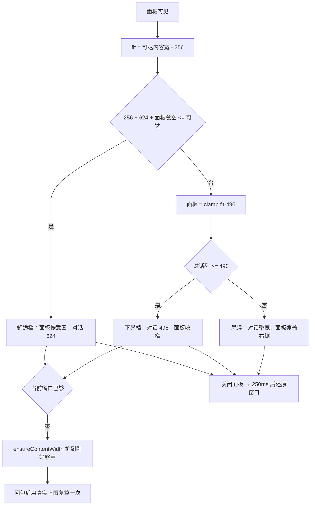

# 文件面板与聊天列的宽度预算 — 设计（二版）

- 日期：2026-11-12
- 状态：已实施，验收见 [verification.md](verification.md)，实施记录见 [worklog.md](worklog.md)
- 二版修订：把"窗口扩展"从三种模式的候选方案之一提升为**唯一主机制**；删除独立的"面板压到 320"档；按 DPI 实算重定悬浮阈值；补上"偏好被窄窗口改写"这一根因。

## 1. 体验目标（可验收的表述）

| 用户动作 | 期望 | 不允许 |
|---|---|---|
| 小窗口里点"文件" | 窗口一次扩到刚好够用，对话与文件都直接可读 | 需要拖面板、拖窗口 |
| 再点一次收起 | 窗口回到我原来的窄窗口 | 窗口停在宽尺寸 |
| 面板里拖宽一次 | 之后每次打开都用这个宽度，除非屏幕放不下 | 窄窗口里拖窄后，偏好被永久改写 |
| 自己拉窗口 | 应用不抢回去 | 打开面板时反向缩放 |
| 最大化 / 贴边吸附 | 不改用户窗口几何 | 扩窗把贴边窗口弹开 |

默认 1280×820 的行为必须完全不变：打开面板不产生任何尺寸变化。

## 2. 现状取证

| 事实 | 位置 |
|---|---|
| 左栏 `md:w-64`（256px），窄屏上下堆叠 | `ConversationSidebar.tsx` |
| 聊天列 `min-w-0 flex-1`，内容区 `md:px-8`（左右各 32） | `AgentChatPage.tsx` |
| 面板宽度 = 360–900 的 state，默认 384，存 `localStorage`（键 `teachforge.artifacts.sidebarWidth`） | `ArtifactSidebar.tsx` |
| `applyWidth` 用 `innerWidth - 560` 夹紧，**夹紧值随后写回存储** | `ArtifactSidebar.applyWidth` / `handleResizeEnd` / `handleResizeKeyDown` |
| 主窗口 `width:1280,height:820,minWidth:960,minHeight:640`，无 bounds 持久化 | `electron/main/main.ts:692` |
| 桌面桥没有窗口能力（只有 `getBackendState/request/pick*/streamChat/revealInFolder`） | `src/types/desktop-bridge.ts` |

根因两条：**（a）面板宽度是"当刻可用宽度"的结果值，被当成用户的长期意图保存**；**（b）唯一能救场的资源——窗口宽度——没有任何交互路径**。

## 3. 原则

1. **窗口是唯一的弹性资源**：对话列和面板的宽度只按空间分配，不再向下挤压到不可读。
2. **面板宽度是意图，不是事实**：`requestedPanelWidth` 永久保存；渲染宽度 = 分配结果。空间够就按意图，不够就临时收窄，空间回来立刻恢复。
3. **只扩到刚好够用**：目标宽度 = 让对话列达到舒适档所需，不做最大化，不改高度，不移动（除非被屏幕边界逼着移）。
4. **关闭即还原**：扩窗是"打开文件面板"这个动作的临时后果，撤销要跟着收起走；用户动过窗口就放弃还原。
5. **只在需求变大时申请扩窗**：打开面板、把面板拖宽。窗口被用户缩小时不抢尺寸。

## 4. 宽度预算（唯一事实来源）

新增 `layout-budget.ts`，全部常量与分配规则集中在这一点；`ArtifactSidebar` 删掉 `RESERVED_LAYOUT_WIDTH`。

| 常量 | 值 | 依据 |
|---|---|---|
| `LEFT_RAIL_WIDTH` | 256 | `md:w-64` |
| `CHAT_GUTTER_WIDTH` | 64 | 正文区左右各 32 |
| `CHAT_COLUMN_COMFORT` | 624（正文 560） | 14px 正文约 38 汉字/行 |
| `CHAT_COLUMN_FLOOR` | 496（正文 432） | 约 31 汉字/行；1366 屏 125% 缩放（可用宽 1093 DIP）仍能保持拆分的下界 |
| `PANEL_MIN_WIDTH` | 320 | 现有下限，Markdown/SVG 不横向挤压 |
| `PANEL_MAX_WIDTH` | 900 | 现有上限 |
| `PANEL_DEFAULT_WIDTH` | 384 | 现有默认值 |
| `STACKED_BREAKPOINT` | 768 | Tailwind `md`；低于此值面板上下堆叠 |

派生：**拆分可行下限** = 256 + 496 + 320 = 1072 内容宽；**舒适所需** = 256 + 624 + 意图宽度（默认 1264）。
下限取 496 而不是更宽松的 512，是为了让 1366@125%（内容宽约 1077）仍落在拆分档而不是悬浮档——差 11px 就会换一种交互，值不值得由这条阈值决定。

DPI 实算（`workArea` 与 `innerWidth`/`getBounds()` 同属 DIP；下表第三列是**可达内容宽** = `workArea.width − 边框差`，边框差按 16 估算，实现时实测）：

| 显示器 | 缩放 | 可达内容宽（DIP） | 打开面板的结果 |
|---|---|---|---|
| 1920×1080 | 100% | 1904 | 扩到 1264：对话 624 + 面板 384（舒适档） |
| 1920×1080 | 125% | 1520 | 同上 |
| 1366×768 | 100% | 1350 | 同上 |
| 1440×900 | 125% | 1136 | 扩到 1136：对话 496 + 面板 384（下界档） |
| 1366×768 | 125% | 1077 | 扩到 1077：对话 496 + 面板 325（下界档） |
| 1280×800 | 100% | 1264 | 正好等于舒适所需 → 默认窗打开面板零变化 |
| 1280×800 | 125% | 1008 | 装不下 → 面板右侧悬浮，对话保持整宽 |

## 5. 分配规则（单一公式，替代原来的三档阶梯）

```ts
planArtifactLayout(input: {
  viewportContentWidth: number;    // window.innerWidth
  requestedPanelWidth: number;     // 用户意图（localStorage -> state）
  maxContentWidth: number | null;  // 主进程回报的 OS 可达内容宽，null = 未知
}): {
  mode: 'stacked' | 'split' | 'overlay';
  panelWidth: number;              // 实际渲染宽度
  chatColumnWidth: number;         // 分配后对话列宽
  requiredContentWidth: number;    // 本次规划需要的窗口内容宽
  needsGrowth: boolean;            // requiredContentWidth > viewportContentWidth
}
```

步骤：

1. `viewportContentWidth < 768` → `stacked`，不扩窗（堆叠本来就各占满宽）。
2. 上限 `limit = maxContentWidth ?? Infinity`；可分配空间 `fit = limit - 256`。
3. `need = 256 + 624 + clamp(requested, 320, 900)`；`needsGrowth = need > viewportContentWidth`。够就返回 `split` + 意图宽度。
4. 不够（`need > limit`）时按顺序让出空间，一条公式：
   `panelWidth = clamp(min(requested, fit - CHAT_COLUMN_FLOOR), PANEL_MIN, PANEL_MAX)`
   `chatColumnWidth = fit - panelWidth`
   - `chatColumnWidth >= CHAT_COLUMN_FLOOR` → `split`（面板比意图窄，对话仍 ≥ 下界）。
   - 否则 → `overlay`：对话列保持 `viewportContentWidth - 256`，面板宽 `min(requested, max(320, viewport - 256 - 320))`，覆盖在右侧而不是挤占。
5. `requiredContentWidth` 按模式回传，供调用方申请扩窗：
   - 舒适档：`256 + 624 + 意图宽度`（这是扩窗目标，不是 `limit`）；
   - 下界档：`256 + 对话列 + 面板宽`（= `limit`，若视口还没到上限就扩到这里）；
   - 悬浮档：等于当前视口，**不扩窗**（再宽也拆不开，没有收益）。
   `maxContentWidth` 未知时先按可扩处理，收到回包后按真实上限复算一次。

要点：**没有"面板档"和"对话档"两个独立分支**——先扣面板、不够再判对话是否触底。这样 1366@125%（1077）自然落在"对话 496 + 面板 325"，而不是跳到悬浮。

## 6. 窗口扩展协议

### 6.1 桥接契约（`desktop-bridge.ts`）

```ts
/** 把窗口内容宽至少扩到 minContentWidth；返回实际内容宽与该显示器可达上限。 */
ensureContentWidth(minContentWidth: number): Promise<{
  contentWidth: number;
  maxContentWidth: number;
}>;
/** 撤销临时扩窗：仅当窗口仍是扩展后的尺寸时回到扩展前宽度。 */
releaseContentWidth(): Promise<void>;
```

- Main 侧校验：`Number.isFinite`、取整、`[768, 8192]`；越界抛错，不静默夹紧。
- Renderer 只能表达"需要多宽"，不能指定坐标或任意 bounds；上限由 Main 按窗口所在显示器的 `workArea` 决定。
- `hasDesktopBridge()` 增加这两项检查；浏览器预览（无桥）走 `maxContentWidth = null`，只降级不扩窗。

### 6.2 Main 侧几何（`window-layout.ts` 纯函数 + `main.ts` 胶水）

```ts
planWindowGrowth({ bounds, contentBounds, workArea, minContentWidth }):
  | { x: number; y: number; width: number; height: number }
  | null
```

1. `frame = bounds.width - contentBounds.width`（**运行时实测**，不硬编码；125% 缩放下硬编码会有 1–2px 漂移累积）。
2. `maxContent = workArea.width - frame`；`targetContent = min(minContentWidth, maxContent)`。
3. `targetContent <= contentBounds.width` → `null`（不缩也不动）。
4. `targetOuter = targetContent + frame`；`x` 保持，超界时夹回：`x = clamp(bounds.x, workArea.x, workArea.x + workArea.width - targetOuter)`——贴右边时窗口向左长，绝不被推出屏幕。高度不变，无动画。
5. **写宽度，不写回读值**（实机校准得出，见 §6.4）：`setBounds` 必须同时给出高度（省略高度会让 Electron 从 content rect 反推并逐次累加），但给出的高度取自每个窗口**首次扩窗前**记下的 `baseline.height`；`y` 用当前值，让用户拖动窗口后仍跟随。

跳过扩窗（直接返回当前值，让 Renderer 走悬浮兜底）：

- `isMaximized() || isFullScreen()`：不打扰全屏状态，`workArea` 就是可达上限。
- 吸附启发式：`bounds.width` 与 `workArea.width / 2` 或 `/ 4` 相差 ≤ 4px 视为贴边吸附——`setBounds` 会解除 Windows 吸附，属用户可见副作用。

### 6.3 还原（决定：做，是本次体验的核心，不是可选项）

只扩不缩 = "想回到窄窗口还得自己拖"，与诉求直接冲突；无条件回缩又会覆盖用户在面板打开期间的手动调整。规则：

- 每窗口两份状态：`windowBaselines`（首次扩窗前的 rect，**整个窗口会话复用**）与 `pendingGrowth`（当前这次打开写入的 rect + 对应 baseline）。
- `ensureContentWidth`：baseline 不存在就先记下当前 bounds；写入 `{ x: 规划 x, y: 当前 y, width: 规划宽, height: baseline.height }`，并记 `applied`。
- `releaseContentWidth`：先看用户是否动过——`sameHorizontalBounds(当前, applied)` 只比 `x` 与宽度（高度由 Electron 取整，不可靠）；通过则按 `{ x: 当前 x, y: 当前 y, width: baseline.width, height: baseline.height }` 还原。
- baseline **不随关闭清除**：写回一个"读回值"再写一次会让 DPI 取整逐轮累积（实测每轮 +1~2px）。只有 `will-resize`（用户自己改尺寸，Win/macOS）才丢弃 baseline 与 pending，下次打开重新采样。
- Renderer 在面板隐藏、收起、组件卸载（设置/资料库/演练模式/知识掌握）时调用；重复调用幂等。
- 收起走 250ms 延迟：连续点两次文件入口或误触 Esc 时不出现"扩—缩—扩"抖动。

### 6.4 实机校准（2026-11-12，Windows 11 + 125% 缩放）

用一个独立 Electron 进程复刻 main 的几何路径（不启动后端），实测：

| 观察 | 数据 |
|---|---|
| 边框差 | 实测 `frame = 14`（不是 16；125% 缩放下会变） |
| 扩到内容 1264 | 外层 1279、内容 1264，与规划一致；`workArea.width` 2048 时上限 2048/内容 2034 也对得上 |
| 只传 `{x,width}`（省略 y/height） | 高度每轮 +2~3px：822→826→829→831——Electron 会从 content rect 反推高度并再次加边框 |
| 每轮传入"上一轮读回的 bounds" | 仍会漂：还原宽度 962→963→964，高度 823→825→826→827 |
| 每窗口只采样一次 baseline，之后扩与还原都从它派生（当前实现） | 连续 6 轮：扩 1279×823（内容 1264），还原 962×823（内容 948），逐轮完全一致；上限 2048（内容 2034）也对 |

结论：漂移的根源是**把读回值当输入**。实现里 baseline 每个窗口只采样一次，扩与还原都是它的纯函数；代价是与原始 960×822 有一次性的 +2/+1 取整偏移（同一份值写两次，Windows 落在不同像素），之后不再变化，用户手动改尺寸时 baseline 失效重新采样。

## 7. 触发点

| 事件 | 行为 |
|---|---|
| 面板由隐藏变可见（顶栏徽标、卡片"查看全部"、挂载时已可见） | 按预算申请扩窗 |
| 拖拽手柄 `pointerup`、键盘方向键 | 只在意图宽度**变大**时申请一次（拖拽过程中窗口不追指针） |
| 窗口 resize / 最大化 / 换显示器 | 只重算预算与模式，**不扩窗** |
| 面板隐藏 / 卸载 | 延迟 250ms 调 `releaseContentWidth()` |



## 8. 三种呈现

- **split**：与今天一致，`md:w-[var(--artifact-sidebar-width)]` + 分隔手柄。
- **overlay**：面板绝对定位在所在行右侧（行容器 `relative`；面板 `absolute inset-y-0 right-0 z-30`，左缘阴影 + `border-l`），**不加遮罩**，左侧对话仍可读可点；补 `Esc` 收起；层级低于全屏预览 `z-40`、低于 toast `z-50`。
- **stacked**（<768）：沿用现有上下堆叠，不扩窗。

## 9. 关键决定

| 议题 | 决定 | 理由 |
|---|---|---|
| 谁让出宽度 | 窗口优先 → 面板收窄 → 悬浮兜底 | 对话和文件都要可读；只压面板等于把问题推给预览 |
| 面板宽度的真值 | 单一 `requestedPanelWidth`，渲染期分配 | 现实现把夹紧值当偏好存回，是"每次都要手动调"的根因 |
| 回缩 | 做，且严格加锁 | 诉求是"小窗口对话"，窗口停在宽尺寸＝每次还要自己拖回去 |
| 悬浮阈值 | 1072 内容宽（256+496+320） | 二版从 1200 上调到 1072（更宽松）：1366 屏 125% 缩放只剩约 1077 内容宽，原阈值会让小笔记本过早失去"同时查看" |
| 对话下界档 | 432 正文（对话列 496） | 约 31 汉字/行，够读；比"悬浮盖住对话"更符合"同时查看" |
| resize 时补扩 | 不补 | 用户主动缩小窗口是明确意图，抢回来是最糟的手感 |
| 吸附/最大化 | 不扩 | `setBounds` 会解除吸附、打断全屏，属可见副作用 |
| 面板比例 vs 绝对宽 | 绝对宽（320–900） | 文档阅读需要可预测的绝对宽度；比例分配在宽屏会失控 |

## 10. 未采纳方案

| 方案 | 为什么不 |
|---|---|
| 独立预览窗口 | 预览、全屏、刷新、toast 都要在第二个窗口重建；"同时查看"变成用户自己排窗口，正是要消除的手工活 |
| 按内容类型自动挑面板宽度 | Markdown 表格、SVG、代码块的理想宽度差异大，打开即跳宽会让"同时查看"变成"每次都在变"；宽度保持用户意图 + 320 下限，需要更大时用全屏按钮 |
| 固定比例分屏（如 38%） | 宽屏下面板会到 700+，窄屏下只有 200+，都不可预测；文档阅读更需要绝对宽度 |
| 只扩不缩 | 关掉文件后仍停在宽窗口，用户要自己拖回去 |
| 打开面板就最大化 | 覆盖用户的窗口位置与尺寸意图，副作用比收益大 |
| 面板默认改成一打开就全屏 | 失去"同时查看" |

## 11. 风险与已知限制

- **面板打开期间用户改窗口尺寸** → 还原记录作废，窗口保持用户尺寸。正确，但表现为"有时不回缩"。
- **悬浮模式下首次一帧**：`maxContentWidth` 未回包前按可扩处理，极小屏可能看到一次宽度回退。
- **吸附启发式只覆盖 1/2、1/4**；Windows 11 其它 snap 比例仍会被扩窗解除吸附。
- **多显示器**：按窗口所在显示器 `workArea` 计算，拖到更窄的屏后重新规划。
- **`minHeight: 640` 已超过 1366@125% 的 614 DIP 可用高度**（与本变更同源的尺寸假设问题），本次不改，记录在案。
- **跨启动窗口尺寸**目前不记忆；每次启动回到 1280×820。若"每次启动还要调窗口"同样构成手工活，建议同批加 T4（见 tasks.md），代价约 30 行主进程代码 + 2 条纯函数测试。
