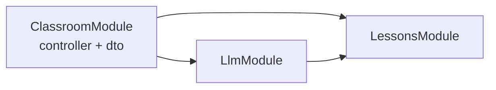

# 课堂模拟 HTTP 契约

> 状态：除 `GET /api/lessons/:lessonId` 与 SSE 外均已实现；课堂首页与舞台已接入这些端点。

## 1. 模块放置

`ClassroomSimulationAgent` 在 `LlmModule`，`LessonsService` 在 `LessonsModule`。控制器放在薄 `ClassroomModule`，避免 `LessonsModule` 反向依赖 `LlmModule`：



`ClassroomModule` 用 `LlmService` 生成总结、用 `ClassroomSimulationAgent` 跑发言轮次；只做 HTTP 边界：校验、错误码映射、调用领域服务，不写业务规则。

## 2. 公共约束

- 所有 `/api/*` 请求由 `main.ts` 的全局钩子校验 `x-teachforge-token`；带 `Origin` 头直接 403。新控制器无需自建鉴权。
- 请求体上限 1 MiB；全局 `ValidationPipe` 开启 `whitelist` 与 `forbidNonWhitelisted`，多余字段直接 400。
- 错误体沿用 Nest 默认：`{ "statusCode": number, "message": string | string[] }`；用户可见文案用中文。

## 3. 端点

| 方法 | 路径 | 作用 | 状态 |
|---|---|---|---|
| `POST` | `/api/lessons` | 新建课堂（先结束旧 active，不调模型） | **已实现** |
| `POST` | `/api/lessons/:lessonId/turns` | 提交一条老师消息并完成一轮 | **已实现** |
| `POST` | `/api/lessons/:lessonId/end` | 结束课堂（幂等） | **已实现** |
| `GET` | `/api/lessons` | 课堂列表（生命周期 + 总结预览） | **已实现** |
| `GET` | `/api/lessons/:lessonId/messages` | 课堂消息列表，带说话人身份 | **已实现** |
| `GET` | `/api/lessons/:lessonId/summary` | 读取课堂总结与生成状态 | **已实现** |
| `POST` | `/api/lessons/:lessonId/summary` | 生成/重新生成课堂总结 | **已实现** |
| `GET` | `/api/lessons/:lessonId` | 课堂生命周期 + 全部消息 | 未实现 |
| `DELETE` | `/api/lessons/:lessonId` | 删除历史课堂（行、总结与记录） | **已实现** |

### 3.1 `POST /api/lessons`

请求体为空。始终新建：先结束当前 `active` 课堂（进入历史），再插入新行，返回 `201`。数据库部分唯一索引保证同时只有一节 active：

```json
{ "id": "uuid", "status": "active", "endedAt": null, "createdAt": "…", "updatedAt": "…" }
```

### 3.2 `POST /api/lessons/:lessonId/turns`

```json
{ "text": "今天我们讲缓存雪崩……" }
```

| 字段 | 规则 |
|---|---|
| `text` | 必填字符串；trim 后 1–20000 字符，超长 400；纯空白 400 |

返回 `200`：与消息列表端点同形（`lessonId/status/integrity/messages`），每条消息带 `speaker/role/name`，前端可直接替换列表，不需要二次请求。

行为：

1. 校验课堂存在且 `active`；同课堂并发的第二轮返回 `409`。
2. 老师消息先落 JSONL，再调导演与学生。
3. 导演与学生的单次调用都有上限（导演 60 秒、学生 120 秒，调用方可用 `timeoutMs` 覆盖）；导演输出非法、学生失败或超时时，老师消息保留、学生消息不写，接口返回 `502`，只给稳定文案，不回传 provider 原文。
4. 客户端断开时中止当前 provider run；记录在追加时损坏返回 `409`「课堂记录损坏，请开始新课堂」；课堂已结束返回 `409`。
5. 成功后返回全量记录（不做增量），控制器直接使用轮次结果，不再二次读取。

### 3.3 `POST /api/lessons/:lessonId/end`

无请求体。返回 `200` 课堂行（`status: "ended"`、`endedAt` 非空）。重复结束同样返回 `200`（幂等，便于恢复流程重试）；不存在的课堂 `404`。

### 3.4 `GET /api/lessons`（已实现）

查询参数：`status?: "active" | "ended"`、`limit?: 1–50（默认 30）`。按 `createdAt` 倒序返回：

```json
{
  "lessons": [
    {
      "id": "uuid",
      "status": "ended",
      "endedAt": "…",
      "createdAt": "…",
      "updatedAt": "…",
      "summaryStatus": "ready",
      "summaryGeneratedAt": "…",
      "summaryPreview": "本节讲了什么 缓存雪崩。…"
    }
  ]
}
```

`summaryPreview` 为 Markdown 压成单行后的前 160 字符；完整总结走 §3.7。

### 3.5 `GET /api/lessons/:lessonId/messages`（已实现）

用于课堂 UI 展示完整消息列表，每条自带说话人身份，前端不需要再按 id 查名册。

```json
{
  "lessonId": "uuid",
  "status": "active",
  "messages": [
    { "id": "uuid", "speaker": "teacher", "role": "teacher", "name": "老师", "text": "……", "createdAt": "…" },
    { "id": "uuid", "speaker": "lin", "role": "student", "name": "林澈", "text": "……", "createdAt": "…" }
  ]
}
```

| 字段 | 说明 |
|---|---|
| `speaker` | 稳定说话人键：`teacher` / `su` / `lin` / `gu` |
| `role` | `teacher` 或 `student`，用于样式分支 |
| `name` | 显示名：老师 / 苏小满 / 林澈 / 顾知夏 |
| `text` | 原话，未做标记包装 |
| `integrity` | 记录完整性：`status: "ok" \| "degraded"`、`corruptLineCount`、`corruptLineNumbers` |

行为：已结束的课堂同样返回（`status: "ended"`），方便回看；`lessonId` 不是 UUID 返回 400；课堂不存在返回 404。

**损坏记录**：单行无法解析时仍返回 `200`，可解析的消息照常返回，`integrity.status` 为 `degraded` 并给出损坏行号；文件本身不改写、不删除、不重命名。读取时文件不可读（权限等）才返回 500。发言端点遇到损坏记录返回 409 并拒绝追加，舞台提供「重试」与「开始新课堂」。

### 3.6 `GET /api/lessons/:lessonId`（未实现）

拟返回 `{ lesson, messages }`；与 §3.4 + §3.5 组合重复，落地前先确认是否仍需要。

### 3.7 课堂总结（已实现）

`GET /api/lessons/:lessonId/summary` 返回：

```json
{
  "lessonId": "uuid",
  "status": "ended",
  "summaryStatus": "ready",
  "summary": "## 本节讲了什么\n……",
  "error": null,
  "generatedAt": "…"
}
```

`POST /api/lessons/:lessonId/summary` 无请求体，生成并返回同样的视图：

| 场景 | 行为 |
|---|---|
| 课堂未结束 | `409`，不调用模型 |
| 正在生成 | `409`（进程内 in-flight） |
| 记录损坏 | `200` + `summaryStatus: "failed"` + “课堂记录损坏，无法生成总结。”，不调用模型 |
| 模型失败/超时 | `200` + `status: "failed"` + “总结生成失败，请重试。”，不抛 HTTP 错误 |
| 成功 | `200` + `ready` + Markdown；重复调用即重新生成 |

总结存于 `lessons` 表（`summaryStatus/summaryMarkdown/summaryError/summaryGeneratedAt`），不进 JSONL；启动时把遗留的 `generating` 重置为 `failed`。

### 3.8 `DELETE /api/lessons/:lessonId`（已实现）

只允许删除 `ended` 课堂：删除 `lessons` 行、总结与 `<configDir>/lessons/<id>/` 记录目录，返回 `{ "lessonId": "uuid" }`（`200`）。

进行中的课堂与总结生成中返回 `409`；课堂不存在 `404`；成功 `200` 并删除行、总结与记录目录（目录删除失败只记日志，孤儿目录无害）。

## 4. 错误映射

| 场景 | 状态码 | 说明 |
|---|---|---|
| `text` 为空或超长 | 400 | 不创建课堂、不写文件 |
| 课堂不存在 | 404 | — |
| 删除进行中的课堂 / 总结生成中 | 409 | 历史课堂才可删除 |
| 课堂已结束 / 记录损坏（仅发言端点） | 409 | `Lesson is not active` 不外泄；记录损坏时拒绝追加，前端提供“开始新课堂” |
| 同课堂已有轮次运行 | 409 | `ClassroomTurnsService` 的课堂级锁；第二轮直接拒绝 |
| 导演输出不可解析 / 学生调用失败 / 超时 | 502 | 老师消息已保留；响应不包含 provider 原文 |
| 取消（客户端断开） | 无响应 | 通过 `reply.raw` 的关闭事件中止 Pi run；老师消息可能已保留 |

## 5. 前端映射

`GET /api/lessons/:lessonId/messages` 已直接返回展示字段，`ClassroomMode` 不再自己维护名册：

| 接口字段 | 前端字段 | 规则 |
|---|---|---|
| `id` | `id` | 直接使用 |
| `speaker` | 头像/样式键 | 直接使用（`teacher` / `su` / `lin` / `gu`） |
| `role` | `role` | `teacher` / `student`，决定气泡左右与样式 |
| `name` | `label` | 直接显示「老师」「林澈」等 |
| `status` | 输入区状态 | `ended` 时禁用发送；`active` 可继续 |

前端实现：`classroom-api.ts` 做请求与运行时校验；`ClassroomHome` 维护列表/详情与总结轮询；`ClassroomMode` 以「是否存在消息」决定讲解/回答态，草稿放在按 lessonId 的模块级 `drafts`（仅本次应用会话）。失败后重新拉取记录；若老师消息已落盘则清空对应草稿，避免重复发送。

## 6. 待定

- 流式与重试：首版非流式（逐字显示再评估 SSE）；没有 `clientMessageId`，客户端仍禁止自动重试。桌面桥只对 `GET` 做一次网络重试，非幂等 POST 不重放。
- 唯一 active：数据库部分唯一索引保证；`POST /api/lessons` 结束旧 active 后新建，迁移会把历史多余 active 关闭。
- 与 conversation 关联：课堂暂不绑定 `conversationId`；需要“课堂记录进入会话历史”时再设计外键与迁移。
