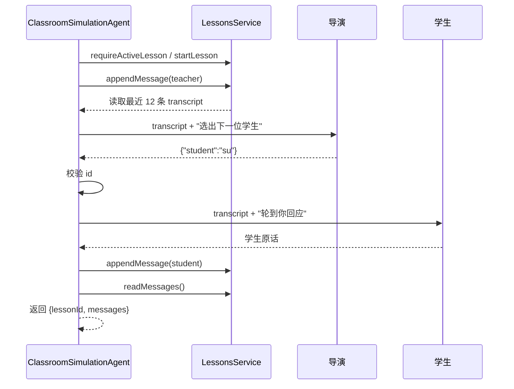

# 课堂模拟 Agent 轮次 — 设计

## 1. 决策与依据

| 候选 | 结论 | 依据 |
|---|---|---|
| 消息写 SQLite `messages` / 新消息表 | ❌ | 单用户本地应用，消息只按时间回放、不参与查询；一次课堂 = 一次完整重放，JSONL 追加比行级事务更简单，也避免把课堂正文混进普通对话表 |
| 消息写 `<configDir>/lessons/<id>/messages.jsonl` | ✅ | 与 Pi/Codex 的本地记录方式一致；`LessonsService` 独占读写；一条消息一行，追加即持久 |
| 服务内 `messages: any[]` 累积 | ❌ | Nest 服务是单例，成员数组会跨课堂串数据；且与文件形成第二个事实源。每轮直接读 JSONL |
| 每轮从 JSONL 重建 transcript | ✅ | 会话无状态，重启不丢上下文；不需要课堂级长驻 Pi session 与空闲回收。代价是每轮重发最近 12 条 / 4000 字符，已设上限 |
| 课堂级长驻 Pi session | ❌（v1） | `SessionManager.inMemory` 重启即丢，仍需从文件重建；还要额外管理 session 生命周期与泄漏 |
| 导演模型输出 `{"student":"su"}` | ✅ | 选人需要读懂上下文（谁刚问过、老师是否已回应）；输出收敛为一个字段，校验成本低 |
| 导演输出自然语言再解析 | ❌ | 名称、标点、多学生列举都会让解析不稳定；JSON 契约与 `parseJsonObject` 可复用 |
| 解析失败静默随机选人 | ❌ | 把模型故障伪装成正常课堂行为；失败必须可见 |
| `random_dispatcher` / `dispatch_to_student` 工具 | 暂缓 | 导演直接返回学生 id 即可完成同一决策；工具化留到导演需要多步编排时，避免现在引入工具循环 |
| 两个 Agent 使用思考模式 | ❌ | 导演只选一个人、学生只说一两句话；思考增加延迟与 token，不改善结果 |
| `systemPrompt` 追加在 Pi 编码提示词后 | ❌ | 课堂会话不碰工作区，遗留的文件/工具说明会诱导无效工具调用；用 `systemPrompt` 整体替换 |

## 2. 角色与会话

```mermaid
flowchart LR
  T[老师消息] --> L[LessonsService<br/>追加 JSONL]
  L --> C[ClassroomSimulationAgent]
  C --> D[导演会话<br/>systemPrompt=课堂规则<br/>无工具]
  D -->|{"student":"lin"}| C
  C --> S[StudentAgent.createAgent<br/>学生人设 systemPrompt]
  S -->|纯文本| C
  C --> L2[追加学生消息]
  L2 --> R[返回 lessonId + messages]
```

| 角色 | system prompt | 工具 | 输出 | 生命周期 |
|---|---|---|---|---|
| 导演 `ClassroomSimulationAgent` | 学生名册 + 选人规则 + JSON 契约 | 无 | `{"student": "su" \| "lin" \| "gu"}` | 每轮新建、`finally` 销毁 |
| 学生 `StudentAgent` | 人设 + 课堂记录格式 + 说话方式 | 无 | 一到两句话的纯文本 | 每次发言新建、销毁 |

两侧都走 `pi-agent-runtime`：`DefaultResourceLoader` 关闭全部发现通道，`systemPrompt` 覆盖默认编码提示词，`tools: []`，`compaction: false`，`thinkingLevel: 'off'`。

## 3. 一轮时序



顺序约束：老师消息在两次模型调用之前落盘，失败轮次保留用户输入；学生消息只在成功后追加。

## 4. 数据模型

`lessons`（SQLite，migration `1794030000000`）：

| 列 | 类型 | 说明 |
|---|---|---|
| `id` | varchar PK | UUIDv4，同时是记录目录名 |
| `status` | varchar | `active` / `ended` |
| `endedAt` | datetime | 结束时间，active 时为 null |
| `createdAt` / `updatedAt` | datetime | TypeORM 自动维护 |

`<configDir>/lessons/<lessonId>/messages.jsonl`，一消息一行：

```json
{"id":"uuid","speaker":"teacher","text":"今天我们讲缓存雪崩……","createdAt":"2026-11-13T02:45:48.228Z"}
{"id":"uuid","speaker":"lin","text":"老师，那是不是像早上八点大家同时抢课……","createdAt":"2026-11-13T02:45:51.102Z"}
```

- `speaker` 只允许 `teacher` 或三名学生 id；读回时校验，坏行报行号。
- 文件缺失视为空记录；目录在第一次追加时创建（`0o700`）。
- `getLessonDirectory()` 先校验 UUID，防止 id 变成路径穿越。

## 5. Prompt 契约

**导演**

- 名册由 `CLASSROOM_STUDENTS` 生成，避免提示词与代码漂移。
- 选人规则：优先最近没发言的学生；上一位学生的问题还没被老师回应时可以继续选他；三人轮完后重新轮转；需要收束时优先最近提问的学生。
- 知识点：导演输出 `pointLabel`、`done`、`nextStudent`、`nextFocus`；标签变化即新点；收束后代码按提名（非法则发言最少→随机）让另一名学生提出新点问题；上限与轮次见 [point-state.md](point-state.md)。
- 输出 `{"student":"su","pointLabel":"缓存雪崩","done":false,"nextStudent":"lin","nextFocus":"…"}`；`student/nextStudent` 仅接受三名学生，`done` 为布尔；非 JSON、缺字段、非法 id 一律抛错，不做修复或随机兜底。

**学生**

- system prompt 说明课堂记录格式（`<speaker_name>说话人</speaker_name>` 行）、人设与“只输出一到两句话”。
- user 消息 = transcript + 本轮知识点（标签/已发言轮次/是否收束）+ “现在轮到你（林澈）回应”。

**记录渲染**

- 最近 12 条、4000 字符，从最新往回填，保证老师刚说的话一定在；正文转义 `& < >`，防止伪造 `</speaker_name>`。
- 标签只存在于 prompt，存储/返回/前端都用结构化字段。

## 6. 错误语义

| 场景 | 行为 |
|---|---|
| 空消息 | 抛错，不建课堂、不写文件 |
| `lessonId` 不存在 / 已结束 | `requireActiveLesson` 抛错，不产生新的模型调用 |
| 导演输出不可解析或 id 非法 | 抛错；老师消息已保留，学生消息不写 |
| 学生调用失败 / 超时 / 取消 | 老师消息保留，学生消息不写，错误向调用方传播 |
| JSONL 坏行 | 读接口降级返回可解析消息 + 损坏行号（`200`）；发言轮次拒绝（`readMessages` 抛错），文件不改写。见 §9 |
| 进程重启后续写 | 直接从文件读回全部消息，课堂可继续 |

## 7. 并发与持久化边界

- `LessonsService` 为每个课堂维护一条 Promise 链，追加在链内完成“校验 active → 校验记录完整 → mkdir → appendFile”，避免两轮交错写行，也避免把新消息写进已损坏的文件。
- 整轮串行由 `ClassroomTurnsService` 保证：同一课堂的第二轮直接 409；`endLesson()` 也进入同一队列，状态变更与追加互斥。
- 文件 I/O 与模型调用都不在数据库事务内；lesson 行的插入与第一次追加是两次独立操作，后者失败时留下一个没有记录的空课堂（可读为空）。

## 8. 安全与边界

- `lessons/` 根加入 `SettingsService.getManagedFilePaths()`：普通对话的 `read`/`write`/`edit` 工具不能读写课堂记录。
- 课堂会话本身 `tools: []`，不注册文件、网络或记忆工具；`noExtensions` 关闭包发现。
- 导演与学生会话不加载 `IDENTIFY.md`、`PREFERENCE.md`、skills 或项目上下文文件。
- 日志只记录 `requestId`、`lessonId`、`studentId`、长度与耗时，不记录消息正文。

## 9. 损坏恢复（后端已实现）

| 场景 | 行为 |
|---|---|
| 单行/多行损坏 | 读接口返回 `200` + `integrity.degraded` + 行号，可解析消息照常展示；文件不改写、不删除、不重命名 |
| 追加消息 | `appendMessage()` 在每课堂队列内先读一遍记录；发现损坏直接拒绝，绝不把新消息写进坏文件 |
| 开始新课堂 | `POST /api/lessons` 先结束当前 active（进入历史），再生成新 UUID 与新目录 |
| 文件缺失 / 不可读 | 缺失视为空记录；不可读返回 500（环境/权限问题） |
| 数据保留 | 不自动修复、不覆盖旧文件；损坏内容保留给人工检查 |

界面约定：`degraded` 时在消息侧栏顶部显示“记录有 N 行损坏，已跳过”并提供「开始新课堂」与「重试」；已结束课堂也显示「开始新课堂」。

## 10. HTTP 与其他后续能力

具体请求/响应、错误码与前端字段映射见 [api-contract.md](api-contract.md)。除 `GET /api/lessons/:id` 详情端点与 SSE 外均已实现。

| 能力 | 拟定契约 |
|---|---|
| 课堂 HTTP | `GET /api/lessons`、`GET /api/lessons/:lessonId/messages`（含 `integrity`）、`POST /api/lessons`、`POST /api/lessons/:id/turns`、`POST /api/lessons/:id/end` **已实现**；`GET /api/lessons/:id` 与 SSE 仍为设计。走现有本地 token 校验；先非流式 |
| 前端接入 | 已实现：`ClassroomHome`（列表/详情/总结轮询/新建）与 `ClassroomMode`（加载、发送、按 `speaker` 定位气泡、结束回首页）；草稿按 lessonId 暂存在内存 |
| `random_dispatcher` 工具 | 无入参，从三人中随机返回一个 id；由导演会话通过 `customTools` 注册，`tools` allowlist 同步加入 |
| `dispatch_to_student` 工具 | 入参 `student`；执行体复用本轮 `studentReply()`，把带标签的文本作为工具结果返回；仍不注册给学生会话 |
| 课堂级锁 | 已实现：`ClassroomTurnsService` 每课堂一个运行标记，第二次请求 409；请求断开通过 `reply.raw` 中止 provider |

## 11. 课堂总结与历史首页

### 11.1 存储决策（已实现）

| 候选 | 结论 | 依据 |
|---|---|---|
| 写进 `messages.jsonl` | ❌ | 总结不是对话，混入 transcript 会污染 speaker 契约和损坏判定 |
| 写 `<lessonDir>/summary.md` | ❌ | 历史首页要列 N 节课的摘要预览；逐文件读取 + 解析的成本和代码都更高，状态还要另找来源 |
| 存 SQLite `lessons` 列 | ✅ | 小文本、一次性生成、要按状态/时间查询；消息仍只在 JSONL，用户的“消息不进 SQLite”约束不变 |

字段：`summaryStatus`（`none/generating/ready/failed`）、`summaryMarkdown`、`summaryError`、`summaryGeneratedAt`。只做 P2 模型总结，不做 P1 规则统计。

### 11.2 生成流程（已实现）

- 触发：结束课堂后由 UI 调 `POST /api/lessons/:id/summary`；已结束课堂可随时重新生成。结束本身不触发模型调用。
- 调用：`ClassroomSummariesService` → `LlmService.generate()`，固定 `systemPromptAppend`、`tools: []`、不加载记忆、120 秒超时；不写快照、不写消息。
- 输入：最近 200 条 / 20 000 字符 transcript（`<speaker_name>` 格式、正文转义）。
- 输出：Markdown 四节（本节讲了什么 / 学生关注点 / 尚未解答 / 建议补充），不超过 600 字。
- 失败与损坏：模型失败写 `failed` + 用户安全文案（接口仍 200，不回传 provider 原文）；记录损坏直接 `failed`，不调模型。
- 并发：进程内 in-flight 集合，重复请求返回 409；启动时把遗留的 `generating` 重置为 `failed`。

约束（[学习趣味性设计讨论](../../source/学习趣味性设计讨论.md) F2/F5）：总结只描述记录里出现过的事实，不写“已掌握/未掌握”、分数或排名。

### 11.3 历史首页（已实现）

- 侧栏「课堂模式」打开课堂首页（与「知识掌握」同构），不再直接进入课堂；只有进入舞台时窗口才锁 16:9。
- 进行中的课堂：最近一条 `active`，显示开始时间，操作「结束课堂」「继续上课」；结束会触发后台总结。
- 历史课堂：`ended` 按结束时间倒序，显示日期、总结状态与摘要预览（已去掉 Markdown 符号）；生成中每 3 秒轮询，失败可重新生成。
- 空态与新建：无进行中课堂时显示说明；「开始新课堂」进入草稿舞台，首次发送才创建并结束旧 active，空草稿退出不落库。
- 点击历史项进入只读详情：完整总结 + 消息记录，可重新生成总结。

## 12. 与产品设计稿的关系

[课堂模式功能设计](../../source/课堂模式功能设计.md) 描述的是完整课堂：讲解 → 轮流提问 → 逐题回答 → 报告，并区分临时退出与结束课堂。本变更只覆盖“一次老师发言 → 一名学生回应”的后端轮次，其余仍是目标能力，不应按已实现描述。
