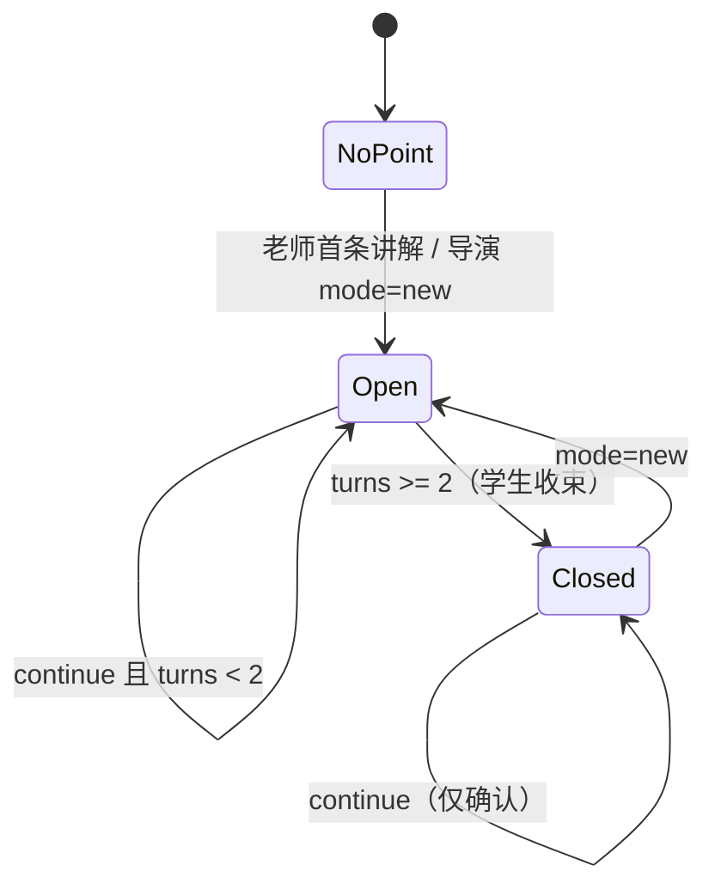

# 知识点收束状态

## 问题

课堂里老师回答学生追问后，学生会继续追问同一个知识点，没有停止条件，实测会无限来回。只靠提示词不可行：导演只负责选人，学生只拿到被截断的 12 条记录，数不清已经讨论了几轮。

## 状态

每个课堂在 SQLite `lessons` 保存：

| 列 | 含义 |
|---|---|
| `pointStartMessageId` | 当前知识点第一条老师消息的 id |
| `pointLabel` | 导演概括的知识点标签（≤40 字符） |
| `pointClosed` | 是否已收束；收束后学生只确认、不再提问 |
| `pointUpdatedAt` | 最近一次状态写入时间 |

轮次**不单独存计数器**：`turns = pointStartMessageId 之后的学生消息数`。消息文件是事实源，崩溃只会少算，不会多算。

## 每轮流程

1. 老师消息落盘，记下 `teacherMessage.id`。
2. 读课堂状态，计算 `turns`。
3. 导演输出 `{"student":"su","mode":"new|continue","pointLabel":"…"}`：
   - `new`：老师开启新内容，重置 `pointStartMessageId` 为新消息、`pointClosed=false`。
   - `continue`：沿用当前点。
4. 代码计算 `forceClose = pointClosed || turns >= 2`。
5. 学生提示词带「当前知识点 / 已发言轮次 / 是否收束」。收束时明确要求：不再提问，确认理解并请老师继续下一个知识点。
6. 学生回复成功后写状态：
   - 新点 → 写入新起点与标签；
   - 收束 → `pointClosed=true`；
   - 普通继续 → 不写（轮次由消息推导）。

## 边界

| 场景 | 行为 |
|---|---|
| 旧课堂无状态 | 下一条老师消息视为新点 |
| 起点消息 id 不在记录中 | 重置为新点，避免误判轮次 |
| 导演把所有消息标成 new | 提示词明确禁止；日志记录 `classroom.point.started` 便于发现 |
| 收束后老师继续讲同一点 | `continue` 仍强制收束，学生只确认 |
| 删除课堂 | 状态列随行删除 |
| 崩溃 | 消息已落盘但状态未写时，轮次按 transcript 重算，最多少算一轮 |

## 配置

- `MAX_POINT_STUDENT_TURNS = 2`（`lessons/lesson-point.ts`）：2 次学生发言后，第 3 次必须收束。
- 导演上限、学生上限与代码常量共用；调整时无需改提示词。

## 验证

- `test:classroom-point`：无状态起点、新点重置、轮次推导、上限、已收束保持、起点缺失、标签截断、导演 JSON 解析。
- 真实模型 3 轮：第 1/2 轮学生提问，第 3 轮回复不含问号且包含「明白/理解/继续/下一个」；SQLite `pointClosed=1`、`pointStartMessageId` 保持不变。
