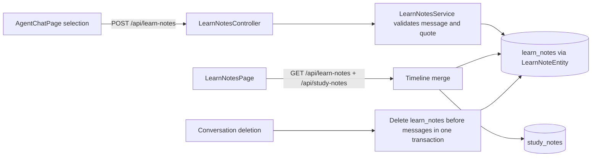

# Learn Notes Rename Design

## Problem

Saved excerpts from assistant messages are presented as “学习笔记”, but their SQLite table, backend package, DTOs, desktop helpers, and HTTP route still use `focus_items` / Focus Item terminology. The mismatch obscures the persistence owner and leaves the local HTTP API coupled to an outdated feature name.

## Goals

- Persist saved excerpts in `learn_notes` while preserving all rows and column values from `focus_items`.
- Use `learn-notes` names for the backend module and desktop feature/API surface.
- Expose the saved excerpt operations at `/api/learn-notes` and keep `study_notes` independent.
- Apply the migration to the database path the application actually resolves: `~/.tech-forge/db/teachforge.db`.

## Non-Goals

- Redesign the “学习笔记” timeline, note editor, or assistant selection flow.
- Merge saved excerpts with user-authored `study_notes` or change either API payload.
- Rename the SQLite database file or alter unrelated tables.
- Rewrite applied historical migrations; they must continue to describe the schema they originally installed.

## Must-Not-Break Existing Behavior

- A saved excerpt remains anchored to a persisted assistant message and its conversation.
- Duplicate excerpts for one message remain rejected by the unique `(messageId, quoteKey)` index and are returned idempotently by the service.
- The optional `note` field remains editable and clearing it does not delete the excerpt.
- Conversation deletion removes saved excerpts before messages and preserves user-authored `study_notes` while clearing their conversation association.
- The desktop timeline continues to merge saved excerpts and user-authored notes by creation time.

## Current Behavior

`FocusItemsController` serves `GET/POST /api/focus-items`, `PATCH /api/focus-items/:id`, and `DELETE /api/focus-items/:id`. `FocusItemsService` validates assistant-message ownership, quote and note lengths, and duplicate quote handling. `FocusItemEntity` stores the row in `focus_items` with a foreign key to `conversations` and three indexes. `FocusPointsPage` combines these rows with the separate `/api/study-notes` results. Conversation deletion explicitly removes `focus_items` before messages.

The database options use `migrationsRun: true` and `migrationsTransactionMode: 'all'`. The existing local database has migrations through `StudyNotes1794090000000`, contains `focus_items`, and is located at `~/.tech-forge/db/teachforge.db`. The path `~/.tech-forge/db/techforge.db` does not exist and is not the path returned by `resolveTeachForgeDatabasePath()`.

## Proposed Behavior

Add migration `1794100000000-rename-focus-items-to-learn-notes.ts`. It creates `learn_notes` with the existing columns and constraints under current names, copies every row from `focus_items`, drops the old table, and creates the renamed indexes. The migration runs in TypeORM's existing all-migrations transaction. Its `down` path performs the inverse copy. This preserves IDs, timestamps, quote hashes, notes, and conversation references while allowing the foreign-key and index names to match the new table.

Rename the active backend folder and declarations to `learn-notes` / `LearnNote*`. Change the controller route to `/learn-notes`. Rename the desktop feature folder and its saved-excerpt API/page symbols; update the Agent selection flow to call the new API. Rename the free-text note dialog/API files to `AddStudyNoteDialog` and `study-notes-api` to make their distinct `study_notes` ownership explicit. The merged page and its user-facing copy remain “学习笔记”.

Historical migration files and class names remain unchanged so existing migration-ledger entries continue to match. The `focus_items` name therefore remains only in those historical schema migrations and the new migration's source-table copy/drop operations.

## Alternatives Considered

| 方案 | 结论 | 理由 | 是否升级为 ADR |
|---|---|---|---|
| Keep the old table and add a `learn_notes` view | 否决 | Leaves persistence and TypeORM entity on the old name, so the requested rename is incomplete. | n/a |
| Rename the table in place with `ALTER TABLE` | 否决 | SQLite retains the old index and foreign-key constraint names; a transactional create-copy-drop gives the new table a fully consistent schema. | n/a |
| Create an empty `learn_notes` table and keep `focus_items` | 否决 | Splits existing and future rows and would require dual reads/writes; migration must preserve the current data in one canonical table. | n/a |

## Business Flow

The selected assistant text remains the unit saved as a learning note. The persisted row still has a message anchor, quote, optional note, and creation timestamps. The free-text note flow remains a sibling source in the same timeline.

## End-to-End Data Interaction Flow

| 关键节点 | 输入 | 节点职责 | 输出 / 状态变化 | 关键边界 |
|---|---|---|---|---|
| AgentChatPage | Persisted assistant message ID, selected quote, optional note | Collects and submits the saved excerpt | New or existing LearnNote | Existing single-message selection and client validation remain unchanged |
| LearnNotesController | HTTP request at `/api/learn-notes` | DTO validation and protocol mapping | Existing response shape and status codes | Local authenticated bridge; route changes in lockstep with bundled desktop client |
| LearnNotesService | Validated DTO | Verify message ownership/role, normalize input, deduplicate, update or delete | LearnNote DTO | Unique quote key remains enforced by SQLite |
| Migration 179410 | Existing `focus_items` rows | Create, copy, and replace table | One canonical `learn_notes` table | TypeORM transaction rolls back on any DDL/data-copy failure |
| LearnNotesPage | LearnNote and StudyNote lists | Merge both independent sources by `createdAt` | Existing “学习笔记” timeline | `study_notes` remains a separate table and API |
| ConversationsService.delete | Conversation ID | Delete dependent rows in FK-safe order | Conversation rows removed | `learn_notes` removed before messages; `study_notes` content is retained |

## Data And API Impact

- SQLite table: `focus_items` becomes `learn_notes`; all columns and values remain unchanged.
- Indexes become `UQ_learn_notes_message_quote`, `IDX_learn_notes_createdAt`, and `IDX_learn_notes_conversation`; the foreign key is named `FK_learn_notes_conversation`.
- API route prefix changes from `/api/focus-items` to `/api/learn-notes`; the list, create, update-note, delete methods and JSON fields keep their existing semantics.
- Backend exports become `LearnNoteEntity`, `LearnNotesService`, `LearnNotesController`, `LearnNotesModule`, and `LearnNoteDto` / `CreateLearnNoteDto` / `UpdateLearnNoteDto`.
- `study_notes`, its `/api/study-notes` API, and its conversation-deletion behavior are not changed.

## Frontend Fetching Logic

The LearnNotes page continues loading the saved-excerpt API and free-text study-note API together. Only the saved-excerpt path changes to `/api/learn-notes`; the timeline ordering, error handling, editing, and deletion behavior stay the same.

## Frontend Behavior

The desktop “学习笔记” page remains the same. Component, folder, navigation key, and API helper names change to Learn Notes. Assistant selection still opens the quote-and-note dialog; free-text notes continue using the separately named StudyNote dialog.

## Backend Fetching Logic

TypeORM repositories switch from `LearnNoteEntity` to `learn_notes`. Conversation title projection and persisted message lookup remain unchanged. The app's automatic migration runner applies 179410 at startup to its configured database.

## Backend Behavior

Validation, duplicate handling, ordering, note update, and delete semantics are retained. Conversation deletion targets `learn_notes` before deleting messages and continues nulling `study_notes.conversationId`.

## Error Handling

Existing controller and service HTTP errors remain unchanged. A failed schema copy or index creation aborts the migration transaction; the old table remains the canonical table and the migration is not recorded as complete.

## Risks

- The HTTP path is intentionally renamed. The bundled desktop renderer is updated in the same change; external callers of the local-only old path would need to use `/api/learn-notes`.
- TypeORM migration discovery depends on preserving historical migrations and adding the new timestamp after 179409.
- The user mentioned `techforge.db`, but the actual application file is `teachforge.db`; migrating the actual resolved path avoids creating a database the app does not use.

## Verification

1. Build backend and desktop to catch stale exports/imports and route calls.
2. Inspect the applied database migration ledger, table columns/indexes/FK, row count, and `PRAGMA foreign_key_check` at `~/.tech-forge/db/teachforge.db`.
3. Confirm no active application source calls `/api/focus-items` or refers to `FocusItem*`; old names remain only in historical migration records and the new migration's source-table migration logic.
4. Do not run automated tests unless separately requested.

## Design Deviations

| 偏差 | 发现于 | 与设计不符之处 | 处理（改设计 / 改现状文档 / 接受）|
|---|---|---|---|

## Version History

## Current Doc Updates

- [x] `docs/current/domains/conversations/index.md`
- [x] `docs/current/domains/conversations/api-contract.md`
- [x] `docs/manifest.yaml`
