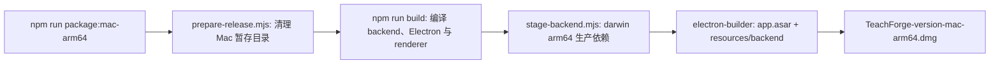

# macOS Apple Silicon 安装包 Design

## Problem

仓库当前只有 Windows x64 NSIS 打包配置。`scripts/stage-backend.mjs` 对原生依赖硬编码保留 `win32-x64.node` 与 `onnxruntime-node/bin/napi-v6/win32`，会删除 macOS 运行所需的二进制。

## Goals

- 在 Apple Silicon macOS 主机上生成 `TeachForge-<version>-mac-arm64.dmg`。
- 产物内保留 `better-sqlite3` Darwin arm64 prebuild 和 ONNX Runtime Darwin arm64 binding 与动态库。
- 继续使用已验证的 Electron `app.asar` + `resources/backend` 布局。
- 保持 Windows x64 NSIS 构建脚本和依赖裁剪行为。

## Non-Goals

- Intel macOS、Universal、Linux 或 Windows ARM64 构建。
- Developer ID 签名、公证、Mac App Store 发布或官网分发。
- 更改应用运行时、后端代码、数据目录、功能行为或 npm 依赖版本。

## Must-Not-Break Existing Behavior

- `npm run package:win` 继续生成 Windows x64 NSIS 安装包。
- 两个平台均将后端放在 `resources/backend`，并以实文件形式加载原生模块。
- 原有 `prepare-release.mjs` 在 Windows 上遇到文件占用时仍报告被占用路径及进程。
- Windows 构建继续只保留 `better-sqlite3` win32 x64 与 ONNX Runtime win32 资源。

## Current Behavior

根 `electron-builder.yml` 只声明 `win.nsis` x64。根 `package.json` 只有 `package:win`。后端 staging 复制生产依赖闭包后硬编码裁剪到 Windows x64。桌面 Electron 主进程已使用相同的打包后端路径，不需要运行时代码修改。

## Proposed Behavior

- 新增 `package:mac-arm64`，顺序执行目标产物清理、项目构建、`darwin arm64` 后端 staging 和 `electron-builder --mac dmg --arm64 --publish never`。
- `stage-backend.mjs` 接收 `win32 x64` 或 `darwin arm64`，拒绝其他目标；在裁剪前确认两个必需原生依赖都包含目标二进制，再仅保留该目标平台文件。
- `prepare-release.mjs` 保留默认 Windows 清理行为，并增加 `mac-arm64` 目标，清理 `release/mac-arm64` 与 `release/mac-arm64.tmp`。
- `electron-builder.yml` 新增 arm64 DMG 目标与稳定产物名；Mac 使用从现有图标生成的 512×512 `build/icon-mac.png`，满足 macOS 图标最低尺寸；关闭公证以避免构建隐式上传。
- 默认不强制选择签名身份。没有可用身份时会生成未签名 DMG；签名与公证仍是正式对外分发前的独立发布工作。

## Alternatives Considered

| 方案 | 结论 | 理由 | 是否升级为 ADR |
|---|---|---|---|
| 新建 macOS 专用 staging 脚本 | 否决 | 平台差异仅在目标原生文件集合，重复依赖扁平化会造成两份逻辑漂移 | n/a |
| staging 从运行主机自动推断平台 | 否决 | 构建目标需显式可读；错误主机不应静默生成错误原生文件集 | n/a |
| 仅增加 electron-builder 的 macOS target | 否决 | 当前裁剪会删除 Darwin 二进制，单改 target 得到不可启动的产物 | n/a |

## Business Flow

开发者在 Apple Silicon macOS 上运行 `npm run package:mac-arm64`，得到可挂载的 DMG。用户将 app 拖入 Applications 后启动应用。

## End-to-End Data Interaction Flow

| 关键节点 | 输入 | 节点职责 | 输出 / 状态变化 | 关键边界 |
|---|---|---|---|---|
| 根 npm 脚本 | macOS arm64 构建命令 | 串联清理、编译、staging 与 DMG 构建 | DMG 文件 | 打包命令只能在支持的原生构建主机运行 |
| `stage-backend.mjs` | 目标平台、架构及 npm 生产依赖树 | 扁平复制生产依赖，校验并筛选原生二进制 | `build/backend` | 目标二进制缺失时在复制前失败 |
| electron-builder | 桌面构建结果与 backend stage | 组装 Electron 应用并制作 DMG | `release/*.dmg` 与 `release/mac-arm64/*.app` | 公证关闭；签名不作为构建前提 |

## Data And API Impact

无数据库、API、业务数据或用户设置变化。构建目录仅包含可再生成的发行产物。

## Frontend Fetching Logic

不适用。本变更不修改渲染层读取逻辑。

## Frontend Behavior

不修改桌面 UI；沿用现有渲染层构建产物。

## Backend Fetching Logic

不适用。本变更只调整生产依赖的打包文件集合。

## Backend Behavior

运行时行为不变。两种平台均从 `process.resourcesPath/backend/dist/main.js` 启动 backend，并从 `resources/backend/node_modules` 加载依赖。

## Error Handling

目标平台不受支持，或 `better-sqlite3` / ONNX Runtime 缺少目标原生文件时，staging 脚本输出明确错误并以非零状态退出，不继续制作 DMG。

## Risks

- 本地 DMG 不保证代码签名或公证。对外分发还需 Developer ID 签名和 Apple 公证；关闭公证可避免当前打包命令自动上传。
- 本地生产依赖树可能包含额外平台文件；staging 将裁剪两项后端关键原生依赖，其他依赖由对应平台 npm 安装结果决定。
- 只验证 macOS arm64 主机的构建；不能据此宣称 Intel Mac 或其他平台可用。

## Verification

- 运行 `npm run package:mac-arm64`，确认产生非空 DMG 与 `.app`。
- 通过 `file` / `lipo -archs` 检查 bundle 主程序及两个原生依赖含 `arm64`；确认 backend stage 保留 Darwin arm64 文件并移除 Windows/Linux ONNX 目录。
- 检查 electron-builder 配置解析成功，Windows x64 构建脚本的目标参数未变。

## Design Deviations

| 偏差 | 发现于 | 与设计不符之处 | 处理（改设计 / 改现状文档 / 接受）|
|---|---|---|---|
| Mac 图标需单独放大到最低尺寸 | L001 | 首次实际打包发现 `build/icon.png` 为 256×256，electron-builder 要求 macOS 图标至少 512×512；增加仅供 Mac 使用的 512×512 图标文件 | 接受；不改 Windows 图标输入 |

## Version History

### v2.0 — <YYYY-MM-DD>

- 触发：<开发者验收反馈，问题描述>
- 改动内容：<逐条列出>
- 影响范围：<受影响的 Goals / Non-Goals / 接口 / 流程章节>
- 处理状态：<已重新实施 / 待实施 / 已拒绝并说明理由>

## Current Doc Updates

- [x] `docs/current/platform/packaging.md`
- [x] `docs/current/platform/tech-stack.md`
- [x] `docs/current/platform/index.md`
- [x] `docs/current/index.md`
- [x] `docs/manifest.yaml`
