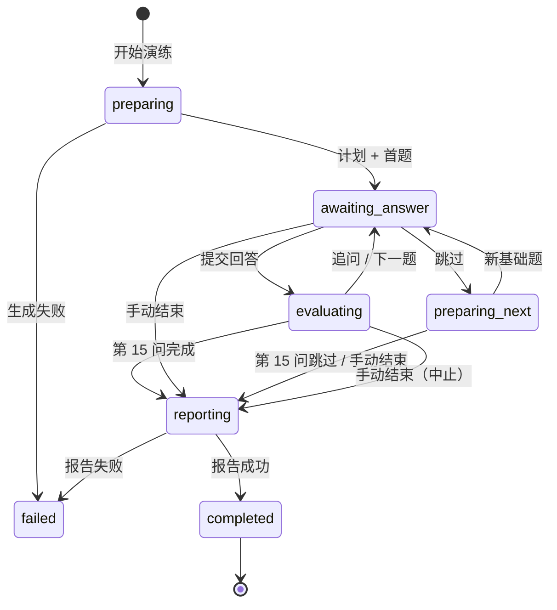

# 演练模式（Rehearsal）

演练是同一 Conversation 下的独立 Agent。它不写入普通对话消息，而是由 `RehearsalsService` 维护自己的状态机：AI 扮演一名学生，用费曼学习法向教师提问；教师回答后先做本题评估，再决定追问或换题。报告完成后，普通对话通过摘要注入继续使用演练结果。

## 当前行为

### 开始与上下文

- 开始前必须存在普通对话历史：至少一条已完成 user 行和一条已完成 assistant 行；存在 `pending` 普通行时返回 409。桌面端只有在当前 thread 出现 completed user + assistant round 后启用「开始演练」；否则按钮置灰，并在按钮下方提示先完成一轮普通对话。
- `ConversationsService.getRestorableHistory(conversationId, upToSequenceNo?)` 只读地投影可恢复历史，并返回 `{ history, maxSequenceNo }`；不创建 turn、不写消息。
- 开场规划调用复用父会话的 Pi 快照（含 compaction），但 `LlmService.generate()` 不保存快照；没有快照或快照落后时按 SQLite 重建。规划输出 `topic`、`learningSummary`、3–8 个知识点和第一道基础题。
- 后续答题、跳过和报告调用只带 `learningSummary + plan + 已有问答 + 当前状态`，不再重复注入完整普通历史。
- 演练 Agent 使用代码写死的 system prompt，不加载 SOULS/style preference、不加载 pi-memory、注册空工具列表；它不能写文件或执行命令。
- 学生画像可选，最多 1000 字符；它只影响提问视角，不覆盖输出格式与规则。
- 学生画像持久化在 `<configDir>/rehearsal-persona.txt`（默认 `~/.tech-forge/rehearsal-persona.txt`），不建表、不按会话隔离：任何会话进入演练模式都读取同一份文本，编辑器失焦时通过 `PUT /api/rehearsal-persona` 原子写回；空文件等价于"没有画像"，此时使用默认好奇学生画像。每次开始演练仍把当时的文本作为 `persona` 传给 start 接口，历史演练保留各自投递时的 `personaText`。

### 准备画面

- `POST` 仍是同步请求；桌面端在 `isStarting` 时用独立准备画面替换开始表单（「开始演练」与「开始新的演练」共用），不进入 session 壳层。
- 画面元素：标题、进度条、进度条下的状态文案、底部说明；**不显示已用时间或预计时长**。
- 状态文案来自只读端点 `GET /api/conversations/:id/rehearsals/preparing` 的 `phase`：`history` / `prior_summaries` / `session` / `plan` / `repair` / `saving`。进度条按预计时长平滑推进，上限 90%，不显示百分比或时间数字；start 返回后才补到 100%。
- start 返回后先停止轮询并把进度条补到 100%、显示「准备完成，正在进入演练…」，约 450ms 后才切到 session，避免停在半途直接跳走。
- 轮询间隔 1s（页面不可见 5s），start resolve/reject 后停止；端点不读库、不做 reconciliation，未登记返回 `null`，此时显示「正在准备第一道题…」。
- 失败后离开准备画面，回到开始页显示既有可执行文案；不提供取消（同步请求没有服务端 abort 入口）。
- 准备中切换会话时，旧 start 的结果不会写入新会话：`RehearsalStore.start()` 在 await 返回后校验 `conversationId`。

### 状态机

- `preparing`：生成计划与首题。
- `awaiting_answer`：当前题等待回答。
- `evaluating`：正在评估当前回答并决定下一步。
- `preparing_next`：跳过已落库，正在生成新基础题。
- `reporting`：正在生成总体报告。
- `completed` / `failed`：报告成功或失败；失败保留逐题数据，可重试结束。

### 限额

- 总提问数上限 15，包含基础题、追问和跳过；`askedQuestionCount` 在题目展示时计数。
- 同一基础题最多 2 次追问；`followUpDepth` 为 0/1/2，第 2 次追问之后后端强制下一基础题。
- 跳过不评估、不追问，消耗 1 个名额且不返还；第 15 问被跳过时直接完成。
- 一题未答就点「结束演练」时，桌面端先确认；确认后调用 `DELETE /api/rehearsals/:id` 丢弃本次演练（删除 Rehearsal/Turn 与已有 transcript），不生成空报告。
- 模型动作只有 `follow_up` / `next_question`；模型返回 `complete` 会被当作下一题处理，结束只由用户或 15 上限触发。
- 计数从 `rehearsal_turns` 派生并写回 `rehearsals`，不信任模型返回值。

### 结果同步

- 评估完成时写 `rehearsals.overallEvaluationJson` 与各 turn 的 `evaluationJson`，并写 transcript：
  `<configDir>/sessions/<conversationId>/rehearsals/<rehearsalId>.md`。
- 普通对话由 `ChatService` 调用 `RehearsalsService.buildConversationDigest()`，只取 `loadedContext = 0` 的最近 3 次 completed 演练摘要，总长度封顶 6000 字符。
- 摘要不拼进本轮 user 文本：`LlmService.stream()` 在 `session.prompt()` 前用 `appendCustomMessageEntry(..., display: false)` 追加一条 `rehearsal_digest` custom message entry，随后 `markDigestDelivered()` 置 `loadedContext = 1`。一次投递后 `Pi` 快照继续携带，不再重复注入。
- digest 包含主题、学生画像、逐题问题/回答摘要/评估、总体薄弱点/建议和 transcript 路径；普通 Agent 可用 `read` 读取完整记录。
- `contextRefsJson.rehearsals` 记录本次投递的 `rehearsalIds` 与字符数；`ConversationsService.mergeUserMessageContextRefs()` 与 attachments / knowledge 合并，不再整体覆盖。
- `LlmService` 保存 Pi 快照前用 `replaceInjectedUserText()` 清除本轮和历史的附件/知识块注入；它同时处理字符串与 text-block 内容，并用代码写死的注入标题 + `## 用户输入` 分隔符清理旧快照。`custom_message` entry 不在清理范围内，因此 digest 得以留存。
- 普通对话继续接收已完成演练的摘要上下文；演练评估报告通过演练模式中的历史记录查看，不在普通对话区域单独展示卡片。

### 历史记录

- 演练模式内可打开「历史演练」：当前 conversation 的进行中、已完成和报告失败记录。
- 列表只返回摘要（主题、状态、结束原因、进度、总体摘要、`counts`、`nextCursor`），不返回 turns/plan/完整报告；点击后按需读取单次详情。
- 进行中记录置顶；浏览历史不卸载当前 session，返回后题面、输入和进行中状态保留。
- 历史范围限定在当前 conversation；跨会话历史不实现。

## 持久化

`rehearsals` 新增字段：`personaText`、`contextUpToSequenceNo`、`planJson`、`askedQuestionCount`、`baseQuestionCount`、`skippedCount`、`overallEvaluationJson`、`endReason`。

`rehearsal_turns` 新增字段：`kind`（`base` / `follow_up`）、`baseSequenceNo`、`followUpDepth`、`pointId`；turn 状态包括 `awaiting_answer`、`answer_saved`、`evaluated`、`skipped`、`unanswered`、`failed`。

同一 conversation 最多一个活跃 Rehearsal，由部分唯一索引
`UQ_rehearsals_conversation_active`（active 状态集合）和 Service 条件检查共同保证。删除 conversation 时按现有顺序删除 `rehearsal_turns` → `rehearsals`，再删除 session 目录中的 transcript。

## 失败与恢复

- 模型 JSON 非法时最多尝试 3 次（含首次），重试 prompt 在原始 prompt 后追加本次解析错误，要求模型只输出合法 JSON；仍非法返回 422，保留答案供重试。
- 模型调用本身失败（超时、网络等）不在本服务重试：重试由 Pi SDK 处理，本服务只记录诊断日志并映射为 504/502/409。
- 面向用户的错误只给「发生了什么 + 下一步按钮」，并按 `label` 定制：`answer` 提示回答已保存、点「重试评估」；`skip` 提示点「重试」；`report` 提示点「重试结束」；`plan` 提示再点「开始演练」。provider 原始文本与模型原始输出只进日志。
- 面向开发者的日志：`rehearsal.model.call_failed` 记录 `label`、`attempt`、`timedOut`、截断的 `errorMessage` 与错误类型/堆栈；`rehearsal.model.json_invalid` 额外记录 `outputLength`、截断的 `outputPreview` 与 `parseError`。
- 回答评估失败：turn 转 `failed`，rehearsal 回 `awaiting_answer`；同一 `answerRequestId` 可重试。
- 跳过生成失败：turn 保持 `skipped`，rehearsal 保持 `preparing_next`；同一 `turnId` 可重试。
- 报告失败：rehearsal 转 `failed`，保留逐题数据；桌面端直接进入报告视图并显示「重试结束」，重试 `end`。
- 进程中断后，读取时 reconciliation 无活跃 run 的行：`evaluating`/`preparing_next` 立即回 `awaiting_answer`，`reporting` 立即转 `failed`；`preparing` 等 120 秒后转 `failed`，避免误伤仍在进行的开场规划。
- 回答在提交时已写入 `rehearsal_turns.answer`；重启后 `latest` 会恢复题面与历史问答。若上次评估未完成，桌面端显示已保存回答与「重试评估」，用同一回答 + 新请求键继续，不重复创建 turn。
- 每个 Rehearsal 在进程内串行；`end` 会 abort 进行中的模型调用并等待其退出，迟到结果不写入。

## 当前边界

- 报告生成失败时，历史和报告页只显示逐题数据，不伪造总体结论。
- 零回答结束走丢弃，不产生报告；已有回答时丢弃返回 409。
- 普通对话 digest 只投递一次：`loadedContext = 1` 后不再重建，token 成本只发生一次；本轮若在真正追加到 session 前被取消，这批演练不会补投（at-most-once），失败与取消路径只记录日志。
- 投递后的 digest 随 Pi 快照持久化：报告重算或演练被丢弃后，模型上下文中仍是投递时的文本，transcript 路径可能已失效；完整原文留在 transcript。
- 开场复用父 Pi 快照时，模型可能延续普通对话语气；system prompt 已强制角色切换，但仍需真实长对话验收。
- v1 使用 JSON 请求/响应，不做 SSE；没有跨会话演练历史、报告导出、人工重评或计划编辑。
- 15 问总上限包含追问，基础题实际数量可能是 5–15。

## 代码入口

- 状态机、digest、transcript、恢复：`apps/backend/src/rehearsals/rehearsals.service.ts`
- 准备阶段（进程内只读）：`rehearsal-preparing-registry.ts`
- 模型 prompt 与 JSON 校验：`rehearsal-prompts.ts`、`rehearsal-json.ts`
- 每 Rehearsal 锁与 abort：`rehearsal-run-registry.ts`
- HTTP 边界：`rehearsals.controller.ts`
- 非流式模型调用：`apps/backend/src/llm/llm.service.ts` 的 `generate()`
- 普通对话注入：`apps/backend/src/chat/chat.service.ts`
- 快照清洗：`apps/backend/src/llm/session-entries.ts`
- 桌面端：`apps/desktop/src/features/rehearsal/`
