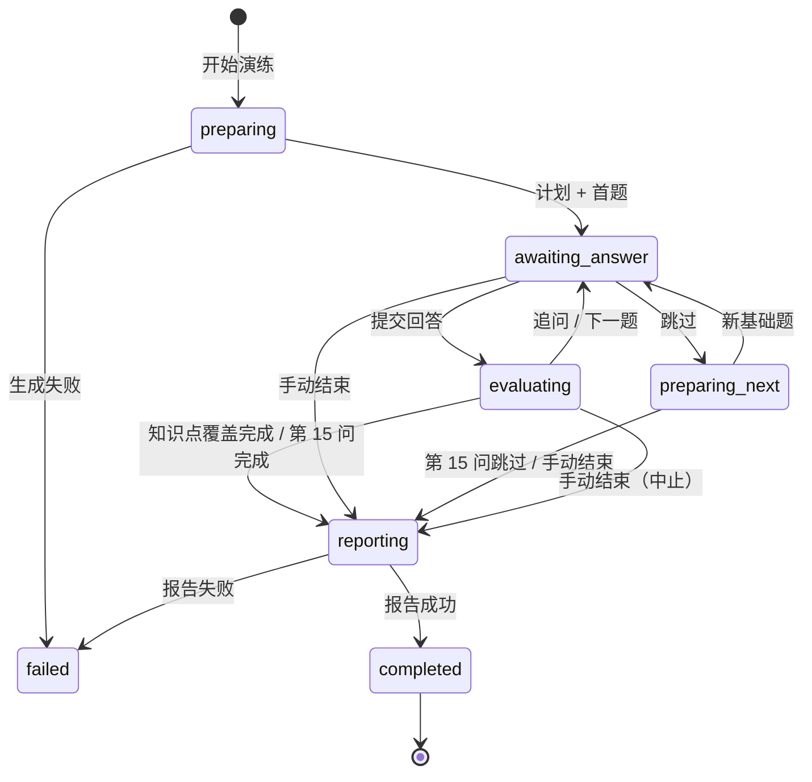

# 演练模式（Rehearsal）

演练是同一 Conversation 下的独立 Agent。它不写入普通对话消息，而是由 `RehearsalsService` 维护自己的状态机：AI 扮演一名学生，用费曼学习法向教师提问；教师回答后先做本题评估，再决定追问或换题。报告完成后，普通对话通过摘要注入继续使用演练结果。

## 当前行为

### 开始与上下文

- 开始前必须存在普通对话历史：至少一条已完成 user 行和一条已完成 assistant 行；存在 `pending` 普通行时返回 409。桌面端只有在当前 thread 出现 completed user + assistant round 后启用「开始演练」；同一判定也门控页头的「演练模式」页签——没有该 round 时页签置灰且不可点击，说明文案挂在按钮外层（`title`），与开始页的 `disabledReason` 共用 `REHEARSAL_REQUIRES_ROUND_HINT`。若当前模式已是演练，而 round 消失（如新建议题、清空会话），视图自动退回对话模式。`ConversationsService.getRestorableHistory(conversationId, upToSequenceNo?)` 只读投影可恢复历史并返回 `{ history, maxSequenceNo }`，不创建 turn、不写消息。
- 开场规划复用父会话 Pi 快照（含 compaction），但 `LlmService.generate()` 不保存快照；快照缺失或落后时按 SQLite 重建。规划输出 `topic`、`learningSummary`、1–8 个知识点和第一道基础题。知识点数量按对话实际内容确定；内容少时可以只有 1–2 个，不要求凑满。
- 后续答题、跳过和报告只带 `learningSummary + plan + 已有问答 + 当前状态`，不重复注入完整普通历史。演练 Agent 使用代码写死的 system prompt，不加载 IDENTIFY/PREFERENCE 文本或工具；它不能写文件或执行命令。
- 学生画像可选、最多 1000 字符，只影响提问视角。画像持久化在 `<configDir>/rehearsal-persona.txt`，不建表、不按会话隔离；`PUT /api/rehearsal-persona` 原子写回，空文件等价于没有画像。每次开始把当时文本作为 `persona` 传入，历史演练保留 `personaText`。

### 准备画面

- `POST` 是同步请求；桌面端在 `isStarting` 时显示独立准备画面：动图主图（`apps/desktop/src/assets/rehearsal-preparing.gif`）、标题、五段真实阶段清单（读取学习内容 / 回顾演练记录 / 加载上下文 / 生成演练题目 / 保存计划）、进度条、状态文案和底部说明，不显示已用时间或预计时长。清单每段都由后端 `phase` 推导：`repair` 归入「生成演练题目」，没有后端无法上报的阶段；动图只是情绪层，`aria-hidden`，不承载信息。状态文案来自只读端点 `GET /api/conversations/:id/rehearsals/preparing` 的 `phase`：`history` / `prior_summaries` / `session` / `plan` / `repair` / `saving`。端点不读库、不做 reconciliation，未登记返回 `null`；轮询 1s（页面不可见 5s），start 结束即停止。
- 进度条与清单是两个独立信号：进度条按预计时长推进（`estimatePreparingPercent`，5s≈45%、20s≈83%），上限 90%，只用于安抚等待，不代表真实阶段。start 返回后进度条补到 100%、清单全部标记完成，标题换成「准备完成，马上开始演练」、状态行显示「准备完成，正在进入演练…」，约 450ms 后切换；失败回到开始页显示可执行文案，不提供取消。准备中切换会话时，旧 start 结果不会写入新会话：`RehearsalStore.start()` 在 await 返回后校验 `conversationId`。等待超过 45 秒时追加一行模型较慢的提示。

### 状态机

`reporting` 生成总体报告；`completed` / `failed` 为终态，失败保留逐题数据并可重试结束。

### 限额

- 总提问数上限 15，包含基础题、追问和跳过；它是上限而不是目标，对话内容少时不会为了凑满 15 次继续出题。`askedQuestionCount` 在题目展示时计数，计数从 `rehearsal_turns` 派生并写回 `rehearsals`，不信任模型返回值。同一基础题最多 2 次追问；`followUpDepth` 为 0/1/2，第 2 次追问之后后端强制下一基础题。
- 跳过不评估、不追问，消耗 1 个名额且不返还；第 15 问被跳过时直接完成。一题未答就点「结束演练」时，先确认再调用 `DELETE /api/rehearsals/:id` 丢弃本次演练（删除 Rehearsal/Turn 与已有 transcript），不生成空报告。
- 模型动作有 `follow_up` / `next_question` / `finish`。当计划知识点已覆盖且没有必须追问的缺口时，模型返回 `finish`，后端立即转 `reporting`，`endReason='coverage'`，不生成下一题；因此结束可由用户、模型覆盖判断或 15 上限触发。
- 桌面端只显示「已回答 X 题（最多 15 题）」这类上限文案，不把 15 当作必须完成的固定分母。

### 结果同步

- 评估完成时写 `rehearsals.overallEvaluationJson` 与各 turn 的 `evaluationJson`，并写 `<configDir>/sessions/<conversationId>/rehearsals/<rehearsalId>.md` transcript。普通对话由 `ChatService` 调用 `RehearsalsService.buildConversationDigest()`，只取 `loadedContext = 0` 的最近 3 次 completed 演练摘要，总长度封顶 6000 字符。
- 摘要不拼进本轮 user 文本：`LlmService.stream()` 在 `session.prompt()` 前用 `appendCustomMessageEntry(..., display: false)` 追加 `rehearsal_digest`，随后 `markDigestDelivered()` 置 `loadedContext = 1`；一次投递后 Pi 快照继续携带，不再重复注入。
- digest 包含主题、画像、逐题问答摘要/评估、总体薄弱点/建议和 transcript 路径；`contextRefsJson.rehearsals` 记录 `rehearsalIds` 与字符数，并由 `mergeUserMessageContextRefs()` 与 attachments / knowledge 合并。
- `LlmService` 保存快照前用 `replaceInjectedUserText()` 清除本轮和历史的附件/知识块注入；`custom_message` entry 不清除，因此 digest 留存。普通对话继续接收摘要上下文；报告通过演练历史查看，不在普通对话展示卡片。

### 会话知识掌握事实

- 每个 Conversation 最多一条派生事实，持久化在 `conversation_knowledge_facts`，字段为 `summary`、`knowledgePointDetailsJson`、`tagsJson`、`masteryLevel`、`generationStatus`、`lastError`、`generatedAt`、`createdAt`、`updatedAt`；不新增版本号、来源清单、尝试次数、独立任务表或知识点表。
- 报告完成（手动 end、模型判断知识点已覆盖、回答/跳过达到 15 问上限）在保存 `completed`、`overallEvaluationJson`、`endedAt` 的同一事务里把事实行置 `pending`；已有内容时只改状态并清空旧错误，保留已发布内容。提交后才唤醒后台 worker，HTTP 继续返回原报告；重复 end 已 completed 演练不重复登记。
- 后台服务默认每 5 秒扫描 `pending`，按 `updatedAt`、`conversationId` 升序领取；进程内共用一个 worker，同一会话不重叠。领取用短事务把 `pending` 条件更新为 `running` 并读取输入快照，模型调用不持有数据库事务。
- 输入包含该会话全部 `completed` 演练，按 `endedAt`、`createdAt`、`id` 升序；报告/计划损坏或报告知识点无法映射到计划时明确失败。每条评估带演练 ID、时间、知识点名称、原始等级、依据和总体报告。事实模型使用专用固定 system prompt、`tools: []`、独立 AbortSignal，不携带画像、父会话上下文、IDENTIFY、PREFERENCE 或记忆，也不写普通消息/快照；结构校验失败最多 3 次调用（首次 + 2 次修复），provider 错误交给既有 LLM 边界。
- 预算在同一模型解析后用实际 `contextWindow` 构造：先全量历史，超限从最旧开始整份移除，允许 0 份历史；旧事实与本次评估必保留，窗口未知或必保留内容超限时失败。输出预留 8192 token、安全余量 10%，UTF-8 字节数为保守上界，并计入 system prompt、结构包装与修复文本。
- 模型输出严格校验：summary ≤200 Unicode code points，等级/证据状态枚举，标签 0–8 个且去重，知识点不重复；`insufficient` 等级与考察时间为空，`sufficient` 二者非空，`lastAssessedAt` 必须来自真实评估。引用只能来自本次输入或旧事实原样携带，且同会话真实存在；不按跨演练相同 `pointId` 合并。
- 成功时整体替换内容、清空 `lastError`、更新 `generatedAt`；失败只在仍为 `running` 时转 `failed`，保留旧内容与旧 `generatedAt`，`lastError` 为有界脱敏摘要。处理期间新报告改回 `pending` 时，旧成功或旧失败都不得发布，worker 重新读取最新快照再生成。启动先把遗留 `running` 恢复为 `pending` 再领取；未唤醒和释放竞态由周期扫描补偿，`failed` 不自动重试。关闭时停止领取并尽力 abort，`running` 留给下次启动恢复。会话删除在原有事务中先删事实行，迟到结果影响 0 行，不重建事实。
- 只读查询 `GET /api/conversations/:conversationId/knowledge-facts` 不触发生成、不修复状态、不读缓存：无行返回 `200` + `fact: null`；首次未成功返回空内容 + 状态；更新中/失败返回最近成功内容与 `generatedAt`；JSON 损坏返回安全 500。集合查询 `GET /api/knowledge-facts` 返回全部事实，按 `updatedAt DESC, conversationId ASC` 排序，且不读取/返回 `knowledgePointDetails` 以控制列表成本。契约见[演练 API 契约](api-contract.md#list-conversation-knowledge-facts)。

### 历史记录

- 演练模式内可打开「历史演练」：当前 conversation 的进行中、已完成和报告失败记录。列表只返回摘要（主题、状态、结束原因、进度、总体摘要、`counts`、`nextCursor`），不返回 turns/plan/完整报告。进行中记录置顶；浏览历史不卸载当前 session，返回后题面、输入和进行中状态保留；不提供跨会话历史。

## 持久化

`rehearsals` 新增 `personaText`、`contextUpToSequenceNo`、`planJson`、`askedQuestionCount`、`baseQuestionCount`、`skippedCount`、`overallEvaluationJson`、`endReason`。

`rehearsal_turns` 新增 `kind`（`base` / `follow_up`）、`baseSequenceNo`、`followUpDepth`、`pointId`；turn 状态包括 `awaiting_answer`、`answer_saved`、`evaluated`、`skipped`、`unanswered`、`failed`。同一 conversation 最多一个活跃 Rehearsal，由部分唯一索引 `UQ_rehearsals_conversation_active` 与 Service 条件检查共同保证。

`conversation_knowledge_facts` 以 `conversationId` 为主键与外键，`generationStatus` 建普通索引；迁移 `1794010000000-conversation-knowledge-facts` 只建表/索引，不回填历史。删除 conversation 时按 `conversation_knowledge_facts` → `rehearsal_turns` → `rehearsals` 顺序清除派生数据，再删除 session 目录中的 transcript。

## 失败与恢复

- 模型 JSON 非法时最多尝试 3 次（含首次），重试 prompt 追加本次解析错误；仍非法返回 422，保留答案供重试。模型调用本身失败（超时、网络等）不在此重试，重试由 Pi SDK 处理，本服务映射为 504/502/409。面向用户的错误只给「发生了什么 + 下一步按钮」：`answer` 提示点「重试评估」，`skip` 提示点「重试」，`report` 提示点「重试结束」，`plan` 提示再点「开始演练」。provider 原始文本与模型原始输出只进日志。
- 开发者日志：`rehearsal.model.call_failed` 记录 `label`、`attempt`、`timedOut`、截断 `errorMessage` 与错误类型/堆栈；`rehearsal.model.json_invalid` 额外记录 `outputLength`、截断 `outputPreview` 与 `parseError`。
- 回答评估失败：turn 转 `failed`，rehearsal 回 `awaiting_answer`；同一 `answerRequestId` 可重试。跳过生成失败：turn 保持 `skipped`，rehearsal 保持 `preparing_next`；同一 `turnId` 可重试。报告失败：rehearsal 转 `failed`，保留逐题数据并可重试 `end`。
- 进程中断后，读取时 reconciliation 无活跃 run 的行：`evaluating`/`preparing_next` 立即回 `awaiting_answer`，`reporting` 立即转 `failed`；`preparing` 等 120 秒后转 `failed`。回答在提交时已写入 `rehearsal_turns.answer`；重启后 `latest` 恢复题面与历史问答。没有进行中的评估时，上次评估未完成会显示已保存回答与「重试评估」，并预填回答框，用同一回答 + 新请求键继续，不重复创建 turn；正常提交与重试期间只显示「正在进行评估…」，不显示该提示。
- 每个 Rehearsal 在进程内串行；`end` 会 abort 进行中的模型调用并等待退出，迟到结果不写入。

## 当前边界

- 报告生成失败时，历史和报告页只显示逐题数据，不伪造总体结论。零回答结束走丢弃；已有回答时丢弃返回 409。
- 普通对话 digest 只投递一次：`loadedContext = 1` 后不再重建，本轮若在真正追加到 session 前被取消，这批演练不会补投（at-most-once）。
- 投递后的 digest 随 Pi 快照持久化：报告重算或演练被丢弃后，模型上下文中仍是投递时的文本，transcript 路径可能已失效；完整原文留在 transcript。
- 开场复用父 Pi 快照时，模型可能延续普通对话语气；system prompt 已强制角色切换，但仍需真实长对话验收。
- v1 使用 JSON 请求/响应，不做 SSE；没有跨会话演练历史、报告导出、人工重评或计划编辑；15 问总上限包含追问；覆盖计划后模型会提前结束，因此一次演练可能明显少于 15 次提问。
- 知识事实仅支持单后端进程：没有多实例调度、手动重试 API、前端卡片消费、普通对话注入或跨会话画像；启动和查询不回填历史会话。事实语义仍取决于模型归并，引用校验只保证定位真实；真实 provider 的进步/退步/范围/分歧输出需要 L3 人工核查。

## 代码入口

- 状态机、digest、transcript、恢复：`apps/backend/src/rehearsals/rehearsals.service.ts`；准备阶段：`rehearsal-preparing-registry.ts`；每 Rehearsal 锁与 abort：`rehearsal-run-registry.ts`
- 模型 prompt 与 JSON 校验：`rehearsal-prompts.ts`、`rehearsal-json.ts`
- 知识事实实体、服务/worker、严格校验、预算与 prompt：`conversation-knowledge-fact.entity.ts`、`conversation-knowledge-facts.service.ts`、`conversation-knowledge-facts.validation.ts`、`conversation-knowledge-facts.budget.ts`、`conversation-knowledge-facts.prompts.ts`
- 知识事实只读 HTTP：`conversation-knowledge-facts.controller.ts`；演练 HTTP 边界：`rehearsals.controller.ts`
- 知识掌握视图使用 `GET /api/knowledge-facts` 读取轻量列表，打开详情后使用 `GET /api/conversations/:id/knowledge-facts`；展示契约见[知识掌握](../knowledge-profile/api-contract.md)
- 非流式模型调用：`apps/backend/src/llm/llm.service.ts` 的 `generate()`；普通对话注入：`apps/backend/src/chat/chat.service.ts`；快照清洗：`apps/backend/src/llm/session-entries.ts`
- 桌面端：`apps/desktop/src/features/rehearsal/`
