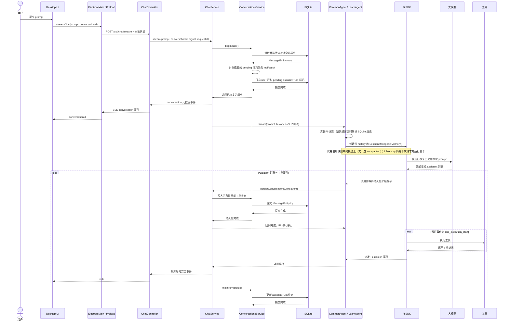

# Agent Runtime 运行链路

本文记录当前 Agent 的执行流程，以及扩展能力时必须保留的边界。内容以代码中已实现的行为为准；运行链路或持久化契约变化时应同步更新。

## Runtime ownership

| 组件 | 职责 |
|---|---|
| `App` / `useRemoteThreadListRuntime` | 以稳定 `ThreadListAdapter` 读取 Conversation 摘要，并为每个访问过的线程创建独立 LocalRuntime；assistant-ui 保持后台线程挂载，切换不会取消其他会话的流。活动 remote ID 仍写入 localStorage 供启动恢复。 |
| `AgentChatPage` / `ConversationStore` | 恢复活动 ID、加载最近最多 30 条可见消息并以 Message ID 按需前置更早历史；各线程的 composer 附件/命令草稿以稳定 localThreadId 键控。页面采用全高双栏，侧栏列表与消息视口独立滚动，输入区保持可见；设置按钮切换右侧聊天/设置主视图，不卸载根 Conversation Runtime。 |
| `SettingsPage` / `ConversationSidebar` | 会话行悬停显示「…」，菜单里的「删除会话」直接物理删除（无二次确认），删除当前会话时同时清空线程与输入区；通过侧栏底部设置入口切换视图；从本地设置 API 加载 DeepSeek 模型字段、密钥配置状态、IDENTIFY 身份文本与 PREFERENCE 风格文本，并保存用户编辑。Renderer 不读取本机文件；设置页通过本机设置 API 接收明文 API Key，其他 Agent 流程不接收密钥。 |
| Desktop Agent adapter | 发送最新用户输入和该线程的 `unstable_threadId`（已初始化时为 remote Conversation ID）；不读取全局活动会话，也不让后台 `conversation` SSE 改变选择。活动映射按 requestId 保存，流终止后刷新摘要。 |
| Electron Main / Preload | Main 代理固定 Agent SSE 路由，并避免 renderer 接触本地 backend token；Preload 暴露类型化流桥接。 |
| `ChatController` | 校验并流式处理 `POST /api/chat/stream`；客户端断开时中止请求。 |
| `ChatService` | 在当前 backend 进程内按 conversation 串行化请求，编排持久化和 Pi 流，并投影允许传出的事件。 |
| `ConversationsService` | 管理有序 SQLite 消息行，保存用户、Pi 消息和工具状态，并在下一请求前对账中断状态。 |
| `CommonAgent` / `LearnAgent` | 每次请求创建 Pi session 时重新读取 DeepSeek 模型配置、IDENTIFY.md 与 PREFERENCE.md；Pi cwd 取本会话工作区 `<configDir>/sessions/<conversationId>/workspace`，组合系统提示词，注册持久化扩展钩子，并按 `loadMemory` 注册记忆工具。聊天与 skill 轮次再注册 `web_search`/`web_fetch`（内部 JSON 调用不注册）。Pi skill 从 `<configDir>/skills`（内置模板首次安装于此）与 `<workspace>/skills` 装载；带 `skillName` 的请求把 `/skill:<name>` 放在模型 prompt 首位，并在发送前确认 skill 已发现。另提供非流式 `generate()` 供演练使用，默认不装载记忆，也不启用网页工具。 |
| `RehearsalsService` | 维护演练状态机、15 问限额、逐题评估、总体报告、transcript 与普通对话 digest；开场只读复用父会话 Pi 快照，后续 JSON 调用不写快照、不注册文件工具。 |
| `MemoryService` | 用户级跨会话记忆：db0 core + sql.js 单文件 `<configDir>/memory/db0.sqlite`，复用本地 bge 512 维嵌入；注册 `memory_write`/`memory_search`/`memory_list`；每轮把 `## 长期记忆` 块拼进 user prefix；显式中文意图捕获；独占锁与每日备份；管理 API `GET/DELETE /api/memories`。详见[长期记忆](../domains/memory/index.md)。 |
| `workspace-file-tools.ts` | 以工具实际文件操作强制读写边界：读普通文件可来自任意位置，但拒绝应用托管路径（config.toml、IDENTIFY.md、PREFERENCE.md）；受保护目录（知识库根）默认拒绝读取，仅当当前用户请求明确点名其中路径并表达读取意图时放行；写入默认限制在当前会话工作区，并可使用本轮明确目标的一次性授权。 |
| Pi SDK | 执行模型与工具循环并维护本次运行的内存会话；不直接读写 TeachForge 数据库。 |

## 运行日志

Backend 使用 Nest `Logger` 输出单行 JSON 事件。Agent stream 请求由 `ChatController` 生成一个内部 `requestId`，并沿 `ChatService`、`ConversationsService`、`LearnAgent` 传递；会话列表和历史查询各自生成 requestId。日志常用 `requestId` 和 `conversationId` 串联阶段。

`ChatController` 记录 HTTP 接收、SSE 终态和客户端断开；`ChatService` 记录队列等待、轮次状态、Pi 消息/工具生命周期与锁释放；`ConversationsService` 记录恢复、消息/工具持久化及查询结果；`CommonAgent` 与 `LearnAgent` 记录 SDK/session 初始化阶段、模型运行、Pi 自动压缩和持久化钩子失败。终态和操作失败带耗时、状态及安全错误类型；持久化失败在所属 Service 记录，Agent/LLM 层再记录传播后的失败阶段。

Pi 自动压缩由 SDK 触发，`CommonAgent` 在 `generate()`、`LearnAgent` 在 `stream()` 的事件订阅中记录 `llm.compaction.started`、`llm.compaction.completed`、`llm.compaction.cancelled`、`llm.compaction.failed`。字段包含触发原因（`threshold`、`overflow`、`manual`）、`tokensBefore`、`estimatedTokensAfter`、`summaryChars`、摘要请求的 `summaryUsageTotalTokens` 以及压缩前后的 `contextTokens`/`contextPercent`；失败只记录 `errorMessageChars`，不记录摘要文本或原始异常 message。`llm.session.create.completed` 记录生效的 `compactionEnabled`、`compactionReserveTokens`、`compactionKeepRecentTokens`、`modelContextWindow` 和 `compactionThresholdTokens`；`llm.provider_run.started` 与 `llm.stream.completed` 记录发送前后的上下文占用。

Renderer 的会话列表和历史读取失败会在浏览器控制台输出安全诊断字段（操作、错误分类、HTTP 状态和错误类型），不记录对话正文或认证 token。直接用普通浏览器打开 Vite 开发地址时没有 Electron preload 的 `window.teachforge` 桥接；前端会标记 `desktop_bridge_unavailable`，后端不会收到请求或产生对应 HTTP 日志。

常规阶段和终态使用 `log`、异常或取消使用 `warn`/`error`；消息与工具进度汇总到 `debug`，最多每 5 秒记录一次。`chat.tool.terminated` 在工具失败时升为 `error` 并附 `failureReason`：`output_limit_truncated`（响应触达输出上限，参数被截断）、`invalid_arguments`、`aborted`、`blocked`、`tool_not_found`、`file_policy_denied`、`tool_error`。前两类由 Pi 在工具代码执行前拒绝（`aborted`、`blocked` 同理），不会产生 `llm.file_tool.operation.failed`，失败原因只能从结果文案分类；文案本身（包含模型原始参数）不进入日志。`chat.message.terminated` 在消息落库为 `failed` 时同为 `error` 并附 `stopReason`（`length` 表示输出上限截断）。Pi 文件工具的 access/readFile/detectImageMimeType/mkdir/writeFile 操作失败时，`CommonAgent` 在 `workspace-file-tools.ts` 的失败回调中输出 `llm.file_tool.operation.failed`，记录工具名、操作阶段、目标位于 workspace 内外的分类、耗时、安全错误类型/错误码/syscall；`EWORKSPACE` 会标记为 `workspace_policy_denied`。该事件不记录目标路径、文件内容或原始异常 message，并用 `requestId`/`conversationId` 与 `chat.tool.*` 生命周期日志关联。读取目标的每次解析输出 `llm.file_tool.read.resolution`：成功为 `log`，被拒为 `warn`，字段含 `outcome`（`resolved`、`invalid_path`、`path_unavailable`、`not_a_file`、`managed_file_denied`、`guarded_directory_denied`）、目标位于 workspace 内外的分类、受保护路径数、守护目录数、本回合读取授权类型、授权是否抬升守护目录默认值、耗时。它与 `llm.file_tool.operation.failed` 互补：后者只知道 `EWORKSPACE`，前者指出是哪一道检查拒绝；同一目标被 Pi 多次解析（access/readFile/mime 检测）时重复内容只记录一次，同样不记录目标路径。网页工具调用输出 `llm.web_tool.started`、`llm.web_tool.completed`、`llm.web_tool.failed`、`llm.web_tool.cancelled`，字段包含工具名、query/URL 字符数、结果条数、HTTP 状态、重试次数和耗时；不记录 query、URL、正文或 API Key。记录可包含 ID、角色/工具名、状态、数量、耗时、provider/model ID、文本长度以及受限的 stack frame。日志不包含 prompt、assistant 正文、工具参数/结果、原始异常 message、provider payload、API key 或本地认证 token。`requestId` 不属于 SSE、HTTP DTO 或桌面桥接契约。

## 请求与持久化时序

Session 初始化时，`CommonAgent` 从 `SettingsService` 单独读取工作空间路径，并将其同时用于 `DefaultResourceLoader.cwd`、`SessionManager.inMemory(cwd, ...)`、`createAgentSession({ cwd })` 和自定义文件工具。Pi 的 `agentDir` 仍由 `sdk.getAgentDir()` 提供。Pi SDK 文档说明 `cwd` 用于项目资源发现、上下文文件、会话分组和内置工具路径；此处保持所有 session 与文件工具同根。配置与风格文件的所有权见[本机 Agent 设置](../domains/system-settings/index.md)。

进程内扩展只走 `DefaultResourceLoader.extensionFactories`（对话持久化钩子与记忆工具）；`customTools` 另注入工作区文件工具与 DeepSeek 网页工具。`noExtensions: true` 关闭包发现，因此不会从 `node_modules` 或用户目录加载任何文件扩展；`additionalExtensionPaths` 也不再使用。记忆工具只在 `loadMemory` 为真时注册，`generate()` 默认不装载；网页工具只在 `webToolsEnabled` 为真时注册，`generate()` 固定关闭。

`createAgentSession({ tools })` 的列表是对**所有**已注册工具的 allowlist，当前列 `read`/`edit`/`write`/`grep`/`find`/`ls`，聊天与 skill 轮次再追加 `memory_*`，有 API Key 时再追加 `web_search`/`web_fetch`；自定义文件工具与网页工具经 `customTools` 注入。会话创建后调用 `session.bindExtensions({})`，进程内扩展才能收到 `session_start` 与后续生命周期事件。

### 网页搜索与抓取工具

`web-tools.ts` 把 DeepSeek 官方 Search/Fetch 暴露为 `web_search`、`web_fetch` 两个只读自定义工具，经 `customTools` 注入；不新增扩展工厂、不写文件、不访问 SQLite。

- 启用条件：`config.toml` 有 DeepSeek API Key，且 `PiSessionBuildOptions.webTools !== false`。`generate()` 固定传 `false`，因此演练与知识事实等内部 JSON 调用不会产生搜索费用；普通聊天与 `/探索主题` skill 轮次由模型决定是否调用。
- 参数：`web_search` 的 `query` 1–128、`count` 1–50（默认 5）、`include_content`（默认 false）；当前用户原话截到 128 字符后作为 `ori_question`。`web_fetch` 只接受含 host 的 http/https URL，拒绝用户名/密码。
- 响应：Search 输出标题、URL、站点、日期、权威性与摘要；Fetch 输出标题与 Markdown 正文。搜索结果上限 12,000 字符，单条正文摘录 2,000 字符，Fetch 正文上限 16,000 字符。
- 错误：400/401/402/403/404/413 直接返回工具错误；408/429/5xx 间隔 500 ms 重试一次（429 尊重 `Retry-After`，上限 2 秒）；取消抛 `AbortError`。日志只记录长度、状态、重试次数和耗时，不记录 query、URL 或正文。
- 计费与限速归 DeepSeek 账号：Search 100 QPS、Fetch 25 QPS，均按成功请求次数计费。

## 持久化与恢复约定

`beginTurn()` 按 `sequenceNo` 读取该对话的全部消息行，对账上次中断的轮次，然后在模型调用前保存新的 `user/completed` 行和 `assistantTurn/pending` 标记。

`CommonAgent` 优先读取 `pi_session_snapshots` 作为模型上下文（含 compaction 等 Pi 条目），仅当快照最后一条持久化消息与 SQLite 最新历史不一致（崩溃或快照未保存）时回退 SQLite 重建；未命中时也走重建。当前 prompt 则单独通过 `session.prompt(prompt)` 发送。

恢复出的条目在交给 Pi 之前先经 `checkSessionEntries()`（`llm/session-entries.ts`）核对工具调用配对，两条恢复路径共用这一步：

- 找不到对应 assistant `toolCall` 的 `toolResult` 丢弃。
- 只有调用、没有结果的 `toolCall` block 从该条 assistant 消息里剥掉，保留 assistant 文本；与 `recoverInterruptedPiMessage()` 对 SQLite 行的处理一致。
- 被丢弃条目的子条目重新接到相邻条目上，恢复结果保持单链（模型上下文取叶子路径）。

必须核对的原因是 OpenAI 兼容端点校验 `tool_calls` 与 `tool` 的配对：崩溃退出或 `length` 截断会留下缺失 `toolCall` 的不完整 assistant 条目和它的结果，原样重放会让此后每一轮都以同一个 400 失败，而不是当轮可见地失败。修复结果立即 upsert 回 `pi_session_snapshots`，一次失败的请求不会把同一份坏数据再读回来。

上下文压缩由 Pi SDK 自动执行，应用层不调用 `session.compact()`，也不自行裁剪或摘要历史：

- 触发条件为 `contextTokens > contextWindow - reserveTokens`。SDK 在发送新 user prompt 前、工具结果追加后准备下一轮 assistant 时、运行结束后各检查一次；provider 报上下文溢出或出现可恢复的 `length` 结束时，会压缩并重试一次。
- 模型描述符按 DeepSeek 文档声明 `contextWindow = 1_000_000`、`maxTokens = 65_536`（思考模式未设置 `max_tokens` 时的厂商默认值）。Pi 的 `buildBaseOptions()` 总会把 `options.maxTokens ?? model.maxTokens` 写进请求的 `max_tokens`，所以「不设置」在 SDK 中只会落到 16,384；描述符值就是实际上限。单次请求的输出预算还会被 `clampMaxTokensToContext()` 收缩为 `contextWindow - 估算输入 - 4096`。取舍见 [ADR](../../decisions/2026-11-13-deepseek-output-budget.md)。
- 默认 `reserveTokens = 16384`、`keepRecentTokens = 20000`，可由 Pi 全局设置 `<agentDir>/settings.json` 或项目设置 `<cwd>/.pi/settings.json` 覆盖，并支持按 `provider/modelId` 设置 `modelOverrides`。
- 本应用通过 `SettingsManager.applyOverrides()` 在内存中强制 `compaction.enabled = true`，不写用户全局 Pi 设置文件；即使 `<agentDir>/settings.json` 里设为 `false`，该 session 仍会压缩且原文件保持不变。压缩产生的 `CompactionEntry` 下次随快照恢复；SQLite `messages` 仍保留完整历史，不受压缩影响。
- `billion-context-pi` 未被 `DefaultResourceLoader` 装载，只有遗留类型声明，不参与压缩。

已用离线 provider 验证：恢复 40 条历史后，Pi 在发送本轮 prompt 前自动触发 `reason: "threshold"` 的压缩，上下文从 12000 token 估算降到 604 估算，压缩条目写入快照；命令为 `npm run verify:compaction --workspace @teachforge/backend`。

已知限制：Pi 在缺少 provider usage 时按 `字符数 / 4` 估算 token，中文内容会被低估，因此刚由 SQLite 历史重建、且尚无 usage 的会话可能晚于真实阈值才压缩；正常带 usage 的响应不受影响。本轮新注入的附件/知识块在发送前不计入阈值，若因此溢出则由 overflow 恢复压缩并重试一次，仍可能失败（见会话附件限制）。

Pi 的 `message_start`、每个 `message_update`、`message_end` 及工具执行 start/update/end 事件都会进入异步扩展钩子。钩子调用 `ChatService.persistPiEvent()`，等待 SQLite 写入完成后 Pi 才继续。只有 assistant 和 toolResult 消息事件会保存；用户行已单独提前写入，system prompt 由 session 配置提供。

每次 `stream()` 结束且持久化没有失败时，`LearnAgent` 调用 `CommonAgent.saveConversationSnapshot()`，用 `replaceInjectedUserText()` 把当前 user 消息还原为纯用户文本，并按历史 user 行 id 与注入标题清理旧快照中的附件/知识块（演练 digest 走独立 `custom_message` entry，不参与剥离），再 upsert 回 `pi_session_snapshots`。该函数同时处理字符串和 Pi text-block 内容；旧快照没有可匹配 id 时，用代码写死的注入标题 + `## 用户输入` 分隔符兜底。每次创建新 session 都从 `~/.tech-forge/config.toml` 读取 DeepSeek 配置，并把非空 `IDENTIFY.md` 身份文本（位于风格偏好之前）与 `PREFERENCE.md` 风格文本追加在固定系统提示词之后。API Key 在 backend 用于 DeepSeek Provider 注册，并由本机设置 API 返回设置页显示；不进入 Agent SSE、普通日志或 SQLite。

## 会话附件

用户可以在输入区为一条消息附加文件（PDF、DOCX、Markdown、TXT，以及 PNG/JPEG/GIF/WebP 图片）。附件**不进资料库**：没有 `documents` 行、没有分块与向量，也不参与 `/查询资料库`。

1. 挑选文件时只生成标签：Renderer 记下 `{attachmentId, path}`（id 由渲染层生成，路径来自专用文件选择器），不上传任何内容。
2. 发送时 `ChatPromptDto.attachments`（≤10、UUIDv4 + 绝对路径）随 prompt 进入 `ChatService.stream()`；桌面桥接在 Electron Main 校验该列表，格式不对直接拒绝整次请求。
3. `ChatService` 先 `beginTurn()` 得到会话 ID，再由 `AttachmentsService.storeForConversation()` 把文件复制到 `<configDir>/sessions/<conversationId>/attachments/<attachmentId>/<原文件名>`；只有需要转换的 PDF/DOCX 才把解析正文写到同目录的同名 `.md`（`lesson.docx` → `lesson.md`），Markdown/TXT 本身即文本，直接使用原文件、不生成副本；图片复制后编码为 base64 供本轮视觉输入。复制时机受会话 ID 约束：新会话在这一刻之前不存在。`<configDir>` 默认 `~/.tech-forge`。
4. 单份失败不影响整轮：不支持的格式记为 `unsupported`，路径不存在记为 `missing`，解析失败、图片内容与扩展名不符或超出内联大小限制记为 `unreadable`，本轮以一行说明告知模型，而不是静默省略。
5. 正文经 `renderAttachmentContext()` 拼成"本轮用户附加的文件"块，与知识块一起作为 `LlmRequestOptions.promptContext` 交给 `LearnAgent`，由它拼在本轮 user message 前面（`## 用户输入` 之后才是用户原话）。图片不进入这段文本，而是经 `LlmRequestOptions.images` 随 `session.prompt()` 作为 inline `image_url` 内容发送；文本块只列出图片文件名，便于模型对号引用。演练 digest 不走这条路：它经 `LlmRequestOptions.contextMessage` 在 `session.prompt()` 前以 `custom_message` entry 追加一次，随快照持久化（见 §持久化与恢复约定）。**都不进入 system prompt**：否则每轮变化会打断 provider 的前缀缓存，也违反 system prompt 只承载规则的设计。文本注入有 40000 字符上限：按用户顺序取文件，超出被截断（模型收到"本轮只提供开头 N 字"说明），后面没有余量的文件整体跳过并同样告知。
6. 正文和图片字节都不进入 `messages.contentJson`、不进入 SSE、不进入历史接口。user 行 `contextRefsJson.attachments` 保存 `{attachmentId, name, kind, characters, injectedCharacters}`：前两项供气泡标签与历史投影，`kind` 区分文本/图片，后两项供后续轮描述"共多少字、已提供多少字"。
7. 附件正文和图片只注入承载它的那一轮。之后每次请求都会追加一段"本会话可读取的附件"指针：每份附件的可读文件绝对路径（PDF/DOCX 为同名 `.md`，Markdown/TXT/图片为原文件）、总字数或"图片"标记、已注入字数，并提示用 `read`（文本可带 offset/limit；图片会作为视觉输入返回）或 `grep` 继续读取。附件目录不在受保护目录内，工具都能读；模型因此可以回到原文或原图，而不是凭记忆补全。
8. 指针不重复注入正文，只提供路径与规模，成本约每附件两行。图片只出现在承载它的那一轮：快照保存前 `replaceInjectedUserText()` 会丢弃 user entry 里的 `image` 块，避免每轮重复计费。

已知限制：40000 字符仍是经验值，长对话叠加长附件时可能仍超出模型上下文——那种情况表现为 `llm.stream.failed`，Pi 把 provider 的拒绝记成 `stopReason: "error"` 的 assistant 消息，`CommonAgent` 据此抛 `LlmProviderRejectedError` 并在日志里带 `providerErrorMessage`（截断 600 字符，不进 UI），因为 Pi 压缩无法压缩本轮新注入的正文。图片走 DeepSeek 兼容的内联 `image_url` 输入：单张上限 32 MiB，单轮所有图片原始字节上限 32 MiB（base64 后约 42.7 MiB，仍在 48 MiB 请求体限制内）。DeepSeek Files API 的 `file_id` 引用需要 `file` 内容块，而 Pi 的 OpenAI 兼容 provider 只序列化 `image_url`；附件只在一轮使用，因此不引入 Files API。附件文件按会话存放，删除会话时随 `sessions/<id>/` 一起清理。

## 文件读写边界

- 应用固定设置由 `SettingsService` 独占：`~/.tech-forge/config.toml`、`IDENTIFY.md` 与 `PREFERENCE.md` 不开放给 Agent 文件工具读取或修改。后端按路径、真实路径和文件身份拒绝直接访问、符号链接/硬链接别名，以及设置文件原子替换时的同目录临时文件。
- Agent 默认输出根是当前会话工作区 `<configDir>/sessions/<conversationId>/workspace`。`read` 可读取任意来源的普通文件；知识库根（`<configDir>/knowledge`）默认拒绝，用户在该轮明确点名路径时放行（config/IDENTIFY/PREFERENCE 无此例外）；`edit`、`write` 与 `mkdir` 的每次实际文件操作必须通过 `workspace-file-tools.ts` 校验，不依赖 prompt 作为安全机制。
- 知识库根里唯一的读取例外是生成的目录文件 `<configDir>/knowledge/index.md`：`CommonAgent` 把它交给 `workspace-file-tools.ts` 的 `readableGuardedPaths`，按精确路径放行，同目录上传原文仍被拒绝，且豁免不会扩展到父目录。`DocumentsService.onModuleInit` 在启动时按数据库重建该文件（缺失才写，空库写成“资料库当前为空”），因此会话按 `AGENTS.md` 读到它时不会得到 ENOENT。
- 当前流式用户请求只在包含明确写入意图且唯一绝对目标时，创建当前 session 的一次性外部写许可。命名目录的权限覆盖该目录及下级；命名文件仅允许该文件且其父目录须已存在。模糊路径、多个候选目标、历史消息、文件内容或模型输出都不会授予许可。
- `bash`、`subagent`、`subagents_enable` 保持排除。新增工具或扩展若能写文件，必须经过同一边界评估并阻止绕过。

Renderer 的会话摘要通过 `GET /api/conversations` 读取。选中会话时，`GET /api/conversations/:conversationId/messages` 默认返回最近最多 30 条可见 user/assistant 文本和 `hasMore`；user 行可包含其轮次的安全工具摘要。用户点击“查看更早的消息”后，Renderer 以最早已加载消息 ID 查询前一页并前置到 LocalRuntime，同时按持久 user message ID 恢复工具活动。接口不返回完整工具参数、partial/final result、toolResult 或 Pi 原始 payload。该 UI 分页不改变下一轮 Agent 请求从 SQLite 恢复完整模型历史的行为。

`conversation-history.ts` 将历史 DTO 转为 LocalRuntime 消息：保留 ID、角色、文本和时间，仅 assistant 携带 `status`。存储/API 的 user 状态不能直接传给 assistant-ui，否则即使 HTTP 200，`thread.reset()` 也会抛错。`AgentEventBus` 独立恢复 user 行下的工具摘要；历史活动没有请求 ID，也不显示未持久化的整轮耗时。`tool-activity-label.ts` 把每个工具调用转成普通用户措辞：`read`/`write`/`edit` 为“正在/已读取、写入、编辑 + 文件名”，`grep` 为“搜索 + 搜索词 + 文件名”；只读取 `path` 与 `pattern` 两个参数。本轮处于 `working` 且尚无文本增量时，回答位置显示一行等待状态：转动图标 + 当前动作（无进行中工具为“正在思考…”，否则复用同一措辞，如“正在读取 <文件名>”）+ 秒级耗时；超过 60 秒追加一行“更长等待”提示，首个文本增量到达（转为 `responding`）即移除该行。桌面回归命令为 `npm run test:conversation-history --workspace @teachforge/desktop`。

Assistant 消息（包括 toolCall block 和参数）以及原生 `toolResult` 消息以带格式标记的 JSON 保存在 `contentJson`。工具执行元数据、部分输出、最终结果和终态保存在独立的 `toolExecution` 行中。`assistantTurn` 和 `toolExecution` 行不会作为模型消息发送。

下一次请求会把 pending 工具执行标记为中断。不完整的 assistant 快照保留已生成文本，并移除未完成的 toolCall block。已完成的 tool call 若缺少 `toolResult`，优先用已持久化的工具最终结果重建；没有最终结果时则补一条错误结果，避免重放可能已产生副作用的工具。

每次请求都会加载全部可恢复历史，不做上下文裁剪或摘要，也不会自动续跑原来的 provider 调用。这里的“恢复”是下一次请求从持久消息继续对话。

数据库事务只覆盖短时读写，不跨模型或工具 I/O。持久化钩子写入失败时会中止 Pi 请求，并作为请求错误返回。

## 演练模式

演练是独立 Agent，不经过 `ChatService.stream()`，也不写 `messages`：

- `RehearsalsService.start()` 用 `ConversationsService.getRestorableHistory()` 读取父会话历史，再调用 `CommonAgent.generate()`。该调用可传入父 `conversation`，让 `restoreEntries()` 复用父 Pi 快照（含 compaction），但 `generate()` 不保存快照。
- `start()` 通过可选的 `onPhase` 回调把 session 引导、provider 调用与 JSON 修复重试写入进程内 `RehearsalPreparingRegistry`，只由只读端点 `GET /api/conversations/:id/rehearsals/preparing` 读取；该登记不参与状态机、不落库，重启即丢失。
- 后续答题/跳过/报告调用使用新的临时 Pi session，只带 `learningSummary + plan + 已有问答`；不传 `conversation`，不写快照。
- 演练 system prompt 由代码写死；不加载 IDENTIFY/PREFERENCE 文本、`tools: []`。因此演练 Agent 不能写文件、执行命令或读取知识库。
- 每题动作只有 `follow_up` / `next_question`；第 15 问（含跳过）由后端转 `reporting`，模型不能提前结束。
- 报告完成写 `rehearsals.overallEvaluationJson` 和 `<configDir>/sessions/<conversationId>/rehearsals/<rehearsalId>.md`。普通对话下一轮由 `ChatService` 调 `buildConversationDigest()`，把最近 3 次摘要放进 `promptContext`；`contextRefsJson.rehearsals` 记录实际注入的 id。
- `generate()` 不注册 `persistConversationEvent`，因此不会触发 `ConversationsService` 的消息持久化钩子。
- `generate()` 支持可选的 `buildPrompt({contextWindow})`：在 provider/model 解析完成后、调用 `session.prompt()` 前用同一次解析的实际窗口构造最终输入。不传该回调时保持原有字符串 prompt 行为。会话知识事实使用该入口做预算截断，避免读取两次配置导致模型漂移。
- 会话知识事实使用同一 `generate()` 边界但独立 AbortSignal、`tools: []`、固定 system prompt，不传父 conversation；后台 worker 不写普通消息、Pi 快照或 PREFERENCE。行为见[演练模式](../domains/rehearsals/index.md#会话知识掌握事实)。

详细状态机与 API 见[演练模式](../domains/rehearsals/index.md)。

## 课堂模拟

课堂模拟是独立 Agent，不经过 `ChatService`，也不写 `messages` 或 `pi_session_snapshots`：

- `ClassroomSimulationAgent.run()` 每轮先建/取 `lessons` 行，把老师消息追加到 `<configDir>/lessons/<lessonId>/messages.jsonl`，再从文件重建最近 12 条 / 4000 字符的 transcript。
- 导演会话由 `llm/pi-agent-runtime.ts` 创建：`systemPrompt` 整体替换默认编码提示词、关闭 extensions/skills/prompt templates/context files、`tools: []`、`compaction: false`、`thinkingLevel: 'off'`；只输出 `{"student":"su|lin|gu"}`，非 JSON 或非法 id 直接抛错，不随机兜底。
- 学生会话由 `StudentAgent.createAgent(systemPrompt)` 创建，同样是工具关闭、无思考的一次性 Pi session；导演与学生的系统提示词都不加载 IDENTIFY/PREFERENCE/skill。
- SQLite 只存课堂生命周期（`lessons.id/status/endedAt/时间戳`）；消息一行一条 JSON 追加，Agent 不保留消息成员变量，重启后从文件恢复。
- `lessons/` 根加入 `SettingsService.getManagedFilePaths()`，普通对话的文件工具不能读写课堂记录。
- 课堂 HTTP 目前有列表、消息、建/发言/结束与总结读写（`GET /api/lessons`、`POST /api/lessons/:lessonId/turns`、`GET/POST /api/lessons/:lessonId/summary` 等）；每课堂用 `ClassroomTurnsService` 拒绝并发轮次；详情端点、SSE 与 `random_dispatcher`/`dispatch_to_student` 工具仍未实现。
- 桌面端 `ClassroomHome` 负责进行中/历史/总结详情与新建；`ClassroomMode` 进入时加载记录、发送走 `/turns`、结束时后台生成总结，只有舞台挂载时才锁 16:9。
- 课堂总结由 `ClassroomSummariesAgent` 通过 `CommonAgent.generate()` 生成：固定 `systemPromptAppend`、`tools: []`、无记忆、120 秒超时；结果存 `lessons` 表，不在 JSONL；失败/损坏/并发都落在 `summaryStatus`，启动时重置遗留的 `generating`。
- 记录损坏时读接口返回 `integrity: degraded` 与行号，`appendMessage()` 拒绝写入坏文件；恢复手段是新建课堂，旧文件保留不修复。
- 每课堂只串行化“追加”，尚未串行化整轮。

## 压缩职责结论

Pi SDK（当前 1.5.0）自身负责模型上下文的自动压缩，TeachForge 工程层不触发、不实现压缩，也不会丢弃或改写 SQLite 历史。触发、配置和持久化方式见上文“持久化与恢复约定”。

`billion-context-pi` 仍未接入运行链路（仅遗留类型别名），既不负责压缩，也不参与消息改写。对 `billion-context-pi` 的取舍记录在[Agent Runtime 待办问题](../../source/agent-runtime-open-questions.md)；该文件保留问题来源与结论差异，不再作为未决阻塞项。

## 扩展边界

1. 对话持久化归 `ConversationsService` 所有。Pi 扩展不得直接访问 SQLite，也不得引入第二份 transcript 数据源。
2. 新增或修改 Pi 消息/工具事件时，保留 awaited 持久化钩子。新增持久事件时，同时定义行格式、终态和中断处理、恢复行为及验收标准。
3. 完整 Pi 消息、provider 响应和工具结果保留在 backend。当前投影会发送生命周期事件、文本增量和工具活动（包含用于提取路径的参数）；UI 只显示工具动作、相关路径、状态和耗时，不显示原始参数或结果。扩展输出必须经过 `ChatStreamEvent`、桥接校验和 adapter。
4. 文件读写分离授权：读取可访问任意普通文件但不得读取 SettingsService 托管的 config/IDENTIFY/PREFERENCE；知识库根（`knowledge/`）默认拒绝读取，只有当前用户请求明确点名该路径时才建立一次性读取许可；创建、编辑和建目录默认必须位于当前会话工作区。唯一例外由当前用户流式请求中的唯一明确绝对目标产生，并只对当前 session 有效。由 `workspace-file-tools.ts` 在真实文件 I/O 前执行检查；不得通过 Pi cwd、提示词、bash 或扩展绕开。
5. 保留按 conversation 串行化请求的行为；等待 provider 或工具期间不得持有数据库事务。
6. 运行契约变化时，同步更新本文、相关领域页面、manifest 路由和验收标准。将已确认的当前行为与未来方案分开记录。
7. 长期记忆归 `MemoryService` 所有：存储在 `<configDir>/memory/db0.sqlite`（sql.js 单写者，带独占锁与每日备份），嵌入复用本地 bge；模型只通过 `memory_write`/`memory_search`/`memory_list` 访问，`ChatService` 负责每轮注入与显式意图捕获。记忆目录加入受保护路径，文件工具不可读写；记忆内容不进入 SQLite 消息表与 SSE；快照清洗会剥离 `## 长期记忆` 块。删除会话不删除记忆，管理入口是设置页的 `GET/DELETE /api/memories`。
8. 演练状态归 `RehearsalsService` 所有，不得写入 `messages` 或复用父 `pi_session_snapshots`。新增演练模型调用时必须走 `generate()`，保持不写快照、无工具；普通对话只通过一次性 digest（`custom_message` entry + `loadedContext` 标记）与 `contextRefsJson` 读取演练结果。
9. 网页搜索与抓取归 `CommonAgent` 与 `llm/tools/web-tools.ts` 所有：只读调用 DeepSeek Search/Fetch，不写文件、不访问 SQLite、不参与消息持久化；仅在已配置 DeepSeek Key 且 `webTools !== false` 时启用，`generate()` 明确关闭。日志与错误结果不得包含 query、URL、正文或 API Key。

10. 每个不同的大模型调用场景必须单独定义 Agent：位于 `apps/backend/src/llm/agents/`，文件名与类名使用 `<Scenario>Agent.ts` / `<Scenario>Agent`，在 `AgentModule` 注册后由领域 Service 注入。通用生成能力复用 `CommonAgent.generate()`；场景 Agent 只承载该场景的提示词、输入编排和结果解析，不复制 session、工具、记忆或配置装配。

## 技能装载与探索主题

Pi skill 是提示词包，不是新 Agent：`additionalSkillPaths` 指向 `<configDir>/skills`（默认 `~/.tech-forge/skills`）和用户 `<workspace>/skills`。内置 skill 的源模板随 backend 分发在 `assets/skills`（由编译产物 `dist/llm` 解析为 `../../assets/skills`）；`CommonAgent` 在首次创建 session 前调用 `installBundledSkills()` 把模板复制到 `<configDir>/skills`，目标目录已有 `SKILL.md` 时不覆盖，因此用户编辑过的 skill 不会被升级静默替换。

`noSkills: true` 只关闭默认目录发现，这两条显式路径仍会加载；每次 `resourceLoader.reload()` 后，`CommonAgent` 用 `getSkills()` 读取名称、描述与路径。`<configDir>/skills` 不随会话工作区删除，用户可直接查看和编辑。

探索主题命令（`/探索主题 <主题>`）的链路：

1. `ChatService` 用 `parseTurnCommand()` 剥掉前导命令；`/探索主题` 与 `/查询资料库` 可组合、顺序不限。研究轮次固定先调 `KnowledgeService.buildContext()`，检索预算、范围、重排、去重和 `contextRefsJson` 与 `/查询资料库` 完全一致。
2. `ChatService` 把资料块放进 `promptContext`，并向 `LearnAgent.stream()` 传 `skillName: 'deep-research'`；不新增 Agent、状态机或表。
3. `CommonAgent` 在 `createSession()` 中校验 skill 存在（缺失时抛 `Pi skill not found`），然后构造 `/skill:deep-research <promptContext>\n\n## 用户输入\n<主题>` 并传 `expandPromptTemplates: true`。Pi 把 `SKILL.md` 展开为 `<skill>` 块，资料与用户主题成为其参数。
4. 快照清洗仍以纯主题 `prompt` 为准，因此本轮 skill 正文与资料块不会在下一轮重放；入库消息也只保存主题。
5. skill 用 `read`/`write`/`edit`/`grep` 写 `deep-research/<slug>/知识文档.md` 与 `知识地图.svg`，并在需要补充外部证据时调用 `web_search`/`web_fetch`；资料库分片仍是主证据，网络结论标 `[网络：<标题> · <URL>]`。写入回调把两个文件登记为会话 artifact，不放开知识库目录直读。

内置 skill 的硬性约束（见 `SKILL.md`）：资料库分片是主证据，引用带资料名/章节/页码；网络证据引用带标题/URL；未覆盖内容标 `[补充背景]`，不确定或冲突内容标 `[待核实]`；先写文档并通过自检，再写 SVG；SVG 必须自包含、带 `viewBox`、禁止脚本/`foreignObject`/外部引用。模型漏写其中一个产物时，本轮不会失败，聊天摘要只报告实际生成的文件。

## 代码入口

- HTTP/SSE 边界：`apps/backend/src/chat/chat.controller.ts`
- 轮次编排与安全事件投影：`apps/backend/src/chat/chat.service.ts`、`chat-events.ts`
- 对话消息行和中断对账：`apps/backend/src/conversations/conversations.service.ts`
- 历史查询 Controller 与 DTO：`apps/backend/src/conversations/conversations.controller.ts`、`conversation-query.dto.ts`
- 结构化日志与安全错误字段：`apps/backend/src/logging/structured-logger.ts`
- Pi session 创建、历史映射和 awaited 持久化扩展：`apps/backend/src/llm/agents/CommonAgent.ts`、`apps/backend/src/llm/agents/LearnAgent.ts`
- DeepSeek 网页搜索/抓取工具：`apps/backend/src/llm/tools/web-tools.ts`
- 斜杠命令解析：`apps/backend/src/knowledge/knowledge-command.ts`、`apps/backend/src/chat/deep-research-command.ts`、`apps/backend/src/chat/turn-command.ts`
- skill 安装与发现：`apps/backend/src/llm/skills.ts`、`SettingsService.getSkillsDirectory()`
- 内置探索主题 skill 模板：`apps/backend/assets/skills/deep-research/SKILL.md`
- 长期记忆：`apps/backend/src/memory/`（引擎、锁/备份、策略、工具、管理 API）
- 第三方文件扩展：无；扩展全部是 `extensionFactories` 进程内工厂（持久化钩子 + 记忆工具）
- SQLite 实体映射：`apps/backend/src/conversations/conversation.entity.ts`、`message.entity.ts`、`pi-session-snapshot.entity.ts`
- Pi session 快照读写与恢复选择：`apps/backend/src/conversations/pi-session-snapshots.service.ts`
- 桌面 adapter 和桥接：`apps/desktop/src/features/agent/agent-chat-adapter.ts`、`apps/desktop/electron/main/main.ts`、`apps/desktop/electron/preload/preload.ts`
- 会话侧栏与 Renderer 查询状态：`apps/desktop/src/features/agent/AgentChatPage.tsx`、`ConversationSidebar.tsx`、`conversation-store.ts`
- 会话附件：`apps/backend/src/attachments/`、`apps/desktop/src/features/agent/ComposerAttachments.tsx`、`attachment-store.ts`
- 演练状态机、digest、transcript：`apps/backend/src/rehearsals/`
- 课堂模拟 Agent 与本地记录：`apps/backend/src/llm/ClassroomSimulationAgent.ts`、`StudentAgent.ts`、`apps/backend/src/lessons/`
- 演练桌面视图：`apps/desktop/src/features/rehearsal/`
- 本机设置 UI 和 backend 文件配置：`apps/desktop/src/features/settings/SettingsPage.tsx`、`apps/backend/src/settings/`

## Pi SDK 官方文档

- [SDK 与外部历史初始化](https://pi.dev/docs/latest/sdk)
- [Session 消息与工具结果格式](https://pi.dev/docs/latest/session-format)
