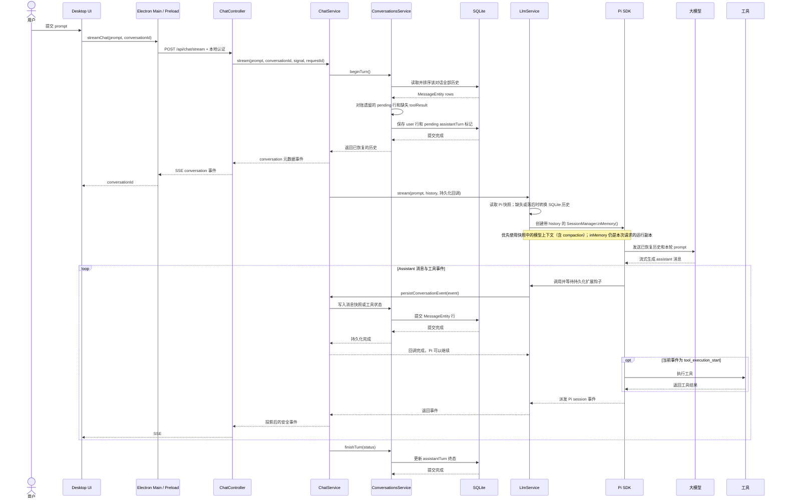

# Agent Runtime 运行链路

本文记录当前 Agent 的执行流程，以及扩展能力时必须保留的边界。内容以代码中已实现的行为为准；运行链路或持久化契约变化时应同步更新。

## Runtime ownership

| 组件 | 职责 |
|---|---|
| `App` / `useRemoteThreadListRuntime` | 以稳定 `ThreadListAdapter` 读取 Conversation 摘要，并为每个访问过的线程创建独立 LocalRuntime；assistant-ui 保持后台线程挂载，切换不会取消其他会话的流。活动 remote ID 仍写入 localStorage 供启动恢复。 |
| `AgentChatPage` / `ConversationStore` | 恢复活动 ID、加载最近最多 30 条可见消息并以 Message ID 按需前置更早历史；各线程的 composer 附件/命令草稿以稳定 localThreadId 键控。页面采用全高双栏，侧栏列表与消息视口独立滚动，输入区保持可见；设置按钮切换右侧聊天/设置主视图，不卸载根 Conversation Runtime。 |
| `SettingsPage` / `ConversationSidebar` | 会话行悬停显示「…」，菜单里的「删除会话」直接物理删除（无二次确认），删除当前会话时同时清空线程与输入区；通过侧栏底部设置入口切换视图；从本地设置 API 加载 Provider 字段、密钥配置状态与 SOULS 文本，并保存用户编辑。Renderer 不读取本机文件；设置页通过本机设置 API 接收明文 API Key，其他 Agent 流程不接收密钥。 |
| Desktop Agent adapter | 发送最新用户输入和该线程的 `unstable_threadId`（已初始化时为 remote Conversation ID）；不读取全局活动会话，也不让后台 `conversation` SSE 改变选择。活动映射按 requestId 保存，流终止后刷新摘要。 |
| Electron Main / Preload | Main 代理固定 Agent SSE 路由，并避免 renderer 接触本地 backend token；Preload 暴露类型化流桥接。 |
| `ChatController` | 校验并流式处理 `POST /api/chat/stream`；客户端断开时中止请求。 |
| `ChatService` | 在当前 backend 进程内按 conversation 串行化请求，编排持久化和 Pi 流，并投影允许传出的事件。 |
| `ConversationsService` | 管理有序 SQLite 消息行，保存用户、Pi 消息和工具状态，并在下一请求前对账中断状态。 |
| `LlmService` | 每次请求创建 Pi session 时重新读取 Provider 与 SOULS.md；Pi cwd 取本会话工作区 `<configDir>/sessions/<conversationId>/workspace`，组合系统提示词，装载 `pi-memory` 文件扩展并注册持久化钩子。另提供非流式 `generate()` 供演练使用。 |
| `RehearsalsService` | 维护演练状态机、15 问限额、逐题评估、总体报告、transcript 与普通对话 digest；开场只读复用父会话 Pi 快照，后续 JSON 调用不写快照、不加载 `pi-memory`、不注册文件工具。 |
| `pi-memory` 扩展 | 由 `additionalExtensionPaths` 装载的第三方 Pi 扩展：注册 `memory_write`、`memory_read`、`memory_search`、`memory_forget`、`memory_restore`、`scratchpad`、`memory_status`，并在每轮把记忆快照追加到系统提示词。记忆是纯 Markdown，存放于 `SettingsService` 提供的 `<configDir>/memory/`（默认 `~/.tech-forge/memory/`），按用户而非会话隔离。 |
| `workspace-file-tools.ts` | 以工具实际文件操作强制读写边界：读普通文件可来自任意位置，但拒绝应用托管路径（config.toml、SOULS.md）；受保护目录（知识库根）默认拒绝读取，仅当当前用户请求明确点名其中路径并表达读取意图时放行；写入默认限制在当前会话工作区，并可使用本轮明确目标的一次性授权。 |
| Pi SDK | 执行模型与工具循环并维护本次运行的内存会话；不直接读写 TeachForge 数据库。 |

## 运行日志

Backend 使用 Nest `Logger` 输出单行 JSON 事件。Agent stream 请求由 `ChatController` 生成一个内部 `requestId`，并沿 `ChatService`、`ConversationsService`、`LlmService` 传递；会话列表和历史查询各自生成 requestId。日志常用 `requestId` 和 `conversationId` 串联阶段。

`ChatController` 记录 HTTP 接收、SSE 终态和客户端断开；`ChatService` 记录队列等待、轮次状态、Pi 消息/工具生命周期与锁释放；`ConversationsService` 记录恢复、消息/工具持久化及查询结果；`LlmService` 记录 SDK/session 初始化阶段、模型运行、Pi 自动压缩和持久化钩子失败。终态和操作失败带耗时、状态及安全错误类型；持久化失败在所属 Service 记录，Agent/LLM 层再记录传播后的失败阶段。

Pi 自动压缩由 SDK 触发，`LlmService` 在 `stream()` 和 `generate()` 的事件订阅中记录 `llm.compaction.started`、`llm.compaction.completed`、`llm.compaction.cancelled`、`llm.compaction.failed`。字段包含触发原因（`threshold`、`overflow`、`manual`）、`tokensBefore`、`estimatedTokensAfter`、`summaryChars`、摘要请求的 `summaryUsageTotalTokens` 以及压缩前后的 `contextTokens`/`contextPercent`；失败只记录 `errorMessageChars`，不记录摘要文本或原始异常 message。`llm.session.create.completed` 记录生效的 `compactionEnabled`、`compactionReserveTokens`、`compactionKeepRecentTokens`、`modelContextWindow` 和 `compactionThresholdTokens`；`llm.provider_run.started` 与 `llm.stream.completed` 记录发送前后的上下文占用。

Renderer 的会话列表和历史读取失败会在浏览器控制台输出安全诊断字段（操作、错误分类、HTTP 状态和错误类型），不记录对话正文或认证 token。直接用普通浏览器打开 Vite 开发地址时没有 Electron preload 的 `window.teachforge` 桥接；前端会标记 `desktop_bridge_unavailable`，后端不会收到请求或产生对应 HTTP 日志。

常规阶段和终态使用 `log`、异常或取消使用 `warn`/`error`；消息与工具进度汇总到 `debug`，最多每 5 秒记录一次。记录可包含 ID、角色/工具名、状态、数量、耗时、provider/model ID、文本长度以及受限的 stack frame。日志不包含 prompt、assistant 正文、工具参数/结果、原始异常 message、provider payload、API key 或本地认证 token。`requestId` 不属于 SSE、HTTP DTO 或桌面桥接契约。

## 请求与持久化时序

Session 初始化时，`LlmService` 从 `SettingsService` 单独读取工作空间路径，并将其同时用于 `DefaultResourceLoader.cwd`、`SessionManager.inMemory(cwd, ...)`、`createAgentSession({ cwd })` 和自定义文件工具。Pi 的 `agentDir` 仍由 `sdk.getAgentDir()` 提供。Pi SDK 文档说明 `cwd` 用于项目资源发现、上下文文件、会话分组和内置工具路径；此处保持所有 session 与文件工具同根。配置与风格文件的所有权见[本机 Agent 设置](../domains/system-settings/index.md)。

扩展只走两条通道：`DefaultResourceLoader.extensionFactories` 里的进程内工厂（对话持久化钩子），以及 `additionalExtensionPaths` 指定的文件扩展（`pi-memory`，路径从 `pi-memory/package.json` 解析到 `index.ts`，由 Pi 自己用 jiti 编译该 TypeScript 文件——本 backend 是 CommonJS，无法直接 import 它）。`noExtensions: true` 只关闭包发现，不关闭这两条通道。

`createAgentSession({ tools })` 的列表是对**所有**已注册工具（含扩展工具）的 allowlist，因此除 `read`/`edit`/`write`/`grep` 外还列出 `memory_*` 与 `scratchpad`；漏掉会让扩展工具被静默过滤，模型完全看不到。会话创建后调用 `session.bindExtensions({})`，扩展才能收到 `session_start`：`pi-memory` 在这里探测 qmd（未安装时 `memory_search` 返回安装说明）并生成记忆快照，随后每轮由 `before_agent_start` 把快照追加到系统提示词；记忆为空时不追加任何内容。

`pi-memory` 的记忆根不在 Pi 全局 agent 目录，而在应用自己的配置根：`SettingsService.getMemoryDirectory()` 返回 `<configDir>/memory`（默认 `~/.tech-forge/memory/`），`LlmService` 在装载扩展前把它写入 `process.env.PI_MEMORY_DIR`。扩展在模块加载时读取该变量，Pi 的扩展缓存按 cwd 复用已加载模块，因此必须早于第一次 `resourceLoader.reload()`；该赋值也覆盖外部环境里遗留的同名变量。

## 持久化与恢复约定

`beginTurn()` 按 `sequenceNo` 读取该对话的全部消息行，对账上次中断的轮次，然后在模型调用前保存新的 `user/completed` 行和 `assistantTurn/pending` 标记。

`LlmService` 优先读取 `pi_session_snapshots` 作为模型上下文（含 compaction 等 Pi 条目），仅当快照最后一条持久化消息与 SQLite 最新历史不一致（崩溃或快照未保存）时回退 SQLite 重建；未命中时也走重建。当前 prompt 则单独通过 `session.prompt(prompt)` 发送。

上下文压缩由 Pi SDK 自动执行，应用层不调用 `session.compact()`，也不自行裁剪或摘要历史：

- 触发条件为 `contextTokens > contextWindow - reserveTokens`。SDK 在发送新 user prompt 前、工具结果追加后准备下一轮 assistant 时、运行结束后各检查一次；provider 报上下文溢出或出现可恢复的 `length` 结束时，会压缩并重试一次。
- 默认 `reserveTokens = 16384`、`keepRecentTokens = 20000`，可由 Pi 全局设置 `<agentDir>/settings.json` 或项目设置 `<cwd>/.pi/settings.json` 覆盖，并支持按 `provider/modelId` 设置 `modelOverrides`。
- 本应用通过 `SettingsManager.applyOverrides()` 在内存中强制 `compaction.enabled = true`，不写用户全局 Pi 设置文件；即使 `<agentDir>/settings.json` 里设为 `false`，该 session 仍会压缩且原文件保持不变。压缩产生的 `CompactionEntry` 下次随快照恢复；SQLite `messages` 仍保留完整历史，不受压缩影响。
- `billion-context-pi` 未被 `DefaultResourceLoader` 装载，只有遗留类型声明，不参与压缩。

已用离线 provider 验证：恢复 40 条历史后，Pi 在发送本轮 prompt 前自动触发 `reason: "threshold"` 的压缩，上下文从 12000 token 估算降到 604 估算，压缩条目写入快照；命令为 `npm run verify:compaction --workspace @teachforge/backend`。

已知限制：Pi 在缺少 provider usage 时按 `字符数 / 4` 估算 token，中文内容会被低估，因此刚由 SQLite 历史重建、且尚无 usage 的会话可能晚于真实阈值才压缩；正常带 usage 的响应不受影响。本轮新注入的附件/知识块在发送前不计入阈值，若因此溢出则由 overflow 恢复压缩并重试一次，仍可能失败（见会话附件限制）。

Pi 的 `message_start`、每个 `message_update`、`message_end` 及工具执行 start/update/end 事件都会进入异步扩展钩子。钩子调用 `ChatService.persistPiEvent()`，等待 SQLite 写入完成后 Pi 才继续。只有 assistant 和 toolResult 消息事件会保存；用户行已单独提前写入，system prompt 由 session 配置提供。

每次 `stream()` 结束且持久化没有失败时，`LlmService` 用 `replaceInjectedUserText()` 把当前 user 消息还原为纯用户文本，并按历史 user 行 id 与注入标题清理旧快照中的附件/知识块（演练 digest 走独立 `custom_message` entry，不参与剥离），再 upsert 回 `pi_session_snapshots`。该函数同时处理字符串和 Pi text-block 内容；旧快照没有可匹配 id 时，用代码写死的注入标题 + `## 用户输入` 分隔符兜底。每次创建新 session 都从 `~/.tech-forge/config.toml` 读取 Provider 配置，并把非空 `SOULS.md` 文本追加在固定系统提示词之后。API Key 在 backend 用于 Provider 注册，并由本机设置 API 返回设置页显示；不进入 Agent SSE、普通日志或 SQLite。

## 会话附件

用户可以在输入区为一条消息附加文件（PDF、DOCX、Markdown、TXT）。附件**不进资料库**：没有 `documents` 行、没有分块与向量，也不参与 `/查询资料库`。

1. 挑选文件时只生成标签：Renderer 记下 `{attachmentId, path}`（id 由渲染层生成，路径来自专用文件选择器），不上传任何内容。
2. 发送时 `ChatPromptDto.attachments`（≤10、UUIDv4 + 绝对路径）随 prompt 进入 `ChatService.stream()`；桌面桥接在 Electron Main 校验该列表，格式不对直接拒绝整次请求。
3. `ChatService` 先 `beginTurn()` 得到会话 ID，再由 `AttachmentsService.storeForConversation()` 把文件复制到 `<configDir>/sessions/<conversationId>/attachments/<attachmentId>/<原文件名>`，解析正文写到同目录 `text.md`。复制时机受会话 ID 约束：新会话在这一刻之前不存在。`<configDir>` 默认 `~/.tech-forge`。
4. 单份失败不影响整轮：不支持的格式记为 `unsupported`，路径不存在记为 `missing`，解析失败记为 `unreadable`，本轮以一行说明告知模型，而不是静默省略。
5. 正文经 `renderAttachmentContext()` 拼成"本轮用户附加的文件"块，与知识块一起作为 `LlmRequestOptions.promptContext` 交给 `LlmService`，由它拼在本轮 user message 前面（`## 用户输入` 之后才是用户原话）。演练 digest 不走这条路：它经 `LlmRequestOptions.contextMessage` 在 `session.prompt()` 前以 `custom_message` entry 追加一次，随快照持久化（见 §持久化与恢复约定）。**都不进入 system prompt**：否则每轮变化会打断 provider 的前缀缓存，也违反 system prompt 只承载规则的设计。注入有 40000 字符上限：按用户顺序取文件，超出被截断（模型收到"本轮只提供开头 N 字"说明），后面没有余量的文件整体跳过并同样告知。
6. 正文不进入 `messages.contentJson`、不进入 SSE、不进入历史接口。user 行 `contextRefsJson.attachments` 保存 `{attachmentId, name, characters, injectedCharacters}`：前两项供气泡标签与历史投影，后两项供后续轮描述"共多少字、已提供多少字"。
7. 附件正文只注入承载它的那一轮。之后每次请求都会追加一段"本会话可读取的附件"指针：每份附件的 `text.md` 绝对路径、总字数与已注入字数，并提示用 `read`（可带 offset/limit）或 `grep` 继续读取。附件目录不在受保护目录内，两个工具都能读；模型因此可以回到原文，而不是凭记忆补全。
8. 指针不重复注入正文，只提供路径与规模，成本约每附件两行。

已知限制：40000 字符仍是经验值，长对话叠加长附件时可能仍超出模型上下文——那种情况表现为 `llm.stream.failed`（`Pi SDK completed without returning assistant text.`），因为 Pi 压缩无法压缩本轮新注入的正文。附件文件按会话存放，删除会话时随 `sessions/<id>/` 一起清理。

## 文件读写边界

- 应用固定设置由 `SettingsService` 独占：`~/.tech-forge/config.toml` 与 `SOULS.md` 不开放给 Agent 文件工具读取或修改。后端按路径、真实路径和文件身份拒绝直接访问、符号链接/硬链接别名，以及设置文件原子替换时的同目录临时文件。
- Agent 默认输出根是当前会话工作区 `<configDir>/sessions/<conversationId>/workspace`。`read` 可读取任意来源的普通文件；知识库根（`<configDir>/knowledge`）默认拒绝，用户在该轮明确点名路径时放行（config/SOULS 无此例外）；`edit`、`write` 与 `mkdir` 的每次实际文件操作必须通过 `workspace-file-tools.ts` 校验，不依赖 prompt 作为安全机制。
- 当前流式用户请求只在包含明确写入意图且唯一绝对目标时，创建当前 session 的一次性外部写许可。命名目录的权限覆盖该目录及下级；命名文件仅允许该文件且其父目录须已存在。模糊路径、多个候选目标、历史消息、文件内容或模型输出都不会授予许可。
- `bash`、`subagent`、`subagents_enable` 保持排除。新增工具或扩展若能写文件，必须经过同一边界评估并阻止绕过。

Renderer 的会话摘要通过 `GET /api/conversations` 读取。选中会话时，`GET /api/conversations/:conversationId/messages` 默认返回最近最多 30 条可见 user/assistant 文本和 `hasMore`；user 行可包含其轮次的安全工具摘要。用户点击“查看更早的消息”后，Renderer 以最早已加载消息 ID 查询前一页并前置到 LocalRuntime，同时按持久 user message ID 恢复工具活动。接口不返回完整工具参数、partial/final result、toolResult 或 Pi 原始 payload。该 UI 分页不改变下一轮 Agent 请求从 SQLite 恢复完整模型历史的行为。

`conversation-history.ts` 将历史 DTO 转为 LocalRuntime 消息：保留 ID、角色、文本和时间，仅 assistant 携带 `status`。存储/API 的 user 状态不能直接传给 assistant-ui，否则即使 HTTP 200，`thread.reset()` 也会抛错。`AgentEventBus` 独立恢复 user 行下的工具摘要；历史活动没有请求 ID，也不显示未持久化的整轮耗时。`tool-activity-label.ts` 把每个工具调用转成普通用户措辞：`read`/`write`/`edit` 为“正在/已读取、写入、编辑 + 文件名”，`grep` 为“搜索 + 搜索词 + 文件名”，`pi-memory` 的 `memory_*` 与 `scratchpad` 用固定动词（记录/读取/搜索/删除/恢复/检查记忆、更新便签）且不带目标；只读取 `path` 与 `pattern` 两个参数。本轮处于 `working` 且尚无文本增量时，回答位置显示一行等待状态：转动图标 + 当前动作（无进行中工具为“正在思考…”，否则复用同一措辞，如“正在读取 <文件名>”）+ 秒级耗时；超过 60 秒追加一行“更长等待”提示，首个文本增量到达（转为 `responding`）即移除该行。桌面回归命令为 `npm run test:conversation-history --workspace @teachforge/desktop`。

Assistant 消息（包括 toolCall block 和参数）以及原生 `toolResult` 消息以带格式标记的 JSON 保存在 `contentJson`。工具执行元数据、部分输出、最终结果和终态保存在独立的 `toolExecution` 行中。`assistantTurn` 和 `toolExecution` 行不会作为模型消息发送。

下一次请求会把 pending 工具执行标记为中断。不完整的 assistant 快照保留已生成文本，并移除未完成的 toolCall block。已完成的 tool call 若缺少 `toolResult`，优先用已持久化的工具最终结果重建；没有最终结果时则补一条错误结果，避免重放可能已产生副作用的工具。

每次请求都会加载全部可恢复历史，不做上下文裁剪或摘要，也不会自动续跑原来的 provider 调用。这里的“恢复”是下一次请求从持久消息继续对话。

数据库事务只覆盖短时读写，不跨模型或工具 I/O。持久化钩子写入失败时会中止 Pi 请求，并作为请求错误返回。

## 演练模式

演练是独立 Agent，不经过 `ChatService.stream()`，也不写 `messages`：

- `RehearsalsService.start()` 用 `ConversationsService.getRestorableHistory()` 读取父会话历史，再调用 `LlmService.generate()`。该调用可传入父 `conversation`，让 `restoreEntries()` 复用父 Pi 快照（含 compaction），但 `generate()` 不保存快照。
- 后续答题/跳过/报告调用使用新的临时 Pi session，只带 `learningSummary + plan + 已有问答`；不传 `conversation`，不写快照。
- 演练 system prompt 由代码写死；不加载 SOULS/style preference、不加载 `pi-memory`、`tools: []`。因此演练 Agent 不能写文件、执行命令或读取知识库。
- 每题动作只有 `follow_up` / `next_question`；第 15 问（含跳过）由后端转 `reporting`，模型不能提前结束。
- 报告完成写 `rehearsals.overallEvaluationJson` 和 `<configDir>/sessions/<conversationId>/rehearsals/<rehearsalId>.md`。普通对话下一轮由 `ChatService` 调 `buildConversationDigest()`，把最近 3 次摘要放进 `promptContext`；`contextRefsJson.rehearsals` 记录实际注入的 id。
- `generate()` 不注册 `persistConversationEvent`，因此不会触发 `ConversationsService` 的消息持久化钩子。

详细状态机与 API 见[演练模式](../domains/rehearsals/index.md)。

## 压缩职责结论

Pi SDK（当前 1.5.0）自身负责模型上下文的自动压缩，TeachForge 工程层不触发、不实现压缩，也不会丢弃或改写 SQLite 历史。触发、配置和持久化方式见上文“持久化与恢复约定”。

`billion-context-pi` 仍未接入运行链路（仅遗留类型别名），既不负责压缩，也不参与消息改写。对 `billion-context-pi` 的取舍记录在[Agent Runtime 待办问题](../../source/agent-runtime-open-questions.md)；该文件保留问题来源与结论差异，不再作为未决阻塞项。

## 扩展边界

1. 对话持久化归 `ConversationsService` 所有。Pi 扩展不得直接访问 SQLite，也不得引入第二份 transcript 数据源。
2. 新增或修改 Pi 消息/工具事件时，保留 awaited 持久化钩子。新增持久事件时，同时定义行格式、终态和中断处理、恢复行为及验收标准。
3. 完整 Pi 消息、provider 响应和工具结果保留在 backend。当前投影会发送生命周期事件、文本增量和工具活动（包含用于提取路径的参数）；UI 只显示工具动作、相关路径、状态和耗时，不显示原始参数或结果。扩展输出必须经过 `ChatStreamEvent`、桥接校验和 adapter。
4. 文件读写分离授权：读取可访问任意普通文件但不得读取 SettingsService 托管的 config/SOULS；知识库根（`knowledge/`）默认拒绝读取，只有当前用户请求明确点名该路径时才建立一次性读取许可；创建、编辑和建目录默认必须位于当前会话工作区。唯一例外由当前用户流式请求中的唯一明确绝对目标产生，并只对当前 session 有效。由 `workspace-file-tools.ts` 在真实文件 I/O 前执行检查；不得通过 Pi cwd、提示词、bash 或扩展绕开。
5. 保留按 conversation 串行化请求的行为；等待 provider 或工具期间不得持有数据库事务。
6. 运行契约变化时，同步更新本文、相关领域页面、manifest 路由和验收标准。将已确认的当前行为与未来方案分开记录。
7. `pi-memory` 直接读写 `<configDir>/memory/`（默认 `~/.tech-forge/memory/`，由 `LlmService` 以 `PI_MEMORY_DIR` 注入）下的记忆 Markdown；目标是扩展内的固定常量，不接受模型选择的路径，因此不经过 `workspace-file-tools.ts` 的授权检查，也不进入 SQLite、SSE 或历史接口。记忆按用户全局共享，不按会话隔离；把它搬进 workspace、知识库或会话目录，或依赖扩展默认的 `~/.pi/agent/memory/`，都会破坏这条边界。
8. 演练状态归 `RehearsalsService` 所有，不得写入 `messages` 或复用父 `pi_session_snapshots`。新增演练模型调用时必须走 `generate()`，保持不写快照、无工具、无 `pi-memory`；普通对话只通过一次性 digest（`custom_message` entry + `loadedContext` 标记）与 `contextRefsJson` 读取演练结果。

## 代码入口

- HTTP/SSE 边界：`apps/backend/src/chat/chat.controller.ts`
- 轮次编排与安全事件投影：`apps/backend/src/chat/chat.service.ts`、`chat-events.ts`
- 对话消息行和中断对账：`apps/backend/src/conversations/conversations.service.ts`
- 历史查询 Controller 与 DTO：`apps/backend/src/conversations/conversations.controller.ts`、`conversation-query.dto.ts`
- 结构化日志与安全错误字段：`apps/backend/src/logging/structured-logger.ts`
- Pi session 创建、历史映射和 awaited 持久化扩展：`apps/backend/src/llm/llm.service.ts`
- 第三方文件扩展：`pi-memory`（backend 依赖，经 `additionalExtensionPaths` 装载）；记忆目录 `<configDir>/memory/` 由 `SettingsService.getMemoryDirectory()` 提供
- SQLite 实体映射：`apps/backend/src/conversations/conversation.entity.ts`、`message.entity.ts`、`pi-session-snapshot.entity.ts`
- Pi session 快照读写与恢复选择：`apps/backend/src/conversations/pi-session-snapshots.service.ts`
- 桌面 adapter 和桥接：`apps/desktop/src/features/agent/agent-chat-adapter.ts`、`apps/desktop/electron/main/main.ts`、`apps/desktop/electron/preload/preload.ts`
- 会话侧栏与 Renderer 查询状态：`apps/desktop/src/features/agent/AgentChatPage.tsx`、`ConversationSidebar.tsx`、`conversation-store.ts`
- 会话附件：`apps/backend/src/attachments/`、`apps/desktop/src/features/agent/ComposerAttachments.tsx`、`attachment-store.ts`
- 演练状态机、digest、transcript：`apps/backend/src/rehearsals/`
- 演练桌面视图：`apps/desktop/src/features/rehearsal/`
- 本机设置 UI 和 backend 文件配置：`apps/desktop/src/features/settings/SettingsPage.tsx`、`apps/backend/src/settings/`

## Pi SDK 官方文档

- [SDK 与外部历史初始化](https://pi.dev/docs/latest/sdk)
- [Session 消息与工具结果格式](https://pi.dev/docs/latest/session-format)
