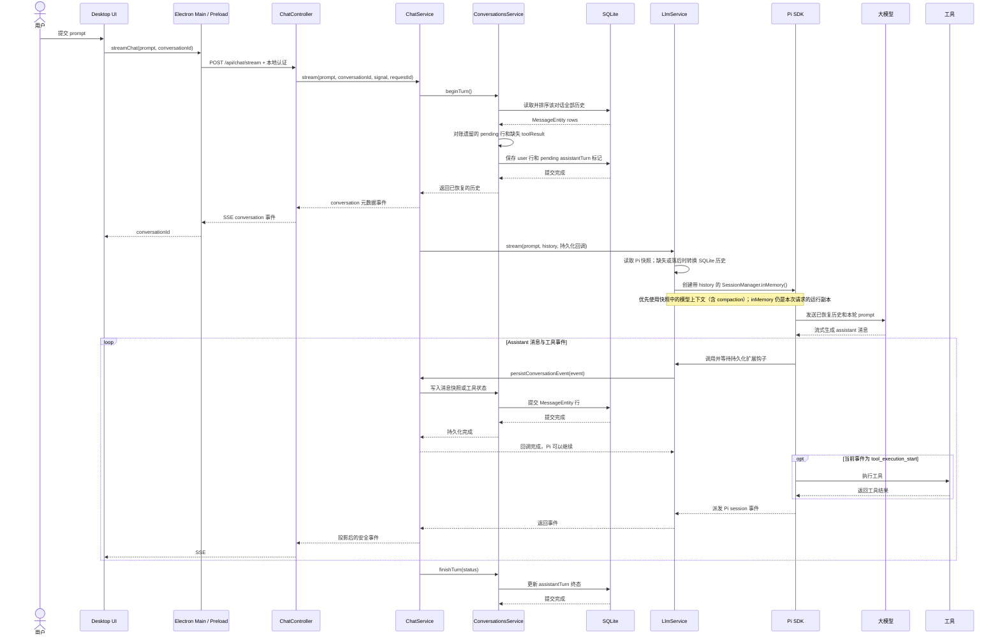

# Agent Runtime 运行链路

本文记录当前 Agent 的执行流程，以及扩展能力时必须保留的边界。内容以代码中已实现的行为为准；运行链路或持久化契约变化时应同步更新。

## Runtime ownership

| 组件 | 职责 |
|---|---|
| `AgentChatPage` / `ConversationStore` | 启动时读取 Conversation 摘要并恢复仍存在的活动 ID；选择会话时读取最近最多 30 条可见消息，以 Message ID 按需前置更早历史；新线程清除活动 ID。页面采用全高双栏，侧栏列表与消息视口独立滚动，输入区保持可见；设置按钮切换右侧聊天/设置主视图，不卸载根 Conversation Runtime。 |
| `SettingsPage` / `ConversationSidebar` | 通过侧栏底部设置入口切换视图；从本地设置 API 加载 Provider 字段、密钥配置状态与 SOULS 文本，并保存用户编辑。Renderer 不读取本机文件；设置页通过本机设置 API 接收明文 API Key，其他 Agent 流程不接收密钥。 |
| Desktop Agent adapter | 发送最新用户输入和活动 `conversationId`；保存后端返回的 ID；将安全流事件转换为 UI 更新，并在元数据/终止事件后刷新侧栏摘要。 |
| Electron Main / Preload | Main 代理固定 Agent SSE 路由，并避免 renderer 接触本地 backend token；Preload 暴露类型化流桥接。 |
| `ChatController` | 校验并流式处理 `POST /api/chat/stream`；客户端断开时中止请求。 |
| `ChatService` | 在当前 backend 进程内按 conversation 串行化请求，编排持久化和 Pi 流，并投影允许传出的事件。 |
| `ConversationsService` | 管理有序 SQLite 消息行，保存用户、Pi 消息和工具状态，并在下一请求前对账中断状态。 |
| `LlmService` | 每次请求创建 Pi session 时重新读取 Provider、SOULS.md 和 workspace；以 workspace 统一 Pi cwd，组合系统提示词并注册扩展和持久化钩子。 |
| `workspace-file-tools.ts` | 以工具实际文件操作强制读写边界：读普通文件可来自任意位置但拒绝应用托管设置；写入默认限制在 workspace，并可使用本轮明确目标的一次性授权。 |
| Pi SDK | 执行模型与工具循环并维护本次运行的内存会话；不直接读写 TeachForge 数据库。 |

## 运行日志

Backend 使用 Nest `Logger` 输出单行 JSON 事件。Agent stream 请求由 `ChatController` 生成一个内部 `requestId`，并沿 `ChatService`、`ConversationsService`、`LlmService` 传递；会话列表和历史查询各自生成 requestId。日志常用 `requestId` 和 `conversationId` 串联阶段。

`ChatController` 记录 HTTP 接收、SSE 终态和客户端断开；`ChatService` 记录队列等待、轮次状态、Pi 消息/工具生命周期与锁释放；`ConversationsService` 记录恢复、消息/工具持久化及查询结果；`LlmService` 记录 SDK/session 初始化阶段、模型运行和持久化钩子失败。终态和操作失败带耗时、状态及安全错误类型；持久化失败在所属 Service 记录，Agent/LLM 层再记录传播后的失败阶段。

Renderer 的会话列表和历史读取失败会在浏览器控制台输出安全诊断字段（操作、错误分类、HTTP 状态和错误类型），不记录对话正文或认证 token。直接用普通浏览器打开 Vite 开发地址时没有 Electron preload 的 `window.teachforge` 桥接；前端会标记 `desktop_bridge_unavailable`，后端不会收到请求或产生对应 HTTP 日志。

常规阶段和终态使用 `log`、异常或取消使用 `warn`/`error`；消息与工具进度汇总到 `debug`，最多每 5 秒记录一次。记录可包含 ID、角色/工具名、状态、数量、耗时、provider/model ID、文本长度以及受限的 stack frame。日志不包含 prompt、assistant 正文、工具参数/结果、原始异常 message、provider payload、API key 或本地认证 token。`requestId` 不属于 SSE、HTTP DTO 或桌面桥接契约。

## 请求与持久化时序

Session 初始化时，`LlmService` 从 `SettingsService` 单独读取工作空间路径，并将其同时用于 `DefaultResourceLoader.cwd`、`SessionManager.inMemory(cwd, ...)`、`createAgentSession({ cwd })` 和自定义文件工具。Pi 的 `agentDir` 仍由 `sdk.getAgentDir()` 提供。Pi SDK 文档说明 `cwd` 用于项目资源发现、上下文文件、会话分组和内置工具路径；此处保持所有 session 与文件工具同根。配置与风格文件的所有权见[本机 Agent 设置](../domains/system-settings/index.md)。

## 持久化与恢复约定

`beginTurn()` 按 `sequenceNo` 读取该对话的全部消息行，对账上次中断的轮次，然后在模型调用前保存新的 `user/completed` 行和 `assistantTurn/pending` 标记。

`LlmService` 优先读取 `pi_session_snapshots` 作为模型上下文（含 compaction 等 Pi 条目），仅当快照最后一条持久化消息与 SQLite 最新历史不一致（崩溃或快照未保存）时回退 SQLite 重建；未命中时也走重建。当前 prompt 则单独通过 `session.prompt(prompt)` 发送。

Pi 的 `message_start`、每个 `message_update`、`message_end` 及工具执行 start/update/end 事件都会进入异步扩展钩子。钩子调用 `ChatService.persistPiEvent()`，等待 SQLite 写入完成后 Pi 才继续。只有 assistant 和 toolResult 消息事件会保存；用户行已单独提前写入，system prompt 由 session 配置提供。

每次 `stream()` 结束且持久化没有失败时，`LlmService` 将该 session 的 `getEntries()` upsert 回 `pi_session_snapshots`。每次创建新 session 都从 `~/.tech-forge/config.toml` 读取 Provider 配置，并把非空 `SOULS.md` 文本追加在固定系统提示词之后。API Key 在 backend 用于 Provider 注册，并由本机设置 API 返回设置页显示；不进入 Agent SSE、普通日志或 SQLite。

## 文件读写边界

- 应用固定设置由 `SettingsService` 独占：`~/.tech-forge/config.toml` 与 `SOULS.md` 不开放给 Agent 文件工具读取或修改。后端按路径、真实路径和文件身份拒绝直接访问、符号链接/硬链接别名，以及设置文件原子替换时的同目录临时文件。
- Agent 默认输出根是 `~/.tech-forge/workspace/` 或用户设置的其他绝对路径。`read` 可读取任意来源的普通文件；`edit`、`write` 与 `mkdir` 的每次实际文件操作必须通过 `workspace-file-tools.ts` 校验，不依赖 prompt 作为安全机制。
- 当前流式用户请求只在包含明确写入意图且唯一绝对目标时，创建当前 session 的一次性外部写许可。命名目录的权限覆盖该目录及下级；命名文件仅允许该文件且其父目录须已存在。模糊路径、多个候选目标、历史消息、文件内容或模型输出都不会授予许可。
- `bash`、`subagent`、`subagents_enable` 保持排除。新增工具或扩展若能写文件，必须经过同一边界评估并阻止绕过。

Renderer 的会话摘要通过 `GET /api/conversations` 读取。选中会话时，`GET /api/conversations/:conversationId/messages` 默认返回最近最多 30 条可见 user/assistant 文本和 `hasMore`；user 行可包含其轮次的安全工具摘要。用户点击“查看更早的消息”后，Renderer 以最早已加载消息 ID 查询前一页并前置到 LocalRuntime，同时按持久 user message ID 恢复工具活动。接口不返回完整工具参数、partial/final result、toolResult 或 Pi 原始 payload。该 UI 分页不改变下一轮 Agent 请求从 SQLite 恢复完整模型历史的行为。

`conversation-history.ts` 将历史 DTO 转为 LocalRuntime 消息：保留 ID、角色、文本和时间，仅 assistant 携带 `status`。存储/API 的 user 状态不能直接传给 assistant-ui，否则即使 HTTP 200，`thread.reset()` 也会抛错。`AgentEventBus` 独立恢复 user 行下的工具摘要；历史活动没有请求 ID，也不显示未持久化的整轮耗时。桌面回归命令为 `npm run test:conversation-history --workspace @teachforge/desktop`。

Assistant 消息（包括 toolCall block 和参数）以及原生 `toolResult` 消息以带格式标记的 JSON 保存在 `contentJson`。工具执行元数据、部分输出、最终结果和终态保存在独立的 `toolExecution` 行中。`assistantTurn` 和 `toolExecution` 行不会作为模型消息发送。

下一次请求会把 pending 工具执行标记为中断。不完整的 assistant 快照保留已生成文本，并移除未完成的 toolCall block。已完成的 tool call 若缺少 `toolResult`，优先用已持久化的工具最终结果重建；没有最终结果时则补一条错误结果，避免重放可能已产生副作用的工具。

每次请求都会加载全部可恢复历史，不做上下文裁剪或摘要，也不会自动续跑原来的 provider 调用。这里的“恢复”是下一次请求从持久消息继续对话。

数据库事务只覆盖短时读写，不跨模型或工具 I/O。持久化钩子写入失败时会中止 Pi 请求，并作为请求错误返回。

## 待办评估

`billion-context-pi` 在当前配置下是否已负责上下文压缩尚未确认。当前实现每次加载全部历史且不做应用层压缩；在问题结论形成前，不要假设扩展会自动压缩，也不要自行裁剪历史。评估记录见[Agent Runtime 待办问题](../../source/agent-runtime-open-questions.md)。

## 扩展边界

1. 对话持久化归 `ConversationsService` 所有。Pi 扩展不得直接访问 SQLite，也不得引入第二份 transcript 数据源。
2. 新增或修改 Pi 消息/工具事件时，保留 awaited 持久化钩子。新增持久事件时，同时定义行格式、终态和中断处理、恢复行为及验收标准。
3. 完整 Pi 消息、provider 响应和工具结果保留在 backend。当前投影会发送生命周期事件、文本增量和工具活动（包含用于提取路径的参数）；UI 只显示工具动作、相关路径、状态和耗时，不显示原始参数或结果。扩展输出必须经过 `ChatStreamEvent`、桥接校验和 adapter。
4. 文件读写分离授权：读取可访问任意普通文件但不得读取 SettingsService 托管的 config/SOULS；创建、编辑和建目录默认必须位于 backend 配置的 Agent workspace。唯一例外由当前用户流式请求中的唯一明确绝对目标产生，并只对当前 session 有效。由 `workspace-file-tools.ts` 在真实文件 I/O 前执行检查；不得通过 Pi cwd、提示词、bash 或扩展绕开。
5. 保留按 conversation 串行化请求的行为；等待 provider 或工具期间不得持有数据库事务。
6. 运行契约变化时，同步更新本文、相关领域页面、manifest 路由和验收标准。将已确认的当前行为与未来方案分开记录。

## 代码入口

- HTTP/SSE 边界：`apps/backend/src/chat/chat.controller.ts`
- 轮次编排与安全事件投影：`apps/backend/src/chat/chat.service.ts`、`chat-events.ts`
- 对话消息行和中断对账：`apps/backend/src/conversations/conversations.service.ts`
- 历史查询 Controller 与 DTO：`apps/backend/src/conversations/conversations.controller.ts`、`conversation-query.dto.ts`
- 结构化日志与安全错误字段：`apps/backend/src/logging/structured-logger.ts`
- Pi session 创建、历史映射和 awaited 持久化扩展：`apps/backend/src/llm/llm.service.ts`
- SQLite 实体映射：`apps/backend/src/conversations/conversation.entity.ts`、`message.entity.ts`、`pi-session-snapshot.entity.ts`
- Pi session 快照读写与恢复选择：`apps/backend/src/conversations/pi-session-snapshots.service.ts`
- 桌面 adapter 和桥接：`apps/desktop/src/features/agent/agent-chat-adapter.ts`、`apps/desktop/electron/main/main.ts`、`apps/desktop/electron/preload/preload.ts`
- 会话侧栏与 Renderer 查询状态：`apps/desktop/src/features/agent/AgentChatPage.tsx`、`ConversationSidebar.tsx`、`conversation-store.ts`
- 本机设置 UI 和 backend 文件配置：`apps/desktop/src/features/settings/SettingsPage.tsx`、`apps/backend/src/settings/`

## Pi SDK 官方文档

- [SDK 与外部历史初始化](https://pi.dev/docs/latest/sdk)
- [Session 消息与工具结果格式](https://pi.dev/docs/latest/session-format)
