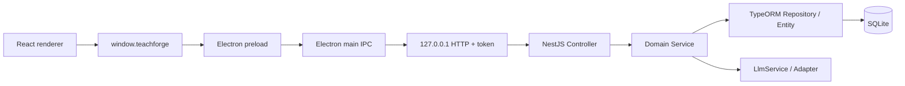

# TeachForge 当前架构与代码放置指南

本文说明当前代码如何运行，以及以后增加业务时应将代码放在哪里。前半部分是扫描到的现状，后半部分是基于现有边界的放置约定。设计草案中的目标能力不视为已经实现。

## 1. 快速放置规则

| 要做的事 | 放置位置 | 责任边界 |
|---|---|---|
| 页面、交互、展示状态 | `apps/desktop/src/features/<domain>/`（新增功能建议） | React 页面和组件负责展示及交互状态，不承载持久化或业务规则 |
| 前端调用后端 | `apps/desktop/src/api/`（建议新增） | 集中封装类型化 API 请求；不要让每个组件拼接请求和处理协议细节 |
| Electron 生命周期、窗口、本地进程和 IPC | `apps/desktop/electron/main/` | 桌面进程集成、权限边界和本地后端代理，不放学习业务规则 |
| 暴露给 React 的安全桌面能力 | `apps/desktop/electron/preload/` | 只暴露窄接口并转发 IPC，不暴露 Node 或任意 IPC 能力 |
| HTTP 接口和输入校验 | `apps/backend/src/<domain>/` 的 Controller、DTO | Controller 负责协议转换；DTO 负责请求结构和格式校验 |
| 业务用例与跨组件编排 | 对应领域的 `*Service` | 负责用例规则、调用领域/基础设施能力和持久化协调 |
| 持久化结构 | 对应领域目录中的 `*.entity.ts` | 只描述表、字段、关系和索引，不放流程规则 |
| Schema 演进 | `apps/backend/src/database/migrations/` | 新增/修改表结构用迁移；保持 `synchronize: false` |
| 模型提供商调用 | `apps/backend/src/llm/` | `LlmService` 统一调用入口；提供商差异放 `adapters/` |
| 文件系统、向量索引等底层能力 | 现有领域 Service 的依赖；需要复用时再新增 `platform` adapter | 业务规则归领域，通用 I/O 适配归基础设施 |

简单功能可继续使用现有领域文件；当组件变多时再按页面、组件、hooks 和类型拆分，不先创建空目录或通用框架。

## 2. 运行路径

React renderer 不直接使用 Node API，也不直接访问本地 HTTP 服务。请求经 preload 的窄桥接接口进入 Electron main，再由 main 添加本地 token 并转发到随机端口上的 NestJS 服务。

当前主路径代码位于 [React App](../../../apps/desktop/src/App.tsx)、[preload](../../../apps/desktop/electron/preload/preload.ts)、[Electron main](../../../apps/desktop/electron/main/main.ts)、[Nest bootstrap](../../../apps/backend/src/main.ts) 和 [AppModule](../../../apps/backend/src/app.module.ts)。

## 3. 前端与桌面端

| 位置 | 当前内容 | 后续边界 |
|---|---|---|
| `apps/desktop/src/main.tsx` | React renderer 入口，挂载 `App` 和全局样式 | 保持为应用启动与根组件装配点 |
| `apps/desktop/src/App.tsx` | 当前单页原型：请求 health、列出和创建 Course | 新业务不要持续堆进该文件；按领域拆到 `src/features/<domain>/` |
| `apps/desktop/src/types/desktop-bridge.ts` | IPC 请求、响应和 `window.teachforge` 类型 | 只放桌面桥接契约；业务 API 类型放对应 feature/API 文件 |
| `apps/desktop/electron/main/main.ts` | 启动/停止 backend 子进程、创建窗口、校验 IPC 请求、代理 HTTP | 可访问 Electron/Node 能力；不要在此实现会话、演练等业务用例 |
| `apps/desktop/electron/preload/preload.ts` | 通过 `contextBridge` 暴露 `getBackendState` 和 `request` | 保持最小授权面；新增能力需定义明确 IPC 方法，不暴露通用 Node 接口 |

当前还没有独立 API client、query/cache 层或全局前端状态库。新增业务请求时建议先建立轻量 `src/api` 封装，再由领域页面或 hook 调用；只有实际复杂度出现后再引入缓存或状态框架。

## 4. 后端模块责任

Nest 根入口通过 `AppModule` 组合模块；业务逻辑按领域模块放置，而不是按数据库表或技术动作单独散落。

| 模块 | 应拥有的业务责任 | 扫描到的实现状态 |
|---|---|---|
| `platform` / `health` | 进程级能力及健康状态 | `PlatformModule` 装配 `HealthModule`；当前提供 health endpoint |
| `conversations` | Conversation/Message、普通对话用例和消息持久化 | Entity 已注册；Service 为空壳，尚无对话 Controller |
| `rehearsals` | Rehearsal/RehearsalTurn、提问、回答和轮次评估 | Entity 已注册；Service 为空壳。评估直接属于 RehearsalTurn |
| `documents` | 共享/会话资料、文件版本、解析状态、分片与关联 | Entity 已注册；Service 为空壳，文件导入和检索流程未实现 |
| `artifacts` | Agent 生成物料的文件记录和元数据 | 单表 Artifact Entity 已注册；Service 为空壳，不设计 ArtifactVersion |
| `retrieval` | 按 Conversation 资料范围组合检索上下文 | Service 为空壳 |
| `knowledge` | 共享知识集合的领域操作 | Service 为空壳 |
| `embedding` | 文本向量化能力 | Service 为空壳 |
| `llm` | 模型运行时及提供商适配 | `LlmService` 已有 generate/stream；DeepSeek 与 OpenAI 兼容 Adapter 读取环境变量 |
| `agent` | 需要多个步骤或工具协作时的 Agent 运行编排 | Service 为空壳；单纯模型调用直接使用 LLM 能力，不必先增加通用 Agent 抽象 |
| `jobs` | 必须在后台运行的长任务与恢复机制 | Service 为空壳；未建 Job 表或队列 |

`assessments`、`memory`、`teaching`、`lessons` 目前只有空壳或未接入用例。当前数据模型将每轮评估放入 RehearsalTurn，并暂缓长期记忆；不要据目录名就新增 Assessment 或 Memory 表。Course 页面/API 是遗留原型，Course/Class/Lesson 不属于当前目标模型。

## 5. 后端分层约定

一次 HTTP 业务路径按以下方向流动：

1. **Controller**：定义路由，读取 path/query/body，调用一个领域用例并返回结果；不直接写 Repository、不调用 LLM。
2. **DTO**：描述边界输入并做结构校验；不包含持久化和跨请求状态。
3. **Service**：实现一个领域用例，例如发送 Conversation 消息、提交 RehearsalTurn 回答或登记 Artifact；需要 LLM、检索和文件操作时通过依赖注入编排。
4. **Entity/Repository**：实体定义 TypeORM 映射；Repository 由 Nest `TypeOrmModule.forFeature` 提供，业务查询从所属领域 Service 发起。
5. **Migration**：Schema 变化放在 `database/migrations`，并在 `database.options.ts` 注册实体；不要依赖开发环境自动同步表结构。

LLM 和文件 I/O 都是外部副作用，不放在 SQLite 写事务中。`LlmService` 管提供商/会话调用，不拥有 Conversation 或 Rehearsal 的业务规则；具体领域 Service 决定何时调用模型、保存哪些业务状态。

实体类采用应用生成的 ID，不自动生成业务流程。当前实体字段和关系见[字段草案](../../source/data-model-fields.md)；实体实现是代码事实，草案状态仍需单独维护。

## 6. 当前装配与重要差异

- [数据库选项](../../../apps/backend/src/database/database.options.ts)注册 Course 原型及当前 9 个目标实体；SQLite 启用 WAL、外键和 busy timeout，自动运行 migration，关闭 schema synchronize。
- 目标数据表由 [个人学习迁移](../../../apps/backend/src/database/migrations/1793930000000-personal-learning-schema.ts)创建。此迁移不代表对应业务流程已实现。
- `HealthModule` 由 `PlatformModule` 装配，而 `PlatformModule` 已导入 [AppModule](../../../apps/backend/src/app.module.ts)；`HealthController` 提供桌面端使用的 `/api/health`。
- Electron 当前将 `TEACHFORGE_DATA_DIR` 设置为 `app.getPath('userData')`；backend 未提供该变量时回退到当前工作目录 `.data`。系统设计草案中的用户可选工作空间和 `config.toml` 还未由此处实现。
- [Course API 与 UI](../../../apps/backend/src/courses/courses.controller.ts)仍可用，但与个人学习目标模型冲突。不要把它复制成新的 Course/Class/Lesson 依赖路径；移除旧原型应作为独立业务变更处理。
- `main.ts` 使用 Electron 生成的本地随机 token 和 loopback origin 检查保护本机 HTTP；这是进程边界保护，不是用户账号、身份模型或多租户隔离。

## 7. 新增业务时的落点清单

- 先选一个领域：Conversation、Documents、Rehearsals、Artifacts 或明确的基础设施模块。
- UI 交互放 React feature；业务规则、校验和数据写入放 backend domain Service。
- Controller 只做 HTTP 边界；Entity 只做结构映射；Schema 改动必须带 migration。
- 跨领域调用经过对方模块的公开 Service 契约，避免 Controller 互调或直接穿透到其他领域 Repository。
- 不添加账号/teacherId/tenantId、课程层级、独立 Assessment、ArtifactVersion 或长期记忆实体，除非产品决策重新改变。
- 若能力尚未实现，保留清晰的领域 Service 边界即可；不要为了架构完整而填入空业务方法或过早增加通用抽象。
