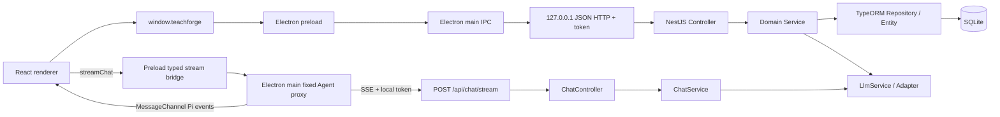

# TeachForge 当前架构与代码放置指南

本文说明当前代码如何运行，以及以后增加业务时应将代码放在哪里。前半部分是扫描到的现状，后半部分是基于现有边界的放置约定。设计草案中的目标能力不视为已经实现。

## 1. 快速放置规则

| 要做的事 | 放置位置 | 责任边界 |
|---|---|---|
| 页面、交互、展示状态 | `apps/desktop/src/features/<domain>/`（新增功能建议） | React 页面和组件负责展示及交互状态，不承载持久化或业务规则 |
| 前端调用后端 | `apps/desktop/src/api/`（建议新增） | 集中封装类型化 API 请求；不要让每个组件拼接请求和处理协议细节 |
| Electron 生命周期、窗口、本地进程和 IPC | `apps/desktop/electron/main/` | 桌面进程集成、权限边界和本地后端代理，不放学习业务规则 |
| 暴露给 React 的安全桌面能力 | `apps/desktop/electron/preload/` | 只暴露窄接口并转发 IPC，不暴露 Node 或任意 IPC 能力 |
| HTTP 接口和输入校验 | `apps/backend/src/<domain>/` 的 Controller、DTO | Controller 负责协议转换；DTO 负责请求结构和格式校验 |
| 业务用例与跨组件编排 | 对应领域的 `*Service` | 负责用例规则、调用领域/基础设施能力和持久化协调 |
| 持久化结构 | 对应领域目录中的 `*.entity.ts` | 只描述表、字段、关系和索引，不放流程规则 |
| Schema 演进 | `apps/backend/src/database/migrations/` | 新增/修改表结构用迁移；保持 `synchronize: false` |
| 模型提供商调用 | `apps/backend/src/llm/` | `LlmService` 统一调用入口；提供商差异放 `adapters/` |
| Backend 业务流程诊断日志 | `apps/backend/src/logging/structured-logger.ts` 与各领域 Controller/Service | 通过 Nest Logger 输出带 requestId 的 JSON 事件；由所属边界记录阶段与失败，不输出业务正文或工具 payload |
| 文件系统、向量索引等底层能力 | 现有领域 Service 的依赖；需要复用时再新增 `platform` adapter | 业务规则归领域，通用 I/O 适配归基础设施 |

简单功能可继续使用现有领域文件；当组件变多时再按页面、组件、hooks 和类型拆分，不先创建空目录或通用框架。

## 2. 运行路径

React renderer 不直接使用 Node API，也不直接访问本地 HTTP 服务。请求经 preload 的窄桥接接口进入 Electron main，再由 main 添加本地 token 并转发到随机端口上的 NestJS 服务。

当前主路径代码位于 [React App](../../../apps/desktop/src/App.tsx)、[preload](../../../apps/desktop/electron/preload/preload.ts)、[Electron main](../../../apps/desktop/electron/main/main.ts)、[Nest bootstrap](../../../apps/backend/src/main.ts) 和 [AppModule](../../../apps/backend/src/app.module.ts)。

## 3. 前端与桌面端

| 位置 | 当前内容 | 后续边界 |
|---|---|---|
| `apps/desktop/src/main.tsx` | React renderer 入口，挂载 `App` 和全局样式 | 保持为应用启动与根组件装配点 |
| `apps/desktop/src/App.tsx` | 装配 Agent `LocalRuntime`、`AssistantRuntimeProvider` 与占满窗口的 `AgentChatPage` | 新业务不要持续堆进该文件；按领域拆到 `src/features/<domain>/` |
| `apps/desktop/src/features/agent/` | `AgentChatPage` 启动时通过共享 `ConversationStore` 加载会话列表并恢复仍存在的活动会话；默认读取最近 30 条可见消息，并可按需前置更早历史；`ConversationSidebar` 负责切换、新建、知识库、知识掌握和设置入口；`agent-chat-adapter` 消费 Pi 文本增量与事件并刷新摘要；`agent-event-bus` 发布本轮 UI 活动状态；`SlashCommandMenu` 在 composer 内提供 `/` 命令菜单（清空草稿走 `aui.composer.setText`，不用受控 hack，命令文本存 `composer-command-store`）；选择菜单项后命令以标签挂在输入区内（`composer-command-store`），发送时由 `agent-chat-adapter` 拼回 `/查询资料库 `；知识库说明写在输入框占位符，无常驻工具栏；输入区左下「附件」按钮复用同一文件选择器，挑选只生成标签（不上传），发送时随请求携带 `{attachmentId, path}`，已发送附件以标签附着在用户气泡内（`attachment-store`） | 页面经受限的 `window.teachforge.request()` 调用本地 API，不接触模型凭据；侧栏列表和消息视口各自滚动，输入区位于消息视口外并固定可见；设置、知识库和知识掌握视图只替换右侧主区域，根 Conversation Runtime 保持挂载 |
| `apps/desktop/src/features/rehearsal/` | 演练模式视图：开始页、答题/逐题评估、报告、历史列表/只读详情；普通对话不展示演练评估卡片；`rehearsal-store` 管理当前 session 与历史视图，`rehearsal-api.ts` 封装 JSON 请求 | 只使用 `window.teachforge.request()`；不读取文件正文、不直接访问 SQLite；浏览历史不卸载当前 session |
| `apps/desktop/src/features/settings/` | 本机模型 Provider、工作空间路径和 `SOULS.md` 风格编辑页 | 只使用 `window.teachforge.request()` 访问本地设置 API；GET 将已保存密钥回填到普通文本控件；只在本机设置页明文显示 |
| `apps/desktop/src/features/knowledge/` | 知识库视图：资料列表、导入、删除 | 经 `window.teachforge.pickImportFiles()` 取绝对路径后调 `/api/documents/*`；导入期间轮询列表展示 `parsing → ready`；不读取文件字节，也不访问知识库目录 |
| `apps/desktop/src/features/knowledge-profile/` | 知识掌握卡片视图：状态、摘要、详情和会话入口 | 通过 `knowledge-profile-api.ts` 读取 `/api/knowledge-facts`；点击详情后按会话读取 `/api/conversations/:id/knowledge-facts`；跳转复用 Agent 会话恢复回调 |
| `apps/desktop/src/api/backend-error.ts` | 后端错误信封的安全消息提取 | 多个 feature 复用同一实现，避免各自解析 `message` 字段 |
| `apps/desktop/src/types/desktop-bridge.ts` 与 `chat-stream-event.ts` | IPC 请求、响应、conversation 元数据与安全 Pi-native Agent stream 事件和 `window.teachforge` 类型/运行时校验 | 只放桌面桥接契约；业务 API 类型放对应 feature/API 文件 |
| `apps/desktop/electron/main/main.ts` | 启动/停止 backend 子进程、创建窗口、校验 IPC 请求、代理 JSON HTTP（`backend-request.ts`：每次请求关闭连接、socket 级失败重试一次、中文错误、记录方法/路径/错误码）和固定 Agent SSE 路径、提供只返回路径的系统文件选择器；dev 模式加载 Vite 页面后自动在独立窗口打开 DevTools | 可访问 Electron/Node 能力；不得在此实现会话、演练等业务用例 |
| `apps/desktop/electron/preload/preload.ts` | 通过 `contextBridge` 暴露 `getBackendState`、`request` 和类型化 `streamChat`/取消接口 | 保持最小授权面；只经专用 MessagePort 转发已校验事件，不暴露通用 Node 或 IPC 接口；Vite 页面须由 Electron 加载，普通浏览器直开不包含该 bridge |

当前还没有独立 API client、query/cache 层或全局前端状态库。新增业务请求时建议先建立轻量 `src/api` 封装，再由领域页面或 hook 调用；只有实际复杂度出现后再引入缓存或状态框架。

## 4. 后端模块责任

Nest 根入口通过 `AppModule` 组合模块；业务逻辑按领域模块放置，而不是按数据库表或技术动作单独散落。

| 模块 | 应拥有的业务责任 | 扫描到的实现状态 |
|---|---|---|
| `platform` / `health` | 进程级能力及健康状态 | `PlatformModule` 装配 `HealthModule` 与 `DocumentParserModule`；health 提供 `/api/health` |
| `platform` / `document-parser` | 文件解析适配层：把 PDF/DOCX/MD/TXT 转成按页文本与质量告警 | `DocumentParserModule` 导出 `DocumentParserService`；v1 使用 `pdfjs-dist` 与 `mammoth`，无 Python、无子进程、无模型下载；`documents` 域尚未接入 |
| `conversations` | Conversation/Message、普通对话用例和消息持久化 | `ConversationsController` 提供摘要列表、每页最多 30 条的可见文本历史、物理删除（`DELETE /:conversationId`，连同行与本地 session 目录）以及会话知识库范围读写（`GET/PUT /:conversationId/knowledge-scope`，存在 `conversations.metadataJson`）；user 行可嵌套安全工具摘要与附件引用 `{attachmentId, name}`，assistant 行可带本轮 `generatedFiles`。Entity 与 `ConversationsService` 管理 SQLite 持久化、历史投影、pending 对账及 Pi 历史恢复 |
| `attachments` | 会话附件：按会话存放的副本、正文提取与后续轮路径 | `AttachmentsService.storeForConversation()` 在发送时把文件复制到 `<configDir>/sessions/<conversationId>/attachments/<attachmentId>/`，解析正文写到 `text.md`；`textFilePath()` 供后续轮指针使用。没有 HTTP 入口，不写数据库、不建索引、不参与检索 |
| `rehearsals` | Rehearsal/RehearsalTurn、提问、回答、轮次评估、总体报告与历史 | `RehearsalsService` 维护 `preparing → awaiting_answer → evaluating/preparing_next → reporting → completed/failed` 状态机；15 次总提问、单题 2 次追问、跳过消耗名额；开场用 `LlmService.generate()` 只读复用父 Pi 快照，后续只带 plan + 问答；报告写 `overallEvaluationJson` 与 session transcript；`GET/POST /api/conversations/:id/rehearsals`、`GET /api/rehearsals/:id`、answers/skip/end 已接入；历史列表只返回摘要并分页。评估直接属于 RehearsalTurn。学生画像不建表，保存在 `<configDir>/rehearsal-persona.txt`，由 `GET/PUT /api/rehearsal-persona` 读写，所有会话共用 |
| `documents` | 共享/会话资料、文件版本、解析状态、分片与关联 | `DocumentsService.ingestFile()` 实现"本地文件路径 → 解析 → 分块（500 tokens、10% 重叠）→ 事务写 `documents` / `document_versions` / `document_chunks` / `chunk_search_terms` → 向量写 `chunk_embeddings`"，状态 `parsing → chunking → indexed → ready`（embedding 失败停在 `indexed`；解析或分块失败为 `failed` + `processingError`），按 `contentHash` 幂等，可指定 `documentId` 追加版本；`listDocuments` / `getDocumentDetail` / `listVersionChunks` 提供读取；`DocumentsController` 暴露 `GET /api/documents`、`POST /api/documents/import`（复制进 `[workspace].path` 后入库）、`DELETE /api/documents/:id`（清六表 + 两份文件副本，处理中返回 409）。会话关联未实现 |
| `artifacts` | 会话产出文件的索引与只读预览 | `write`/`edit` 成功后登记 `ArtifactsService.registerArtifact()`：会话内文件存相对路径（`pathKind='session'`），用户指定绝对路径存 `external`；`ArtifactsController` 提供 `GET /api/conversations/:id/artifacts`、`GET /api/artifacts/:id/content`、`/location`；`missing` 现算；不设计 ArtifactVersion |
| `settings` | 本机模型 Provider、Agent 默认输出路径与风格偏好文件 | `SettingsController` 暴露 `GET/PUT /api/settings`；`SettingsService` 独占 `.tech-forge/config.toml` 和 `SOULS.md`，并提供 `getWorkspacePath()` / `getSessionWorkspaceDirectory()` 与托管文件路径；全局 workspace 设置已从界面移除，仅保留存储值与知识库历史目录迁移使用；API Key 仅由本机设置 API 返回设置页，不进入 Agent SSE、日志或 SQLite |
| `retrieval` | 按 Conversation 资料范围组合检索上下文 | `RetrievalService.search()` 实现词法 + 向量双通道与 RRF 融合（k=60，候选 50/路，默认返回 12），支持 `documentIds` 范围过滤与向量下限 0.55；向量不可用时退回词法单路。`LlmQueryExpander` 在词法零命中时用已配置模型做错字纠正与同义词扩展，只增补、800 ms 预算、失败回落。`text-normalizer.ts` 提供中文 bigram 归一化与 MATCH 构造 |
| `knowledge` | 本轮知识上下文：`/查询资料库` 命令解析、会话范围、分片选择、重排与渲染 | `KnowledgeService` 只消费 `documents`、`retrieval` 与 `chunk-reranker`；不拥有存储，不做范围判定（范围归 `documents`） |
| `embedding` | 文本向量化能力 | `EmbeddingService` 加载随仓库分发的 `bge-small-zh-v1.5` q8 模型（`assets/models`，离线，148 ms 加载），批量 32 编码并返回已归一化的 512 维向量；失败时调用方可降级 |
| `llm` | 模型运行时及提供商适配 | `LlmService` 提供 `generate` 与 `stream`：`stream` 用于普通对话并保存 Pi 快照；`generate` 供演练做非流式 JSON 调用，可读父历史但从不保存快照、可禁用工具。每个 session 从 SettingsService 读取 Provider、SOULS.md 和 workspace；Pi cwd 是会话工作区 `<configDir>/sessions/<conversationId>/workspace`；工具适配层实施读写分离与托管文件保护；不注册检索或记忆工具：知识库由 `/查询资料库`（及 `/探索主题`）命令在 `ChatService` 中显式触发；知识块与附件正文经 `LlmRequestOptions.promptContext` 拼在本轮 user message 前面，演练 digest 经 `LlmRequestOptions.contextMessage` 作为持久 `custom_message` entry 追加一次（system prompt 保持逐字稳定），保存 Pi 快照前用 `replaceInjectedUserText` 把当前和历史 user 消息还原为纯文本；Pi skill 从 `<configDir>/skills`（内置模板首次安装于此）与用户 `<workspace>/skills` 装载，`skillName` 请求把 `/skill:<name>` 放在模型 prompt 首位 |
| `chat` | Agent 单轮运行入口；必要时编排模型和工具协作 | `ChatController` 提供受本地认证保护的 `POST /api/chat/stream` SSE；可选 `conversationId` 指定持久对话，未提供时服务创建 ID 并先发送 `conversation` 元数据事件。`ChatService` 按 conversation 串行化请求，并只投影允许展示的 Pi lifecycle、tool start/end 与文本 delta 字段；每轮还调用 `RehearsalsService.buildConversationDigest()`，把尚未投递的 completed 演练摘要经 `LlmRequestOptions.contextMessage` 交给 `LlmService` 追加为持久 `custom_message` entry，并用 `mergeUserMessageContextRefs()` 合并 `rehearsals` 引用、`markDigestDelivered()` 置位。`LlmService` 的请求级 Pi 扩展钩子在事件继续派发或工具启动前等待 ConversationsService 落库。Controller/Service 使用同一 requestId 记录业务阶段、持久化、工具和终态日志 |
| `jobs` | 必须在后台运行的长任务与恢复机制 | Service 为空壳；未建 Job 表或队列 |

`assessments`、`memory`、`teaching` 目前只有空壳或未接入用例。当前数据模型将每轮评估放入 RehearsalTurn，并暂缓长期记忆；不要据目录名就新增 Assessment 或 Memory 表。Course 与 Lesson 模块及课程原型界面已从运行代码中移除；Course/Class/Lesson 不属于当前目标模型。

## 5. 后端分层约定

一次 HTTP 业务路径按以下方向流动：

1. **Controller**：定义路由，读取 path/query/body，调用一个领域用例并返回结果；不直接写 Repository、不调用 LLM。
2. **DTO**：描述边界输入并做结构校验；不包含持久化和跨请求状态。
3. **Service**：实现一个领域用例，例如发送 Conversation 消息、提交 RehearsalTurn 回答或登记 Artifact；需要 LLM、检索和文件操作时通过依赖注入编排。
4. **Entity/Repository**：实体定义 TypeORM 映射；Repository 由 Nest `TypeOrmModule.forFeature` 提供，业务查询从所属领域 Service 发起。
5. **Migration**：Schema 变化放在 `database/migrations`，并在 `database.options.ts` 注册实体；不要依赖开发环境自动同步表结构。

LLM 和文件 I/O 都是外部副作用，不放在 SQLite 写事务中。`LlmService` 管提供商/会话调用，不拥有 Conversation 或 Rehearsal 的业务规则；具体领域 Service 决定何时调用模型、保存哪些业务状态。

实体类采用应用生成的 ID，不自动生成业务流程。当前实体字段和关系见[字段草案](../../source/data-model-fields.md)；实体实现是代码事实，草案状态仍需单独维护。

## 6. 当前装配与重要差异

- [数据库选项](../../../apps/backend/src/database/database.options.ts)注册当前 10 个目标实体；SQLite 启用 WAL、外键和 busy timeout，自动运行 migration，关闭 schema synchronize。
- 文档解析适配层位于 [platform/document-parser](../../../apps/backend/src/platform/document-parser/)，由 `PlatformModule` 装配并导出 `DocumentParserService`。v1 只做文本层提取（`pdfjs-dist` 逐页重建行/段、`mammoth` 转 Markdown），PDF 无文本层返回 `NO_TEXT_LAYER`；解析结果按 `pages[]` 返回，页码锚点由 Documents 域写入 `locatorJson`。MinerU 子进程方案保留为触发式升级路径，见[解析适配层设计](../../changes/2026-11-08-document-parser-adapter/design.md)。
- 后端测试统一编译到 `.test-dist`（`BACKEND_TEST_BUILD_DIR` 可覆盖），因为开发模式下运行中的 backend 会锁住 `dist`。
- Course 模块和桌面端课程原型已从运行代码中移除。为保留历史迁移，新建数据库仍会创建遗留 `courses` 表；本次清理不删除既有数据库中的课程表或数据。
- 目标数据表由 [个人学习迁移](../../../apps/backend/src/database/migrations/1793930000000-personal-learning-schema.ts)创建。[Pi session 快照迁移](../../../apps/backend/src/database/migrations/1793940000000-pi-session-snapshots.ts)另行创建 `pi_session_snapshots` 表；`LlmService` 每轮结束后 upsert Pi `getEntries()`，下一轮优先使用快照（含 compaction），仅当快照落后于 SQLite 最新消息时回退重建。
- `HealthModule` 由 `PlatformModule` 装配，而 `PlatformModule` 已导入 [AppModule](../../../apps/backend/src/app.module.ts)；`HealthController` 提供桌面端使用的 `/api/health`。
- Electron 默认不再设置 `TEACHFORGE_DATA_DIR`，backend 因而使用用户主目录 `.tech-forge`（SQLite 主库 `~/.tech-forge/db/teachforge.db`，托管文档副本位于同根 `documents/`）；Electron 只把自身 `userData` 作为 `TEACHFORGE_LEGACY_DATA_DIR` 传入，backend 在 Nest 启动前先把旧布局的 `<dataRoot>/teachforge.db`（含 WAL/SHM）迁入 `db/`；若目标仍无数据库，再把该目录下已有的 `teachforge.db`（含 WAL/SHM）与 `documents/` 一次性迁入。目标已有数据库时跳过后续迁移。`TEACHFORGE_DATA_DIR` 仍可显式覆盖并同时重定向 Electron 的 `userData`。本机模型设置在同一用户主目录 `.tech-forge/config.toml`（`TEACHFORGE_CONFIG_DIR` 可覆盖配置根目录），风格偏好在同目录 `SOULS.md`；每个新 Pi session 读取模型、风格和 workspace 配置。`config.toml` 的 `[workspace].path` 默认是 `.tech-forge/workspace/`，旧默认值映射到该目录；Pi cwd 和文件工具都使用此路径。config.toml 与 SOULS.md 仍固定归 SettingsService 所有。API Key 按用户要求明文写入 TOML，并经本机设置 API 返回 Renderer 设置页显示；候选草案建议使用操作系统安全存储，差异记录在[系统设置当前事实](../domains/system-settings/index.md)。
- `Course` API 与桌面端课程原型不再注册或调用；不要把它复制成新的 Course/Class/Lesson 依赖路径。
- `main.ts` 使用 Electron 生成的本地随机 token 和 loopback origin 检查保护本机 HTTP；这是进程边界保护，不是用户账号、身份模型或多租户隔离。
- Agent SSE 路径由 Electron Main 固定代理；Main 注入本地 token 并按 SSE 帧增量解析，再经每请求独立的 `MessageChannelMain` 交给 Preload。Renderer 可收到 `conversation` 元数据、`agent_start`、`turn_start/end`、`tool_execution_start/end`、text-only `message_update`、`agent_end` 与安全终态事件；未知事件和非白名单字段不会穿过桌面桥，Renderer 不能指定本地 HTTP 地址或读取 token。
- Agent 页面使用 `@assistant-ui/react` 的本地运行时和 Renderer `AgentEventBus`。每轮工具活动以 user message id 为键保存在进程内；页面按消息 id 读取对应活动，避免新轮覆盖旧轮。用户消息在悬停或键盘聚焦时，气泡下方出现复制按钮，点击后把该消息文本写入剪贴板并短暂显示对勾反馈。活动显示在对应用户消息下方：本轮运行中默认展开，最终回复到达（活动转为 idle）后自动收起为“已工作 + 耗时”摘要行，历史活动挂载时即为收起状态；用户仍可随时手动展开或收起。工具行用普通用户措辞呈现动作（正在/已读取、写入、编辑、搜索）、`grep` 搜索词、文件名和状态，不显示工具名、其他参数或结果。助手回答位置另有一行等待状态：本轮处于 `working`（尚未产生文本增量）时显示转动图标、当前动作（无进行中工具为“正在思考…”，否则为“正在读取 <文件名>”等）和秒级耗时，超过 60 秒追加长等待提示；文本开始流式（`responding`）后该行消失，因此模型思考或解析长文档期间消息区不会是空白。助手回答使用 `@assistant-ui/react-markdown` 的 `MarkdownTextPrimitive` 渲染 GFM Markdown，移除外层卡片边框；Renderer 阻止不安全 URL scheme 与图片加载。文本 delta 仍累积到 assistant-ui 回答。
- `ConversationStore` 在 Agent 页面启动时加载 `/api/conversations`，在 localStorage 保存活动 conversation ID，并在会话选择时从 `/api/conversations/:id/messages` 加载最近最多 30 条可见历史后调用 `runtime.thread.reset()`；`beforeMessageId` 支持按需读取并前置更早消息。新建空线程会清除活动 ID。列表在会话元数据事件和流终止后刷新。选中历史时按持久 user message ID 恢复该轮已终态的工具摘要。
- Backend 将用户消息和 Pi assistant/toolResult 原生消息按事件写入 SQLite，工具执行状态单独记录；Pi `SessionManager.inMemory()` 在后续请求恢复所有历史消息。下一请求会对账中断行和未完成 tool call，不会重启原 provider 调用。
- Pi session 使用 SDK 原生 `read`、`edit`、`write` 工具定义，并通过 `src/llm/tools/workspace-file-tools.ts` 强制文件权限。`read` 可读取任意来源普通文件，但拒绝 config.toml、SOULS.md 及其链接/硬链接别名；`edit`、`write`、`mkdir` 默认只在 Agent workspace 中执行，并拒绝路径穿越、符号链接和特殊文件。当前用户请求明确给出唯一绝对外部目标时，可在本轮临时写入授权目录或文件；外部文件的父目录须已存在。`bash`、`subagent`、`subagents_enable` 不可用；创建 session 前会 reload resource loader，再装载 allowlist 中的 `billion-context-pi` 和 `pi-subagents` 扩展。Electron 进程 cwd 仍由 Main 设置，但不作为 Agent 文件写入根目录。真实 Electron 验证曾观察到工具任务后 backend 子进程异常退出，Pi SDK 扩展 loader 报 stale-context guard；根因未确认，详见 [Agent 单轮流式变更 L004](../../changes/2026-11-06-agent-streaming-loop/worklog.md)。

## 7. 新增业务时的落点清单

- 先选一个领域：Conversation、Documents、Rehearsals、Artifacts 或明确的基础设施模块。
- UI 交互放 React feature；业务规则、校验和数据写入放 backend domain Service。
- Controller 只做 HTTP 边界；Entity 只做结构映射；Schema 改动必须带 migration。
- 跨领域调用经过对方模块的公开 Service 契约，避免 Controller 互调或直接穿透到其他领域 Repository。
- 不添加账号/teacherId/tenantId、课程层级、独立 Assessment、ArtifactVersion 或长期记忆实体，除非产品决策重新改变。
- 若能力尚未实现，保留清晰的领域 Service 边界即可；不要为了架构完整而填入空业务方法或过早增加通用抽象。
