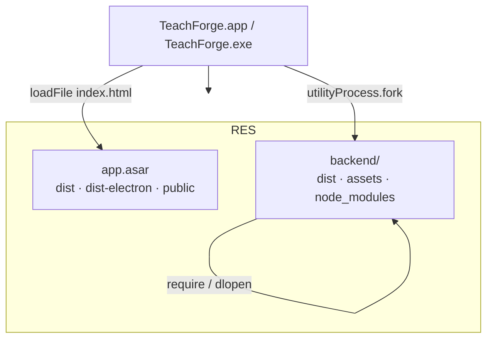

# 桌面安装包

## 1. 命令与产物

Windows x64 与 macOS Apple Silicon 使用独立原生构建命令：

```bash
npm run package:win
# = node scripts/prepare-release.mjs
#   && npm run build
#   && node scripts/stage-backend.mjs win32 x64
#   && electron-builder --win nsis --x64 --publish never

npm run package:mac-arm64
# = node scripts/prepare-release.mjs mac-arm64
#   && npm run build
#   && node scripts/stage-backend.mjs darwin arm64
#   && electron-builder --mac dmg --arm64 --publish never
```

| 产物 | 内容 |
|---|---|
| `release/TeachForge-<version>-setup.exe` | Windows x64 NSIS；per-user 安装，可选择安装目录，创建桌面与开始菜单快捷方式 |
| `release/win-unpacked/TeachForge.exe` | Windows 未安装目录，用于打包态检查 |
| `release/TeachForge-<version>-mac-arm64.dmg` | Apple Silicon macOS DMG；挂载后将 TeachForge 拖入 Applications |
| `release/mac-arm64/TeachForge.app` | macOS arm64 应用 bundle |
| `resources/app.asar` / `resources/backend/` | 两个平台共用的桌面主进程、渲染层，以及后端 `dist`、`assets` 与生产 `node_modules` 布局 |

`electron-builder.yml` 的 `directories.app` 是 `apps/desktop`，因此打包读取桌面 workspace 的 `package.json`（`main` 指向 `dist-electron/electron/main/main.js`），产物版本也来自该 workspace。

## 2. 安装包布局



`app.asar` 里没有 `node_modules`：桌面端依赖全部是 Vite 构建期依赖。后端依赖以实文件形式放在 `resources/backend/node_modules`，原生模块不经过 asar。

## 3. 构建步骤

| 步骤 | 行为 |
|---|---|
| `node scripts/prepare-release.mjs [win\|mac-arm64]` | 按目标删除旧的 unpacked 输出及临时目录；Windows 会报告占用进程 |
| `npm run build` | `nest build` + `tsc`（主进程）+ `vite build`（渲染层） |
| `node scripts/stage-backend.mjs <platform> <arch>` | 清空 `build/backend`；复制后端产物与生产依赖闭包；仅接受 `win32 x64` 或 `darwin arm64` |
| 依赖扁平化 | 根提升包保持 `node_modules/...`；`apps/backend/node_modules/*` 也映射到 staging 根；目标路径冲突时报错，不静默覆盖 |
| 平台裁剪 | 校验 `better-sqlite3` 与 ONNX Runtime 的目标原生文件，再各自只保留目标平台与架构 |
| electron-builder | 三个 `extraResources` 映射（`dist`、`assets`、`node_modules`）复制到 `resources/backend`；Windows 生成 NSIS，macOS 生成 arm64 DMG |

electron-builder 的复制过滤器会丢弃 `from` 根目录下名为 `node_modules` 的目录，因此依赖映射必须独立作为一条 `extraResources`（`from: build/backend/node_modules`），不能与 `dist`/`assets` 合并。

## 4. 运行时路径

| 事实 | 入口 |
|---|---|
| 打包态后端入口 | `process.resourcesPath/backend/dist/main.js`（`getBackendEntry()`） |
| 打包态依赖解析 | Node 从 `resources/backend/dist` 逐级找到 `resources/backend/node_modules`；不设置 `NODE_PATH` |
| 后端工作目录 | `utilityProcess.fork` 将 `cwd` 设为 `resources/backend/dist`；TypeORM migration glob 按此 cwd 解析 |
| 后端资源根 | `resources/backend/assets`：`dist/llm` 与 `dist/documents/chunking` 的相对路径指向此处 |
| 渲染层入口 | `<app.asar>/dist/index.html` |
| 窗口与 Dock 图标 | `<app.asar>/public/logo.ico`、`logo.png`；Mac app/DMG 图标由 `build/icon-mac.png` 转换（512×512，源图来自 `build/icon.png`） |
| 数据目录 | 默认仍为 `~/.tech-forge`；`TEACHFORGE_DATA_DIR` 覆盖时同时改 Electron `userData` |

开发态与打包态共用同一组相对资源路径；只有后端入口在 `app.isPackaged` 时切换为 `resources/backend/dist`。

## 5. 原生依赖

| 依赖 | Windows x64 包 | macOS Apple Silicon 包 |
|---|---|---|
| `better-sqlite3` 13 | `prebuilds/win32-x64.node` | `prebuilds/darwin-arm64.node` |
| `onnxruntime-node` 1.30 | `bin/napi-v6/win32/x64` | `bin/napi-v6/darwin/arm64`，含 binding 与 `.dylib` |
| 编译策略 | `npmRebuild: false`；N-API 预编译文件 | `npmRebuild: false`；N-API 预编译文件 |

两平台的后端均在 `resources/backend` 实文件目录内运行，原生模块不经过 asar。

## 6. 已知边界

- Windows 包未签名，SmartScreen 会提示未知发布者；macOS 包不强制签名且关闭公证，不能视为已签名、公证的公开发行包。
- 目前产出 Windows x64 NSIS 与 macOS Apple Silicon DMG；不支持 Intel / Universal、portable、MSI 或自动更新。
- 构建依赖已安装的 `node_modules` 与已构建的 `apps/backend/dist`，不提供独立离线安装。

## 7. 清理失败（EBUSY）

Windows 上 `release/win-unpacked/resources/app.asar` 被外部进程持有时，electron-builder 可能在收尾时抛 `EBUSY`。`scripts/prepare-release.mjs` 会在构建前清理目标目录；Windows 使用 Restart Manager 列出占用进程，macOS 提示先退出 TeachForge.app 或关闭占用进程。

Windows 清理失败时输出类似：

```
[prepare-release] cannot remove release/win-unpacked: EBUSY on .../resources/app.asar
[prepare-release] held open by:
  pid 22580  Code.exe (Visual Studio Code)
```

关闭占用者后重跑对应命令：`npm run package:win` 或 `npm run package:mac-arm64`。
