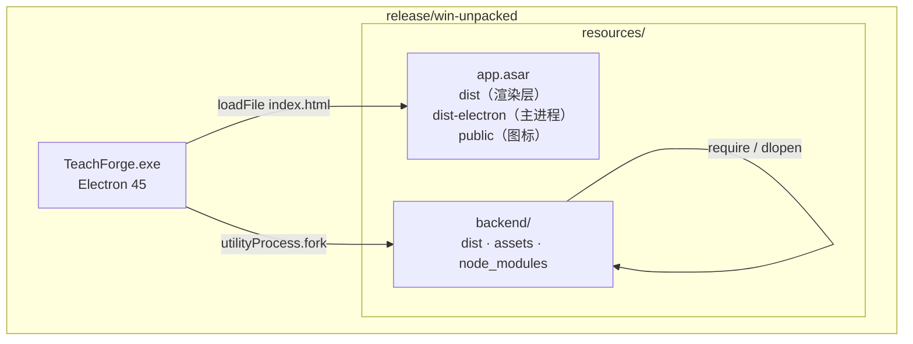

# Windows 安装包

## 1. 命令与产物

```bash
npm run package:win
# = node scripts/prepare-release.mjs
#   && npm run build
#   && node scripts/stage-backend.mjs
#   && electron-builder --win nsis --x64 --publish never
```

| 产物 | 内容 |
|---|---|
| `release/TeachForge-0.1.0-setup.exe` | NSIS 安装器（289 MB）；per-user 安装，可选择安装目录，创建桌面与开始菜单快捷方式 |
| `release/win-unpacked/TeachForge.exe` | 未安装目录，可直接运行，用于打包态冒烟 |
| `release/win-unpacked/resources/app.asar` | 桌面主进程、渲染层与图标（11.8 MB） |
| `release/win-unpacked/resources/backend/` | 后端 `dist`、`assets` 与生产 `node_modules`（651 MB 未压缩） |

`electron-builder.yml` 的 `directories.app` 是 `apps/desktop`，因此打包读取的是桌面 workspace 的 `package.json`（`main` 已指向 `dist-electron/electron/main/main.js`）。

## 2. 安装包布局



`app.asar` 里没有 `node_modules`：桌面端依赖全部是 Vite 构建期依赖。后端依赖以实文件形式放在 `resources/backend/node_modules`，不经过 asar，原生模块直接按普通路径加载。

## 3. 构建步骤

| 步骤 | 行为 |
|---|---|
| `node scripts/prepare-release.mjs` | 先删除上次的 `release/win-unpacked`、`release/win-unpacked.tmp`。这两个目录只有 electron-builder 收尾时才清理，若 `resources/app.asar` 被外部进程占用，整轮构建会在最后一步以 `EBUSY` 失败；前置删除把失败提前到构建之前，并打印占用进程 |
| `npm run build` | `nest build` + `tsc`（主进程）+ `vite build`（渲染层） |
| `node scripts/stage-backend.mjs` | 清空 `build/backend`；复制 `apps/backend/dist`、`apps/backend/assets`；按 `npm ls --workspace @teachforge/backend --omit=dev --parseable` 复制生产依赖闭包到 `build/backend/node_modules` |
| 依赖扁平化 | 根提升包保持 `node_modules/...`；`apps/backend/node_modules/*` 也映射到 `build/backend/node_modules/*`；目标路径冲突时脚本直接报错，不静默覆盖 |
| 平台裁剪 | `better-sqlite3` 只保留 `prebuilds/win32-x64.node`；`onnxruntime-node` 只保留 `bin/napi-v6/win32` |
| electron-builder | 三个 `extraResources` 映射（`dist`、`assets`、`node_modules`）复制到 `resources/backend`，再生成 NSIS |

electron-builder 的复制过滤器会丢弃 `from` 根目录下名为 `node_modules` 的目录，因此依赖映射必须单独作为一条 `extraResources`（`from: build/backend/node_modules`），不能与 `dist`/`assets` 合成一条 `from: build/backend` —— 合并时会静默丢失全部依赖。

## 4. 运行时路径

| 事实 | 入口 |
|---|---|
| 打包态后端入口 | `process.resourcesPath/backend/dist/main.js`（`getBackendEntry()`） |
| 打包态依赖解析 | Node 从 `resources/backend/dist` 逐级向上找到 `resources/backend/node_modules`；不设置 `NODE_PATH` |
| 后端工作目录 | `utilityProcess.fork` 显式把 `cwd` 设为 `resources/backend/dist`。TypeORM 的 migration glob 结果按进程 cwd 解析，跨盘（安装盘与启动目录不同盘）会解析成 `E:\C:\...` 而启动失败 |
| 后端资源根 | `resources/backend/assets`：`dist/llm` 与 `dist/documents/chunking` 的 `__dirname/../../assets`、`../../../assets` 都指向它 |
| 渲染层入口 | `<app.asar>/dist/index.html`（由 `__dirname/../../../dist/index.html` 得到） |
| 窗口与 Dock 图标 | `<app.asar>/public/logo.ico`、`logo.png`（由 `__dirname/../../../public` 得到） |
| 数据目录 | 默认仍为 `~/.tech-forge`；`TEACHFORGE_DATA_DIR` 覆盖时同时改 Electron `userData` |

开发态与打包态共用同一组 `__dirname` 相对路径；只有后端入口在 `app.isPackaged` 时切换为 `resources/backend/dist`。

## 5. 原生依赖

| 依赖 | 事实 |
|---|---|
| `better-sqlite3` 13 | 包内 `prebuilds/win32-x64.node`（N-API），随安装包放在 `resources/backend/node_modules` |
| `onnxruntime-node` 1.30 | `bin/napi-v6/win32/x64/onnxruntime_binding.node` + `onnxruntime.dll`、`DirectML.dll` 等 |
| 编译策略 | `npmRebuild: false`：全部为 N-API 预编译，打包不要求 C++ 工具链 |
| 加载方式 | 后端在 `resources/backend` 实文件目录内运行，原生模块不经过 asar |

## 6. 已知边界

- 安装包未签名，Windows SmartScreen 会提示未知发布者。
- 只产出 x64 NSIS；无 portable、MSI、arm64 目标，无自动更新。
- `release/TeachForge-0.1.0-setup.exe` 体积主要来自 `onnxruntime-node`（287 MB）、`onnxruntime-web`（140 MB）与 PDF/Canvas 相关二进制；当前未做进一步裁剪。
- 构建脚本依赖已安装的 `node_modules` 与已构建的 `apps/backend/dist`，不做独立的离线安装。

## 7. 清理失败（EBUSY）

`release/win-unpacked/resources/app.asar` 被外部进程持有句柄时，Windows 既不允许删除也不允许重命名该文件；electron-builder 在收尾清理旧输出时会抛 `EBUSY: resource busy or locked, unlink ...\resources\app.asar`，此时构建产物已经全部生成，只是没能覆盖旧目录。

`scripts/prepare-release.mjs` 在构建前删除同一批目录；删除失败时用 Restart Manager（`scripts/release-lock-report.ps1`）列出占用进程并退出码 1：

```
[prepare-release] cannot remove release\win-unpacked: EBUSY on ...\resources\app.asar
[prepare-release] held open by:
  pid 22580  Code.exe (Visual Studio Code)
```

常见占用者：从 `release/win-unpacked` 启动过且仍在运行的 `TeachForge.exe`；预览或索引过打包产物的编辑器扩展宿主（VS Code 执行 `Developer: Reload Window` 即可释放）。关闭占用者后重新执行 `npm run package:win`。
