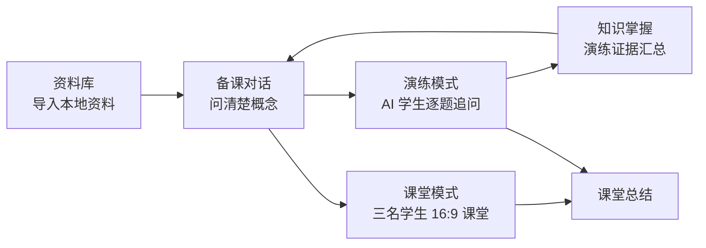

# TeachForge 产品介绍（对外宣传讨论稿）

**文档状态：** 讨论稿，用于与产品经理对齐"对外说什么、不说什么"。
**事实口径：** 第 6 节的每条能力都对应 `docs/current/` 与代码已实现行为；第 7 节列出设计稿里有、代码里没有的能力，**不得出现在对外材料中**。第 5 节是产品全貌，不等于全部已实现。

## 1. 一句话

**TeachForge 是一个本地运行的教师课前演练工作台：先把要讲的知识讲清楚，再让 AI 扮演学生把你问住。**

三种长度的版本：

| 长度 | 文案 |
|---|---|
| 一句话 | 进教室之前，先被三个学生问一遍。 |
| 电梯版（30 秒） | TeachForge 是给教师的 Windows 桌面工具。它把资料、备课对话、AI 学生演练和知识掌握放在同一个本地工作台里：你可以上传教材问清楚概念，让 AI 扮演学生连续追问你，最后在 16:9 的教室里对着三名学生讲一遍。资料与记录都存在你自己的电脑上，结论只来自你的实际作答。 |
| 功能版 | 资料库（本地 PDF/DOCX/MD/TXT 解析与摘要）+ 备课对话（带文件、联网与知识点产物）+ 演练模式（15 问上限的费曼式追问与逐题评估）+ 知识掌握（演练证据汇总）+ 课堂模式（三名学生的 16:9 课堂模拟与课后总结）+ 长期记忆与本地设置。 |

## 2. 要解决的问题

教师的真实缺口不是"写不出讲稿"，而是**讲稿写完了，人不一定讲得清**。

| 痛点 | 具体表现 | TeachForge 的回应 |
|---|---|---|
| 知识没有内化 | 让 AI 生成一份讲稿，自己却没理解透；被追问第二层就卡住 | 备课对话负责把概念问透；演练模式负责检验你是否能独立讲出来 |
| 课堂问题想不到 | 备课时假设学生"应该懂"，上讲台被一个基础问题打断节奏 | 演练模式由 AI 主动提问并追问；课堂模式用三名不同性格的学生轮流发难 |
| 经验不积累 | 每次备课从零开始，上次卡在哪、哪块讲过、哪块没验证都记不住 | 演练结束后自动生成"知识掌握"结论；跨会话长期记忆保留偏好与事实；课堂结束生成课堂总结 |

现有 AI 工具的错位：它们大多在优化"生成得更快更多"，而教师真正缺的是"我能不能讲、会不会被问倒"。TeachForge 把生成当中间产物，把**能不能讲清楚**当验收标准。

## 3. 用户

**核心用户：** 需要反复讲授专业知识的高校教师、职业教育讲师、企业培训讲师；首期验证领域是计算机与软件工程。

**典型场景（一次备课）：**

1. 新建一个课题，把教材章节、论文或讲义导入资料库。
2. 在对话里追问概念、边界和反例；用 `/探索主题` 让 AI 产出知识文档和知识地图。
3. 觉得差不多了，切到演练模式，让 AI 扮演学生逐题追问。
4. 看报告：哪道题答得稳、哪块只是"看懂了"但讲不出来。
5. 想更接近真实课堂，就进课堂模式，对着三名学生把课讲一遍，结束后看课堂总结。

**不是给谁：**

- 不是学生自学工具（没有课程体系、习题、打卡）。
- 不是班级管理或多人协作平台（单人、本地、无账号、无云同步）。
- 不是一键生成课件的工具（不承诺替代教师备课产出物）。
- 不是实时课堂助手（产品明确不要求在讲台上向 AI 求助）。

## 4. 五条对外承诺

这五条既是产品原则，也是宣传口径的安全边界：任何素材若违反其中一条，就是在透支可信度。

| 原则 | 对外表达 | 意味着 |
|---|---|---|
| 理解优先于生成 | "我们不打分你写得多快，只关心你讲不讲得清" | 不宣传"一键生成完整讲稿" |
| 证据优先 | "每条结论都能点回你当时怎么答的" | 不编造评价、不做随机夸奖、不做诱导性激励 |
| 课前准备，不打扰课堂 | "上课的是你，AI 只在课前陪你练" | 不宣传实时答疑、课堂投屏助手 |
| 本地优先 | "资料和记录留在你的电脑上，我们不设服务器" | 云端同步、账号体系不在承诺内；调用模型时相关片段会发给 DeepSeek |
| 单人深度 | "为一个人的专业成长设计" | 不做排行榜、证书、班级对比 |

另有一条产品内部约定，宣传时可直接用作差异点：**没有百分制分数、排名、徽章和打卡**；掌握状态只有四档（建议加强 / 证据不足 / 基本掌握 / 熟练掌握），并且"未验证"永远不等于"薄弱"。

## 5. 产品全貌



| 界面 | 用户在这里做什么 | 留下的东西 |
|---|---|---|
| 备课对话 | 多轮追问、带附件、生成知识文档与知识地图 | 会话历史、会话文件、长期记忆 |
| 资料库 | 导入 PDF/DOCX/Markdown/TXT，查看解析与摘要 | 知识库目录 `index.md` + 资料副本 |
| 演练模式 | 回答 AI 学生的连续追问，查看逐题评估与报告 | 演练记录、报告、知识掌握事实 |
| 知识掌握 | 按会话查看掌握状态与知识点详情 | 只读汇总，可回到原会话 |
| 课堂模式 | 写一段讲解，回答三名学生的提问，结束课堂 | 课堂记录（JSONL）+ 课堂总结 |
| 设置 | 配置 DeepSeek 模型与 Key、身份设定、风格偏好、长期记忆管理 | 本机 `config.toml` / `IDENTIFY.md` / `PREFERENCE.md` |

## 6. 已实现能力（可演示、可宣传）

### 6.1 备课对话

- 普通对话 + 工具：读取与写入会话工作区文件、搜索文件、联网搜索与抓取（DeepSeek，需配置 Key）。
- 附件：PDF、DOCX、Markdown、TXT 会转换为可读文件并进入本轮上下文；图片直接作为视觉输入。响应里只显示附件标签，正文由模型读取。
- `/查询资料库`：显式触发资料库上下文；目录预载，模型按目录读取原文。不输入命令就不检索，不产生额外成本。
- `/探索主题`：固定先加载资料库目录，再生成 `知识文档.md` 与 `知识地图.svg`；文件在会话文件面板里可预览（Markdown、代码、JSON、Mermaid、SVG）。
- 会话文件面板：列出本会话产出的文件，支持预览、全屏、手动刷新、缺失文件移除记录、在文件管理器中定位。
- 会话管理：历史分页加载、重命名、删除；切换会话不会中断其他会话正在进行的生成。
- 长期记忆：跨会话记住用户偏好与身份事实；每轮按相关度注入最多 2 条；设置页可查看、单条删除、清空。演练与内部生成调用不读记忆。

### 6.2 资料库

- 导入本机 PDF / DOCX / Markdown / TXT（一次可选多份，最多 3 份并发处理）。
- 解析为 Markdown，并由模型生成目录摘要（摘要、3–8 个关键词、资料类型）。
- 生成知识库目录 `index.md`；模型按目录按需读取原文，而不是把整库塞进上下文。
- 同一内容按哈希去重；摘要失败可单份重试；删除会同时清理资料副本与目录条目。
- 状态文案是用户语言（"可以搜索 / 正在读取 / 正在生成摘要 / 摘要未生成 / 导入失败"），不暴露向量、分片等内部术语。

### 6.3 演练模式

- 前提：当前会话至少完成过一轮正常对话。演练不生成新会话，而是挂在当前课题下。
- AI 扮演一名学生，用费曼式提问：先规划主题、学习摘要和 1–8 个知识点，再逐题提问。
- 上限：总提问 15 次（含追问与跳过）；同一基础题最多追问 2 次，之后强制换题。上限是保护而不是目标，内容少时可能明显少于 15 问。
- 可选学生画像（最多 1000 字，本机持久化），只影响提问视角。
- 逐题评估：等级、证据状态、说明；总体报告含强弱项与复习建议。
- 支持跳过、手动结束、失败重试；一题都没答就结束时，确认后会丢弃本次演练，不生成空报告。
- 每次演练写一份 Markdown 记录；普通对话只投递一次最近 3 次完成演练的摘要作为上下文。
- 报告完成即登记知识掌握事实，后台单进程生成，失败保留旧结论与错误摘要，不伪造结论。

### 6.4 知识掌握

- 卡片列表：会话标题、标签、掌握状态、完整摘要；列数随窗口自适应。
- 四档状态：建议加强、证据不足、基本掌握、熟练掌握；无证据时显示"证据不足"而不是"薄弱"。
- 详情页：知识点级等级、证据状态、说明与变化描述；可一键回到原会话继续学习。
- 数据只来自演练证据：普通对话、资料阅读、讲稿内容都不构成掌握依据。

### 6.5 课堂模式

- 16:9 沉浸舞台，窗口在进入舞台时锁定比例；首页保持普通窗口。
- 三名固定学生，各有稳定人设：
  - 苏小满：好奇型，喜欢从故事、比喻和具体场景建立理解。
  - 林澈：逻辑型，关注定义、因果、推理过程与成立条件，会提反例。
  - 顾知夏：务实型，关注理论如何用在真实问题里。
- 一轮对话 = 老师消息 + 一名学生回应。老师先写整段讲解，之后逐题回答。
- 学生气泡按座位定位：林澈左（22%）、苏小满中（50%）、顾知夏右（78%）；等待模型时三个座位显示"正在思考中…"。
- 导演按当前知识点收束：通常约 3 轮后学生只确认理解，5 轮是硬上限；老师开启新讲解时标签变化并重置计数。收束轮会由另一名学生提出新知识点问题。
- 消息侧栏默认折叠，显示消息总数；展开为右侧覆盖抽屉，损坏记录会提示跳过行数。
- "退出课堂"保留进行中课堂；"结束课堂"需确认，结束后后台生成四节 Markdown 课堂总结；首页分「进行中的课堂」与「历史课堂」，历史可重生成总结、删除课堂。
- 课堂不做评分，也不产出掌握度结论。

### 6.6 运行形态与隐私

- Windows x64 桌面应用（NSIS，按用户安装，可改安装目录），Electron + 本地 NestJS 后端。
- 后端只监听 loopback，所有请求需要本机令牌；渲染层不接触令牌。
- 数据在 `~/.tech-forge/`：SQLite 主库、资料副本、会话工作区、记忆库、课堂记录。产品没有自有云端；但每次模型调用都会把当轮相关上下文发往 DeepSeek API，这一点必须在隐私说明里写清，不要用"数据不出本机"作为宣传语。
- 模型只支持 DeepSeek：设置页填写模型 ID 与 API Key；Key 以明文保存在本机 `config.toml`，界面默认遮蔽。
- 联网能力仅限 DeepSeek 搜索/抓取工具，由模型按需调用；演练与内部生成调用不启用这两个工具。

## 7. 不能对外说的（设计稿有、代码没有）

以下能力出现在 `docs/source/` 设计稿或界面概念图里（尤其是那张 8 宫格界面总览图），当前**没有实现**。宣传材料若使用概念图，必须标注"设计稿"。

| 能力 | 当前事实 | 可用替代说法 |
|---|---|---|
| 工作台 / 我的课程 / 教学记忆页面，课程—课次两级结构 | 侧栏实际只有：会话列表、资料库、知识掌握、课堂模式、设置；`teaching`、`assessments` 模块是空壳 | 用"课题（一次对话）"描述工作单位 |
| 大纲与讲稿编辑器、DOCX 导出、版本管理 | 不存在编辑器；只有消息与文件预览 | "在对话里整理讲解要点"，不承诺讲稿编辑 |
| 演练评分（如 80/100）、能力雷达、证书 | 报告只有等级、证据与建议，无百分制、无排名 | "不给分数，只给证据和下一步" |
| 知识关联网络、跨课程关联、待复习到期列表 | 知识掌握只按会话出卡片与详情 | 只说"按课题汇总掌握状态" |
| 混合检索（向量 + BM25 + RRF）作为默认链路 | 模块与历史数据仍在，但当前无生产调用；实际是目录摘要 + 按需读取 | 说"先看目录，再按需读原文" |
| URL 资料导入、扫描件 OCR、表格结构还原 | 只支持本地文件；扫描 PDF 会明确失败 | 写清支持的四种格式 |
| macOS、云同步、多用户、班级与学生真实数据 | 仅 Windows x64；单人本地；无账号 | 说"个人本机使用" |
| 跨会话演练历史、报告导出、人工重评 | 演练历史只在当前会话内 | 不宣传"成长档案导出" |
| 课堂评估（谁没听懂、卡在哪） | 课堂只有课后总结，无评估、无掌握度 | 只说"课堂总结" |
| 讲稿与演练结果联动修订 | 不存在 | 不描述"报告直接改讲稿" |

## 8. 与常见方案的差异

| 维度 | 通用大模型聊天 | AI 备课生成器 | 知识库问答 / RAG 工具 | TeachForge |
|---|---|---|---|---|
| 交互主导 | 用户提问，模型回答 | 表单 → 一次性产出 | 文档检索 → 引用回答 | AI 主动提问，用户作答 |
| 主要产出 | 一段回答 | 讲稿、课件、教案 | 带引用的答案 | 演练评估、掌握状态、课堂总结 |
| 是否检验用户 | 不检验 | 不检验 | 不检验 | 以能否独立讲清为验收 |
| 数据位置 | 云端 | 多为云端 | 视部署 | 本机，loopback，无账号 |
| 长期积累 | 会话内 | 文件级 | 索引级 | 跨会话记忆 + 掌握事实 + 课堂记录 |
| 情绪设计 | 无 | 无 | 无 | 三名有性格的学生 + 16:9 教室舞台 |

一句话差异：**别人帮你写，TeachForge 替你问。**

## 9. 三条可选宣传主线

三条主线对应三种首屏故事，需要产品经理选主次。

| 主线 | 主张 | 最强素材 | 适合渠道 | 风险 |
|---|---|---|---|---|
| A. 考自己（演练为英雄功能） | "你以为你懂了，直到 AI 学生追问第三层" | 演练进行中截图 + 报告里的薄弱点 | 教师社群、公众号长文、知乎 | 静态截图不震撼，需要视频或 GIF |
| B. 三个学生（课堂模式为记忆点） | "进教室前，先被三个学生问一遍" | 16:9 课堂舞台 + 学生气泡 + 思考中动效 | 短视频、小红书、B 站、展会大屏 | 容易被误读成"AI 陪聊/游戏"，需一句解释证据与总结 |
| C. 本地私有（信任卖点） | "教材留在本机，不注册账号，不建云端档案" | 数据目录、loopback、无登录界面 | 高校信息化、教研群、隐私敏感用户 | 模型调用仍需联网与自备 Key；不能说"完全离线" |

**建议结构：B 做钩子，A 做价值，C 做信任。** 理由：课堂模式是唯一"看一眼就懂"的画面；演练模式解释这不是玩具；本地私有解释为什么值得装在自己电脑上。三者叠加正好覆盖"想点开 → 想试用 → 敢试用"。

不建议的主线：

- 以"生成讲稿/大纲"为卖点：产品没有编辑器，且与定位冲突。
- 以"评分、提升 X 分"为卖点：产品明确不打分，承诺即翻车。
- 以"多学生并发 Agent"为技术卖点：实现是单线程导演 + 角色卡，说并发会被技术受众拆穿。

## 10. 三分钟演示脚本

| 时间 | 画面 | 旁白要点 |
|---|---|---|
| 0:00–0:20 | 侧栏 → 新建课题 | "一次备课就是一个课题，资料、对话、演练都挂在这里。" |
| 0:20–0:50 | 资料库导入一份 PDF，展示摘要与关键词 | "本地解析，生成目录；模型需要时才去读原文，不是把整本书灌进上下文。" |
| 0:50–1:20 | 对话追问概念 → 打开 `/探索主题` 产物（知识文档 + 知识地图 SVG） | "问清楚概念；需要时产出一份可预览的知识文档和知识地图。" |
| 1:20–2:10 | 切到演练模式 → 开始演练（准备画面真实阶段）→ 回答两题 → 报告 | "AI 学生开始追问。注意这里：它不给你打分，只告诉你哪题答得稳、哪块讲不出来。" |
| 2:10–2:30 | 切到知识掌握 | "报告完成，掌握状态自动汇总到这张卡片，可以点回原题原答。" |
| 2:30–3:10 | 课堂模式：写讲解 → 三名学生轮流提问 → 结束 → 总结 | "最后，把课讲一遍。三个学生性格不同，问的角度也不同。结束后有一份课堂总结。" |
| 3:10–3:20 | 设置页 → 数据目录 | "资料和记录都在本机，不需要注册账号；模型走你自己的 DeepSeek Key。" |

素材清单（拍摄前需准备）：

- 一段 40–60 秒的课堂舞台录屏（含"正在思考中…"到学生气泡出现的切换），这是最容易被转发的片段。
- 演练报告截图（突出"证据/缺口"而不是分数）。
- 知识掌握卡片 + 详情页截图。
- `/探索主题` 生成的知识地图 SVG 截图。
- 一张对比图：通用 AI 的"回答" vs TeachForge 的"追问"。
- 一句免责说明：界面概念图（8 宫格总览）需标注"设计稿，当前版本以实际界面为准"。

## 11. 与产品经理待决问题

1. **目标细分市场**：首发主打高校专业课教师，还是职教/企业培训讲师？两者对"课堂模拟"的共鸣不同。
2. **记忆点是否押"三个学生"**：若要押，学生是否需要名字、头像、固定人设出现在所有物料里（当前代码已固定苏小满/林澈/顾知夏）。
3. **"不打分"是卖点还是风险**：它建立信任，但会让习惯评分的用户觉得"没有反馈"。是否需要一句"用证据代替分数"的解释文案。
4. **自带 API Key 的摩擦**：首次使用必须配置 DeepSeek Key。宣传是否需要提供体验路径（预置 Key 的试用包、按次计费代理、或明确写"需自备 Key"）。
5. **平台承诺**：当前只有 Windows x64 安装包。对外是否说明 macOS 计划，避免用户下载后无法安装。
6. **命名统一**：对内叫"演练模式/课堂模式"，对外是否需要更直白的说法（如"模拟答辩 / 三学生课堂预演"）；"课题"这个词是否要换成"备课"。
7. **首发渠道与内容形态**：短视频（课堂舞台）与长文（证据与本地化）需要两套素材，谁先做。
8. **发布时机**：是否等"大纲/讲稿"能力落地再对外，还是先用"演练 + 课堂"切入。
9. **商业模式**：免费/买断/订阅；是否开源部分能力；教育机构采购是否需要多机部署（当前不支持）。
10. **成功指标**：入口点击率、首次完成演练率、7 日回访、课堂模式使用率、知识掌握卡片打开率，哪个作为首要指标。

## 12. 术语表（对外文案统一用词）

| 内部词 | 对外建议 | 说明 |
|---|---|---|
| Conversation / 会话 | 课题 | 一次备课的工作单位；避免"聊天窗口" |
| Rehearsal / 演练模式 | 演练（或"AI 学生演练"） | 强调由 AI 主动提问，不是自由聊天 |
| Classroom / 课堂模式 | 课堂模拟 / 三学生课堂 | 强调"进教室前的预演" |
| Knowledge Facts / 知识掌握 | 知识掌握 | 不用"知识画像""能力评分" |
| Knowledge Base / 资料库 | 资料库 | 不用"向量库""索引" |
| Mastery Level | 掌握状态 | 四档：建议加强 / 证据不足 / 基本掌握 / 熟练掌握 |
| Lesson Summary | 课堂总结 | 不叫"课堂报告"，避免被理解为评估 |
| Transcript | 演练记录 / 课堂记录 | 不使用"日志""transcript" |

## 13. 宣传打法：从功能到主张

这一节不介绍产品，只回答一个问题：**程序员怎么把"我做了什么"翻译成"你会变成谁"。**

### 13.1 宣传不是功能说明，是改变承诺

功能说明回答"它有什么"，宣传回答"用了它，我会变成谁"。

> 为【谁】在【什么时刻】，用【一个可见的差异】解决【什么痛】；证据是【可验证的东西】。

套到 TeachForge：

| 要素 | 内容 |
|---|---|
| 谁 | 第一次讲某门专业课，或讲了几年仍然怕被问住的教师 |
| 什么时刻 | 开课前一周，PPT 做完了，心里没底 |
| 可见差异 | 不是"AI 帮你写"，而是"AI 学生先把你问一遍" |
| 痛 | 讲稿有了，但不知道自己能不能讲清、会不会被问倒 |
| 证据 | 报告能点回原题原答；课堂记录能回看谁问了什么 |

判断一句话是功能还是主张：把产品名删掉，句子还成立吗？"支持 PDF 解析"删掉产品名什么都不是；"进教室前，先被三个学生问一遍"删掉产品名仍然是一个画面。

### 13.2 每句话只讲一层：功能 → 能力 → 收益 → 身份

| 功能（开发视角） | 能力（它实际能做到） | 收益（用户得到什么） | 身份（用户成为谁） |
|---|---|---|---|
| 15 问上限、每题最多 2 次追问 | 根据你的回答继续追问 | 提前发现"看懂了但讲不出"的地方 | 学生怎么问都问不倒 |
| 三名固定学生、三种人设 | 从好奇、逻辑、务实三个角度提问 | 预演真实课堂的意外问题 | 上课不慌 |
| 资料库本地解析与目录 | 资料留在自己电脑，按需读取 | 不用把教材传给第三方 | 可以放心用真实材料备课 |
| 演练报告 + 知识掌握四档 | 按证据汇总薄弱点 | 知道下一步补哪一块 | 越备越轻松 |
| 课堂总结 | 一节课的完整记录 | 下课前就能回看 | 每节课都算数 |

规则：首页、视频、海报只讲收益与身份；功能放第二屏；架构（SQLite、loopback、Pi SDK）任何对外材料都不出现。

### 13.3 五个可用叙事，选一个做主线

| 叙事 | 主张 | 首屏画面 | 适合 |
|---|---|---|---|
| 恐惧 | "讲台上最怕的那句话：老师，为什么？" | 学生气泡弹出，老师停顿 | 教师社群、公众号 |
| 反共识 | "AI 不该替你写讲稿，该替你当学生" | 左边是生成的长文，右边是一句追问 | 知乎、技术社区、行业评论 |
| 场景 | "进教室前，先被三个学生问一遍" | 16:9 课堂 + 三个气泡 | 短视频、小红书、展会 |
| 身份 | "好老师不是讲得多，是经得起问" | 报告里的证据链 | 长文、访谈、教发中心 |
| 信任 | "教材留在你自己的电脑上" | 数据目录、无登录界面 | 高校信息化、教研群 |

**建议：反共识做主张，恐惧做共鸣，场景做钩子。** 反共识让人愿意讨论，恐惧让人对号入座，场景让人三秒看懂。信任叙事单独用不够吸引，但必须出现在隐私说明里。

### 13.4 可直接改的文案模板

**一句话（用于签名、简介、海报）**

> 进教室之前，先被三个学生问一遍。

**15 秒视频字幕（三行）**

> 备课到凌晨，讲稿改了五遍。
> 然后 AI 学生问了一句："老师，为什么？"
> TeachForge：上课前，先被问一遍。

**标题（同一内容可换五种）**

- 我让 AI 扮演三个学生，把我自己的课问崩了
- 备课最怕的不是写不完，是不知道能不能讲清
- 讲稿生成只需要一分钟，讲清楚需要被追问十次
- 我用一个本地工具，提前听了一遍学生的问题
- 别让 AI 替你写，让 AI 替你问

**长文开头（200 字结构）**

1. 一次具体的失败：哪节课、哪个问题、当时怎么卡住。
2. 发现：问题不在讲稿，在"没人问过我"。
3. 做法：让 AI 扮演学生，先问一遍；哪些追问真的有用，哪些是噪音。
4. 结果：改了什么、第二次演练怎么样（真实记录，不夸大）。
5. 邀请：给同样要开新课的老师试用，附下载与 Key 说明。

**落地页结构**

| 区块 | 内容 |
|---|---|
| H1 | 进教室之前，先被三个学生问一遍 |
| 副标题 | 本地运行的教师课前演练工具：资料、演练、课堂模拟 |
| 15 秒视频 | 课堂舞台 + 一句追问 |
| 三条证据 | 真实录屏、用户原话、报告截图（标注来源） |
| 边界说明 | 不打分；需自备 DeepSeek Key；Windows |
| CTA | 下载 Windows 版，用一课试试 |

CTA 避免"立即体验智能教学新范式"，用具体动作："下载 Windows 版，用一课试试"。

**所有示例都是待校准草稿**：正式使用前，用 13.5 的访谈替换其中的假设。

### 13.5 证据从哪来（程序员最容易跳过的一步）

找 5 位真实教师，每人 30 分钟，只问五个问题：

1. 最近一次备课是什么时候？花了多久？
2. 哪一部分最没底？
3. 有没有被学生问住过？当时问的是什么？
4. 你会怎么准备学生可能问的问题？
5. 如果有个工具能让你先被问一遍，愿意花 10 分钟试吗？

不要问"你觉得这个功能好不好""你会用吗"。要的是**具体事件与原话**，不是意见。

产出物：

- 3 句可以直接当标题的用户原话。
- 1 个真实到可以复述的场景（哪门课、哪个问题、卡在哪）。
- 1 条可署名的试用证言（征得同意）。

证据等级：**用户原话 > 真实录屏 > 自己长期的使用记录 > 界面概念图（不可用于宣传）**。

### 13.6 渠道与两周节奏

| 渠道 | 内容 | 目的 |
|---|---|---|
| B 站 / 视频号 | 60 秒演示 + 3 分钟完整流程 | 让人看懂"被追问"是什么体验 |
| 小红书 | 图文："我被 AI 学生问崩了" + 课堂截图 | 触达非技术教师 |
| 公众号 / 知乎 | 长文复盘：一次真实备课的失败与修正 | 建立可信度，承接搜索 |
| 教研室群 / 教发中心 | 5 位种子教师试用 + 证言 | 拿到第一批真实反馈 |

第一周：做 5 次访谈、录 1 条 60 秒视频、写 1 篇自述、搭落地页。
第二周：发 3 条内容（视频 / 图文 / 长文）、给 5 位教师开通、收集 3 条证言、按评论改一次文案。

一次只主推一个渠道，另一个渠道只做分发，避免每条内容都为不同平台重写。

### 13.7 看什么指标

| 层 | 指标 | 说明 |
|---|---|---|
| 内容 | 完播率、收藏、评论里出现"怎么用/在哪下载" | 比点赞更能说明意图 |
| 激活 | 下载 → 配置 Key → 完成第一次演练 | 配置 Key 是最大流失点，单独看 |
| 留存 | 7 天内完成第二次演练 | 一次演练可能只是好奇 |
| 口碑 | 用户主动复述的那句话是什么 | 决定下一轮文案 |

下载量不是唯一指标：拿到 100 个下载但没人完成演练，说明宣传与产品体验错位。

### 13.8 程序员常见错误（发布前自查）

| 错误 | 症状 | 改法 |
|---|---|---|
| 从架构讲起 | "本地 SQLite + loopback + Pi SDK" | 只说"资料在你电脑上" |
| 功能清单当卖点 | 六条 bullet，每条都以"支持"开头 | 只留一个主差异，其余放第二屏 |
| 抽象词 | 智能、赋能、一站式、全链路 | 换成具体动作与画面 |
| 一次讲六个功能 | 用户记不住任何一条 | 一条内容只讲一个改变 |
| 自证 | 全部素材都是自己的截图 | 加用户原话与真实试用 |
| 隐藏限制 | 不提自备 Key、只支持 Windows、不打分 | 主动写清，降低退货与差评 |
| 概念图当产品 | 用 8 宫格设计稿做宣传 | 标注"设计稿"，或只用实机录屏 |
| 追求专业感 | 文案像说明书，没有人味 | 用一个具体失败开场 |

### 13.9 需要产品经理拍板的三件事

1. **主叙事**：反共识 / 恐惧 / 场景 / 身份 / 信任，选一个做主线，其余做支撑。
2. **首发渠道**：一个内容平台 + 一个私域，其余只分发。
3. **证据来源**：谁去做 5 次教师访谈、谁出镜录屏、证言如何授权。

## 14. 小红书首轮内容实验（2026-11-13 采样）

用 TikHub 的小红书搜索接口，对以下关键词各取搜索第一页 20 条，读取标题、点赞、收藏、评论与作者；对 5 条头部笔记补读正文与评论。样本是**搜索结果快照**，受个性化与地域影响，点赞为采集时点值，不代表全站统计。

### 14.1 头部内容的互动结构

按每个关键词点赞前 5 条计算中位数，"藏/赞"表示资源属性，"评/赞"表示讨论属性。

| 关键词 | 前 5 赞中位 | 藏/赞 | 评/赞 | 内容类型 |
|---|---:|---:|---:|---|
| 教师备课 | 6822 | 0.63 | 0.042 | 备课笔记资源 |
| 新教师备课 | 5893 | 0.62 | 0.023 | 新教师方法 |
| 公开课准备 | 2106 | 1.14 | 0.171 | 流程 + 情绪 |
| 试讲准备 | 2090 | 0.83 | 0.019 | 模板清单 |
| AI 备课 | 2769 | 1.07 | 0.020 | 工具教程 |
| 被学生问住 | 3659 | 0.36 | 0.100 | 故事 / 情绪 |
| 费曼学习法 | 10391 | 0.53 | 0.005 | 方法清单 |
| 输出式学习 | 525 | 1.34 | 0.021 | 方法书摘 |
| AI 学习工具 | 5731 | 1.02 | 0.017 | 工具清单 |
| 师范生 | 3110 | 0.66 | 0.021 | 试讲视频 |
| 试讲 | 11688 | 0.32 | 0.029 | 表演视频 |
| 新老师 | 13493 | 0.90 | 0.123 | 剧情 / 经验 |
| 上课紧张 | 1393 | 0.49 | 0.094 | 情绪共鸣 |

三种内容各拿一种指标：

| 类型 | 指标特征 | 代表内容 | 对发布的意义 |
|---|---|---|---|
| 资源/工具 | 藏/赞 0.6–1.3，评/赞 <0.03 | 备课笔记、AI 备课教程 | 能拿到收藏，但用户不说话，私信少 |
| 情绪/故事 | 评/赞 0.09–0.17，藏/赞 0.3–0.5 | 被学生问住、新老师糗事、公开课紧张 | 评论最多，最适合做首帖 |
| 表演/展示 | 赞高、藏低、评低 | 无生试讲 vlog | 看人，不看方法；难承接工具 |

### 14.2 教师侧：已存在的原话

高赞标题几乎都是第一人称的具体失败，不是方法名：

| 笔记标题 | 赞 | 藏 | 评 |
|---|---:|---:|---:|
| 苍天啊！讲《桃花源记》，我被学生问住了～ | 37812 | 8094 | 1933 |
| 教书嘛，谁还没被学生问倒了？ | 4230 | 1940 | 164 |
| 讲望洞庭的时候被学生问住了 | 2340 | 1328 | 94 |
| 救救我吧！新人老师不会备课肿么办？ | 11606 | 12116 | 135 |
| 新老师上课通病，早改早受益！ | 6171 | — | — |
| 公开课紧张 | 4063 | 863 | 131 |

评论区语言（摘自公开评论）："怎么才能做到这么淡定，下面练的好好的，面试就语速加快没有了微笑"；"脱离政治讲《桃花源》，有点太置身事外了"。前者是表现焦虑，后者是知识追问——**同一批人，两种痛**。

同时，"AI 备课"已经是成熟赛道，但叙事是"偷懒/出 PPT/逐字稿"（3 天备完公开课、3 分钟出 PPT），收藏高、评论低。我们的"AI 替你问"与它相反，适合做反共识内容，但要避免被归进"又一个 AI 备课工具"。

### 14.3 学习者侧：两个不同的群体

| 群体 | 代表内容 | 规模信号 | 与产品的关系 |
|---|---|---|---|
| 通用学习者 | 费曼学习法、输出式学习、AI 学习工具 | 费曼头部 1 万–7.5 万赞 | 只有"讲出来 + 被追问"这一层相关；不讲课、不需要课堂模拟；Windows + 自备 Key 摩擦高 |
| 师范生 / 教资 / 教编 | 无生试讲 vlog、试讲模板、公开课紧张 | 试讲头部 1.1 万–9.5 万赞 | 有"被评委追问"的真实环节，与演练模式相关；但不评姿态、语音、板书，只练问答 |

结论：如果第二条帖子面向"学习者"，**优先选师范生/准教师**，而不是泛大学生。泛学习者能带来收藏，但几乎不会转化为产品用户。

### 14.4 两条帖子的规格

**帖子 A：教育者（在职教师）**

| 项 | 内容 |
|---|---|
| 标题候选 | ① 被学生问住的那十秒，我才知道自己没讲清 ② 讲《__》被学生问住后，我改了整节课 ③ 新老师最怕的不是备课，是那句"老师，为什么" |
| 封面 | 16:9 课堂舞台实机截图 + 大字"被学生问住的那一秒"；不用 8 宫格概念图 |
| 正文结构 | 具体课文/知识点 → 学生原问题 → 当时怎么答、哪里虚 → 发现"讲稿≠讲清" → 用 AI 学生先演练 → 报告里指出的薄弱点 → 邀请同类老师 |
| 标签 | #新老师 #教师成长 #备课 #被学生问住 #课堂 |
| CTA | "想要试的评论区扣 1 / 私信"；不放外链、不放二维码 |
| 目标信号 | 评论、私信、主页访问 |

**帖子 B：学习者（师范生/准教师）**

| 项 | 内容 |
|---|---|
| 标题候选 | ① 试讲能背，评委一追问就慌？ ② 无生试讲练了十遍，答辩那三问没人陪练 ③ 教资面试最难的不是试讲，是被追问 |
| 封面 | 三个学生气泡 + "评委追问模拟"字样 |
| 正文结构 | 试讲≠答辩 → 被追问时卡在哪 → 让 AI 扮演三名学生/评委连续追问 → 报告指出"背过但没讲清" → 明确不评姿态与语音 |
| 标签 | #师范生 #教资面试 #试讲 #答辩 #教师成长 |
| CTA | 同上 |
| 目标信号 | 收藏、评论、私信 |

若坚持做泛学习者版本，标题用"费曼学习法最大的坑：你讲的那遍，没人追问"，但预期只验证叙事，不验证转化。

### 14.5 实验设计与判定

两条帖子受众与叙事同时变化，严格说不是 A/B，而是**两个市场的探针**。要让它可比较，至少固定：同一账号、同一封面模板（同一字体/版式）、同一发布时间段（20:30–21:30）、同一标签数量、同一 CTA。

| 指标 | 采集方式 | 说明 |
|---|---|---|
| 曝光→阅读 | 创作者中心 | 判断封面/标题，而不是内容 |
| 互动率 | (赞+藏+评)/阅读 | 跨帖子可比 |
| 深度评论率 | 评论中含"怎么用/在哪下/求链接"的条数 ÷ 评论数 | 比点赞更接近意图 |
| 私信数 | 人工记录 | 真正的转化前一步 |
| 收藏/赞 | 计算 | 区分资源型与情绪型读者 |

判定规则：

- A 的深度评论率与私信数明显高于 B → 主叙事押教师痛点，B 只做长尾。
- B 的收藏/赞高、私信接近 0 → 学习者只消费内容，不消费产品；停止投入。
- 两条都低 → 问题在封面/标题，不在受众；换封面重发同题材，不要换人群。
- A 评论多但私信少 → 内容共鸣成立、产品门槛（Windows/Key）过高；先解决体验门槛再谈投放。

必须记录的混杂因素：账号冷启动权重、发布时间、话题当日流量、封面是否有人脸、标题夸张程度。两条帖子建议间隔 3–5 天，先发 A，再发 B。

### 14.6 平台与合规

- 笔记内不放外部下载链接、二维码或"加微信"；引导用评论区与私信，主页简介承接。
- 不承诺"提分/上岸/面试必过"；不伪造用户证言；概念图必须标注设计稿。
- 明确写出限制：Windows、需自备 DeepSeek Key、不打分。限制写在正文末尾或评论区置顶，减少退货式差评。
- 评论区前 10 条决定讨论方向：提前准备三条"具体问题"自问自答（如"和 AI 备课工具有什么区别"），不要刷"求链接"。

## 15. 首轮两条帖子成稿（推荐终稿）

发布者身份按"产品作者"写，不虚构教师经历；引用的笔记与评论均来自第 14 节采样。若后续能拿到一位真实教师的授权故事，把 A 帖第一段替换掉，效果会更好。

两条都按事件型写：开头两行出现"上台前/试讲前"的具体时刻，产品名后置到第 5 行以后，限制写在末尾一句。

### 15.1 发布前准备

| 项 | 要求 |
|---|---|
| 图片比例 | 3:4（1080×1440）。课堂舞台是 16:9，必须放进 3:4 画布，不能直接裁成横图 |
| 首图 | 大字主张 + 一张实机截图，不用 8 宫格概念图 |
| 正文 | 每段 1–2 行，不用 Markdown 加粗（平台不渲染），emoji 不超过 5 个 |
| 外链 | 不放链接、二维码、微信号；承接靠评论区与私信 |
| 限制披露 | Windows、自备 DeepSeek Key、不打分，写在正文末尾或置顶评论 |
| 发布时间 | 20:30–21:30；两条间隔 3–5 天，先发 A |

### 15.2 帖子 A：教育者

**标题（三选一）**

1. 备完课还是心里没底？因为没人问过你
2. 下周要上公开课/试讲的，先被三个学生问一遍
3. 被学生问住的那一秒，整节课都得改

**正文**

```text
备完课，PPT 改到第五版，还是心里没底。
怕的不是讲不完，是讲到一半，学生举手："老师，为什么？"

我翻了 400 多条教师笔记，点赞最高的一条是：
"苍天啊！讲《桃花源记》，我被学生问住了"，3.7 万赞。
评论区有人写："从另外一个角度看，渔人是不是我们每一个人？"

备课笔记能收藏，教案能照抄，
但没人替你预演这一句。

所以我做了 TeachForge。

把要讲的资料放进去，先和 AI 把概念问透；
再进"演练模式"，让 AI 扮演学生，一道一道追问。
答得虚，它继续问；答得稳，它换知识点。
结束给一份记录：哪题讲清了，哪块只是"看懂了"。

想更接近真实课堂，就进"课堂模式"：
16:9 的教室，三个学生坐在下面。
一个爱问为什么，一个抠定义和条件，一个只问"这有什么用"。
你讲一段，他们轮着提问。

它不打分，也不发证书。
只在上台前，把"你哪里没讲清"指出来。

Windows 电脑，自备 DeepSeek Key。
下周要上讲台的，评论区扣"试"，我发你安装包和上手步骤。
```

**标签**

`#新老师 #教师成长 #备课 #被学生问住 #课堂 #教师日常 #公开课`

**配图顺序**

1. 封面：大字"先被问一遍"，副标题"下周要上讲台的老师"，底部小字"3.7 万赞的教师笔记，评论区全是同一件事"
2. 课堂舞台实机截图（三个学生 + 气泡）
3. 演练报告截图（薄弱点区域，码掉个人信息）
4. 知识掌握卡片截图
5. 文字卡："它不打分，只告诉你哪里没讲清"

### 15.3 帖子 B：学习者（师范生 / 教资 / 教编）

**标题（三选一）**

1. 试讲能背，评委一追问就慌？
2. 无生试讲练了十遍，答辩那三问没人陪练
3. 教资面试最难的不是试讲，是被追问

**正文**

```text
无生试讲可以背。
开场、提问、板书、小结，练十遍就能顺下来。

但追问不行。
"你为什么这样设计导入？"
"学生这里答不上来，你怎么接？"
"这个环节换成小组讨论，会不会更好？"
背过的东西，一追问就露馅。

我翻到一条试讲视频，9.5 万赞。
评论区有人写：
"怎么才能做到这么淡定，下面练的好好的，可面试就语速加快没有了微笑……"

大家都在看别人怎么讲，
却没人陪自己练"被问"。

TeachForge 做的是后半段：
让 AI 扮演一名爱追问的学生，围绕你准备的那节课连续追问。
答得浅，它继续问；答得空，它换一个角度。
结束后给一份记录：哪题讲清了，哪题只是背过。

它不评姿态、语音、板书，也不给分数。
只练一件事：被追问时，你还能不能把话说清楚。

Windows 电脑，自备 DeepSeek Key。
这周要试讲的，评论区扣"试"。
```

**标签**

`#师范生 #教资面试 #试讲 #答辩 #无生试讲 #教师成长`

**配图顺序**

1. 封面：大字"试讲能背，追问就慌？"，副标题"让 AI 学生先问一遍"
2. 演练模式提问实机截图
3. 演练报告截图
4. 文字卡："不评姿态、不看语音，只练问答"

### 15.4 置顶评论（发布后立刻自己补三条）

| # | 评论 | 用途 |
|---|---|---|
| 1 | 和 AI 备课工具有什么区别？——它们是帮你写，这个只负责问你。 | 提前挡住"又一个 AI 生成器"的误读 |
| 2 | 手机能用吗？——Windows 电脑版，手机暂时不行。 | 过滤无效私信 |
| 3 | 要 API Key 吗？——要自己的 DeepSeek Key，按量计费，不经过我们。 | 提前说清门槛，减少退货式差评 |

### 15.5 私信话术

```text
收到～TeachForge 是 Windows 桌面版，需要你自己的 DeepSeek API Key（按量计费）。
我给你发安装包和 3 步上手：配 Key → 导入一份资料 → 开始一次演练。
装好卡住随时问我，也欢迎告诉我你卡在哪一题。
```

不要把安装包直接塞进第一条私信；先确认对方是 Windows，再发获取方式。平台对私信外链有限制，必要时让对方看主页简介。

### 15.6 发布记录表

| 字段 | A 帖 | B 帖 |
|---|---|---|
| 发布时间 | | |
| 曝光 / 阅读 | | |
| 赞 / 藏 / 评 | | |
| 深度评论数（怎么用/在哪下/求链接） | | |
| 私信数 | | |
| 主页访问 | | |
| 备注（封面、话题、异常流量） | | |

两条都发完后回看第 14.5 节的判定规则：先看深度评论率与私信数，再看收藏/赞；不要用点赞数决定下一轮方向。

## 16. 定位校正：事件型工具，不是习惯型工具

"偷懒内容更火，所以我的工具反人性"这个推论跳过了一步：**互动数据衡量的是内容类型，不是使用意愿。** 但"反人性"的担心有一半是真的——真的一半不在产品，在定位。

### 16.1 数据实际在说什么

| 观察 | 数字 | 能推出 | 不能推出 |
|---|---|---|---|
| 偷懒/资源型内容收藏高 | AI 备课 藏/赞 1.07、评/赞 0.02；教师备课 0.63 / 0.04 | 用户愿意"先存着" | 用户会真的照着做，或愿意为它付费 |
| 情绪/截止日期内容讨论高 | 公开课准备 评/赞 0.17；新老师 0.12；被学生问住 0.10 | 这类话题引发表达与身份认同 | 点赞的人都会买工具 |
| 试讲视频赞高、藏低、评低 | 试讲 藏/赞 0.32 | 用户在围观人，不在学方法 | 方法类内容没有需求 |

高收藏的内容通常也是供给最拥挤的内容：AI 备课教程到处都是，差异只在"哪个工具更快"。高讨论的内容供给反而稀薄——"被学生问住"有 3.7 万赞的故事，却没有对应的产品。**这是空位，不是红海。**

### 16.2 两种产品模型，选一个

| 维度 | 习惯型 | 事件型 |
|---|---|---|
| 触发 | 每天/每周的自我提升 | 开学第一课、公开课、试讲/答辩、新课程第一次讲 |
| 频率 | 高，靠提醒与打卡维持 | 低，集中在截止日期前 7 天 |
| 成功定义 | 连续使用、日常留存 | 完成一次高质量演练、敢上台 |
| 定价 | 订阅 | 单次/单课/学期买断 |
| 内容 | 方法、成长、日常 | 事故、截止日期、同侪压力 |
| 指标 | DAU、7 日留存 | 完成率、事件前使用率、复练次数 |
| 风险 | 没有分数与打卡，很难维持 | 事件之间沉默，需要按学期召回 |

TeachForge 的天然形态是**事件型**：没有分数、没有打卡、一次演练 30–60 分钟、价值发生在"上讲台之前"。把它当习惯型卖，才会显得反人性；当事件型卖，它和面试班、驾照陪练、健身私教是同一种生意——**卖的不是轻松，是关键时刻不失手**。

### 16.3 事件型定位的三个后果

1. **营销按事件买词，不按人群买词。** 关键词用"公开课准备、试讲、教资面试、开学第一课、被学生问住"，不用"教师成长、提升教学能力"这类长期收益词。
2. **首次价值必须压到 15 分钟内。** 事件型用户在截止日期前没有耐心：配置 Key、导入资料、第一次演练要连成一条不中断的路径；提供一节样例课，让用户不用先准备资料就能试。
3. **指标改成事件口径。** 不看 DAU，看"下载→完成首次演练"、"事件前 7 天内使用"、"同一课题复练次数"、"主动转介绍"。

### 16.4 明确不做

- 不做积分、打卡、排行榜：与证据原则冲突，也是习惯型打法的补丁。
- 不追"AI 备课"关键词：红海，且叙事与你相反（它们替你写，你替用户问）。
- 首屏不放"长期提升教学能力"：事件型用户只为下周那节课买单。

### 16.5 判断标准

找 10 位目标用户，问一句："你最近一次要上公开课/试讲/新课程是什么时候？"
- 有 3 位愿意在事件前 7 天花 30 分钟试用 → 事件型成立，按事件型做营销。
- 只有"想长期成长"的人愿意试 → 你还在卖理念，不是卖工具，先改首次体验。

趣味性（课堂模式）降低的是首次使用的抗拒，不改变"什么时候想起你"。**触发靠事件，不靠趣味。**

## 17. 课堂模式：是钩子、是价值，还是装饰

"课堂模式有没有用"取决于用哪把尺子量。它现在同时被期待承担三种角色，而只完成了一种。

### 17.1 三个价值层，别混着算

| 层 | 作用 | 课堂模式现状 |
|---|---|---|
| 注意力（拉新） | 三秒内让人停下 | **最强**。16:9 教室 + 三个学生气泡是产品里唯一"看一眼就懂"的画面 |
| 行为（首次体验） | 逼用户按真实上课的方式讲一遍，而不是打一行字 | **成立**。整段讲解 + 逐题回答，不能像聊天那样只回一句 |
| 证据（留存与转化） | 告诉用户哪里没讲清，形成下一次行动 | **缺失**。没有逐题评估、没有学生级归因、没有接入知识掌握 |

所以它不是没用，是**只完成了舞台，没完成裁判**。舞台负责让人愿意进来，裁判负责让人愿意再来。

### 17.2 现在实际交付了什么

| 已有 | 缺失 |
|---|---|
| 整段讲解作为课堂起点 | 讲解本身不被评估（哪里含糊、哪句是结论） |
| 三名学生、三种提问视角 | 不记录"哪个学生没听懂、卡在哪" |
| 按知识点收束（约 3 轮，5 轮硬顶） | 知识点只有标签，没有掌握状态 |
| 结束后的四节课堂总结 | 总结不进知识事实，不驱动下一次学习 |
| 消息侧栏与历史课堂 | 不能跨课堂看"同一知识点被问过几次" |

结果：课堂结束后，用户得到一段"感觉像上了节课"的体验，但拿不到可行动的结论。演练模式有报告，课堂模式没有——这就是它显得"没用"的直接原因。

### 17.3 数据能证明什么、不能证明什么

| 观察 | 能证明 | 不能证明 |
|---|---|---|
| 试讲 vlog 9.5 万赞、2.2 万赞 | "看别人讲课"有巨大注意力 | 用户愿意自己练；藏/赞 0.32、评/赞 0.03，围观多于方法 |
| 公开课紧张、公开课准备讨论高 | 上台前的紧张是真实痛点 | 缓解方式必须是"沉浸式课堂" |
| "被学生问住"故事 3.7 万赞 | 提问场景有共鸣 | 用户需要 16:9 画面才能练 |

诚实结论：**沉浸式舞台的注意力价值有数据支持，练习价值没有。** 这不等于练习没价值，而是还没有被验证。

### 17.4 三种去留方案

| 方案 | 做什么 | 成本 | 适合 |
|---|---|---|---|
| A. 钩子化 | 只把课堂模式当宣传素材与首次体验，不再投入；价值核心放演练模式 | 最低 | 现在就要发内容、验证市场 |
| B. 补裁判 | 给每个知识点加一句"讲清/含糊"、给每个学生加一行"听懂程度/首个卡点"，并接入知识掌握 | 中（需要逐题评估或至少按知识点汇总） | 确认用户会重复使用课堂 |
| C. 砍掉 | 删除舞台与三学生，只留演练 | 省维护，但失去唯一视觉差异 | 不建议，沉没成本之外还丢掉了钩子 |

**建议 A→B 分两步**：先用 A 发两条内容、验证"课堂画面能不能带来私信"；如果一条课堂视频能稳定带来"我这周要上课"的私信，再做 B。不要在验证之前继续加舞台功能。

### 17.5 两周验证

找 5–10 位教师，每人准备一节真实要上的课：

1. 记录从进入课堂到第一问的时间（超过 3 分钟即为摩擦）。
2. 问他们结束后是否读了总结、读到哪里停下。
3. 两周后是否主动为第二节课再进课堂。
4. 是否把总结里的任何一句用在真实备课里。

判断：**第二次使用率**比第一次的惊叹更重要。只用一次，它是广告片；用第二次，它才是工具。

### 17.6 沉浸式的真正作用

沉浸式不是"让学习变有趣"，而是**改变行为约束**：在聊天框里，用户会写一行字；在教室里，用户会讲一整段。这个行为差异才是舞台的价值。如果舞台没有改变用户怎么讲、讲多久、被追问时怎么答，它就只是装饰。

所以问题不是"要不要沉浸式"，而是"沉浸式有没有换来更完整的讲解和更真实的追问"。有，就保留；没有，就把它降级成宣传素材。
