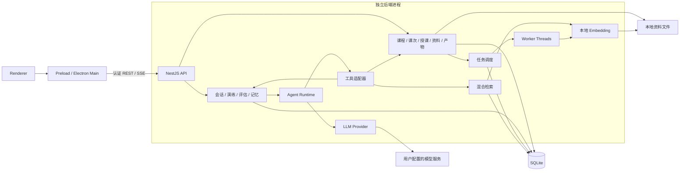
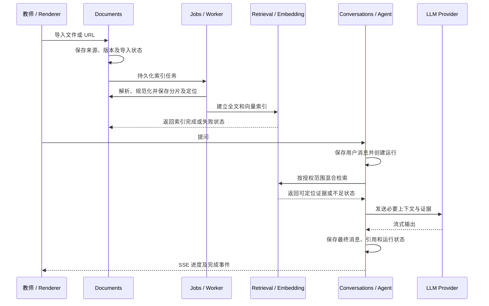
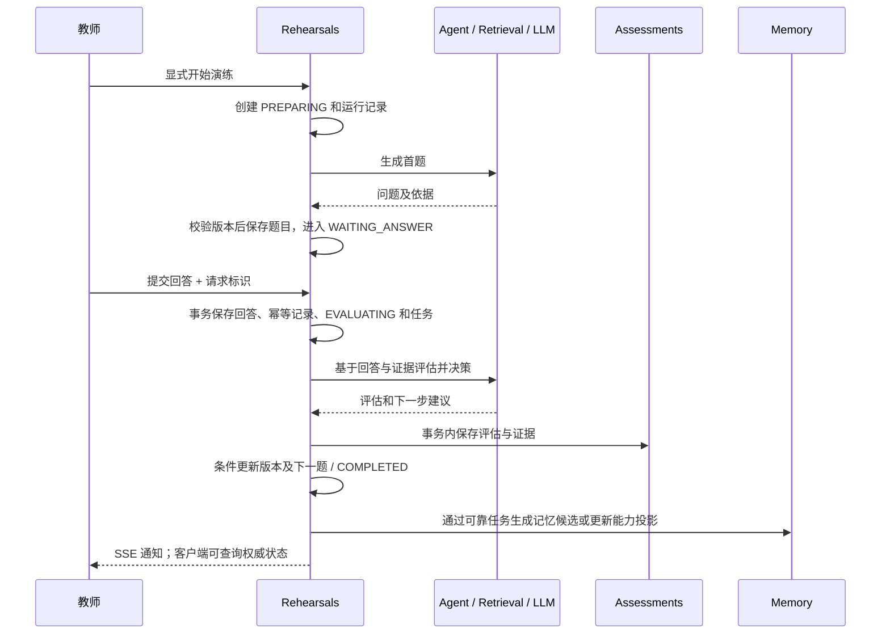

# TeachForge 后端架构设计

- 状态：架构草案，待技术验证；不代表功能已实现。
- 范围：单用户本地桌面应用的 MVP 后端；相邻边界为 Electron 进程管理、Renderer 和外部 LLM。
- 输入：[需求文档](../../需求文档.md)、[功能设计文档](../../功能设计文档.md)。当本文未规定具体行为时，以这两份初稿为业务背景；具体 API Schema 与实施设计需另行细化。
- 现状（2026-11-06）：`apps/backend` 已有 NestJS/Fastify、SQLite/TypeORM migration、健康检查与课程创建和查询；其余模块为目标设计。开发环境通过系统 Node 启动后端，生产打包方案仍待验证。

## 1. 架构结论

采用**单机模块化单体**：Electron Main 管理独立 NestJS 进程，Renderer 经受控 Preload/Main 访问本地 REST 与 SSE；SQLite 保存权威业务状态，本地文件保存原始资料及模型，Worker 处理解析和向量化，用户配置的第三方 LLM 通过适配器访问。模块是代码和数据责任边界，初期不拆进程或独立部署；不引入 Redis、独立数据库服务或多 Agent。



依赖方向：接入层 → 应用服务 → 领域规则和端口 → 基础设施适配器；组合根负责注入。业务模块只经公开应用服务或端口访问其他模块，不直接修改其他模块的表。Agent 工具是调用业务能力的适配器，不拥有业务状态；领域模块不反向依赖 Agent。共享代码只放无业务含义的类型、错误与基础设施，禁止形成万能 `CommonService`。

## 2. 模块职责与数据归属

下表是逻辑边界，初期可以合并为同一个 Nest 模块或目录；拆分不意味着增加部署单元。名称为建议命名，已有 `CoursesModule` 保持兼容。

| 模块            | 负责的用户目标、写入归属                                                                | 对外能力 / 明确不负责                               |
| ------------- | --------------------------------------------------------------------------- | ------------------------------------------ |
| Courses       | 管理课程、班级及关系；`courses`、`classes`                                              | 提供课程及班级上下文；不管理课次状态                         |
| Lessons       | 管理课次目标、时长、学生背景、课程关联；`lessons`、`lesson_classes`                              | 提供课次上下文；不推断授课已发生                           |
| Teaching      | 记录实际授课覆盖、学生提问与反馈；`delivery_records`                                         | 供历史查询和记忆引用；仅教师确认的记录代表实际授课                  |
| Documents     | 导入、文件副本、解析状态、文档版本及来源定位；`documents`、`document_versions`、`document_chunks`    | 提供版本化分片；不直接决定检索排序                          |
| Knowledge     | 知识点及显式关系；`concepts`、`concept_relations`                                     | 提供知识标识、关联；MVP 不做图检索                        |
| Retrieval     | 范围过滤、向量与 BM25 查询、RRF 和证据组装；拥有可重建的 FTS/向量索引及索引版本                             | 返回带来源定位的证据；不拥有原文或能力判断                      |
| Embedding     | 本地模型加载、版本/维度/归一化配置、批量推理；`embedding_profiles`                                | 提供向量生成及模型可用状态；不调用外部 embedding 服务           |
| Conversations | 学习会话和消息、上下文恢复；`sessions`、`messages`                                         | 追加消息、读取历史；不以消息推断演练状态                       |
| Rehearsals    | 开始、逐轮提交、状态机、退出、报告编排；`rehearsals`、`rehearsal_turns`、报告                       | 提供状态转移和恢复；不把完成视为通过                         |
| Assessments   | 保存回答的评估、证据及依据；`assessments`                                                 | 输出可复核结论和 `UNCERTAIN`；不覆盖历史结果               |
| Artifacts     | 知识笔记、大纲、讲稿、版本、确认与 DOCX 导出；`artifacts`、`artifact_versions`                   | 保存及提出局部修改；不因演练结果覆盖教师确认内容                   |
| Memory        | 候选/确认记忆、来源、变更历史、教师知识状态；`memories`、`memory_sources`、`teacher_concept_states` | 按范围检索、确认、纠正、失效或删除；不将学习、讲授或 AI 建议推断成已掌握/已实施 |
| Agent Runtime | 执行循环、策略、工具注册、预算、运行和工具记录；`agent_runs`、`tool_executions`、`agent_events`       | 学习与演练采用不同策略；不绕过业务服务修改数据                    |
| LLM           | Provider 配置、能力发现、流式调用、超时及错误归一化                                              | 用户配置模型；密钥由系统安全存储适配器管理，不写入日志和业务表明文          |
| Jobs          | 本地持久化任务、调度、租约、取消与恢复；`jobs`                                                  | 重试受限的后台工作；不决定业务成功语义                        |
| Platform      | 配置、数据库迁移、认证、健康、文件/密钥存储、日志、事件投递                                              | 提供基础能力；不承载业务规则                             |

Memory 中的当前能力状态是基于 Assessment 及其他有效证据形成的投影，原始评估由 Assessments 保存；删除或撤销证据时必须重新计算或标记待重算。备份、清理、删除资料和重建索引需由拥有者协调，不能依赖跨模块直接删表。

## 3. 端到端数据交互

### 3.1 导入、索引与学习



| 节点                    | 边界与异常处理                                                                   |
| --------------------- | ------------------------------------------------------------------------- |
| Documents / Jobs      | 文件先安全落盘、再事务登记版本和任务；崩溃后清理孤儿文件。失败保留错误及可重试状态；URL 受限或解析失败要明确提示。               |
| Retrieval / Embedding | 分片保留文档版本和页码/章节等定位；同一索引代际的 FTS 与向量均完成并验证后才切换为可查询。失败保留上一代或报告不可用，不把半成品当完整索引。 |
| Conversations / Agent | 先持久化用户消息与运行，再开始远程调用；完成消息和引用后通知客户端。模型或检索失败应显式报告，证据不足时表达不确定性。               |
| LLM                   | 文档、教师输入和记忆均是不可信内容；模型不得自行扩大工具权限或越过确认规则。只发送完成任务所需的上下文。                      |

### 3.2 演练、评估和长期记忆



开始仅由用户显式触发。主状态为 `PREPARING → ASKING → WAITING_ANSWER → EVALUATING → ASKING / COMPLETED`；活动状态可进入 `EXITED`。一次评估可决策 `FOLLOW_UP`、`CHALLENGE`、`NEXT_TOPIC` 或 `COMPLETE`；轮次上限仅是运行保护。状态切换及 Assessment 写入应在同一 SQLite 事务中经应用层协调；LLM 调用在事务外。

提交回答以 `(rehearsal_id, request_id)` 唯一约束去重，同一标识不同内容返回冲突；并以状态及版本条件更新防止并发提交。退出先持久化 `EXITED` 并递增版本，再尽力取消运行；返回结果必须比较原版本和当前状态，过期结果不能产生评估、下一题或覆盖退出。已提交回答保留，未提交文本不是证据。生成失败保留已保存回答，提供重试或退出，避免重复评估。

自动记录业务事实与模型提出的记忆候选分别处理：不可验证的重要候选需教师确认；评估证据与当前能力状态分别保存。授课记录、历史薄弱点与经授权的资料可用于后续备课，且来源可追溯。

## 4. 读取与检索设计

| 读取场景  | 所有者及来源                                                     | 一致性、限制与降级                                    |
| ----- | ---------------------------------------------------------- | -------------------------------------------- |
| 课次工作区 | Lessons 组装课程、课次；Documents、Artifacts、Memory 提供各自摘要          | 分页或批量读取，分别标识加载失败；不以缓存替代权威状态。                 |
| 学习上下文 | Conversations 读取当前会话及最近消息；Lessons、Retrieval、Memory 按需提供上下文 | 控制历史和检索预算；先查当前课次，再按用户授权扩大范围；资料不足时标明，不伪造引用。   |
| 演练及报告 | Rehearsals 读取状态、轮次；Assessments 读取证据；Artifacts 按关联定位章节      | 状态、回答和评估以 SQLite 为准，SSE 只通知；报告允许标记尚未完成或证据不足。 |
| 历史备课  | Memory 查询已确认、未过期的记忆及来源，Teaching 查询实际授课                     | 区分已授课、未授课和学生理解未知；候选与过期记录默认不当作确认事实。           |

混合检索对相同授权范围分别执行 sqlite-vec 向量检索和 FTS5 BM25，再以 RRF 融合、去重和组装邻近上下文；中文分词方案及代码片段检索效果需实测。缺少任一索引时明确报告索引未就绪或失败，可提供标明不完整的临时搜索，但不能视为达到 MVP 混合检索要求。Embedding profile 包含模型、版本、维度及归一化策略；变更时建立新代际并重建，不混用不同向量空间。目标 Recall@10 ≥ 85% 是待人工标注数据集验证的指标，不是既有结果。

## 5. 持久化、任务和流式事件

- SQLite 为权威存储；开启 WAL、外键、busy timeout 与 migration，后端统一管理写入。短事务只包含本地状态变更，不跨 LLM、网络或长时间 Worker 计算。文档文件与 SQLite 无法原子提交，需暂存、引用登记、启动清理和一致性检查。
- 任务建议包含类型、业务对象、幂等键、状态、尝试次数、租约到期时间、进度及错误。业务变更和待执行任务同事务落库；单机调度器以条件更新领取，租约到期后可恢复。执行至少一次，副作用必须由业务唯一约束和状态条件去重；无法安全重试的操作进入待人工处理。
- 启动时将失效租约释放或标记待恢复；运行中的远程模型调用中断后不假定可续传，保留已提交输入和已完成结果，让用户重试。关闭时停止接收新任务、尽力取消、持久化状态并关闭数据库；强制退出依靠下次恢复。
- SSE 事件按 `runId` 和单调 `sequence` 关联。持久化状态变更和可重放的关键事件；高频 token 增量可不持久化，断线后按序号重放保留事件并查询运行及最终消息，缺失的临时增量以权威快照替代。明确事件保留期及重连回退策略后再实现。
- 备份使用 SQLite 一致性备份机制，并包含其引用的原始资料、配置与模型清单；备份期间协调文件删除和数据库快照，恢复后检查引用、索引代际和版本，必要时重建可派生索引。备份不默认包含明文密钥。

## 6. 接口与安全边界

REST 负责资源管理、发起运行、提交回答、取消及查询状态；SSE 负责运行进度和结果通知。接口族建议为 `/api/courses`、`/api/lessons`、`/api/documents`、`/api/conversations`、`/api/rehearsals`、`/api/artifacts`、`/api/memories`、`/api/jobs` 与运行事件流。除现有健康及课程接口外均为规划，方法、字段、错误码和分页协议需在实现前编写完整 API Schema。

Main 管理动态端口和每次启动的高熵令牌，经受控 IPC 代理请求和事件；后端只绑定 `127.0.0.1`，所有接口认证，拒绝未经允许的 Origin。Preload 暴露有限业务操作并校验参数，不暴露任意 URL、路径、凭据或通用 IPC；文件导入使用受控文件选择及大小、类型校验。现有实现拒绝带 Origin 的请求，与 Main 代理模型一致；生产进程启动、令牌通道及打包仍需验证。

URL 抓取限制协议、重定向、体积和超时，解析及每次重定向都禁止访问本机、内网和保留地址，防止通过 DNS 重绑定绕过；需要访问受限来源时明确失败。日志脱敏，不记录令牌、密钥或完整敏感内容；外部 LLM 会接收用户选择的必要内容，界面应清楚说明。系统安全存储不可用时提示用户，不静默降级为明文。

## 7. 推荐代码组织与交付顺序

```text
apps/backend/src/
  main.ts  app.module.ts
  platform/           # 认证、配置、数据库、文件、日志、健康
  courses/ lessons/ teaching/ documents/ knowledge/
  retrieval/ embedding/ conversations/ rehearsals/ assessments/
  artifacts/ memory/ agent/ llm/ jobs/
  # 每个模块按需设置 api、application、domain、infrastructure；简单模块不强制全建
```

上述为目标目录，并非要求立即移动现有 `database/` 或 `health/`。按纵向闭环推进：

1. **基础验证**：独立进程与安装包、原生依赖、迁移、受控认证、SSE、Worker、sqlite-vec/FTS5 和本地模型可用性；覆盖 Windows/macOS。
2. **知识研究**：课程课次、资料导入、混合检索、Provider、学习会话和引用；先以小型真实资料验证中文召回与来源定位。
3. **演练**：状态机、幂等回答、动态追问、评估和报告；验证退出竞态、崩溃恢复及证据不足。
4. **教学产物**：编辑、版本、局部 AI 建议、确认和 DOCX 导出；验证并发保存与不覆盖教师内容。
5. **长期记忆与授课**：授课记录、候选确认、证据和能力投影、跨课次检索；验证来源追溯和纠错重算。

这些阶段是交付顺序，不改变 MVP 对混合检索、可编辑讲稿、动态演练与跨课次记忆的要求。

## 8. 待验证决策与验收重点

| 问题                                             | 验证或处理方式                                            |
| ---------------------------------------------- | -------------------------------------------------- |
| Electron utility process 与 SQLite/ONNX 原生依赖兼容性 | 先在两种目标系统做安装包闭环；不兼容时评估打包 Node runtime，不要求用户另装 Node。 |
| SQLite 单写入、Worker 与模型内存占用                      | 以代表性资料测试导入并发、UI 延迟、内存和恢复；限制 Worker 数及批次。           |
| 中文 FTS 分词、sqlite-vec 扩展及索引代际切换                 | 建立标注集测 Recall@10、引用定位、无证据处理，验证安装包和断电重建。            |
| 密钥存储、SSE 代理与 URL 访问边界                          | 分别验证系统安全存储、重连/取消、重定向及内网地址限制；确定事件保留期。               |
| 删除、备份与来源保留策略                                   | 在实现前明确级联/保留规则、删除后引用表现和备份恢复语义；避免悬空证据或误删教师资产。        |

验收以用户闭环为准：导入资料并获得可核查引用；退出或重启后恢复学习及演练；重复提交与退出竞态不产生额外轮次；演练证据不足时不强行判定；讲稿可恢复、版本化并导出；历史授课及确认记忆能在后续课次使用。详细接口、字段和每项可执行验收标准应随对应功能设计补齐。
