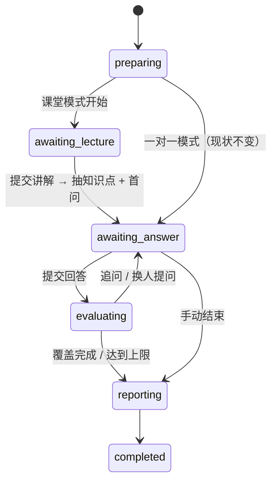

# 学习趣味性设计讨论

**文档状态：** 讨论稿，待产品评审
**范围：** 只讨论“让学习和演练没那么枯燥”的产品机制、落点与优先级，不涉及本轮实现
**约束来源：** 需求文档 P02/P06、知识画像讨论稿 E2/E4/E5、单人本地定位、既有桌面皮肤 token

## 1. 问题定义

当前产品在“正确性”上已经很完整：对话、演练状态机、逐题评估、知识掌握卡片都按证据组织。但情绪层只在两处存在——准备画面的动图和紫罗兰皮肤。其余环节（冷启动、作答、等待评估、看报告、回访）都是纯信息界面。

痛苦不在“缺少游戏”，而在四个具体时刻：

| 时刻 | 用户心里的负担 | 现有机制 |
|---|---|---|
| 打开应用 | 不知道今天从哪开始 | 空状态 + 会话列表，无时间/到期概念 |
| 开口回答 | 怕答错、怕被评判 | 每题立即评估，但没有“不会”的安全出口 |
| 等模型 | 停在一行“正在评估…” | 只有文字状态行 |
| 看报告 | 报告结构齐全但没有情绪落点 | 要点列表 + 免责声明 |
| 过几天回来 | 断签式内疚（如果做打卡就会有） | 目前没有打卡，但也看不到“该复练什么” |

## 2. 设计原则

| 编号 | 原则 | 含义 |
|---|---|---|
| F1 | 趣味来自叙事、工艺和连续性，不来自积分 | 不加分数、等级、徽章、排行榜 |
| F2 | 反馈必须真实且可追溯 | 学生反应由 `assessment.issues/missingPoints` 或报告 `gaps` 生成，不做随机夸奖 |
| F3 | 角色连续性优先于一次性彩蛋 | 一个记得上次卡点的学生，比十个彩蛋有黏性 |
| F4 | 动效、声音默认克制且可关 | 沿用 `prefers-reduced-motion`；新增声音默认关闭 |
| F5 | 一次只增加一个循环 | 避免同时引入角色、星图、课程季导致系统膨胀 |

## 3. 方案清单

### 3.1 打开之前

| 编号 | 方案 | 机制 | 落点 | 成本 |
|---|---|---|---|---|
| A1 | 今日课桌 | 首屏空状态上方给一张“今天可以从这里开始”的卡：一个到期薄弱点 + 一句具体动作 | 知识事实（`conversation_knowledge_facts`）；列表接口当前不返回 `knowledgePointDetails`，需要新聚合端点 | 中 |
| A2 | 时间色温 | `.tf-canvas` 渐变按时段微调（晨间偏紫、夜间偏深），只改变量 | `styles.css` 的 `.tf-canvas`，不新增 token 来源 | 低 |
| A3 | 学生便签 | 侧栏底部一条来自上次报告 `gaps` 的一句便签，点击回到对应会话 | 报告 JSON 已含 `gaps` | 低-中 |

### 3.2 开始演练

| 编号 | 方案 | 机制 | 落点 | 成本 |
|---|---|---|---|---|
| B1 | 学生名册 | 3–5 个原型（大一新生 / 细节控 / 怀疑论者 / 类比党），开始页选 1–2 位；v1 用现有 `persona` 文本组合，不改表 | `RehearsalStart` + `rehearsal-persona` 组装；后续再考虑结构化 | 低 |
| B2 | 入场白 | 准备画面增加一行“学生来意”，由 `plan` 生成，不伪造阶段 | `RehearsalPreparing`，新增只读字段 | 低 |
| B3 | 开门音 | 进入演练时一声很轻的音效，默认关 | 渲染层音频，新增设置项 | 低 |

### 3.3 回答中（压力最大）

| 编号 | 方案 | 机制 | 落点 | 成本 |
|---|---|---|---|---|
| C1 | “我还没想清楚” | 与“跳过”区分：作答框旁一个按钮，记为“该知识点证据不足”，学生追问换角度，不消耗跳过语义 | 状态机新增一个 turn 状态或复用 `unanswered` + 标记 | 中 |
| C2 | 提示券 | 每次演练 1 张：用后该题在报告中标“提示后掌握”，等级不变 | 评估结果加 `hinted` 标记，报告 UI 展示；与 E5 一致 | 中 |
| C3 | 学生反应 | 评估返回后，学生用一句人话复述你的说法或指出缺口，来源是 `issues` / `missingPoints` | `RehearsalSession` 已有评估结果，只需模型多一句 | 低 |
| C4 | 等待微文案 | 评估中轮播学生动作（“小林在翻笔记…”），不假装后端阶段 | `isEvaluating` 状态行 | 低 |

### 3.4 结束

| 编号 | 方案 | 机制 | 落点 | 成本 |
|---|---|---|---|---|
| D1 | 下课铃 | 报告末尾加 `studentClosingLine`：学生视角一句“还是有点绕的地方”，由 `gaps` 生成 | 报告 JSON + 校验 + UI | 中 |
| D2 | 板书速写 | 把报告的 strengths/gaps 生成一张 SVG 板书，写入 session artifacts，可预览 | 复用 `/探索主题` 的 SVG 产物通路 | 中-高 |
| D3 | 盖章时刻 | 报告首次出现时一个评定印章动效（brand + honey），reduced-motion 下静态 | `RehearsalReport` 纯前端 | 低 |

### 3.5 回看与长期

| 编号 | 方案 | 机制 | 落点 | 成本 |
|---|---|---|---|---|
| E1 | 复习到期 | 按知识点的 `lastAssessedAt` 与 30/90 天阈值生成“该复练”列表；断掉不惩罚 | 知识事实详情聚合；需要把时间字段提到列表层 | 中 |
| E2 | 知识星图 | 主题=星座、知识点=星点：实线/虚线/暗点对应 mastered/partial/unverified，点击回证据 | 知识画像页 + 纯 SVG 渲染 | 中-高 |
| E3 | 课程季 | 会话归入课次/章节并显示进度 | 需要新表与入口，暂不做 | 高 |

### 3.6 学习侧对话

| 编号 | 方案 | 机制 | 落点 | 成本 |
|---|---|---|---|---|
| F1 | 讲给我听 | 任意讲解后一个按钮，把这段内容变成 1 题微演练 | 轻量评估端点，不进 15 问状态机 | 中 |
| F2 | 考考我 | 单题内联卡片，答完给等级与缺口，不持久化 | 与 F1 同一端点 | 中 |
| F3 | 三种讲法 | 同一概念按“零基础 / 竞赛生 / 生活类比”重讲 | 纯 prompt 模板 + 一枚按钮 | 低 |
| F4 | 学生问题预演 | 从当前对话生成 5 张“学生可能问”卡片，可一键送进演练 | 对话侧生成 + artifact | 中 |
| F5 | 苏格拉底开关 | 让 Agent 用反问回答，按轮开关，默认关 | prompt 层 | 低 |

### 3.7 课堂模拟（单独提议）

用户提议：一张教室大图，3 名学生各自独立，老师先写一段完整讲解，学生依次提问并互相感知，老师逐题回答；静态背景 + 独立立绘 + 气泡，不追求逐帧动画。

**结论：可行，但必须按“1 个编排器 + 3 张角色卡”实现，不是 3 个并发 Agent。** 现有演练本来就是单线程状态机，一次一个提问；3 个学生只是三种提问视角 + 轮流当发言人。并发跑 3 个 Agent 会带来三倍调用、上下文分叉、“其他学生感知不到”的直接反例，而且没有收益。

#### 流程

`awaiting_lecture` 是课堂模式唯一新增状态；讲解不占 15 问名额。

#### 与现有演练的关系

| 选择 | 做法 | 判断 |
|---|---|---|
| 扩展现有 Rehearsal | 加 `mode`（`socratic` / `classroom`）、`lectureText`、`studentsJson`；turn 加 `speakerId`；回答决策 JSON 加 `nextSpeakerId`、可选 `reaction` | **推荐**：评估、报告、digest、知识事实四条管线全部复用 |
| 新建 Classroom 模块 | 独立表、独立状态机、独立报告 | 不推荐：评估与知识事实要写两遍，后续必然分叉 |

#### 数据与接口增量

| 位置 | 增量 | 说明 |
|---|---|---|
| `rehearsals` | `mode`、`lectureText`、`studentsJson` | 默认 `socratic`，老记录不需要回填语义 |
| `rehearsal_turns` | `speakerId`（可空） | 报告与 UI 归因的唯一依据；空值即一对一 |
| 开始接口 | `mode`、`cast`（v1 用内置原型，不落表） | 课堂模式返回 `awaiting_lecture` |
| 新增端点 | `POST /rehearsals/:id/lecture` | 幂等键，提交讲解后一次调用抽出知识点与首问 |
| 回答接口 | 响应加 `speaker`、`reaction` | `nextSpeaker` 由代码轮转决定，模型只负责以该学生口吻提问 |

#### 舞台

- 容器固定宽高比（建议 16:10），背景图铺满；3 个学生立绘按百分比锚定左/中/右，各自独立 PNG（alpha），不加卡片、描边、投影，沿用准备动图的叠放约定。
- 气泡只显示当前一轮：提问者气泡锚在立绘上方，老师气泡在对侧；历史轮次收进下方「课堂记录」，避免气泡无限堆叠。
- 立绘状态：idle 轻微浮动（`.tf-float` 错开延迟）、提问时微放大、评估后按 `assessment.issues` 显示一个“没跟上”的小标记；不得随机生成表情。
- 窗口变窄（< 900px）或过矮时切换为“头像行 + 传统消息列表”，否则气泡会压住立绘且文字不可读。
- 讲解阶段舞台不显示学生，只有一张“讲台”空镜和大文本框。

#### 报告增量

- 每位学生一行“听懂程度 + 第一个卡点”，由该学生名下各题的 `level`/`issues` 在代码里汇总，**不新增模型调用**，也不造新分数。
- 每个学生的问题都带 `pointId`，继续汇入知识事实；临场偏题允许 `pointId = null`，只出现在报告，不计入掌握。
- 结束时以学生口吻给一句总结（即 D1 下课铃的课堂版）。

#### MVP 边界

1. 内置 3 个原型（如：基础薄弱但敢问 / 抠细节 / 质疑前提），不支持自定义立绘与改名。
2. 讲解一次提交，不支持边讲边问；讲解文本按现有 prompt 截断策略处理，超长提示用户拆分。
3. 学生轮转 + 同一学生最多 1 次追问；不模拟学生互相争论。
4. 报告只加“每位学生听懂程度 + 首个卡点”。

#### 风险

| 风险 | 表现 | 对策 |
|---|---|---|
| 三个学生问得一样 | 三轮后重复同一角度 | 每个原型写死提问约束（例子/前提/边界），prompt 附已问问题并要求不得重复知识点 |
| 归因丢失 | 报告不知道谁没听懂 | `speakerId` 入库，序列化进 prompt，报告按人聚合 |
| 舞台在小窗口崩坏 | 气泡压立绘、文字不可读 | 900px 断点降级为列表布局，首版就必须有 |
| 讲解过长 | plan 抽取被截断、成本上升 | 讲解上限与截断提示；计划摘要复用 `learningSummary` |
| 美术依赖 | 没图就无法验收 | 先做 3 个纯色剪影/头像占位，背景后补；立绘与侧栏插画同一风格 |
| 变成第二套演练 | 只有皮不一样 | 报告必须回答“谁卡住了”，否则不做 |

估算：后端 3–4 天（状态机 + 讲解端点 + 归因 + 报告），前端 3–5 天（舞台 + 降级布局 + 讲解态），美术 1–2 天。整体 1.5–2 周，需要独立立项，不并入 P0/P1。

## 4. 明确不做

| 不做 | 原因 |
|---|---|
| 积分、等级、徽章、排行榜、证书 | 与知识画像 E2 和需求 P06 冲突；单人本地也没有比较对象 |
| 连续打卡与断签惩罚 | 制造焦虑；已有 30/90 天时效模型，用“复习到期”替代 |
| 随机夸奖与“你真棒” | 污染证据，用户会失去对报告的信任 |
| 每次作答撒花/高亮 | 信号贬值，评估结果反而看不清 |
| 假阶段进度 | 准备画面已约定只显示真实 phase |
| 以收藏驱动重复演练 | 会诱导刷数据，污染知识画像 |

## 5. 优先级

| 批次 | 方案 | 依赖 | 说明 |
|---|---|---|---|
| P0（半天内，纯前端） | A2、C4、D3、F3 | 无后端改动 | 先让界面有呼吸感，风险最低 |
| P1（2–5 天） | B1、B2、C3、D1、E1 | B2/D1 改报告 schema；E1 改事实聚合 | 建立学生角色与“下一步”闭环 |
| P2（1–2 周） | C1、C2、F1、F2、E2、D2 | 状态机或新端点 | 需要设计与验证，先做 C1/C2 中的一个 |
| P3 | E3、B3、A1/A3 | 数据模型/音频资产 | 视 P1/P2 使用情况再定 |

## 6. 待决问题

1. 学生原型固定几位？是否允许用户改名、保存自己的组合？
2. 提示券是否影响评估等级？建议只加“提示后掌握”标注，不改 `level`。
3. 星图放在知识画像页内，还是独立入口？
4. 微演练（F1/F2）是否计入知识事实？建议不计，避免单题污染掌握结论。
5. 趣味预算是每屏一个动效还是允许并列？需要一次视觉评审定边界。
6. “我还没想清楚”是否占用 15 问名额？建议占用（它仍是一次提问），但不计为跳过。

## 7. 验收

- 新用户能在 5 分钟内完成第一次演练，且不觉得被评判。
- 演练结束后用户能说出“下一步该练什么”，而不只是“我得了什么评价”。
- 关闭全部动效与声音后，核心流程没有信息损失。
- 任何新增的“情绪反馈”都能点回真实证据，不存在随机生成的评价。
