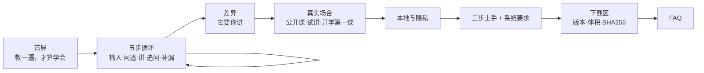

# TeachForge 官网初步规划

**文档状态：** 实现前讨论稿。只定"说什么、放哪、怎么交付下载"，不含视觉设计稿与代码。
**事实口径：** 卖点只取自 [产品介绍](产品介绍.md) 第 6 节（代码已实现）；第 7 节（设计稿有、代码没有）的能力不得出现在官网上。

## 1. 目标与非目标

官网只有一个任务：**让一个老师（或在读师范生）相信「讲给别人听」是检验自己学没学会的方法，并在 3 分钟内完成下载。** 授课场景不单独立传，作为这套学习循环的真实场合出现。

| 目标 | 判定方式 |
|---|---|
| 说清"它不是你写、是替你问" | 陌生人看首屏 5 秒能复述一句主张 |
| 下载可用 | 页面上的链接直接落到安装包，不经过登录、表单、网盘 |
| 下载前信息完整 | 版本、体积、系统要求、SHA256、限制（Windows / 自备 Key / 不打分）全部在下载按钮附近 |
| 不越界宣传 | 无评分承诺、"数据不出本机"、"支持 macOS"等表述 |

非目标（第一版不做）：账号、支付、在线试用、多语言、博客系统、用户社区、文档中心、自动更新客户端。

## 2. 定位：用教别人的方式学习

一句话：**学习的验收不是"看懂了"，是"能讲给别人听，并且经得起追问"。**

| 环节 | 界面 | 学到什么 | 页面证据 |
|---|---|---|---|
| 输入 | 资料库 | 材料变成可读、可检索的本地文本 | 资料库截图 |
| 问透 | 备课对话 | 定义、边界、反例；必要时产出知识地图 | 会话界面截图 |
| 讲 | 课堂模式 | 讲一整段，面对三种提问视角 | 首屏舞台；历史课堂截图讲"讲完留下什么" |
| 追问 | 演练模式 | 被逐题问住，拿到逐题评估 | 演练问答截图 |
| 补漏 | 学习笔记 + 知识掌握 | 回到原话，知道下一步补哪 | 学习笔记截图 |

**课堂负责"教"，演练负责"反馈"，缺一不可。** 只有课堂 = 一场没有反馈的表演；只有演练 = 一次没有输出的问答。这是页面必须把两步绑成一个循环、而不是并列两个功能的原因。

真实讲台（公开课、试讲、教资面试答辩、开学第一课、新课程首讲）不是第二个产品，是循环的真实场合——页面只列场景，不再单开一段功能。

## 3. 卖点 → 解决方案

"解决方案"一列是**产品已实现的能力 + 页面上用来证明它的素材**。没有素材的能力不进官网。

### 3.1 主张（只讲收益，功能放第二屏）

| 候选 | 用途 |
|---|---|
| **教一遍，才算学会**（已采用） | H1；最短、可复述、不依赖产品名 |
| 学没学会，讲一遍就知道 | 副标题或短视频字幕 |
| 讲不清的地方，会被问出来 | 差异块、投放素材 |

### 3.2 循环五步

| 步骤 | 卖点 | 能力 | 页面证据 |
|---|---|---|---|
| 01 输入 | 资料留在本机，按目录读原文 | 本地解析四种格式，生成 `index.md` 目录，模型按目录按需读取；状态文案是「可以搜索」这类用户语言 | 资料库截图 |
| 02 问透 | 先把概念问穿，再开口讲 | 备课对话 + `/查询资料库` + `/探索主题` 产出知识文档与知识地图 SVG | 会话界面截图 |
| 03 讲 | 一轮讲一整段，不能只回一句 | 16:9 舞台；一轮 = 整段讲解 + 一名学生回应；林澈抠定义与条件，苏小满要例子，顾知夏问用途；约 3 轮收束 | 首屏舞台；历史课堂截图 |
| 04 追问 | 讲不清的地方会被继续问 | 逐题提问，同一基础题最多追问 2 次，上限 15 问；逐题给等级、证据状态与说明 | 演练问答截图 |
| 05 补漏 | 带着证据回到原话 | 高亮回答收进「学习笔记」，保留会话名与消息序号，可直接回原会话并补备注；报告完成后汇总四档掌握状态 | 学习笔记截图 + callout |

### 3.3 共用与边界

| 卖点 | 解决方案 |
|---|---|
| 一个课题装下资料、对话、讲与追问 | 侧栏按会话组织，切换会话不中断其他会话的生成 |
| 资料和记录在你的电脑上 | SQLite 主库、资料副本、会话工作区都在 `~/.tech-forge`；后端只监听 loopback，所有请求需本机令牌；无账号 |
| 别人帮你写，它要你讲 | 对比块：生成器交付一篇讲稿，TeachForge 交付"你哪里讲不清" |
| 边界（必须写清） | 模型调用会把当轮相关上下文发给 DeepSeek；仅 Windows x64；自备 Key；不打分；课堂模式不产出掌握度结论 |

### 3.4 为什么首屏是会话工作台

首屏图从课堂舞台改为 `会话界面截图`（三栏：会话 / 对话 / 会话文件 + 知识地图）。理由：

- **它是产品的中心**：资料、对话、演练与课堂入口、会话文件都挂在同一个课题里，用户大部分时间停在这一个界面。
- **右栏是产出物，不是消息**：知识地图让首屏不同于普通聊天工具——右边不是更多对话，而是这次学习留下的东西。
- 课堂舞台后移为循环第 03 步的图，位置仍在页面前 1.5 屏内，"教"的画面不会缺席。

代价：单看首屏容易被读成"又一个 AI 聊天"，且首屏不再直接呈现三名学生。缓解手段是副标题里的「费曼式学习」、紧随其后的五步循环条，以及第 03 步那张整屏教室。

## 4. 页面结构

单页落地页 + 两个必需二级页（隐私说明、更新日志），不做导航菜单树。



| 区块 | 内容 | 必须出现的元素 |
|---|---|---|
| 1 首屏 | H1「教一遍，才算学会」；副标题「本地运行的费曼式学习工具」；主 CTA「下载 Windows 版，用一块知识试试」 | 会话工作台实机截图（三栏含知识地图）；一行限制：Windows x64 · 289 MB · 自备 DeepSeek Key |
| 2 五步循环 | 循环条（输入 / 问透 / 讲 / 追问 / 补漏）+ 五步详述 | 每步一段文字 + 一张整窗截图；不能像两个并列功能 |
| 3 差异 | 生成器交付讲稿，TeachForge 交付"你哪里讲不清" | 两列对比，各 3 行 |
| 3b 大字主张 | 「讲不清的地方，会被问出来。」 | 纯排版停顿，上下留白 ≥ 80px |
| 4 真实场合 | 五个场合各一张卡片：标题 + 一行「那里会被问什么」；结尾一张历史课堂截图 | 卡片网格 + 截图；一句「课堂不做评分」 |
| 5 本地与隐私 | 数据目录、无账号、loopback；DeepSeek 调用边界 | 明确写出"模型调用会把当轮上下文发给 DeepSeek" |
| 6 三步上手 | ① 填 DeepSeek Key ② 导入资料或用样例课题 ③ 讲一遍再让它追问 | 每步一行说明；预计 15 分钟 |
| 7 下载区 | 版本、日期、文件名、体积、SHA256、系统要求、更新方式、SmartScreen 提示 | 至少两个下载入口（顶栏 + 本区） |
| 8 FAQ | 7 条，见下 | 每条 2–3 行 |
| 9 页脚 | 隐私说明、更新日志、联系邮箱、版权 | 更新时间 |

### 4.1 版式参考（notion.com）

采用它的骨架，不采用它的道具：

| 借用的做法 | 落在本站 |
|---|---|
| 居中大标题 + 双 CTA + 全宽产品图 | 首屏；H1 `clamp(2.5rem, 5.2vw, 4rem)`，图下留白 96px |
| 统一区块节奏：kicker → 大标题 → 一两行说明 → 视觉 | `.section-head`；H2 `clamp(1.8rem, 3.2vw, 2.5rem)` |
| 纯排版大字做段落停顿 | 「讲不清的地方，会被问出来。」 |
| 用例卡片（标题 + 一行解释），而非 chip 堆叠 | 「真实场合」五张卡 |
| 页脚三列（品牌 / 产品 / 联系） | 页脚 |
| 顶部一层极淡的品牌色光晕 | `hero-band` 的 radial-gradient |

不照搬：客户 logo 墙、客户证言、统计数字带、自动播放视频。我们没有可公开的证言与数据，宁可缺这一块，也不做假素材。

FAQ 固定 7 条，全部对应真实门槛：

1. 和 ChatGPT / AI 备课工具有什么区别？——它们帮你写，TeachForge 要你讲。
2. 这是学习工具，还是备课工具？——同一件事：先把知识讲给别人听；学新材料、备课、练试讲走同一个循环。
3. 要付费吗？要自己的 API Key 吗？——客户端免费下载，模型走你自己的 DeepSeek Key，按量计费，不经过我们。
4. 数据会上传吗？——资料与记录在本机；调用模型时当轮相关上下文会发给 DeepSeek。
5. 支持 Mac / 手机吗？——当前只有 Windows x64。
6. 为什么 Windows 提示"未知发布者"？——安装包未做代码签名，附 SHA256 供校验。
7. 怎么升级？——当前需手动下载新版本覆盖安装，数据目录不受影响。

## 5. 站点与下载分发

### 5.1 已定

| 项 | 决定 |
|---|---|
| 域名 | `https://www.helloyuchen.com.cn` |
| 站点托管 | 自己的阿里云服务器，静态文件放 `/www/wwwroot/techforge`，nginx 直出 |
| 安装包托管 | 同机的 preview 站点根目录，文件名固定 `TechForge-latest.exe` |
| 下载地址 | `https://preview.helloyuchen.com.cn/TechForge-latest.exe` |
| 发布版本 | 0.1.0 · 2026-11-13 · 289 MB（303,139,741 字节） |
| SHA256 | `293eca584fb00efede8a83265df86523fea6d351017303eb9c58834867c46c96` |

不用对象存储、不用第三方网盘、不用 GitHub Releases：安装包 289 MB，放在同机目录即可，省掉一层外部依赖。代价是自己维护续期、带宽与备份。

### 5.2 目录与 nginx

```text
/www/wwwroot/techforge/            官网（www.helloyuchen.com.cn）
  index.html privacy.html changelog.html 404.html
  styles.css robots.txt sitemap.xml
  assets/            webp 截图、og.png、favicon.ico

/www/wwwroot/techforge-preview/    安装包（preview.helloyuchen.com.cn）
  TechForge-latest.exe
```

安装包用固定文件名 `TechForge-latest.exe`，页面上的版本号、大小与 SHA256 才是真正的版本标识；每次覆盖上传都要同步改页面。

- 参考配置：`apps/website/deploy/nginx.conf.example`（图片一年缓存、HTML 不缓存、404 落到 `404.html`）；安装包在 preview 站点，需关闭 gzip、保留 Range。
- 安装包不进 Git：仓库只放站点文件，exe 手动上传。
- 国内服务器托管 `.com.cn` 域名需要 ICP 备案；未备案的域名解析到大陆服务器会被拦。

### 5.3 每次发版

1. `npm run package:win` 产出 `release/TeachForge-<version>-setup.exe`。
2. 上传到 preview 站点并覆盖为 `TechForge-latest.exe`。
3. `sha256sum` 得到新值，同时取字节数。
4. 改 `index.html`：下载区版本 / 日期 / 大小 / SHA256，以及 JSON-LD 的 `softwareVersion`、`fileSize`。
5. 更新 `changelog.html` 新增一节，`sitemap.xml` 的 `lastmod`。

## 6. 转化门槛与对策

最大流失点不是页面，而是"下载 → 配 Key → 第一次演练"。官网不能解决安装，但必须把这条路径写清楚，否则下载量变成差评。

| 门槛 | 官网对策 |
|---|---|
| 要自备 DeepSeek Key | 首屏一行限制 + FAQ + 三步上手第 1 步；不放到页脚角落 |
| 不知道怎么开始 | 样例课题（若产品侧尚未内置，则提供"用一段自己讲过的课"作为替代路径，并在官网标注） |
| 289 MB / 未签名 | 体积前置；SmartScreen 提示截图与 SHA256 并列 |
| 不确定是否适合自己 | 「不适合谁」三行：不是学生自学工具、不是班级管理、不生成课件 |

## 7. 技术方案

| 项 | 选择 | 理由 |
|---|---|---|
| 代码位置 | 本仓库 `apps/website` | 与产品同仓，发布时同一提交可追溯；部署时整目录上传 |
| 站点形态 | 静态站，零登录、零后端 | 只有文案、图片、视频、下载链接 |
| 构建 | Astro（推荐）或 Vite + React | 内容为主、交互接近零：Astro 默认零 JS、Markdown 直接写文案；若坚持复用现有 React 组件则用 Vite + React，代价是多一份构建与 JS 预算 |
| 内容管理 | 文案与 FAQ 放 Markdown / 结构化数据文件 | 改文案不改组件；与产品介绍第 13.4 节草稿一一对应 |
| 版本数据 | 构建期读取本地 `release.json`（由发布脚本写入） | 不在浏览器里调 GitHub API（限流、CORS、首屏延迟） |
| 视频 | 自托管 mp4（≤ 8 MB）+ 静音自动播放海报图 | 国内可达；不嵌 YouTube |
| 分析 | Cloudflare Web Analytics（无 cookie）或暂不埋点 | 客户端代码内无任何统计 SDK；官网若引入追踪，隐私页必须同步写明 |
| SEO | 静态 HTML、单一 H1、`SoftwareApplication` 结构化数据、OG 图、sitemap | 承接"公开课准备 / 试讲"搜索 |
| 部署 | 自己的阿里云服务器 + nginx | 静态文件直出；安装包同机存放；无第三方平台依赖 |

站点不引入 Tailwind 之外的新设计体系之前，先沿用 `apps/desktop/src/styles.css` 的色板与圆角，保持与客户端同一品牌观感。

## 8. 界面插图规划

### 8.1 素材与处理

- 源图：7 张实机截图，2152×1263。截图是 2 倍缩放，实际界面宽约 1076 CSS px，因此按 1720 宽输出、在 1032 宽栏内显示时接近 1:1，正文可读。
- 输出：`apps/website/assets/*.webp`，质量 82，八张合计约 538 KB；PNG 原件保留。
- 只做三件事：裁掉列表下方空白、圆角 14px、1px `ink-200` 边框 + `shadow-card`。不加设备外壳、不加遮罩、不拉伸。
- 首屏图直接加载，其余 `loading="lazy"`，并写死 `width`/`height` 防布局抖动。
- 截图里的课题内容（RabbitMQ、Transformer 学习）是作者自己的学习记录，可直接使用；出现真实姓名、机构或个人信息时必须打码。

### 8.2 截图 → 页面位置

| 素材 | 位置 | 作用 | 处理 |
|---|---|---|---|
| 会话界面截图 | 首屏主图 | 课题工作台：会话 / 对话 / 知识地图 | 全图，1720×1014 |
| 资料库截图 | 循环 01 输入 | 本地解析与「可以搜索」状态 | 裁底部空白，1720×559 |
| 会话界面截图（右栏裁切） | 循环 02 问透 | 知识地图产出物 | 890×1095，限宽 640 居中 |
| 沉浸式课堂模式截图 | 循环 03 讲 | 三名学生 + 讲解框 | 原比例，1720×969 |
| 演练模式问答界面 | 循环 04 追问 | 逐题评估的「正确」区块 | 裁底部空白，1720×971 |
| 学习笔记界面截图 | 循环 05 补漏 | 摘录带消息序号、可回跳 | 裁底部空白，1720×575 |
| 课堂模式-历史课堂截图 | 真实场合 | 进行中 / 历史课堂 + 总结已生成 | 裁底部空白，1720×559 |
| 进入演练模式加载过程 | 备用 | 等待阶段的真实进度 | 未上首页 |

同一张截图在两个位置出现时，第二处只允许"细节裁切"（如知识地图），不得整图复用。

### 8.3 图注规则

- 图注只写画面里能看见的事实，不重复卖点（卖点在上方正文）。
- 图注 ≤ 40 字，格式「对象 · 事实」。
- 一张图只对应一个步骤，同一张图不在页面出现两次。

### 8.4 还缺的素材

| 素材 | 用在哪 | 优先级 | 说明 |
|---|---|---|---|
| 知识掌握截图（四档卡片 + 详情） | 循环 05 之后 | P0 | 目前只有正文与 callout，没有图 |
| 课堂总结正文 | 循环 03 | P1 | 现有截图只看到「总结已生成」 |
| 40 秒课堂录屏 | 首屏 | P1 | 有录屏时替换静态图 |
| 三步上手三张图 | 上手 | P2 | 现为纯文字步骤；OG 图已由 `assets/og.png` 提供 |
| 三位教师原话 | 首屏 / 社会证明 | P2 | 待访谈（产品介绍 13.5） |

没有用户原话时，首屏只放实机画面，不放假证言。

### 8.5 不用与替代

- 8 宫格总览图（`TeachForge 教学助手界面总览.png`）：概念图，不得使用。
- `bg-classroom.png` + CSS 浮层：真实截图已替代，伪 UI 样式与标记已删除。
- 加载中截图：只在讲"等待阶段"时使用，不当作结果图。

## 9. 验收清单

| 检查 | 命令 / 方法 | 通过标准 |
|---|---|---|
| 下载链接可用 | `curl -I <下载 URL>` | 200，`content-length` 与页面标注体积一致 |
| 校验值正确 | 下载后 `certutil -hashfile TeachForge-Setup-x64.exe SHA256` | 与页面 SHA256 一致 |
| 无 JS 也能下载 | 禁用 JS 打开页面 | 下载按钮是普通 `<a href>`，仍可点击 |
| 移动端 | 360 / 768 / 1440 宽 | 无横向滚动；首屏 CTA 在首屏内 |
| 承诺边界 | 全文检索 | 不出现评分、提分、排名、"数据不出本机"、macOS、云同步 |
| 限制可见 | 首屏 + 下载区 | Windows、体积、自备 Key、未签名四项都在 |
| 循环可复述 | 只看首屏 + 循环条 | 5 秒后能说出"输入→问透→讲→追问→补漏"的顺序 |
| 链接完整性 | 站内链接检查 | 无 404；隐私页与更新日志可达 |
| 性能 | Lighthouse（移动） | Performance ≥ 90，无布局抖动 |
| 下载地址可解析 | `curl -I https://preview.helloyuchen.com.cn/TechForge-latest.exe` | 200，`content-length` = 当前版本字节数 |
| 分享卡片 | 打开 OG 调试器或直接看源码 | `og:image`、`og:url`、`canonical` 均为正式域名 |
| 结构化数据 | Rich Results 测试 | `SoftwareApplication` 无错误 |
| SEO 文件 | `curl /robots.txt`、`/sitemap.xml` | 200，sitemap 含三个页面 |
| 404 | 访问不存在的路径 | 返回 `404.html`，页内链接可回首页 |

## 10. 实施顺序

| 切片 | 产出 | 完成即上线？ |
|---|---|---|
| S0 决策 | 域名、托管、下载源、主叙事拍板（见第 11 节） | 否 |
| S1 骨架 + 下载区 | `apps/website` 可构建；真实安装包链接、SHA256、系统要求 | **是**（先让链接可用） |
| S2 文案 | 首屏、五步循环、差异、真实场合、本地、FAQ、隐私页 | 是 |
| S3 素材 | 录屏、截图、OG 图、三步上手 | 是 |
| S4 上线检查 | 第 9 节清单 + 移动端 + SEO | 是 |

S1 与 S2 可并行；S3 是唯一需要等产品界面稳定的部分。

**原型已落地：** `apps/website/`（`index.html` + `styles.css` + `privacy.html` + `changelog.html`，无 JS、无构建）。首屏、五步循环、差异、真实场合、本地与隐私、三步上手、下载区、FAQ 均已成形；截图、版本号、SHA256 与下载地址为占位，清单见该目录 `README.md`。

## 11. 待拍板

| # | 决策 | 推荐 | 代价 |
|---|---|---|---|
| 1 | 定位 | 学习型主线（费曼法），授课降级为"真实场合"；H1「教一遍，才算学会」（已定） | 触发从事件型转方法型，需要复访设计；易被读成学生工具 |
| 1b | 指标口径 | 不看 DAU，看「下载→完成一次循环」与「两周内第二块知识」 | 没有事件截止日期，召回更难 |
| 2 | 下载托管 | **已定**：自有服务器 `downloads/` 固定文件名 | 需自行维护带宽、备份与续费 |
| 3 | 源码是否公开 | 不公开；产物仓库隔离 | 失去 GitHub 自然流量与"开源可信"叙事 |
| 4 | 站点技术 | Astro 静态 | 新工具链；若团队只熟 React 则改 Vite + React |
| 5 | 分析埋点 | 无 cookie 的访问统计 | 拿不到"下载→首次演练"漏斗，只能看下载计数 |
| 6 | 价格展示 | 本期不放价格，只写"客户端免费 + 自备 Key" | 商业模式未定时避免承诺 |
| 7 | 国内访问 | **已定**：阿里云自托管 | `.com.cn` 域名 + 大陆服务器需 ICP 备案 |
| 8 | 自动更新 | 本期不做，官网写明手动升级 | 版本碎片；二期接 electron-updater 走同一产物源 |

## 12. 风险

| 风险 | 后果 | 缓解 |
|---|---|---|
| 未签名 + 289 MB | 下载后放弃率高 | 体积前置、SHA256、SmartScreen 说明与截图 |
| 自备 Key | 装完不能用，产生差评 | 三步上手放首屏下方、FAQ 第一条 |
| 无自动更新 | 用户长期停在旧版本 | 更新日志页 + 下载区版本号显眼；二期自动更新 |
| 国内下载速度 | 点击→完成下载转化低 | 实测后决定是否换国内 CDN；必要时双源 |
| 承诺越界 | 口碑与合规风险 | 第 9 节"承诺边界"检查纳入发布流程 |
| 个人学习被误读为学生自学产品 | 吸引错人群，转化低 | 段落标题与首句都写"教师自己学"，不出现课程、作业、打卡等学生产品元素 |
| 素材滞后于界面 | 官网截图与实机不一致 | 每次发版重截首屏与下载区截图 |
