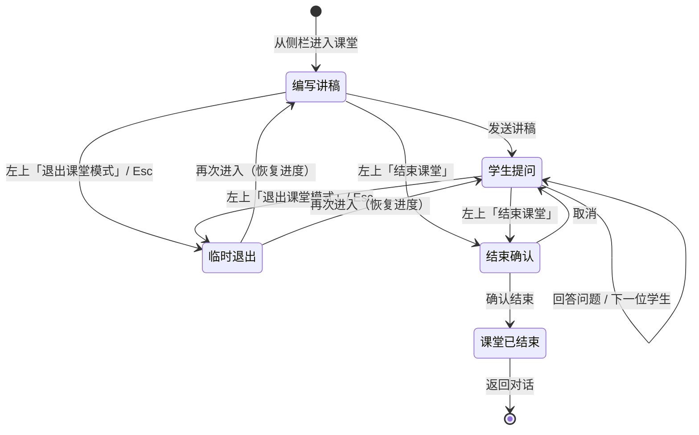

# 课堂模式功能设计（产品设计）

**文档状态：** 产品设计稿，待评审；实现进度见 [课堂模式](../current/platform/classroom-mode.md)。
**需求来源：** 课堂模式验收中提出：消息放进可展开/折叠的侧边栏；发送后输入框变单行；新增「结束课堂」，并区分「临时退出」与「彻底结束」。
**范围：** 单人本地教师的课堂模式：撰写讲解、学生提问、逐题回答、消息侧栏、临时退出与结束课堂。
**不在本文：** 学生画像与评估算法、模型提示词、数据库表结构；这些在对应领域文档中定义。

## 1. 产品定位与目标

课堂模式是「演练模式」之外的第二种教学演练空间：老师在教室里把课讲一遍，三名学生以提问的方式暴露理解缺口。与演练模式的差别：

| 维度 | 演练模式（现有） | 课堂模式 |
|---|---|---|
| 形式 | 聊天式逐题问答 | 教室舞台 + 学生气泡 + 课堂消息 |
| 老师输入 | 单题回答 | 一整段讲解，然后逐题回答 |
| 学生的存在感 | 文本与学生画像 | 三名固定学生、提问有明确归属 |
| 情绪目标 | 被追问的压力 | 被注视的临场感，但可随时暂离 |

目标（可验收）：

1. 老师能在 1 分钟内完成「进入课堂 → 写讲解 → 收到第一问」。
2. 讲解、提问、回答始终有稳定的阅读位置，不靠反复开关弹层。
3. 课堂是「沉浸但可退出」的：临时离开不丢进度，结束课堂有明确、不可误触的确认。

非目标：积分、等级、排行榜、连续打卡；多用户、云同步；自动批改讲解。

## 2. 用户与场景

| 角色 | 场景 | 关键诉求 |
|---|---|---|
| 单人教师 | 备课完成后，想预演学生可能问什么 | 讲解能被完整记录，学生问题聚焦在讲稿的薄弱处 |
| 单人教师 | 上课途中需要去看资料或会话 | 暂离后回来能继续，不重写讲解 |
| 单人教师 | 本节课结束，回到对话继续备课 | 知道这节课留下了什么，能回看 |

## 3. 范围与分期

| 能力 | 说明 | 状态 |
|---|---|---|
| 侧栏入口与 16:9 舞台 | 进入后窗口锁定 16:9，画面铺满 | 已实现 |
| 讲解撰写 / 发送 | 四行输入框，发送后转单行 | 已实现（MVP，本地） |
| 讲稿浮层 | 发送后停留约 3 秒再淡出 | 已实现 |
| 消息侧栏 | 默认折叠、可展开，承载讲稿、提问、回答 | 已实现（本地） |
| 当前学生气泡 | 中间学生头顶显示一条提问 | 已实现（文案写死） |
| 结束课堂 + 确认框 | 左上角分段控件中的「结束课堂」；临时退出与彻底结束分离 | 已实现（本地） |
| 临时退出保留课堂 | 退出后再次进入可继续 | 已实现（内存；应用重启丢失） |
| 真实学生提问与评估 | 讲解抽取知识点、轮流提问、写入报告 | 后续（依赖课堂状态机） |
| 课堂记录持久化 | 结束时把讲稿与问答写入会话历史 | 后续（依赖后端） |

## 4. 核心概念

| 概念 | 定义 |
|---|---|
| 课堂会话 | 从进入课堂到「结束课堂」之间的全部内容：讲稿、提问、回答 |
| 讲稿 | 老师要讲的内容，一次提交，作为整节课的参照 |
| 提问 | 某一名学生针对讲稿提出的问题；同一时刻只展示一条 |
| 回答 | 老师对当前提问的回应；随提问一起进入课堂消息 |
| 课堂消息 | 讲稿、提问、回答按时间排列的记录；侧栏展示 |
| 临时退出 | 离开课堂画面但课堂会话保持进行中 |
| 结束课堂 | 终止课堂会话，不可恢复；结束后进入课堂记录/对话 |

## 5. 整体流程

## 6. 界面与布局

舞台是唯一的画面主体，所有控件以覆盖层形式存在，**不改变 16:9，不挤压画面**。

### 6.1 舞台分区

| 区域 | 高度 | 内容 |
|---|---|---|
| 顶部安全区 | 0–33% | 学生气泡；控件胶囊 |
| 立绘区 | 33–72% | 三名学生（22% / 50% / 78%），不可遮挡面部 |
| 讲台停靠区 | 72–100% | 输入框；发送后的讲稿浮层（临时）；右下角消息按钮 |

### 6.2 底部输入区

| 状态 | 形态 | 行为 |
|---|---|---|
| 编写讲稿 | 四行文本框（96px 固定高，框内滚动）+ 底栏 | `Ctrl/Cmd + Enter` 或「发送」提交；空文本禁用 |
| 学生提问后 | 单行回复框（40px）+ 内联「发送」 | 自动聚焦；提交后清空并把回答写入课堂消息 |

- 输入框高度固定，内容再多也不撑高，只出现框内滚动条。
- 课堂输入框不带附件、不带斜杠命令（备课命令只属于对话）。
- `Esc` 在输入框内不退出课堂，避免误丢草稿。

### 6.3 讲稿浮层

发送讲稿后，讲稿卡浮在输入框上方，与输入框同宽：

- 停留 3 秒，随后 0.6 秒淡出；淡出期间不占停靠区高度，舞台不被持续遮挡。
- 标题「讲稿 · N 字」+「查看全部」；正文固定 4 行、框内滚动。
- 点击「查看全部」立即打开消息侧栏并取消浮层计时。

### 6.4 学生气泡

- 仅当前提问显示在学生头顶上方，气泡底边固定在头顶之上、只向上生长。
- 宽 38% 上限；提问最多 2 行，回答不在气泡内展示，完整问答进课堂消息。
- 同一时刻最多一条提问；回答提交后气泡收起。

### 6.5 消息侧栏

| 项 | 规则 |
|---|---|
| 默认 | 折叠，右下角圆形按钮 + 消息数角标 |
| 展开 | 右侧覆盖抽屉：宽 23%（min 16rem / max 22rem），上 12%、下 3%，玻璃白 + 模糊 |
| 内容 | 时间顺序：`老师 · 讲稿`、学生提问、老师回答；固定高度内部滚动，自动滚到最新 |
| 关闭 | 抽屉内 `X`；`Esc` 关闭；打开时抽屉外区域保持可见 |
| 定位取舍 | 覆盖而非布局列：窗口锁定 16:9，切出 320px 侧栏会让舞台缩成 1080×608 并留白；改为「画面 + 侧栏」的固定比例则窗口会变成约 2.28:1、画面变小。默认折叠把遮挡降到 0 |

## 7. 临时退出与结束课堂

这两个动作必须从命名、位置、颜色和数据结果上区分。

| 维度 | 临时退出（暂离） | 结束课堂（彻底结束） |
|---|---|---|
| 入口 | 左上分段控件「退出课堂模式」（返回箭头） | 左上分段控件「结束课堂」 |
| 快捷键 | `Esc`（无弹层、输入框无焦点时） | 无快捷键，必须点击并确认 |
| 会话状态 | 进行中，保留讲稿/消息/气泡 | 终止，不可恢复 |
| 窗口 | 解锁 16:9，回对话视图 | 解锁 16:9，回对话视图 |
| 再次进入 | 恢复离开时的进度 | 只能开启新课堂 |
| 数据 | 暂存，不落库 | 生成课堂记录（目标）后清理内存 |

### 7.1 顶部控制

- 左上角是**一个分段玻璃控件**，把同一类「课堂生命周期」动作放在一起，避免三个角各有一个独立按钮：
  - 容器：`rounded-full border-white/70 bg-white/80 p-1 shadow-card backdrop-blur-md`；
  - 「退出课堂模式」：返回箭头 + 中性文字，hover `bg-white`，一步暂离；
  - 「结束课堂」：`FlagPennant` + 中性文字，仅 hover/focus 转 `rose-700` 文字与 `rose-50/90` 底；危险色留给确认框，文本常驻、不用纯图标；
  - 右上顶部不再放按钮，画面边缘只保留左上（课堂操作）与右下（课堂消息）两个锚点。
- 模式身份由画面与侧栏标题（「课堂消息」）承载，不再占用标签。

### 7.2 结束确认框

触发：点击「结束课堂」。样式复用现有重命名弹窗的约定（遮罩 `bg-ink-900/30`、白卡 `rounded-2xl`、`shadow-xl`、`role="dialog"` + `aria-modal`）。

| 元素 | 内容 |
|---|---|
| 图标 | `WarningCircle`，`rose-600` |
| 标题 | 结束本节课？ |
| 正文 | 结束后，本节课的讲稿、提问与你的回答会整理为课堂记录，并返回对话。 |
| 补充（有未发送草稿时） | 正在编辑的回答不会保存。 |
| 次按钮 | 继续上课（默认焦点；点击、`Esc`、遮罩点击都可取消） |
| 主按钮 | 结束课堂（`bg-rose-700`、白字，破坏性操作） |

规则：确认框打开时，`Esc` 只关闭弹窗，不退出课堂；焦点初始在「继续上课」，Tab 限制在弹窗内；关闭后焦点回到「结束课堂」按钮。

### 7.3 数据结果

| 动作 | 当前实现 | 目标 |
|---|---|---|
| 临时退出 | 会话存在 `classroomSessionStore`，再次进入恢复讲稿/消息/草稿/气泡；应用重启丢失 | 课堂会话随会话目录持久化；重启后提示「继续上一节课」 |
| 结束课堂 | 分段控件中的「结束课堂」+ 确认框；确认后清空本地会话并返回对话 | 讲稿 + 问答写入当前会话的课堂记录；在对话视图显示「课堂记录」入口 |

## 8. 状态与规则

- 课堂会话状态：`writing → asking → ended`；`away` 是视图状态，不是会话状态。
- 同一时间只允许一个进行中的课堂会话；已结束后需要重新进入才能开始新课堂。
- 讲稿是整节课的参照，不允许结束后修改；「重新讲解」会清空本轮（讲稿、消息、气泡）并回到 `writing`。
- 消息侧栏的角标显示消息条数，不是未读数；默认折叠时不打断课堂。
- 结束课堂不可撤销；没有回收站。

## 9. 文案表

| 位置 | 文案 |
|---|---|
| 侧栏入口 | 课堂模式 |
| 左上（分段） | 退出课堂模式 / 结束课堂 |
| 讲稿占位符 | 写下你准备讲给学生的内容… |
| 讲稿底栏 | Ctrl + Enter 发送 |
| 讲稿浮层标题 | 讲稿 · N 字 |
| 讲稿浮层动作 | 查看全部 |
| 回复占位符 | 回答学生…Ctrl + Enter 发送 |
| 消息按钮 | 展开课堂消息（N 条） |
| 侧栏标题 | 课堂消息 · N |
| 侧栏空状态 | 发送讲解后，讲稿与学生的提问会出现在这里。 |
| 侧栏动作 | 重新讲解 / 收起课堂消息 |
| 结束确认标题 | 结束本节课？ |
| 结束确认正文 | 结束后，本节课的讲稿、提问与你的回答会整理为课堂记录，并返回对话。 |
| 结束确认补充 | 正在编辑的回答不会保存。 |
| 确认按钮 | 继续上课 / 结束课堂 |

## 10. 视觉规范

- 只使用现有 `brand` / `ink` / `honey` / `rose` 色阶，不引入第二套主题来源。
- 结束课堂：常驻中性玻璃胶囊，hover/focus 转 `rose-700` 文字/图标 + `rose-50/90` 底 + `rose-200/70` 描边，焦点环 `brand-500/40`；确认框主按钮保留 `rose-700` 实心白字，危险色只在不可逆的那一步出现。
- 舞台控件统一玻璃胶囊：`bg-white/70–80` + `backdrop-blur-md` + `border-white/60–70`；不加暗色遮罩，避免压暗教室。
- 讲稿、消息、气泡使用白卡 + `shadow-card`；侧栏使用 `bg-white/85` + `backdrop-blur-xl` + `shadow-float`，与舞台分离。
- 动效：课堂进入为软边圆形展开；讲稿浮层 3.6s 后淡出；侧栏 300ms 位移淡入。`prefers-reduced-motion` 下全部关闭，不做替代动画。

## 11. 无障碍与降级

- 「结束课堂」是按钮而非图标：可聚焦、有可读文本。
- 确认框：`role="dialog"`、`aria-modal`、标题与正文关联、焦点捕获、`Esc` 取消、遮罩点击取消。
- `Esc` 优先级：确认框 → 侧栏 → 输入框（忽略）→ 临时退出；不叠加多重退出。
- 消息侧栏折叠时使用 `inert`，不进入 Tab 序列；展开后焦点可进入列表。
- 键盘发送：`Ctrl/Cmd + Enter`；普通 Enter 只换行。
- 颜色不作为唯一语义：结束按钮有文本，确认框有图标 + 标题 + 正文。

## 12. 数据与持久化（概念层）

| 实体 | 关键字段 | 说明 |
|---|---|---|
| 课堂会话 | 会话 ID、关联对话 ID、状态、开始/结束时间 | 单人本地，无账号隔离 |
| 讲稿 | 文本、字数、提交时间 | 一次提交，不中途编辑 |
| 提问 | 学生标识、文本、时间、是否已回答 | 同一时刻仅一条待答 |
| 回答 | 关联提问、文本、时间 | 与提问成对出现 |
| 课堂记录 | 由以上聚合 | 结束课堂时生成，写入会话历史（目标） |

MVP 阶段以上全部是渲染层本地状态，不写数据库；接口与表在接入课堂状态机时定义。

## 13. 指标

| 指标 | 定义 | 目标 |
|---|---|---|
| 课堂启动率 | 进入课堂 / 打开应用 | 观察 |
| 首问到达率 | 发送讲稿后收到提问的比例 | ≥ 95% |
| 完成率 | 结束课堂且至少回答 1 题 / 进入课堂 | ≥ 60% |
| 暂离恢复率 | 临时退出后重新进入并继续 / 临时退出 | ≥ 70% |
| 误结束率 | 确认框取消次数 / 确认框打开次数 | 观察，用于调整文案 |
| 侧栏使用率 | 展开侧栏的课堂会话 / 全部课堂会话 | 观察，验证消息侧栏的必要性 |

## 14. 验收清单

- [ ] 进入课堂后窗口锁定 16:9，画面无留边；拖动窗口等比缩放。
- [ ] 讲稿输入框高度固定 96px，超长内容框内滚动。
- [ ] 发送讲稿后：输入框变单行、浮层出现、3 秒后淡出、右下角出现消息角标。
- [ ] 学生气泡只显示当前提问，位于头顶上方，不遮脸。
- [ ] 消息侧栏默认折叠；展开后按时间显示讲稿、提问、回答；`Esc` 先收侧栏。
- [ ] 左上角是一枚玻璃分段控件（退出课堂模式 / 结束课堂），右上空出；「结束课堂」常驻中性，仅 hover/focus 转红。
- [ ] 点击「结束课堂」弹出确认框；默认焦点在「继续上课」；`Esc`/遮罩取消且不退出课堂。
- [ ] 确认结束后：课堂会话终止、返回对话、不能通过再次进入恢复旧课堂。
- [ ] 临时退出后再进入：讲稿、提问、回答、气泡状态完整恢复。
- [ ] `prefers-reduced-motion` 下无动画，功能不缺失。

## 15. 风险与待决

| 项 | 现状 | 待决 |
|---|---|---|
| 临时退出的恢复边界 | MVP 卸载即清空 | 是否随应用重启恢复；恢复时是否校验讲稿/消息完整性 |
| 结束课堂的记录去向 | 设计为写入会话历史 | 记录是独立实体还是普通消息；对话视图如何呈现 |
| 消息侧栏遮挡 | 展开遮住右侧学生 | 是否需要窄抽屉（200px）或半透明增强；是否记忆展开状态 |
| 学生数量与轮转 | 固定 3 人、当前只显示 1 问 | 一轮内是否允许同一学生追问；提问上限与结束规则 |
| 讲解长度 | 输入框可滚动，无上限提示 | 是否需要字数上限与拆分提示（与模型预算相关） |
| 结束前的未完成回答 | 确认框提示会丢弃 | 是否提供「保存草稿并结束」 |
